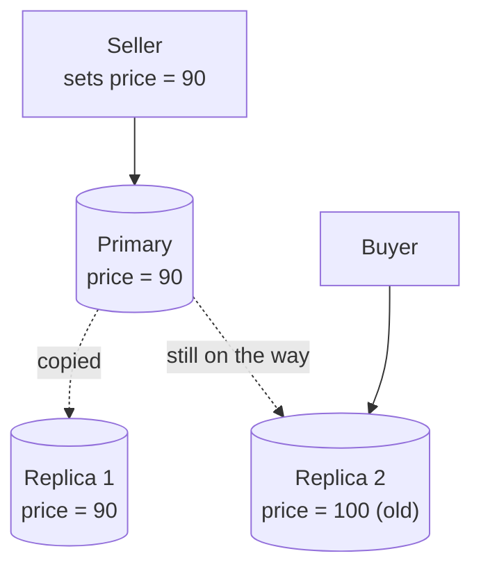
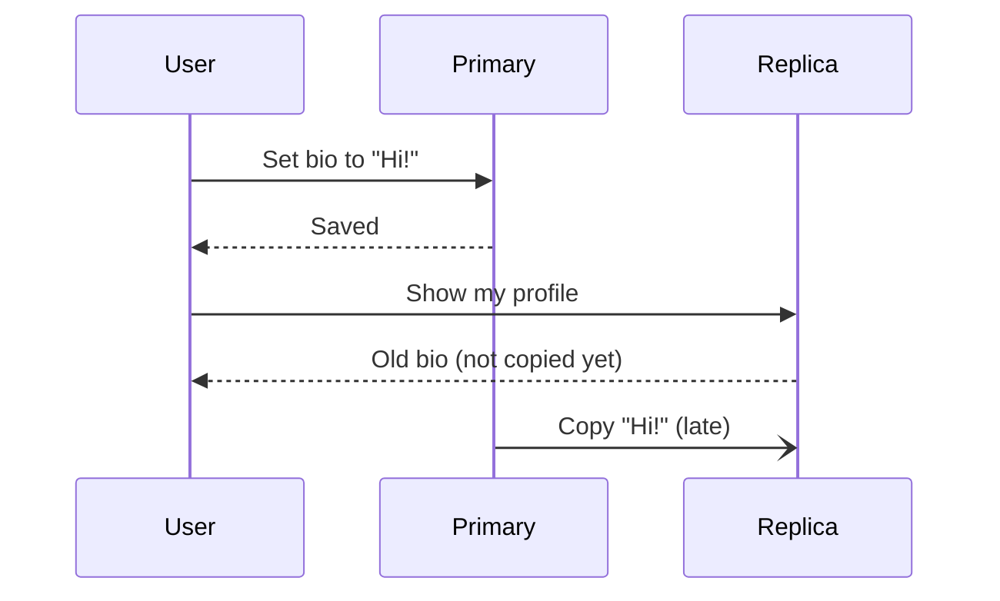

## The idea

Big systems keep **copies** of the same data on many machines. A copy is called a **replica**. When you write, the change reaches one copy first and the others a moment later.

A **consistency model** is the promise the system makes about **what a reader sees during that moment**.

Think of a teacher who moves the exam to Friday:

- **Strong:** the teacher tells the whole class at once, and nobody leaves the room until everyone has heard. Slow, but nobody can ever hear the old date.
- **Eventual:** the teacher tells a few students, and they pass it on. By tomorrow everyone knows. But if you ask a student today, you might still hear "Thursday".

A stronger promise is easier to build on, but it is **slower** and **fails more often** when the network has problems.

## The setup

The delay before a replica gets the change is called **replica lag**. Usually it is milliseconds. Under heavy load it can be seconds. See [Replication](../databases/replication.mdx).

## Strong consistency

**Every read sees the latest write.** It behaves as if there were only one copy of the data. (The formal name is **linearizability**.)

How systems do it:

- Every read and write goes to one leader, or
- The copies run a **consensus** algorithm like Raft, so they all agree on one order of writes (see [Leader Election and Consensus](./leader-election-consensus.mdx)).

Simply writing to "enough" copies and reading "enough" copies (a **quorum**, below) gets close, but on its own it is not fully strong.

The cost:

- **Slower writes**, because you wait for other machines.
- **Errors during network problems.** If a copy can't be sure it has the latest data, it must refuse to answer. This is the "C" choice in the [CAP Theorem](./cap-theorem.mdx).

Use it for: bank balances, booking the last seat, unique usernames, stock count at checkout.

## Eventual consistency

**If writes stop, all copies will become the same, eventually.** Usually within milliseconds or seconds, but there is no promise about exactly when. Until then, a reader may see old data.

- **Good:** fast, and it keeps working during network problems.
- **Bad:** strange moments. You post a comment, refresh, and it's gone. Refresh again and it's back.

Use it for: like counts, view counts, feeds, reviews, search results.

## The levels in between

Between "always the latest" and "eventually", there are useful promises. Most of them are about **what one user sees**, so they are often called **session guarantees**.

| Level | The promise | What it prevents |
| --- | --- | --- |
| **Read-your-writes** | You always see your own changes | You edit your bio, refresh, and see the old bio |
| **Monotonic reads** | You never go back in time. (**Monotonic** = only moves forward) | You saw 10 comments, refresh, and see 8 |
| **Consistent prefix** | You see changes in the order they happened, maybe without the newest ones | A football score goes 0-0, then 1-0, then 1-1. You may see an old score, but never 0-1, a score that never happened |
| **Causal** | If one change caused another, everyone sees them in that order | A reply shows up before the comment it replies to |

### Read-your-writes: the one you will use most

The user thinks their change was lost. Ways to fix it:

- **Read from the primary for a short time** after a user writes. For example, remember "last write at 10:00:05" in their session, and for the next 10 seconds send their reads to the primary.
- **Show the change straight away** in the app, from the response to the write, without reading it back.

**Sticky reads are not enough.** Always sending one user to the same replica doesn't fix this: that replica can still be behind. It only gives **monotonic reads** (the user never goes back in time).

More ways to hide the delay are in [Eventual Consistency in Async Systems](../messaging/eventual-consistency-async.mdx).

## Quorums: choosing per request

Some databases, like Cassandra, let you choose the level for each request. Three numbers matter:

- **N** = how many copies of the data exist
- **W** = how many copies must confirm a **write**
- **R** = how many copies you ask when you **read**

If **R + W is greater than N**, the copies you read and the copies you wrote always overlap by at least one. So at least one answer has the newest value, and the newest version wins.

| N | W | R | R + W greater than N? | Result |
| --- | --- | --- | --- | --- |
| 3 | 1 | 1 | No | Fastest, but reads can be old |
| 3 | 2 | 2 | Yes | The usual "quorum" choice. Reads see the latest finished write, and one copy can be down |
| 3 | 3 | 1 | Yes | Fast reads, but every write fails if any copy is down |

**A quorum is not full strong consistency.** It makes reads see the latest **finished** write, but edge cases remain. While a write is still being copied, one reader can see the new value and the next reader the old one. And a write that fails on some copies is not undone on the copies that saved it. For truly strong reads, use a single leader or consensus.

## Picking the right level per feature

Ask one question: **"What breaks if this read is a few seconds old?"**

| Feature | Level | Why |
| --- | --- | --- |
| Bank balance, payments | Strong | Money must be right |
| Booking the last seat | Strong | Never sell it twice |
| Signing up with a username | Strong | Two people can't take the same name |
| Editing your own profile | Read-your-writes | You must see your own change |
| Comments and chat replies | Causal | Replies must come after what they reply to |
| Like counts, view counts | Eventual | Being off by a few for a moment is fine |
| Feeds, search results | Eventual | A few seconds late is fine |

One app usually mixes several levels. That is normal and a good thing to say out loud.

## In the real world

**Amazon S3 became strongly consistent in 2020.** For years, if you replaced a file in S3 and read it right away, you could still get the old version. Many teams had to build workarounds. In December 2020, AWS made every S3 read return the latest write, at no extra cost.

**DynamoDB lets you pick.** DynamoDB reads are eventually consistent by default. You can ask for a strongly consistent read with the `ConsistentRead` option, and it uses twice as much read capacity, so it costs more.

**Cassandra lets you pick per query.** You set a consistency level such as `ONE`, `QUORUM` or `ALL` on each read and write.

## In the interview

Say the level **per feature** in your non-functional requirements, and handle read-your-writes when you add read replicas:

> "Bookings need strong consistency, so they go to the primary. The event page can be eventually consistent and served from replicas and the cache. After users change their own profile, we read it from the primary for a few seconds, so they always see their change."

<Callout title="Remember this" type="success">
  - A **consistency model** = what a reader may see while copies catch up.
  - **Strong:** always the latest. Slower, and fails during network problems.
  - **Eventual:** copies agree soon. Fast and always up, but reads can be old.
  - **Read-your-writes:** users always see their own changes. Read from the primary right after a write.
  - **Quorum:** if **R + W is greater than N**, reads see the latest finished write. Close to strong, but not fully strong.
  - Ask **"what breaks if this is a few seconds old?"** and choose **per feature**.
</Callout>
