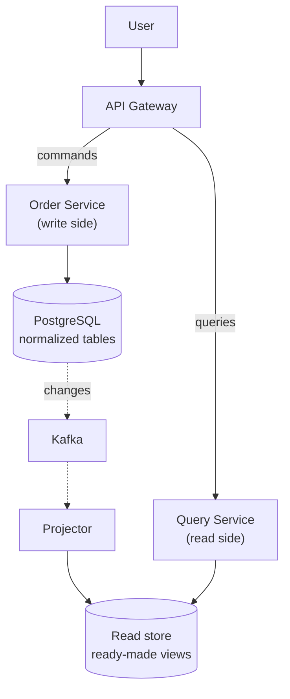

## What is it?

Think of a **restaurant**. The **kitchen** is organized for cooking: raw ingredients, stations, order tickets. The **menu** is organized for customers: dishes grouped by type, with pictures and prices. It is the same food, shown in two very different shapes. You would never hand customers the kitchen's ingredient list.

**CQRS** stands for **Command Query Responsibility Segregation**. In plain words: **use one model to change data, and a different model to read it.**

- A **command** changes data: "place order", "cancel order".
- A **query** reads data: "show my orders", "search products".

### Commands and queries

| | Command (write) | Query (read) |
| --- | --- | --- |
| **Does** | Changes data | Reads data, changes nothing |
| **Returns** | OK or an error, maybe a new ID | Data |
| **Examples** | `PlaceOrder`, `CancelOrder` | `GetOrderHistory`, `SearchProducts` |
| **Cares about** | Rules and correctness | Speed, and the right shape for the screen |

## Why do we need it?

Take an online shop. To keep writes correct, the data is stored in clean, separate tables: `orders`, `order_items`, `products`, `users`. (Splitting data like this is called **normalizing**. See [Normalization vs Denormalization](../databases/normalization.mdx).)

But the "My orders" page needs data from all those tables at once: product names, pictures, totals, sorted by date. That means a big **join** across many tables on **every page view**, and reads happen far more often than writes. Search needs full-text matching, which SQL tables are not good at. A sales dashboard needs totals that are slow to calculate every time.

The shape that is best for **writing** is often bad for **reading**. With one model, you must pick one shape and live with its cost on the other side.

## How it works inside

### Separate read and write models



- The **write side** checks the rules and saves changes in the main database.
- The **read side** answers queries from a **read model**: data already shaped exactly the way a screen needs it. For example, one document per order with the product names and pictures already inside. No joins needed.
- A small worker called a **projector** keeps the read model up to date. (A read model is also called a **projection** or a **view**.)

The read store can be anything that suits the query: Elasticsearch for search, Redis for a fast list, or simply another table.

**CQRS does not have to mean two databases.** There are levels, from light to heavy:

1. **Same database, separate code** for reads and writes.
2. **Same database, separate read tables** or materialized views (saved query results the database can refresh).
3. **Separate databases**, kept in sync by events.

### Keeping them in sync

| Way | How it works |
| --- | --- |
| **Events from the write side** | The service publishes `OrderPlaced` (safely, with the [Outbox Pattern](./outbox-pattern.mdx)), and the projector updates the view |
| **CDC** | Read the write database's log. See [Change Data Capture](./change-data-capture.mdx) |
| **Event sourcing** | The events are the main data, and every view is built from them. See [Event Sourcing](./event-sourcing.mdx) |

A projector, made safe to run twice:

```js
// Keeps the "my orders" view up to date
async function onOrderPlaced(event) {
    const orderList = readDb.collection("order_list");

    // One document per order, found by the order ID
    const filter = { _id: event.orderId };

    const changes = {
        // $set: always write these fields
        $set: {
            userId: event.userId,
            total: event.total,
            placedAt: event.placedAt,
        },

        // $setOnInsert: write this only when the document is new
        $setOnInsert: {
            status: "PENDING",
        },
    };

    // upsert = insert the document if it is missing, update it if it is there.
    // So running this twice does no harm.
    await orderList.updateOne(filter, changes, { upsert: true });
}
```

Why `$setOnInsert` for the status? Say the order has already moved on, and the view says `SHIPPED`. Then an old `OrderPlaced` arrives again (a retry, or a replay). A plain `$set` would put the status back to `PENDING`. `$setOnInsert` only sets it when the document is first created. A more general fix: save the version number of the last event applied to each document, and skip any event that is older.

Because events can arrive twice, projectors should be **idempotent**. See [Idempotency](../messaging/idempotency.mdx). A nice bonus: if a view gets messed up, or you need a new one, you can **throw it away and rebuild it** from the events.

**The catch: the read side lags.** The read model is updated a moment after the write. That is **eventual consistency**. A user places an order, opens "My orders", and the order isn't there yet. Two common fixes:

- Show the new order straight from the command's response, without reading it back.
- For a few seconds after a write, read that user's data from the write side. This gives **read-your-writes**. See [Consistency Models](./consistency-models.mdx).

### When the projector stops

The write side keeps working: commands still succeed. The events wait in Kafka (or in the database log, with CDC), and the read model simply gets **older**. When the projector comes back, it carries on from the last event it saved as done. It may see a few events again, which is fine because it is idempotent. Watch the **lag** (how far behind the read model is) and alert when it keeps growing.

## When to use it

| Worth it when... | Not worth it when... |
| --- | --- |
| Reads and writes are very different in shape or volume | The screens look just like the tables (simple **CRUD**: create, read, update, delete) |
| You need several views of the same data: search, feeds, dashboards | Users must see every change everywhere instantly |
| Reads need to grow separately from writes | The team is small. Two models means more code and more moving parts |

Use CQRS for **one part** of a system that needs it, not for the whole app.

## Alternatives

| Option | What it is | Pick it when |
| --- | --- | --- |
| **One model with good indexes** | The same tables for reads and writes, with the right [indexes](../databases/indexes.mdx) | Simple CRUD, and reads are already fast enough |
| **Denormalize a few fields** | Copy a field (like the product name) into the order row, so the read needs no join | Only one or two screens need a different shape |
| **Read replicas** | Copies of the same database that serve reads. See [Replication](../databases/replication.mdx) | Reads are heavy, but they need the same shape as the writes |
| **A cache** | Keep the results of hot queries in Redis. See [Redis](../caching/redis.mdx) | The same reads repeat, and slightly old data is fine |

## In the real world

**Twitter's home timeline.** Twitter talked publicly about how it built home timelines: when someone tweets, the tweet ID is added to a ready-made timeline list, kept in Redis, for each of their followers. Opening your timeline then reads one list that is already built, instead of running a big query over everyone you follow. That is the CQRS idea: a separate model built only for reading.

**Search boxes.** Most online shops keep products in a SQL database and a copy in a search engine like Elasticsearch, just for the search page. The search index is a read model.

**The name and a warning.** Greg Young made the name CQRS popular around 2010, building on Bertrand Meyer's older rule that "asking a question should not change the answer". Martin Fowler warns on his website that for most systems, CQRS adds risky complexity. Use it where it clearly helps.

## In the interview

Bring it up when reads and writes need very different shapes, like search, dashboards or feeds:

> "Writes go to the Order Service and PostgreSQL. The order history page reads from a separate read model in Elasticsearch, updated from OrderPlaced events. It can be a second behind, so right after checkout I show the new order straight from the response."

<Callout title="Remember this" type="success">
  - **CQRS** = one model for **commands** (writes), another for **queries** (reads).
  - **Why:** the shape best for **writing** (clean, normalized tables) is often bad for **reading** (big joins on every page view).
  - The read model is **ready-made** for the screen. No joins at read time.
  - Keep them in sync with **events** (outbox), **CDC**, or **event sourcing**.
  - The read side **lags**: eventual consistency. Show the user's own change from the response.
  - Projectors must be **idempotent**. Views can be **rebuilt** from events.
  - Not for simple CRUD. Use it only where reads and writes really differ.
  - **Alternatives:** good indexes, a few denormalized fields, read replicas, a cache.
</Callout>
