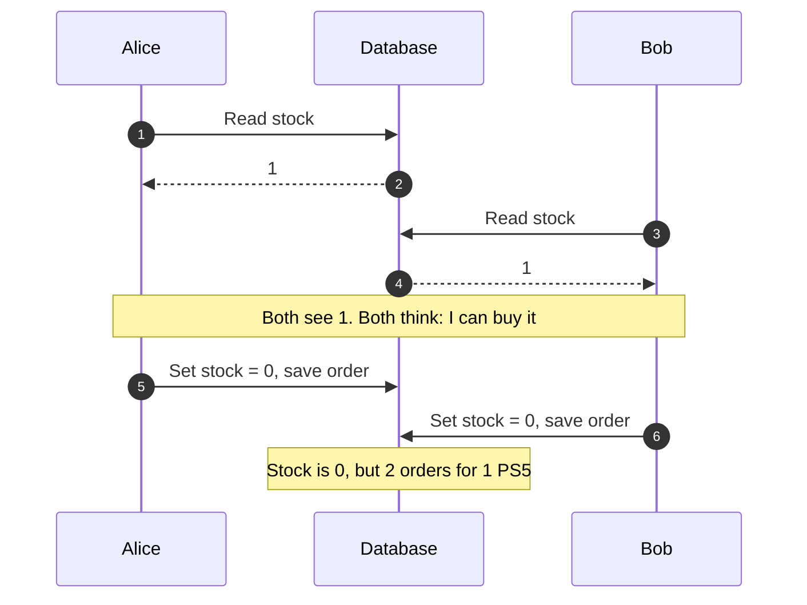
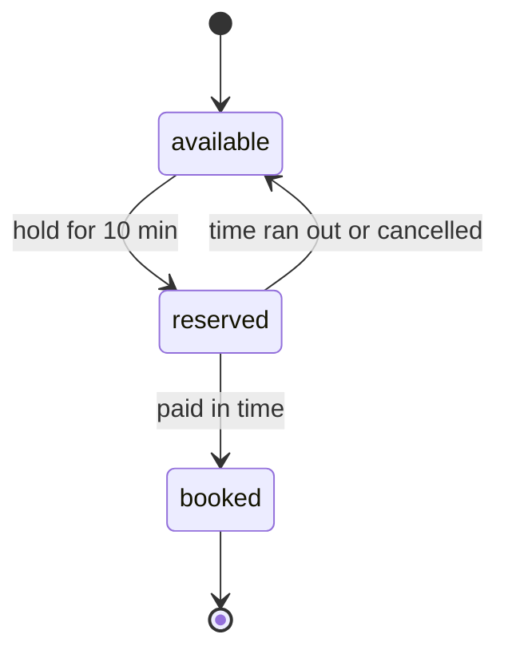
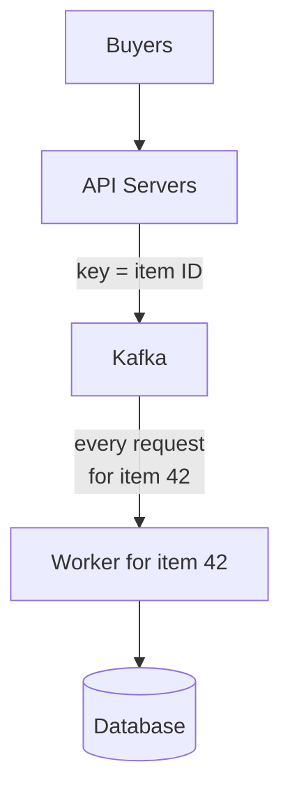
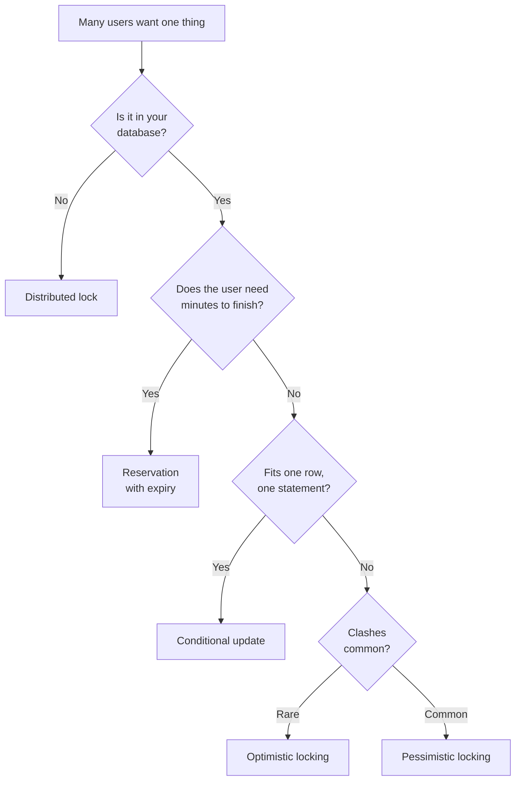
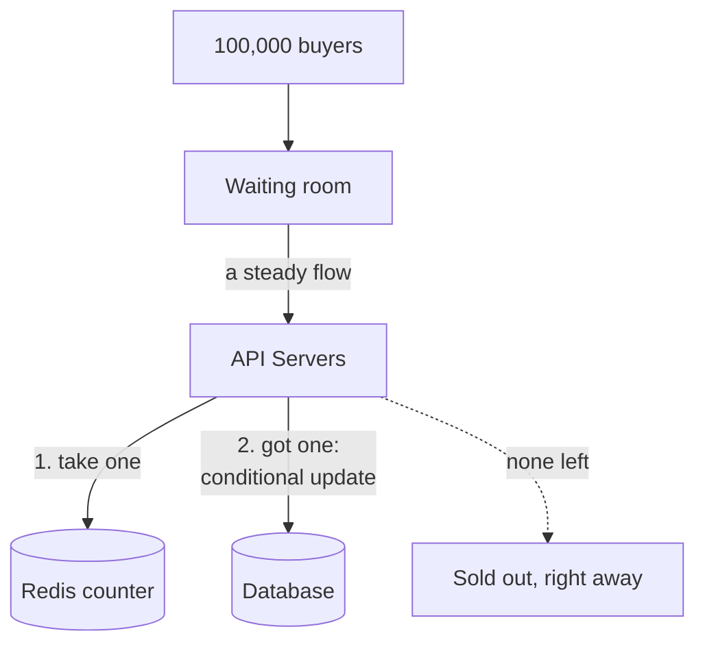

## What is it?

Picture a bakery with **one croissant left** and two cashiers. Two customers ask for it at the same moment. Each cashier looks at the shelf, sees one croissant, and says "It's yours!" Both take the money. Now there are two paid customers and one croissant.

Neither cashier did anything wrong on their own. The problem is the **gap** between looking at the shelf and taking the croissant. In that gap, someone else looked too.

That is **contention**: many people want the **same thing** at the **same moment**. The goal is always the same: **exactly one winner**, and a fast, clear "sorry" for everyone else.

It shows up in many interview questions:

| Question | What everyone wants at once |
| --- | --- |
| [Ticket booking](../questions/ticket-booking.mdx) | The same seat |
| [E-commerce](../questions/e-commerce.mdx) flash sale | The last items in stock |
| Sign-up | The same username |
| Auction | The top bid, in the last second |
| [Uber](../questions/uber.mdx) | The same driver for two riders |
| [Payments](../questions/payment-system.mdx) | The same money in one account |

## Why do we need it?

Here is the code most people write first:

```js
// Looks fine. Breaks when two buyers click at the same moment.
async function buyLastItem(userId, productId) {
    // Step 1: read the stock
    const readSql = "SELECT stock FROM products WHERE id = $1";
    const rows = await db.query(readSql, [productId]);
    const stock = rows[0].stock;

    // Step 2: check it in the app
    if (stock < 1) {
        return "Sold out";
    }

    // Step 3: write the new stock, then save the order
    const writeSql = "UPDATE products SET stock = $1 WHERE id = $2";
    await db.query(writeSql, [stock - 1, productId]);
    await createOrder(userId, productId);

    return "You got it";
}
```

Now Alice and Bob both click "Buy" on the last PS5, a few milliseconds apart:



The bug lives in the **gap** between Alice's read (step 1) and her write (step 5). Bob read the stock in that gap (step 3), **before** Alice wrote her change. This is a **race condition**: the result depends on who is faster. It is also called **check-then-act**, or a **lost update**.

- **Tests don't catch it.** With one user, it always works. It breaks only under real load, when two requests land in the same few milliseconds.
- **A transaction alone doesn't fix it.** At the default level of PostgreSQL (read committed) and MySQL (repeatable read), both transactions still read 1 and write 0. `SERIALIZABLE` makes the database cancel one of them, which the app then retries. That works, but costs speed. See [Isolation Levels](../databases/isolation-levels.mdx) and [Transactions and ACID](../databases/transactions-acid.mdx).

## How it works inside

Every tool below works the same way inside: **one referee** decides, and the check and the write happen as **one step** that nobody can cut into.

- **The referee is usually the database.** An update takes a **row lock** on the row and holds it until `COMMIT`. A second update of the same row **waits**. At the default settings of PostgreSQL and MySQL, it then checks its `WHERE` again against the **new** value. That is why `WHERE stock >= 1` can't sell the last item twice.
- **A unique index is a referee too.** The database checks it inside the insert, so two inserts of the same username can't both pass.
- **When the database can't be the referee,** something else takes the job: one **queue worker** per item (tool 5) or a **lock service** (tool 6).

## The toolbox, from simplest to most complex

Six tools. Start at the top, and only move down when the simpler tool can't do the job.

| # | Tool | The idea in one line |
| --- | --- | --- |
| 1 | **Atomic conditional update** | Put the check **inside** the write |
| 2 | **Optimistic locking** | Save only if nobody changed it since you read it |
| 3 | **Pessimistic locking** | Lock the row first. Others wait in line |
| 4 | **Reservation with an expiry** | Hold it for a few minutes while the user finishes |
| 5 | **A queue for one hot item** | Line everyone up. One worker decides, one by one |
| 6 | **Distributed lock** | A lock that lives outside the database, for many services |

### 1. Atomic conditional update

Don't read, check, then write. Write **with the check inside**:

```sql
UPDATE products SET stock = stock - 1
WHERE id = 42 AND stock >= 1;
-- 1 row changed: you got it. 0 rows changed: sold out.
```

The database runs updates to one row **one at a time**. Alice's update runs first and makes the stock 0. Bob's update then checks `stock >= 1`, finds 0, and changes nothing. There is no gap, so there is no race.

In the app, check how many rows changed. Save the order in the **same transaction**, so a crash can't take the stock without making the order:

```js
const takeOneSql = `
    UPDATE products SET stock = stock - 1
    WHERE id = $1 AND stock >= 1
`;

const addOrderSql = "INSERT INTO orders (user_id, product_id) VALUES ($1, $2)";

async function buyLastItem(userId, productId) {
    return db.transaction(async (transaction) => {
        const result = await transaction.query(takeOneSql, [productId]);

        // 0 rows changed: someone else got the last one
        if (result.rowCount === 0) {
            return "Sold out";
        }

        await transaction.query(addOrderSql, [userId, productId]);

        return "You got it";
    });
}
```

The same trick works for most contention problems:

| Contention | The one-step write |
| --- | --- |
| **Same username** | A **unique index** on `username`. Just insert. The second insert fails. Never "check if it's free, then insert" |
| **Accept a ride** | `UPDATE rides SET driver_id = 5 WHERE id = 77 AND driver_id IS NULL` |
| **Top bid** | `UPDATE auctions SET top_bid = 120, top_bidder = 7 WHERE id = 9 AND top_bid < 120` |
| **In Redis** | `SET seat:A12 user-42 NX`: only the first `SET` wins |

**Use it when** the whole rule fits in **one row** and **one statement**. This covers most contention questions, so reach for it first.

### 2. Optimistic locking: save only if nothing changed

Sometimes the rule needs **more than one row**, so it can't fit in one `WHERE`. Say two people book **meeting room 3** for overlapping times. The app must load the room's bookings and check that the new one doesn't overlap any of them. Each person then inserts a **different** row, so a conditional update on one row can't catch the clash. (This kind of clash is called **write skew**.)

The fix: give the room a `version` number, and make **every booking bump it**.

1. **Read** room 3 (version 7) and its bookings for that afternoon. No lock is held.
2. **Check** in the app that 2 pm to 3 pm doesn't overlap anything.
3. **Save**, in one transaction, but only if the version is **still 7**:

```sql
BEGIN;

UPDATE rooms SET version = version + 1
WHERE id = 3 AND version = 7;
-- 0 rows changed: someone booked room 3 since we read it.
-- ROLLBACK, read again, and check again.

INSERT INTO bookings (room_id, starts_at, ends_at)
VALUES (3, '2026-12-01 14:00', '2026-12-01 15:00');

COMMIT;
```

If two people try at once, both read version 7. The first moves it to 8. The second finds version 8, changes 0 rows, and starts again with fresh data, where it now sees the overlap.

- **Good when clashes are rare,** like editing a product or booking one of many rooms. Nobody waits, and retries are rare.
- **Bad when everyone hits the same row.** 1,000 buyers read version 7. One wins and 999 retry. One wins and 998 retry... Almost all the work is thrown away.

More in [Locks and Deadlocks](../databases/locking.mdx).

### 3. Pessimistic locking: lock first, others wait

Lock the rows **before** reading them. Anyone else who wants them **waits in line** until you commit. Say Alice sends 100 dollars to Bob, and the app must check her balance **and** her daily limit before moving the money:

```sql
BEGIN;

-- Lock both accounts, always in id order, so two transfers can't deadlock
SELECT id, balance FROM accounts WHERE id IN (7, 9) ORDER BY id FOR UPDATE;

-- The app checks the balance and the daily limit here

UPDATE accounts SET balance = balance - 100 WHERE id = 7;
UPDATE accounts SET balance = balance + 100 WHERE id = 9;

COMMIT;  -- the locks are released
```

- **Good when clashes are common** and the check needs a few rows or a few steps. Others wait a moment instead of failing and retrying.
- **Hold the lock for milliseconds, not minutes.** Never keep it while calling a payment provider or waiting for a user to click.
- **Lock rows in the same order** (here, by `id`), or two transactions can each hold one row and wait for the other forever (a **deadlock**).

### 4. Reservations: hold it for a few minutes

Some wins take **minutes**: the user must still type a card number. You can't hold a database lock that long. It ties up a connection, and a closed tab leaves it stuck.

So split it into two quick steps. Each one is just tool 1:

1. **Hold:** mark the seat `reserved` for this booking, with an end time.
2. **Confirm:** when the payment works, mark it `booked`, but only if the hold is still yours.

```sql
-- Hold seat A12 for booking bk_9, for 10 minutes
UPDATE seats
SET status = 'reserved', booking_id = 'bk_9',
    reserved_until = NOW() + INTERVAL '10 minutes'
WHERE id = 'A12'
  AND (status = 'available'
       OR (status = 'reserved' AND reserved_until < NOW()));
-- 1 row changed: the seat is held for you. 0 rows: someone else has it.
```

An **expired hold counts as free**, so correctness never depends on a clean-up job running on time.



This is the "your seats are held for 10:00" timer on ticket and airline sites. The full design, including a payment that arrives just after the hold ran out, is in [Design a Ticket Booking System](../questions/ticket-booking.mdx).

### 5. A queue for one hot item

When thousands of requests per second hit **one** item, even short row locks form a long line inside the database, and its connections fill up.

Another way: **don't let them fight at all.** Put every request for the item into a **queue**, and let **one worker** handle that item's requests, one by one.



How it works:

- The API puts each request on Kafka with the **item ID as the message key**, so all requests for item 42 land in one partition, in arrival order. See [Kafka](../messaging/kafka.mdx).
- **One worker** reads that partition. It is the only writer for item 42, so nothing fights. It can even save in batches: "500 sold" in one write.
- The user hears "request received" right away, and gets the result a moment later.
- After a crash, Kafka can hand a request over again, so the worker skips request IDs it has already handled. See [Idempotency](../messaging/idempotency.mdx).

**Good for** auctions (bids are judged in a clear order) and flash sales. **The cost:** the answer is no longer instant, and there are more moving parts.

### 6. Distributed locks: when there is no single database

Tools 1 to 5 all use **one database** (or one queue) as the referee. Sometimes there isn't one. Say your booking servers send bookings to a partner hotel's old system, which has no "only if free" check of its own. Only one server may book room 301 at a time.

Take a lock on `room:301` in a shared place like Redis or etcd, with an **expiry**, so a crashed server can't block it forever. See [Distributed Locking](./distributed-locking.mdx).

Use it **last**. It adds another system, and a lock can expire while its holder is still working. If the data is in your own database, tools 1 to 4 are simpler and safer.

## When to use which

| Situation | Use | Example |
| --- | --- | --- |
| The rule fits in one row and one statement | **Atomic conditional update**, or a **unique index** | Last item, username, accept a ride |
| The rule needs a few rows, and clashes are rare | **Optimistic locking** (a `version` column) | Booking a meeting room, editing an event |
| The rule needs a few rows, clashes are common, the work is quick | **Pessimistic locking** (`SELECT ... FOR UPDATE`) | Moving money between two accounts |
| The user needs minutes to finish | **Reservation with an expiry** | A seat held while the user pays |
| Thousands of requests per second for one item | **A queue for that item**, plus a fast gate in front (below) | Flash sale, the last minute of an auction |
| The thing is not in your database | **Distributed lock** with a lease and fencing | A partner system with no checks of its own |

The same choice as a picture:



## Alternatives

Ways to avoid the fight, beyond the six tools:

| Option | What it is | Pick it when |
| --- | --- | --- |
| **Serializable isolation** | Let the database find clashing transactions and cancel one. The app retries it. See [Isolation Levels](../databases/isolation-levels.mdx) | Many different rules, and clashes are rare |
| **No winner needed** | Just add, never check: `likes = likes + 1`, or counters that merge | Nobody can "lose", like a like count |
| **Overbook on purpose** | Sell a little more than you have, and make it up to the few who lose out | A rare double sale costs less than a strict check, like airline seats |
| **Pre-registration and a draw** | People sign up first, and a random draw picks who may buy | Demand is far bigger than supply, like a huge concert |

## When one row gets really hot

At huge scale, even the atomic update hits a wall. Updates to one row run **one at a time**, each waiting for the one before it to commit. So one row can only take so many updates per second, often a few hundred to a few thousand, depending on the database and its disks.

Now 100,000 fans hit "Buy" in the first second. They all want the **same row**: a **hot row**. The line grows, requests time out, and the database's connections fill up, which slows everything else down too. It is the [hot key](../advanced-components/hot-keys-fan-out.mdx) problem, for writes.



Fixes, from easy to harder:

1. **Turn most people away early.** Keep a Redis counter set to the stock, say 1,000. A tiny Lua script takes one only if the counter is above 0, in memory, very fast. Only the 1,000 winners go on to the database, and everyone else sees "Sold out" at once. The database is still the real check. See [E-commerce](../questions/e-commerce.mdx).
2. **Slow down the crowd.** A virtual waiting room lets people in at a speed the system can handle. See [Ticket Booking](../questions/ticket-booking.mdx) and [Backpressure](../reliability-security/backpressure.mdx).
3. **Split the stock.** Store 1,000 items as 10 rows of 100. Each buyer tries a random row, and the next one if it is empty. Now 10 updates run at the same time, like the sharded counters in [Scaling Writes](../hld-basics/scaling-writes.mdx).
4. **Line them up.** Use the queue for one hot item (tool 5), with batches.
5. **Give people different things to fight over.** With assigned seats, each seat is its own row, so Alice and Bob only clash on the **exact same seat**. One counter for "1,000 standing tickets" is one hot row for everyone. Prefer many small things over one big one.

## In the real world

**Taylor Swift tickets, 2022.** During the presale for the Eras Tour in November 2022, Ticketmaster said its systems got about **3.5 billion requests**, four times its previous peak. The site struggled, and the general public sale was cancelled. At that scale, contention is mostly about controlling the crowd **before** it reaches the seats.

**Free coffee from a race condition.** In 2015, security researcher Egor Homakov showed a race condition in Starbucks gift cards. By sending the same balance transfer twice at the same moment, he moved the money twice and ended up with extra credit. Both requests checked the balance before either one wrote its change: the read-then-write race.

**DynamoDB has no row locks for this.** Amazon DynamoDB uses **condition expressions** instead: "write this item only if it doesn't exist yet", or "only if its version is still 7". AWS's own tools use a version number for optimistic locking. It is tools 1 and 2, without SQL.

## In the interview

Bring it up whenever two users can want the same thing. Name the race first, then pick the simplest tool that works:

> "Two buyers can click the last PS5 at the same moment, so I won't read the stock and then write it. I'll use one conditional update: take one, only if at least one is left. 1 row changed means you won, 0 means sold out. Paying takes minutes, so that update creates a 10-minute hold instead of holding a lock. For a flash sale with 100,000 buyers, a Redis counter in front turns away everyone after the first 1,000, so the database row never melts."

Also say what the **loser** sees: a fast, clear "Sorry, just sold out", not a spinner or an error page.

<Callout title="Remember this" type="success">
  - **Contention** = many users want the same thing at once. Goal: **exactly one winner**.
  - **Why:** simple code passes every test with one user, but under real load two buyers get the last item. A plain transaction doesn't stop it.
  - **Inside:** one **referee** (a row lock, a unique index, one queue worker) makes the check and the write **one step**.
  - **Read, check, then write** is a race. Two users can read the same value in the gap.
  - **First tool:** an **atomic conditional update** (`... WHERE stock >= 1`) or a **unique index**. Check the row count.
  - **Optimistic** (version column) when clashes are rare. **Pessimistic** (`FOR UPDATE`) when common and quick.
  - **Reservation with an expiry** when the user needs minutes. An expired hold counts as free.
  - **One very hot item:** a Redis counter or waiting room in front, split the stock, or a **queue** with one worker.
  - **Distributed locks** only when there is no single database to be the referee.
  - **Alternatives:** serializable isolation, counters with no winner, overbooking, a pre-registration draw.
</Callout>
