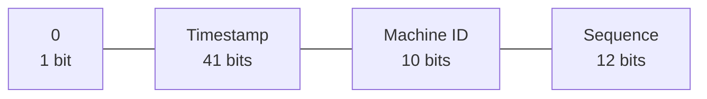
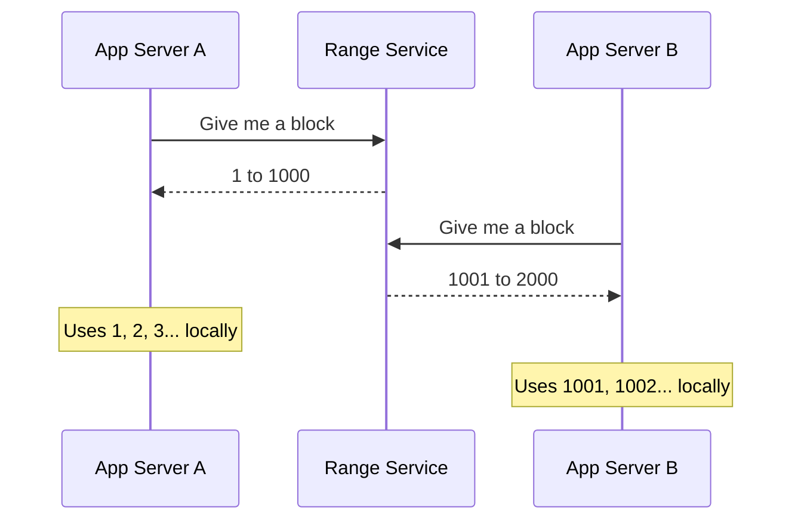

## The idea

Think of a **deli counter with one ticket machine**: 1, 2, 3, and so on. It works perfectly, but everyone must queue at that one machine. Now the shop opens five counters, each with **its own** ticket machine. Two customers can both get ticket 42.

There are three simple ways to fix that:

- Give each machine its **own prefix**: A-42, B-42. (This is the idea behind **Snowflake IDs**.)
- Give each machine its **own block** of numbers: machine A uses 1 to 1,000, machine B uses 1,001 to 2,000. (**Counter ranges**.)
- Use **very long random numbers**, so two machines practically never pick the same one. (**UUIDs**.)

## What a good ID needs

| Need | Why |
| --- | --- |
| **Unique** | Two things must never get the same ID |
| **Fast** | No network call to a central place for every new ID |
| **Sorted by time** | Newer IDs are bigger. "Latest first" becomes "sort by ID", and database indexes stay fast |
| **Small** | 64 bits fits in a `BIGINT` column, and keeps indexes small |
| **Hard to guess** (sometimes) | Others can't guess `/orders/1001` just because they saw `/orders/1000` |

## Auto-increment, and its limits

The simplest way: let the database count. `id BIGSERIAL PRIMARY KEY` in PostgreSQL gives 1, 2, 3, and so on. On **one** database, this is perfect.

Its limits show up as you grow:

- **Sharding breaks it.** If the data is split across many databases, each one counts from 1, and IDs repeat. See [Partitioning and Sharding](../databases/partitioning-sharding.mdx).
- **One central counter** is a bottleneck and a single point of failure.
- **Easy to guess**, and it leaks business numbers. Anyone can see roughly how many orders you get per day.

A common workaround: each database counts in steps with a different start. Database 1 gives 1, 3, 5. Database 2 gives 2, 4, 6. It works, but adding a third database later is painful.

## UUIDs

A **UUID** (universally unique identifier) is a 128-bit ID, written like `550e8400-e29b-41d4-a716-446655440000`. Any server, or even the user's phone, can make one with **no coordination at all**.

- **UUID v4** is random (122 random bits). The chance of two being the same is so tiny you can ignore it.
- **UUID v7** starts with a timestamp, followed by random bits, so it is **sorted by time**. It was standardized in 2024.

```js
import { randomUUID } from 'node:crypto';

randomUUID(); // 'b3e1c0a2-5f1e-4c8e-9a51-2f7d6c1e9b44' (v4, random)
```

| Good | Bad |
| --- | --- |
| No coordination at all | 128 bits: twice the size of a 64-bit `BIGINT` |
| Can be made anywhere, even on the client | v4 is random, so inserts land all over the index |
| Hard to guess | Long and not human friendly |

Why random IDs slow down inserts: a database index is kept **sorted**, like a notebook in alphabetical order. A random ID has to be squeezed in somewhere in the middle, touching a different page each time. A time-sorted ID always goes **at the end**, like writing on the last page. That is why UUID v7 is usually better than v4 for primary keys.

## Snowflake IDs

**Snowflake** is the method Twitter published in 2010. Each ID is one **64-bit number**, built from parts:

| Bits | Part | What it holds |
| --- | --- | --- |
| 1 | Sign bit | Always 0, so the number is positive |
| 41 | Timestamp | Milliseconds since a chosen start date (the **epoch**). Lasts about 69 years |
| 10 | Machine ID | Which server made the ID. Up to 1,024 servers |
| 12 | Sequence | A counter for IDs made in the same millisecond on the same server. Up to 4,096 |



Because the timestamp comes **first**, a bigger ID almost always means a newer ID. Each server makes IDs **on its own**, with no network call. One server can make up to 4,096 IDs per millisecond, which is about 4 million per second.

```js
const EPOCH = 1288834974657n; // Twitter's chosen start date, in November 2010
let lastMs = -1n;
let sequence = 0n;

function nextId(machineId) {
  if (machineId < 0 || machineId > 1023) throw new Error('Machine ID must fit in 10 bits (0 to 1023).');
  let now = BigInt(Date.now());
  if (now < lastMs) throw new Error('Clock moved backward. Refusing to make IDs.');

  if (now === lastMs) {
    sequence = (sequence + 1n) & 4095n;              // keep it to 12 bits
    if (sequence === 0n) {                           // used all 4,096 this millisecond
      while (now <= lastMs) now = BigInt(Date.now()); // wait for the next one
    }
  } else {
    sequence = 0n;
  }
  lastMs = now;

  return ((now - EPOCH) << 22n) | (BigInt(machineId) << 12n) | sequence;
}
```

Things to watch:

- **Machine IDs must be unique.** Set them in config, or give them out at startup through a coordination service like ZooKeeper or etcd.
- **Clocks can move backward.** That could create duplicate IDs, so Snowflake refuses to make IDs until the clock catches up. See [Clocks](./clocks.mdx).
- **Only roughly sorted.** Two IDs made in the same millisecond on different servers are not in exact real order. For feeds, that is fine.
- **JavaScript can't hold 64-bit numbers safely** (its normal numbers are exact only up to 2 to the power of 53). APIs send these IDs as **strings** in JSON.

## Counter ranges

A small central service hands out **blocks** of numbers. Server A asks and gets 1 to 1,000. Server B asks and gets 1,001 to 2,000. Each server then counts on its own, with **no network calls**, until its block runs out.



The range service can be as simple as one database row, or a Redis key increased with `INCRBY 1000`.

- **Good:** short numbers, very simple, and the central service is called only once per block.
- **Bad:** numbers are lost if a server restarts in the middle of a block (gaps are usually fine), and IDs from different servers are not in time order.

This is a great fit for short codes, like in the [URL Shortener](../questions/url-shortener.mdx).

## Which one to pick

| Situation | Pick |
| --- | --- |
| One database, small app | Auto-increment |
| No coordination, size doesn't matter | UUID (v7 if it is a database key) |
| 64-bit, sorted by time, huge scale | Snowflake |
| Short, compact numbers (short links) | Counter ranges |

## In the real world

**Twitter created Snowflake in 2010.** Twitter was moving tweet storage from MySQL to Cassandra, and needed IDs that didn't depend on one database's counter. Its API returns each ID both as a number (`id`) and as a string (`id_str`), because JavaScript can't hold the full number exactly.

**Discord uses Snowflake IDs** for users, messages and servers. Its start date (epoch) is the first second of 2015, and its API sends the IDs as strings.

**Instagram made IDs inside PostgreSQL.** In a 2012 blog post, Instagram described its 64-bit IDs: 41 bits of time, 13 bits for the shard (which database piece the data lives on), and 10 bits of sequence. The IDs were made by a small function inside each database.

**Flickr used "ticket servers".** Flickr wrote in 2010 about two MySQL servers whose only job was handing out IDs. One gave odd numbers and the other gave even numbers, so either one could fail.

**MongoDB ObjectIds** are 12 bytes: a 4-byte timestamp, a 5-byte random value and a 3-byte counter. So they are roughly sorted by creation time too.

## In the interview

Bring it up whenever you need IDs at scale, especially for feeds or messages:

> "Every post needs a unique ID, made on any of our app servers. I'll use Snowflake-style 64-bit IDs: 41 bits of time, 10 bits of machine ID and 12 bits of sequence. No coordination is needed, and the IDs are sorted by time, so 'newest first' is just sorting by ID."

<Callout title="Remember this" type="success">
  - **Auto-increment** is perfect on one database, but breaks with **sharding**.
  - **UUID:** 128 bits, no coordination. v4 is random; **v7 is sorted by time**.
  - **Snowflake:** 64 bits = **1 sign + 41 time + 10 machine + 12 sequence**.
  - Snowflake IDs are made locally, are **sorted by time**, and allow 4,096 per ms per server.
  - **Counter ranges:** each server takes a **block** of numbers. Great for short codes.
  - Send 64-bit IDs to JavaScript clients as **strings**.
</Callout>
