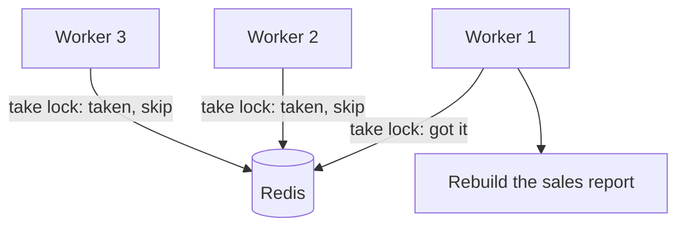
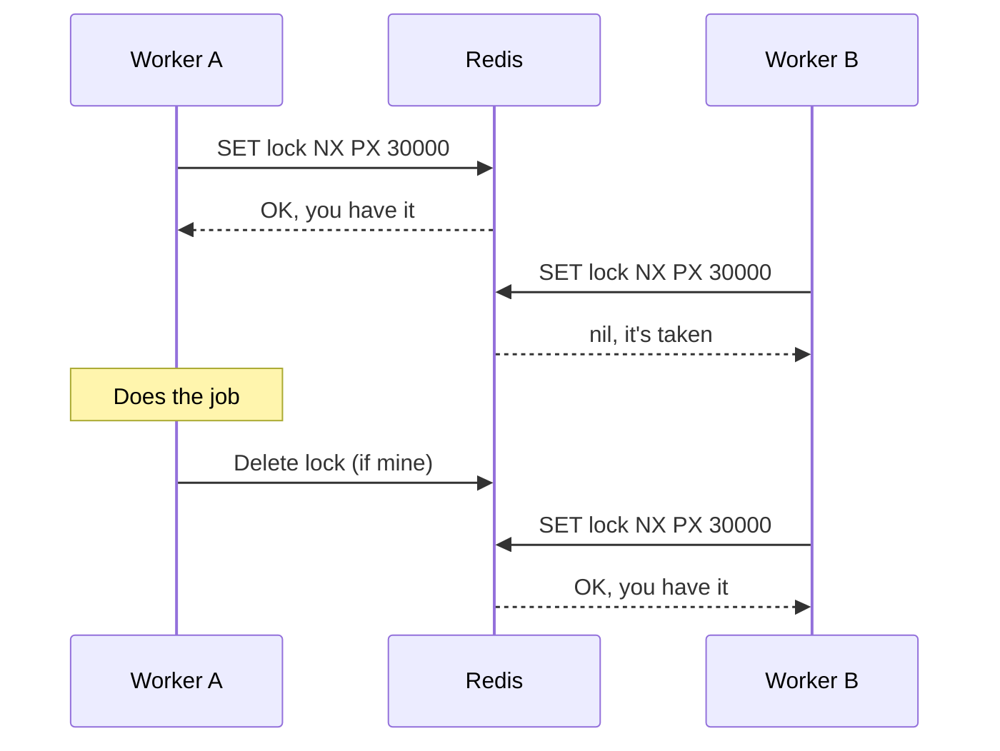
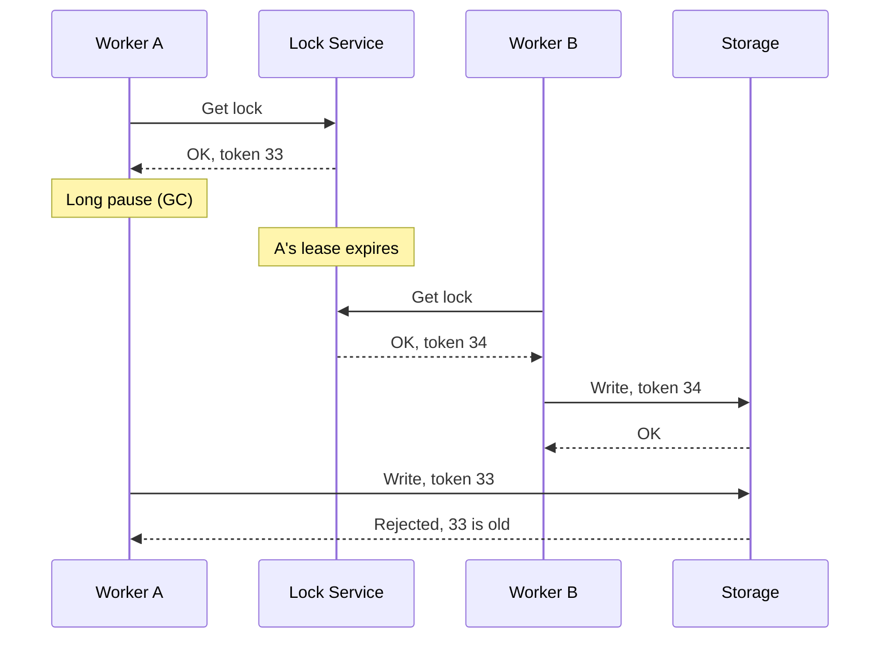

## The idea

Think of an office with **one key** for the meeting room, kept at reception. Whoever holds the key can use the room. Everyone else waits until the key is back.

On **one** server, a lock in memory (often called a **mutex**) does this job. But with ten servers, each has its own memory. Server 1 can't see server 2's locks. So the "key" must live in a **shared place** that every server can reach, like Redis, etcd or ZooKeeper. That is a **distributed lock**.

## Why you need a lock across servers

- **A scheduled job runs on every server.** The "send monthly invoices" job starts on all 5 servers at midnight, and each customer gets 5 invoices. Only one server should run it.
- **Expensive work is done twice.** Two servers rebuild the same big report or cache entry at the same time.
- **One resource, many writers.** Two workers edit the same file in storage and overwrite each other.



**First, check if you need one.** If all the data lives in **one database**, use that database's own locks or a conditional update. They are simpler and safer. See [Locks and Deadlocks](../databases/locking.mdx).

It also helps to ask **why** you want the lock:

| Lock for... | If two holders run at once | What to use |
| --- | --- | --- |
| **Saving work** | Some wasted work. Annoying, not harmful | A simple Redis lock is fine |
| **Correctness** | Broken data, or money moved twice | A stronger lock service **plus fencing tokens** (below) |

## Locks with Redis

Say only one server should rebuild the nightly sales report. If two do it, some work is wasted, but nothing breaks. One Redis command takes the lock:

```bash
# Take the lock only if nobody has it (NX), and let it expire after 30 seconds (PX 30000)
SET lock:report-rebuild 7f3a9c NX PX 30000
# OK     -> you have the lock
# (nil)  -> someone else has it
```

- `NX` means "only set it if the key does not exist yet".
- `PX 30000` means "delete it automatically after 30,000 ms".
- The value `7f3a9c` is a **random token** that only this holder knows.

To release the lock, delete the key, but **only if it still holds your token**. Otherwise you might delete a lock that has since passed to someone else. The check and the delete must happen together, so use a small Lua script, which Redis runs as one step:

```js
// Delete the lock only if we still own it
const RELEASE = `
  if redis.call("GET", KEYS[1]) == ARGV[1] then
    return redis.call("DEL", KEYS[1])
  end
  return 0
`;
await redis.eval(RELEASE, 1, 'lock:report-rebuild', myToken);
```



**Redlock** is a version that takes the lock on 5 separate Redis servers and needs a majority (3 of 5). It keeps working even if 2 of the 5 Redis servers die, but it is still debated (see "In the real world").

## Lock timeouts

Why must a lock expire? If the holder **crashes** while holding it, a lock without a timeout stays forever, and nobody can ever do the job again. A lock with an expiry time is often called a **lease**: you rent the key for a while.

But choosing the timeout is hard:

| Timeout | Problem |
| --- | --- |
| **Too short** | The lock expires while the holder is still working. Now **two** workers run at once |
| **Too long** | If the holder crashes, everyone waits a long time before anyone can continue |

The usual fix: pick a timeout well above the normal job time, and **renew** the lease while the work is still going (like a heartbeat). The Java library Redisson does this automatically with a "watchdog".

Even then, there is a nasty case. The holder can **freeze without knowing it**: a long garbage-collection pause, a paused virtual machine, or a slow network. Its lease expires, another worker takes the lock, and then the first one wakes up **still believing it holds the lock**.

## Fencing tokens

Think of a **hotel key card**. When a new guest checks into a room, the door is set to accept the new card, and the old guest's card stops working. It doesn't matter what the old guest believes: **the door checks**.

A **fencing token** works the same way. Every time the lock is given out, the lock service also hands out a **number that always goes up**: 33, then 34, then 35. The worker sends its number with every write. The storage remembers the highest number it has seen and **rejects anything older**.



The storage must do the check. In SQL it can be a conditional update:

```sql
UPDATE files
SET content = 'new text', last_token = 34
WHERE id = 9 AND COALESCE(last_token, 0) <= 34;
-- 0 rows updated means a newer token has written: stop, we lost the lock
```

- `<=`, not `<`: the holder of token 34 may write more than once. Only an **older** token is rejected.
- `COALESCE(last_token, 0)`: a row that was never written with a token has `last_token` empty (`NULL`), and `NULL <= 34` is never true. `COALESCE` treats it as 0.

Where to get tokens: **etcd** and **ZooKeeper** give every change a number that always goes up, which works as a fencing token. A plain Redis lock doesn't give you one.

**Fencing only protects storage that checks the token.** It can't stop a second invoice **email**. So for billing, also make the work itself safe to repeat (see [Idempotency](../messaging/idempotency.mdx)). A unique rule allows one invoice per customer per month, and the email is queued in the same transaction as the invoice (see [Outbox Pattern](./outbox-pattern.mdx)):

```js
// The invoices table has a unique rule on (customer_id, month)
await db.transaction(async (tx) => {
  const added = await tx.query(
    `INSERT INTO invoices (customer_id, month, total) VALUES ($1, $2, $3)
     ON CONFLICT (customer_id, month) DO NOTHING`,
    [customerId, month, total]
  );
  if (added.rowCount === 0) return;               // already billed: no second invoice, no second email
  await queueInvoiceEmail(tx, customerId, month); // an outbox row, saved in the same transaction
});
```

A crash before the commit saves nothing, so the next run bills that customer. A crash after it leaves the invoice and its email together, and the next run skips that customer.

## Choosing a tool

| Tool | How it works | Good for |
| --- | --- | --- |
| **Redis** `SET NX PX` | One key with an expiry | Saving work: avoid running a job twice |
| **Your database** | A row lock (`SELECT ... FOR UPDATE`) or a conditional update | When the data is in that database anyway |
| **etcd / ZooKeeper** | Built on consensus, with leases and increasing numbers | Correctness, and [leader election](./leader-election-consensus.mdx) |

## In the real world

**Google's Chubby.** Google described its lock service, Chubby, in a 2006 paper. Systems like GFS and Bigtable used it to pick a single master server. Chubby gives out **sequencers**, which are the same idea as fencing tokens: the storage checks them so an old lock holder can't do damage.

**The Redlock debate (2016).** Martin Kleppmann, author of the book *Designing Data-Intensive Applications*, wrote a blog post arguing that Redlock is not safe when correctness matters, because pauses and clock jumps can let two workers hold the lock. He recommended fencing tokens. Salvatore Sanfilippo, the creator of Redis, replied and defended Redlock. The common takeaway: Redis locks are fine for saving work. For correctness, use fencing.

## In the interview

> "Only one instance should run each scheduled job. Where a double run only wastes work, like rebuilding a report, a Redis lock with SET NX and a 30-second expiry, renewed while the job runs, is enough. Billing twice would be harmful, and a Redis lock gives no fencing token. So the billing lock comes from etcd, which gives one, and the database rejects writes with an old token. A lock can't take back an email, so a unique rule also allows only one invoice per customer per month."

<Callout title="Remember this" type="success">
  - A **distributed lock** lives in a shared place (Redis, etcd, ZooKeeper), so all servers see it.
  - Redis: `SET key token NX PX 30000`. Release **only if the token is still yours**.
  - Locks must **expire** (a **lease**), or a crashed holder blocks everyone forever.
  - A paused holder can **wake up after its lease expired** and still think it has the lock.
  - **Fencing tokens:** an always-increasing number. Storage **rejects old tokens**.
  - Redis locks for **saving work**. etcd/ZooKeeper + fencing for **correctness**.
  - Fencing can't stop side effects like a second email. Make the work **idempotent** too: one invoice per customer per month.
</Callout>
