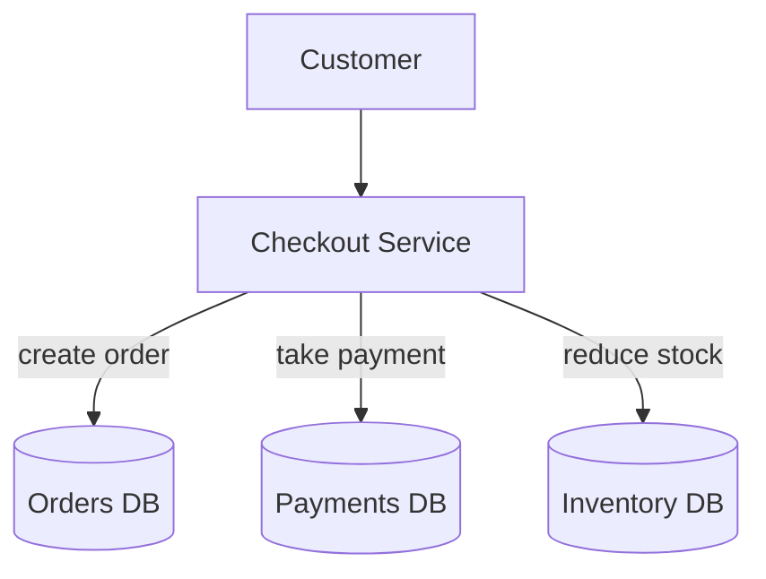
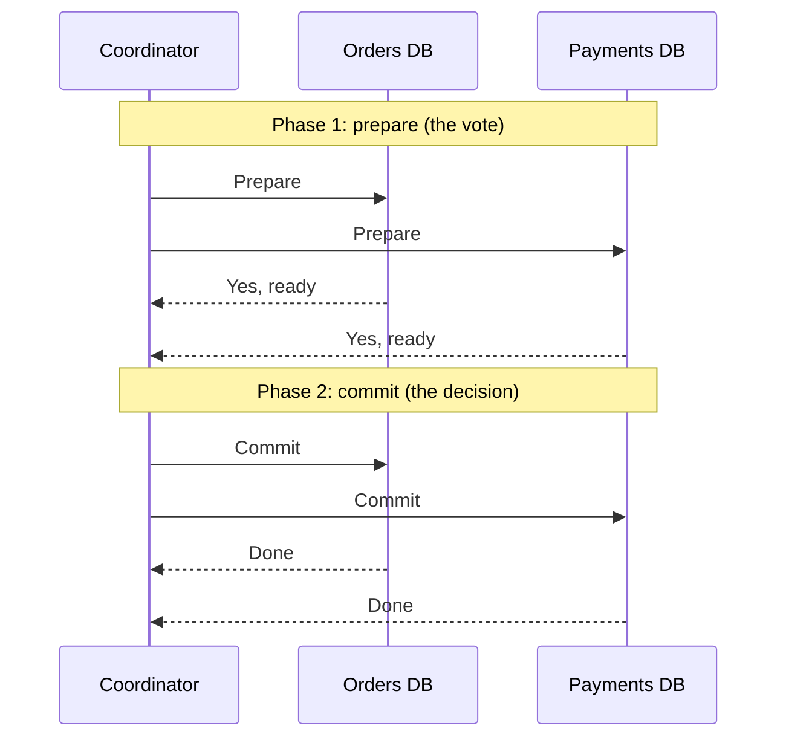
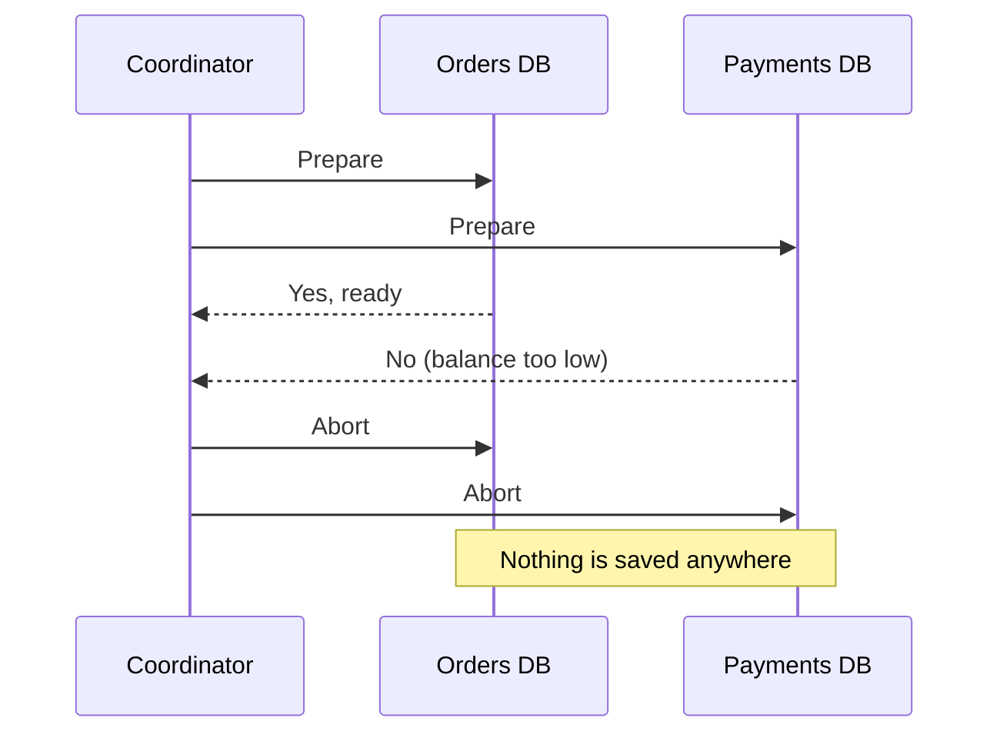
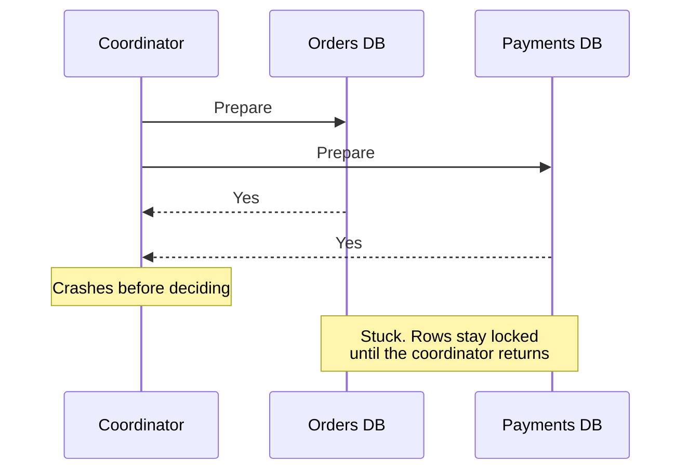

## What is it?

Think of a **wedding**. The officiant asks each person: "Do you take this person...?"

1. **First, the vote.** Both must say "I do". If either says no, the wedding is off for **both**.
2. **Then, the decision.** Only after hearing two "I do"s does the officiant say "I now pronounce you married". From that moment it is final.

That is **two-phase commit (2PC)**: first ask everyone if they are ready, then announce one decision that everyone follows.

Now imagine the officiant faints right after both said "I do", before the announcement. The couple is stuck. Are they married? They can't leave, and they can't marry anyone else, until the officiant wakes up. That is the big weakness of 2PC.

## Why do we need it?

Inside **one** database, a transaction makes many steps all-or-nothing. See [Transactions and ACID](../databases/transactions-acid.mdx).

But with microservices, each service usually has **its own database**:



The Orders DB's transaction can't see or undo what the Payments DB did. If the order and payment are saved but the stock update fails, the data is now wrong in a way no single database can fix. A **distributed transaction** is one that spans many databases or services and still tries to be all-or-nothing.

## How it works inside

### The two roles

There are two roles:

- The **coordinator** (the officiant) runs the process.
- The **participants** (each database) do the work and vote.

### The two phases

**Phase 1: prepare (the vote).** The coordinator asks every participant "Can you commit?" Each participant does the work, saves it safely to disk, **locks the rows**, and answers:

- **"Yes"**: a promise. "I am ready, and I will commit if you tell me to, even if I crash and restart."
- **"No"**: something went wrong, like a broken rule (a wallet balance would go below zero) or a full disk.

**Phase 2: commit (the decision).** If **every** participant said yes, the coordinator writes "commit" in its own log and tells everyone to commit. If **anyone** said no, or didn't answer in time, it tells everyone to abort.



When one participant says no, nobody commits:



The key rule: **once a participant votes yes, it can't change its mind.** It must keep its locks and wait for the decision.

### In PostgreSQL

PostgreSQL supports the participant side of this directly:

```sql
-- On the Orders database
BEGIN;
INSERT INTO orders (id, user_id, total) VALUES (42, 7, 500);
PREPARE TRANSACTION 'order-42';   -- phase 1: vote "yes" (saved to disk, rows stay locked)

-- Later, when the coordinator has decided:
COMMIT PREPARED 'order-42';       -- phase 2: commit
-- or: ROLLBACK PREPARED 'order-42';
```

### What happens after a crash

Both sides write to a **log on disk**, so they can pick up where they left off:

- **A participant fails before voting:** the coordinator gets no answer in time, and aborts everyone.
- **A participant crashes after voting yes:** on restart, it finds the prepared transaction in its log. It keeps the locks and asks the coordinator for the decision.
- **The coordinator crashes after deciding:** it wrote "commit" or "abort" in its log **before** telling anyone. On restart, it reads the log and sends the decision again.
- **The coordinator crashes before deciding:** the participants are stuck. This is the big problem below.

## Problems with 2PC

**1. It gets stuck if the coordinator dies.** This is called **blocking**.



The participants can't commit on their own (maybe someone else voted no). They can't abort on their own (maybe the coordinator already told someone to commit). So they wait, holding locks, and every other request that needs those rows waits too.

**2. It is slow.** Two rounds of messages, plus disk writes, plus locks held the whole time. The whole transaction is as slow as the **slowest** participant.

**3. Everyone must be up.** If any one participant is down, nothing can commit. The more participants, the more often something fails.

**4. Everyone must support it.** Many message queues, many NoSQL databases and all outside APIs can't take part. You can't "prepare" an email and then un-send it.

## When to use it

**Where 2PC is still used:** inside distributed databases like Google Spanner and CockroachDB. They run 2PC for you, and they protect the coordinator by keeping it **copied on several machines** with a consensus algorithm (see [Leader Election and Consensus](./leader-election-consensus.mdx)). If one machine dies, another copy takes over, so nobody stays stuck.

Running it yourself only makes sense for **a few databases inside one system**, with **short** transactions, where every part supports it (for example XA in an older enterprise system).

**Don't use it when:**

- **The steps are in different microservices.** Locks would be held across the network, owned by other teams.
- **A step calls an outside API** (payments, email). It can't "prepare".
- **The flow is long** (seconds to days). Rows would stay locked the whole time.
- **You need high throughput.** Every transaction waits for the slowest participant.

## Alternatives

Between microservices, most teams use a **[saga](./saga-pattern.mdx)** instead: each service commits its own step right away, and if a later step fails, earlier steps are undone with **compensating actions** (like a refund).

| Option | What it is | Pick it when |
| --- | --- | --- |
| **Saga** | Each step commits on its own. A failure runs undo steps | A flow spans services or outside APIs |
| **Outbox** | Save the change and the event in **one** local transaction, publish later | You need a database change plus an event, without 2PC. See the [Outbox Pattern](./outbox-pattern.mdx) |
| **Distributed SQL** (Spanner, CockroachDB) | One database spread over many machines. It runs 2PC for you, safely | The data can live in one database, and you want real ACID |
| **Redraw the boundaries** | Put data that must change together in **one** service and one database | Two services keep needing one transaction. They may really be one |
| **Three-phase commit** | Adds a "pre-commit" round so participants can finish without the coordinator | Rarely in practice: it is still unsafe when the network splits |

How 2PC and a saga compare:

| | 2PC | Saga |
| --- | --- | --- |
| **Consistency** | Strong: all at once | Eventual: step by step |
| **Locks** | Held across services during the vote | Each step commits and releases right away |
| **If the coordinator dies** | Participants are stuck | Steps continue or are undone later |
| **Outside APIs (payments, email)** | Can't take part | Fine |
| **Good for** | A few databases inside one system | Microservices and long flows |

## In the real world

**XA, the old standard.** XA is a standard from the early 1990s for running 2PC across different databases and message brokers. Java supports it through **JTA**. It still exists in banks and older enterprise systems, but microservice teams usually avoid it because of the locks and the blocking.

**PostgreSQL turns it off by default.** The setting `max_prepared_transactions` is `0` by default, so `PREPARE TRANSACTION` doesn't work until you turn it on. The PostgreSQL docs say this feature is meant for outside transaction managers, not for normal apps, and warn that a prepared transaction left open keeps holding its locks.

**Google Spanner uses 2PC safely.** When a Spanner transaction touches data on many machines, it runs 2PC. But each participant is a **group of copies** kept in agreement with Paxos (a consensus algorithm), not a single machine. A crash of one machine doesn't block the transaction.

## In the interview

If the interviewer asks how to keep data correct across services, show you know 2PC, then explain why you'd pick something else:

> "I won't use two-phase commit across services. It holds locks across the network and gets stuck if the coordinator dies. I'll use a saga instead: each service commits its own step, and if a later step fails, we run undo steps like a refund."

<Callout title="Remember this" type="success">
  - A **distributed transaction** = all-or-nothing across many databases.
  - **Why:** each service has its own database, and one database can't see or undo another's work.
  - **2PC:** phase 1 **prepare** (everyone votes), phase 2 **commit or abort** (one decision for all).
  - A "yes" vote is a **promise**: the participant keeps its locks and waits.
  - **Inside:** both sides keep a **log on disk**. The coordinator logs its decision **before** phase 2, so it can resend it after a crash.
  - Big weakness: if the **coordinator dies**, participants are **stuck** holding locks.
  - Also slow, and everyone must be up and must support 2PC.
  - Between microservices, use a **saga** instead. 2PC lives on inside databases like **Spanner**.
  - **Alternatives:** saga, outbox, distributed SQL, or redraw service boundaries.
</Callout>
