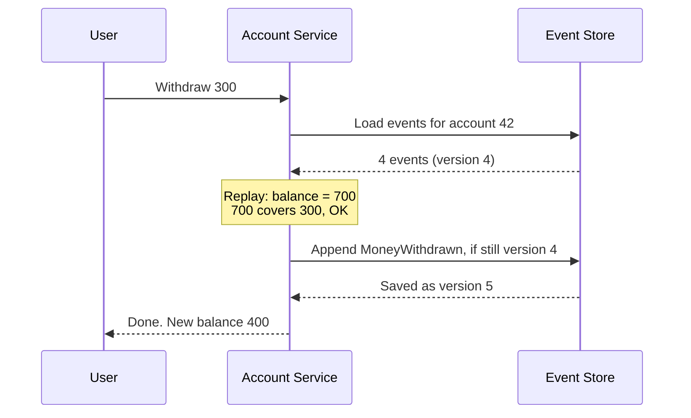
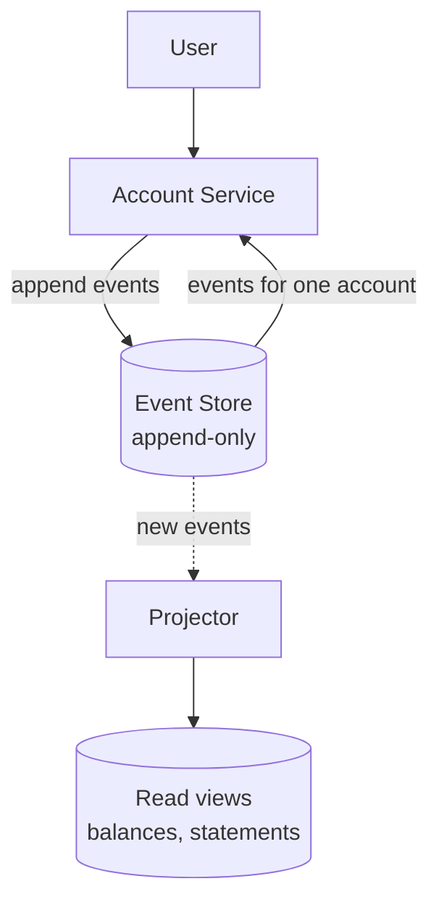
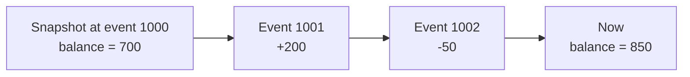

## The idea

Think of your **bank passbook**. The bank doesn't only write "balance: 700". It writes every deposit and every withdrawal, in order. The balance is just the result of adding them up. If you ask "why is my balance 700?", the list answers you. And if the bank makes a mistake, it doesn't erase a line. It adds a **new correcting line**.

**Event sourcing** stores data the same way:

- Every change is saved as an **event**: a fact about something that happened, like `MoneyDeposited`.
- Events go into an **append-only** list (you only add to the end) called the **event log** or **event store**.
- Events are **never changed or deleted**.
- The current state is worked out by **replaying** the events in order.

## State vs events

The usual way stores **only the latest state**:

| account_id | balance |
| --- | --- |
| 42 | 700 |

Event sourcing stores **what happened**:

| # | Event | Amount |
| --- | --- | --- |
| 1 | `AccountOpened` | 0 |
| 2 | `MoneyDeposited` | 1,000 |
| 3 | `MoneyWithdrawn` | 500 |
| 4 | `MoneyDeposited` | 200 |

Balance = 0 + 1,000 − 500 + 200 = **700**.

Both say 700. But the first table has **forgotten how** it got there. Was it one deposit of 700? Or a thousand small payments? The event list never forgets.

## Rebuilding state from events

To get the current state, start from nothing and apply each event in order:

```js
function balanceOf(events) {
    let balance = 0;

    for (const event of events) {
        if (event.type === "MoneyDeposited") {
            balance = balance + event.amount;
        }

        if (event.type === "MoneyWithdrawn") {
            balance = balance - event.amount;
        }
    }

    return balance;
}
```

With the four events from the table above:

```js
const events = [
    { type: "AccountOpened" },
    { type: "MoneyDeposited", amount: 1000 },
    { type: "MoneyWithdrawn", amount: 500 },
    { type: "MoneyDeposited", amount: 200 },
];

console.log(balanceOf(events)); // 700
```

To make a **new** change, the service loads the events, rebuilds the state, checks the rules, and appends one new event:



The "if still version 4" part matters. If someone else added an event in the meantime, the append is rejected, and the service reloads and tries again. This is **optimistic locking**. See [Locks and Deadlocks](../databases/locking.mdx).

**Reading is the hard part.** The event store is great for "give me all events for account 42", but bad for questions like "list all accounts with a balance over 1,000". So event sourcing is almost always paired with **[CQRS](./cqrs.mdx)**: projectors read the events and build ready-made **read views** for queries.



## Snapshots

An account with a million events would be slow to replay every time. The fix is a **snapshot**: every so often (say, every 100 events), save the state at that point.

To load the account, read the **latest snapshot**, then replay **only the events after it**. It is like a monthly bank statement that starts with "opening balance: 700", so you don't re-add years of history.



Snapshots are only a **speed-up**. The events are still the truth. You can delete every snapshot and rebuild them from the events at any time.

## Good and bad sides

| Good | Bad |
| --- | --- |
| **Full history** for free: a built-in audit log | More complex than a simple table |
| **Time travel:** see the state at any moment in the past | Queries need separate read views (CQRS) |
| **Debugging:** replay the events to reproduce a bug | Event formats change over time, and **old events must still be readable** forever (**versioning**) |
| **New views later:** build a new report from all past events | **Deleting data is hard.** Privacy laws like GDPR give people the right to have their data erased, but events are never deleted. A common fix: encrypt each person's data with their own key, and delete the key |
| Events can feed other services | The read side is a little behind: eventual consistency |
| Writes are fast: just add to the end | Replays get slow without snapshots |

**Good fits:** money and ledgers, accounting, orders with many status changes, anything that needs a full audit trail.

**Bad fits:** simple CRUD screens. Use event sourcing for the **one part** of a system that needs history, not for everything.

**Don't mix up the names.** [Event-driven architecture](../messaging/event-driven-architecture.mdx) is about services **telling each other** what happened. Event sourcing is about how **one service stores** its own data. You can use either one without the other.

## In the real world

**Accounting has always worked this way.** Accountants keep a ledger of entries and never erase one. A mistake is fixed by adding a correcting entry. Event sourcing brings that old idea into software.

**Databases do it inside.** Every database keeps a log of changes (like PostgreSQL's write-ahead log) and rebuilds its tables from that log after a crash. [Replicas](../databases/replication.mdx) stay in sync by replaying the same log. See [Change Data Capture](./change-data-capture.mdx).

**LMAX.** LMAX, a London financial exchange, became a famous example after Martin Fowler wrote about its design in 2011. Its core business logic ran in memory on a single thread. Every incoming event was saved to a journal first, so after a crash the system could rebuild its state from a snapshot plus the events that came after it.

**KurrentDB** is a database built just for event sourcing. It was called **EventStoreDB** until its company, Event Store, renamed itself Kurrent. It was started by Greg Young, the same person who made the name CQRS popular.

## In the interview

Bring it up when the requirements say "full history", "audit", or "show every change", especially for money:

> "For the wallet, I'll store every change as an event: deposited, withdrawn, refunded. The balance is built from the events, with a snapshot every 100 events. That gives us a full audit trail, and a separate read model keeps balances ready for fast queries."

<Callout title="Remember this" type="success">
  - **Event sourcing** = store every change as an **event**. Never change or delete events.
  - Current state = **replay** the events, like adding up a bank passbook.
  - **Snapshots** save the state every N events, so replays stay fast.
  - Usually paired with **CQRS**: read views are built from the events.
  - Good: **full history, audit, time travel**. Bad: complex, versioning, hard to delete data.
  - Use it for **money, ledgers and audit trails**, not for simple CRUD.
</Callout>
