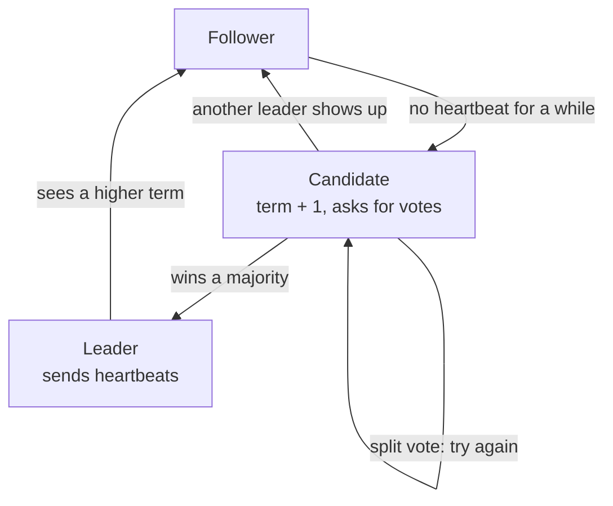
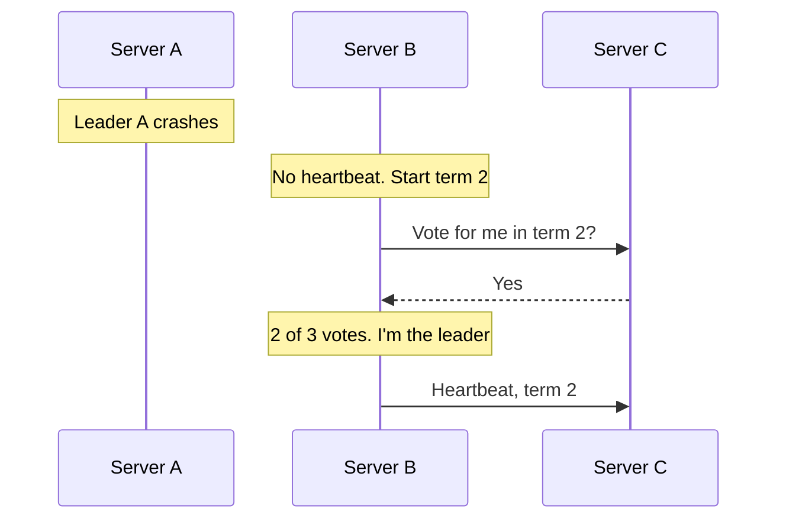
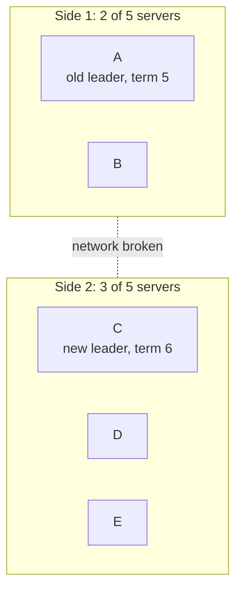

## The idea

Think of a class picking a **class monitor**. The teacher can't watch everything, so one student makes the small decisions: who takes attendance, who collects the homework. With one monitor, nobody argues about who decides.

If the monitor is absent, the class **votes** for a new one. To win, a student needs **more than half** of the votes. Since two students can't both get more than half, there is only ever **one** monitor.

Servers do the same thing:

- **Leader election** = a group of servers picks one leader to make decisions.
- **Consensus** = a group of servers agrees on the same value (who the leader is, or the order of writes), even when some servers crash or messages are lost.

## Why we need a leader

Many jobs are much simpler with one decision-maker:

- **One database primary** takes all writes, so there is one clear order of writes. See [Replication](../databases/replication.mdx).
- **One scheduler** starts the cron jobs, so each job runs once.
- **One controller** decides which server handles which piece of work.

The hard part is not having a leader. It is **replacing** the leader when it dies: automatically, quickly, and with **exactly one** new leader.

## Quorums and majority votes

A **quorum** is the minimum number of votes needed to make a decision. It is usually a **majority**: more than half.

Why a majority? **Any two majorities of the same group always share at least one server.** That shared server can't vote for two different leaders in the same election, so two leaders can never both win.

| Servers | Majority needed | Can lose and keep working |
| --- | --- | --- |
| 1 | 1 | 0 |
| 3 | 2 | 1 |
| 4 | 3 | 1 |
| 5 | 3 | 2 |
| 7 | 4 | 3 |

Look at 3 and 4: both can lose only one server. That is why these groups almost always have an **odd** number of servers, usually **3 or 5**.

## Raft, in simple words

**Raft** is a consensus algorithm, built to be easy to understand. Each server is in one of three roles:

| Role | What it does |
| --- | --- |
| **Leader** | Takes all writes and sends regular "I'm still here" messages (**heartbeats**) |
| **Follower** | Listens to the leader and copies what it sends |
| **Candidate** | A follower that is asking for votes to become the new leader |

**Terms.** Time is split into numbered **terms**: term 1, term 2, term 3, and so on. Each term has **at most one leader**, like "the monitor for term 5". A higher term always wins. If a leader sees a message with a higher term than its own, it knows it is out of date and steps down.

### How an election works

1. The leader sends heartbeats to the followers many times a second.
2. A follower that hears nothing for a while (a **random** wait, a few hundred milliseconds) decides the leader is gone.
3. It becomes a **candidate**: it adds 1 to the term, votes for itself, and asks the others for their vote.
4. Each server gives **one vote per term**, to the first candidate that asks, but only if that candidate's data is at least as up to date as its own.
5. A candidate that gets a **majority** becomes the leader and starts sending heartbeats.
6. If the votes are split and nobody wins, everyone waits another random time and tries again. The randomness makes repeated ties rare.

### How writes work

1. A client sends a write to the leader.
2. The leader adds it to its **log** (its list of changes) and sends it to the followers.
3. Once a **majority** have saved it, the write is **committed**. The leader applies it and replies "done".

So a committed write survives as long as a majority of servers survive. A new leader always has every committed write, because it needed votes from a majority, and at least one of them had the write.

**Paxos** is an older consensus algorithm by Leslie Lamport. It solves the same problem but is famously hard to understand. Raft was designed as an easier alternative.

## Split brain, and how to avoid it

**Split brain** is when **two servers both believe they are the leader** and both accept writes. The data splits into two different versions. It is like a class with two monitors giving opposite orders.

It usually happens when the network splits the group. The old leader is cut off but still running. The other side elects a new leader.

How it is avoided:

- **Majority rule.** A leader needs a majority to commit anything. Side 1 has only 2 of 5 servers, so old leader A can't commit any write. Only side 2 can make progress.
- **Terms.** When the network heals, A sees term 6, knows it is out of date, and steps down.
- **Fencing.** Storage can reject writes from an old leader, using its term as a [fencing token](./distributed-locking.mdx).
- **No two-server groups.** With 2 servers, neither side of a split has a majority. Use 3, or add a small third "tie-breaker" server.

## Tools: ZooKeeper and etcd

You almost never write Raft yourself. You use a **coordination service** that already does consensus:

| Tool | Consensus algorithm | Known for |
| --- | --- | --- |
| **etcd** | Raft | Stores all of Kubernetes' cluster data |
| **ZooKeeper** | ZAB (similar idea) | Used by Hadoop, HBase, and Kafka in the past |
| **Consul** | Raft | Service discovery and settings |

Leader election with them is simple: every candidate tries to **create the same key**, tied to a lease (etcd) or to its session (ZooKeeper). The key disappears automatically if the holder dies. Whoever creates it first is the leader. The others **watch** the key and try again when it disappears. It works like a [distributed lock](./distributed-locking.mdx).

Some databases have Raft built in, like CockroachDB, so each piece of data is kept on several servers that agree on every write.

## In the real world

**Kubernetes runs on etcd.** Kubernetes keeps all its cluster data (what should run, and where) in etcd, which uses Raft. Production clusters usually run 3 or 5 etcd servers. Kubernetes' own scheduler and controller manager also use leader election, so only one copy of each is active at a time, while the others wait as backups.

**Kafka replaced ZooKeeper with Raft.** For years, Kafka used ZooKeeper to elect its controller and store its metadata. Kafka then built its own Raft-based system, called **KRaft**. It became ready for production in Kafka 3.3 (2022), and Kafka 4.0 (2025) removed ZooKeeper completely. One less system to run.

**Raft came from Stanford.** Diego Ongaro and John Ousterhout published Raft in 2014, in a paper called "In Search of an Understandable Consensus Algorithm". Making it easy to understand was the main goal.

## In the interview

Don't design a consensus algorithm. Say which tool does it, and why a majority prevents two leaders:

> "Only one scheduler instance should hand out jobs, so the instances elect a leader through etcd with a lease. If the leader dies, its lease expires and another instance takes over. etcd runs on 3 nodes and needs a majority, so a network split can't create two leaders."

<Callout title="Remember this" type="success">
  - **Leader election:** servers pick one leader. **Consensus:** servers agree on the same data.
  - A **majority** (quorum) is needed. Two majorities always overlap, so there is **one leader**.
  - Use **3 or 5** servers. 3 can lose 1, 5 can lose 2.
  - **Raft:** leader, followers, numbered **terms**, heartbeats, majority votes.
  - **Split brain** = two leaders. Prevent it with majorities, terms and fencing.
  - In practice, use **etcd** or **ZooKeeper**. Don't build your own.
</Callout>
