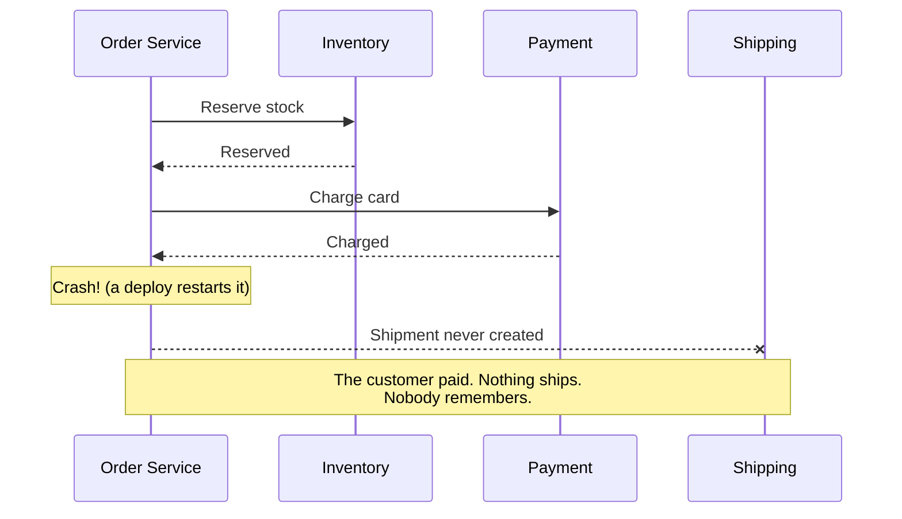
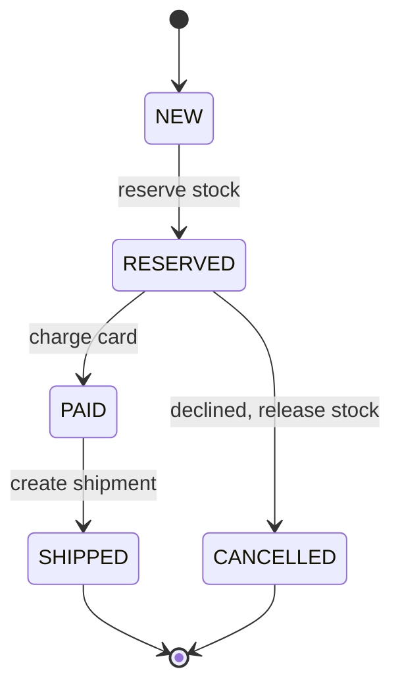
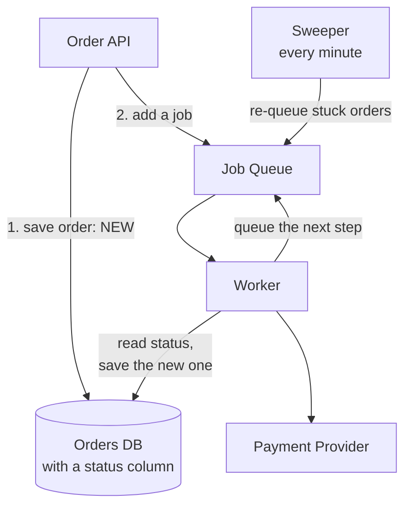
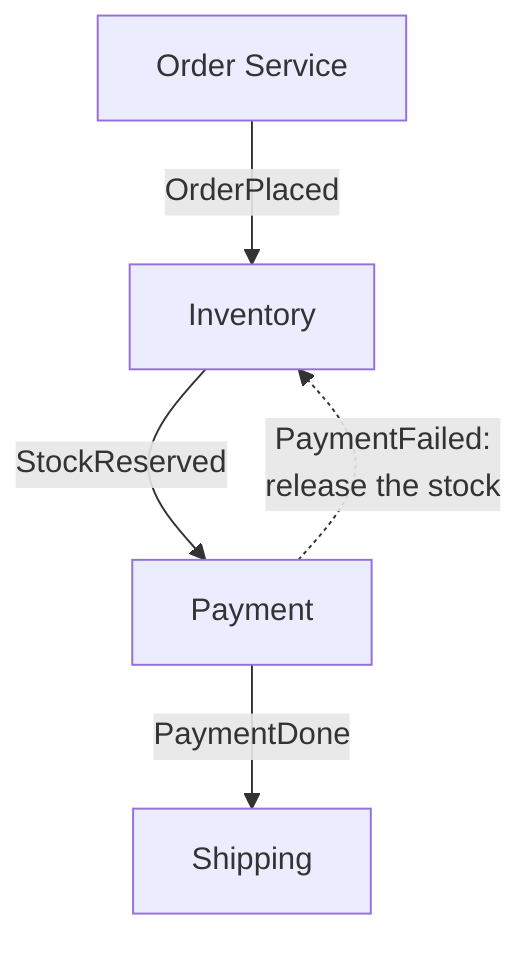
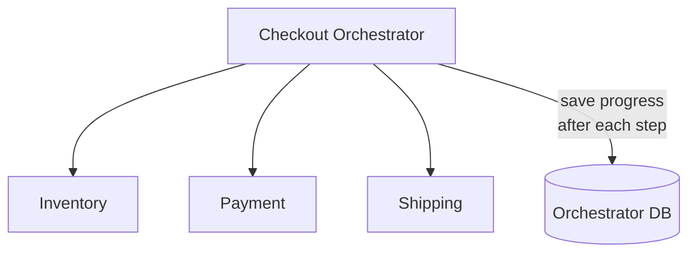
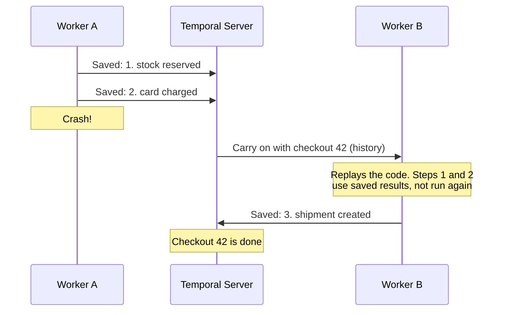

## What is it?

Think of **renovating a kitchen**: order the cabinets, book the plumber, book the electrician, then put it all together. It takes weeks, and many people are involved.

You keep a **checklist on the fridge** and tick off each step when it's done. If you get sick for a week, the checklist tells you exactly where you stopped. If the plumber doesn't show up, you **call again**. If no plumber can do the job at all, you **return the cabinets**. You never just walk away with half a kitchen.

That is a **multi-step process**: one job made of several steps, often in different services, that must **finish completely or be cleanly undone**. It must never stop halfway.

| Process | Steps |
| --- | --- |
| Checkout | Reserve stock → charge the card → create the shipment → send the email |
| Video upload ([YouTube](../questions/youtube.mdx)) | Upload → make 5 sizes → make thumbnails → publish |
| Sign-up | Create the account → create a customer at the payment provider → send a welcome email |
| A ride ([Uber](../questions/uber.mdx)) | Match a driver → run the trip → charge the rider → pay the driver |

## Why do we need it?

The first version usually looks like this:

```js
// All the progress lives in this one server's memory
async function checkout(order) {
    await reserveStock(order.id);
    await chargeCard(order.id);
    await createShipment(order.id);
    await sendConfirmationEmail(order.id);
}
```

It works on a laptop. In production, servers crash, deploys restart them, and networks drop replies:



| What goes wrong | Example | The fix |
| --- | --- | --- |
| **A crash between steps** | Paid, but the shipment is never created | **Save progress** after every step, outside the server's memory |
| **A retry repeats a step** | The charge times out. Did it work? We retry, and the card is charged twice | Make every step **idempotent** (safe to run twice) |
| **A step fails for good** | The card is declined, but the stock stays reserved forever | **Undo** the earlier steps |
| **A step is slow** | Making 5 video sizes takes 20 minutes. No HTTP request waits that long | Run it in the **background**, and report progress |

So every option below does the same three things: it **saves progress** after each step, makes each step **safe to repeat**, and knows how to **undo** each step.

## How it works inside

### Save progress outside the server

The progress lives in a **database**, never only in one server's memory: a `status` column (option 2 below), the orchestrator's own database (option 4), or the engine's event history (option 5). After a crash, any worker reads it and carries on from the right step.

Something must also **notice runs that got stuck**: a sweeper that re-queues old unfinished runs, a queue that hands an unfinished job to another worker, or the engine's own timers.

### Make every step idempotent

Whichever option you pick, steps **will** run twice: a retry after a timeout, a worker crash, a message delivered twice. So every step must be safe to repeat. See [Idempotency](../messaging/idempotency.mdx).

| Step | How to make it safe to repeat |
| --- | --- |
| **Reserve stock** | Save a reservation row with a **unique** `order_id`, in the same transaction as the stock update. A second try fails on the unique rule and changes nothing |
| **Charge the card** | Send `order-42:charge` as the **idempotency key**. The provider returns the first result |
| **Create the shipment** | A **unique** `order_id` in the shipments table, and pass a key to the carrier's API too |
| **Send the email** | Save a row with a unique `(order_id, 'confirmation')`, in the same transaction as the outbox row for the email. A repeat finds the row and skips |
| **Make the 720p video** | Write to a **fixed path** like `videos/42/720p.mp4`. Doing it twice just writes the same file again |

A simple rule: **idempotency key = process ID + step name**, like `order-42:charge`. Every retry of that step sends the same key.

**Retry, then give up loudly.** Retry temporary errors with backoff and jitter, and give every call a timeout. See [Retries, Backoff and Timeouts](../messaging/retries-backoff-timeouts.mdx). Don't retry errors that can never work, like a declined card. After a few tries, move the job to a [dead-letter queue](../messaging/dead-letter-queues.mdx) and alert a person. A stuck process must never fail **silently**.

### Undo steps (compensating actions)

When a step fails **for good**, undo the earlier steps, newest first. An undo is a **new action**, not an eraser: you refund a payment, you don't delete it.

| Step | Undo step |
| --- | --- |
| Reserve stock | Release the stock |
| Charge the card | Refund it |
| Create the shipment | Cancel it, but only before it leaves the warehouse |
| Send the email | Can't be undone, so do it **last** |

Two kinds of failure need different answers:

- **Temporary** (a timeout, a server restarting): **retry forward**. Most failures are this kind.
- **Permanent** (card declined, item discontinued): **undo backward**.

Undo steps must be idempotent too, and retried until they work. More in [Saga Pattern](./saga-pattern.mdx).

## The options, from simple to powerful

### 1. One database transaction, when you can

If every step writes to the **same database**, you don't need anything special. Use one transaction: all steps happen, or none do.

```sql
BEGIN;

UPDATE inventory SET available = available - 1
WHERE product_id = 'ps5' AND available >= 1;
-- 0 rows changed: sold out. ROLLBACK and stop.

INSERT INTO orders (id, user_id, status) VALUES ('ord_555', 7, 'PLACED');

-- Other services hear about the order through an outbox row,
-- saved in the same transaction
INSERT INTO outbox (topic, payload)
VALUES ('orders', '{"type": "OrderPlaced", "orderId": "ord_555"}');

COMMIT;
```

The best multi-step process is one you turned into **one step**. Before you split data across services, ask whether these tables could live in one database. See [Transactions and ACID](../databases/transactions-acid.mdx) and [Outbox Pattern](./outbox-pattern.mdx).

**Across services, or with outside APIs, one transaction is impossible.** A card charge at Stripe can't join your database transaction. [Two-phase commit](./distributed-transactions-2pc.mdx) can join a few databases, but it holds locks across the network and gets stuck if its coordinator dies, so most teams avoid it.

### 2. A state machine in the database + a job queue

Keep the checklist in the database. A `status` column on the order says which step is done. That is a small **state machine**: a fixed list of states, and fixed moves between them. A worker reads the status, does the **next** step, saves the new status, and queues the next job. If the worker crashes, the status still says where we stopped.





#### Step 1: Move the status, only from the one we expect

```js
// Move the order to the next status, but only if it is still in the
// status we expect. If two workers run the same step, only one wins.
async function moveStatus(orderId, fromStatus, toStatus) {
    const sql = `
        UPDATE orders SET status = $3, updated_at = now()
        WHERE id = $1 AND status = $2
    `;

    const result = await db.query(sql, [orderId, fromStatus, toStatus]);

    return result.rowCount === 1;
}
```

This is the conditional update from [Dealing with Contention](./dealing-with-contention.mdx).

#### Step 2: The charge step, with its undo

```js
// Charge the card. If it is declined, undo the stock reservation.
async function chargeStep(order) {
    // chargeCard sends "order ID + charge" as its idempotency key,
    // so a retry can't charge the card twice
    const payment = await chargeCard(order.id);

    if (payment.declined) {
        await releaseStock(order.id);
        await moveStatus(order.id, "RESERVED", "CANCELLED");
        return;
    }

    await moveStatus(order.id, "RESERVED", "PAID");
    await queueJob(order.id);
}
```

#### Step 3: The worker

```js
// A worker runs this for every job. The job only holds the order ID.
// The saved status says which step comes next.
async function handleOrderJob(job) {
    const order = await loadOrder(job.orderId);

    if (order.status === "NEW") {
        await reserveStock(order.id);
        await moveStatus(order.id, "NEW", "RESERVED");
        await queueJob(order.id);
        return;
    }

    if (order.status === "RESERVED") {
        await chargeStep(order);
        return;
    }

    if (order.status === "PAID") {
        await createShipment(order.id);
        await moveStatus(order.id, "PAID", "SHIPPED");
        return;
    }

    // SHIPPED or CANCELLED: nothing left to do
}
```

How it works:

- **The status is the checklist on the fridge.** Every job reads it first, so any worker carries on from the right step.
- **A crash after `chargeCard`, before `moveStatus`:** the status is still `RESERVED`. The job was never marked done, so the queue hands it to another worker, and `chargeCard` runs again. It sends the same idempotency key, so the provider charges once and returns the first result.
- **A crash after `moveStatus`, before `queueJob`:** the status is `PAID`, but no job exists. The **sweeper**, a small job that runs every minute, re-queues unfinished orders that haven't changed for 5 minutes. A duplicate job is harmless: `moveStatus` lets only one worker move the order. (Or save the next job as an outbox row, in the same transaction as the status.)
- **Temporary errors** (a timeout, a `503`) are retried with backoff. After, say, 5 tries, the job goes to a dead-letter queue and a person is alerted.

**Good for** 2 to 5 steps, owned by one team that already has a database and a queue. See [Background Jobs](../advanced-components/background-jobs.mdx). **It gets messy** with many branches, long waits ("remind the seller after 2 days, cancel after 7") and many kinds of processes: you end up building your own workflow engine.

### 3. Choreography: services react to events

Nobody is in charge. Each service listens for an event, does its step, and publishes the next event. Each arrow below is an event sent through Kafka:



- **Good:** services don't call each other, and a new service can join by listening to events.
- **Bad:** the flow is spread over many services. "Where is order 42 right now?" means reading the logs of all of them.
- Every service must publish its events through an [outbox](./outbox-pattern.mdx) and skip events it has already handled.

### 4. Orchestration: one service in charge

One **orchestrator** calls each step in order, saves its progress after each one, and runs the undo steps if something fails for good. It is option 2, grown into its own service.



- **Good:** the whole flow is in one place, easy to follow and change.
- **Bad:** one more service, and it knows about every step.

Choreography and orchestration are the two ways to run a [saga](./saga-pattern.mdx). In an interview, orchestration is usually easier to explain.

### 5. Durable execution: Temporal and AWS Step Functions

Building a reliable orchestrator yourself means writing the saving, retries, timers and sweepers by hand. A **durable execution engine** does that part for you. You describe the steps, and the engine makes sure the process runs to the end, even if servers crash in the middle.

How it saves each step:

- Your process, the **workflow**, calls **activities**: the real steps, like "charge the card".
- After every activity, the engine **writes its result to its own database**, in a list called the **event history**.
- If the worker running the workflow crashes, another worker **replays** the workflow code from the start. For every step already in the history, the engine hands back the **saved result** instead of running the step again. So the code fast-forwards to where it stopped, then carries on.



With Temporal, the workflow is plain code:

```js
import { proxyActivities } from "@temporalio/workflow";

// The real steps (activities) run on workers and call other services.
// If one fails, Temporal tries it again with backoff, 10 tries at most.
const steps = proxyActivities({
    startToCloseTimeout: "1 minute",
    retry: { maximumAttempts: 10 },
});

// The workflow. Temporal saves the result of every step.
export async function checkoutWorkflow(orderId) {
    await steps.reserveStock(orderId);

    try {
        await steps.chargeCard(orderId);
    } catch (error) {
        // Declined, or still failing after 10 tries: undo step 1
        await steps.releaseStock(orderId);
        throw error;
    }

    await steps.createShipment(orderId);
    await steps.sendConfirmationEmail(orderId);
}
```

- **Activities run at least once.** A worker can charge the card and crash before it reports back, so Temporal runs it again. Every activity must be **idempotent**.
- **The workflow decides, activities do the work.** Network calls and database writes go in activities, so a replay makes the same decisions from the saved results.
- **A declined card** is thrown as a **non-retryable** error, so Temporal doesn't try it 10 times.
- **Waiting is safe too.** `await sleep("2 days")` in a workflow is a timer kept on the Temporal server, not in a worker's memory. A restart doesn't lose it.

| Tool | How you describe the steps | Notes |
| --- | --- | --- |
| **Temporal** | Normal code: Go, Java, TypeScript, Python and more | Open source, or a paid cloud service. Grew out of Uber's Cadence |
| **AWS Step Functions** | A state machine written in JSON, shown as a diagram | Run by AWS. Each step calls a Lambda function or another AWS service, with retry and catch rules per step |
| **Azure Durable Functions** | Normal code: C#, JavaScript, Python and more | Saves each step's result and replays the code, like Temporal |

**Worth it when** the process has many steps, branches, long waits (hours or days), or you run many kinds of processes. **The cost:** one more system to run or pay for, and a new way of writing code.

## When to use which

| Situation | Use |
| --- | --- |
| All steps write to one database | **One transaction**, plus an outbox row for events |
| 2 to 5 steps, one team, a database and a queue already in place | **State machine in the database + job queue** |
| A few services that each react on their own | **Choreography** with events |
| Many steps or branches, and you want to see where each run is | **Orchestration** |
| Long waits (hours or days), many steps, many kinds of processes | **Durable execution**: Temporal, Step Functions |
| All-or-nothing across a few databases you own, with no outside APIs | **Two-phase commit**. Rare: usually hidden inside databases like Spanner |

## Alternatives

Beyond the options above:

| Option | What it is | Pick it when |
| --- | --- | --- |
| **Data pipeline schedulers** (Airflow) | Run a graph of batch tasks on a schedule, with retries | The steps are batch jobs, like a nightly report, not one run per user action |
| **BPMN engines** (Camunda) | Draw the process as a standard flow diagram, and the engine runs it | Business people want to see and change the flow |
| **Reconciliation** | Run the steps best effort. A nightly job finds half-done runs and fixes them or alerts a person | Failures are rare, and fixing a few by hand is fine |

## In the real world

**Stripe-style idempotency keys.** Brandur Leach, an engineer who worked at Stripe, wrote a well-known 2017 article on building Stripe-like idempotency keys in PostgreSQL. A request with several steps (save a ride, charge the card through Stripe, send a receipt) saves a **recovery point** in the database after each step. A retry with the same key starts from the last recovery point, not from the beginning. It is option 2 from this page.

**AWS Step Functions.** AWS launched Step Functions in December 2016. A standard workflow can run for **up to one year**, and AWS keeps the history of every step. So a run can wait days for a person to approve something, then carry on.

**Temporal grew out of Uber.** Uber built Cadence to run long workflows that survive crashes. Its creators later founded Temporal, which started as a fork of Cadence.

## In the interview

Bring it up whenever one user action touches several services, or a job takes longer than a request:

> "Checkout touches inventory, payment and shipping, so it can't be one transaction. I'll run it as an orchestrated workflow on Temporal, which saves the result of each step, so a crash resumes where it stopped. Every step is idempotent, keyed by the order ID and step name, so a retried charge can't charge twice. Temporary errors are retried with backoff. If the card is declined, the workflow releases the stock. The confirmation email goes last, because it can't be undone."

If the interviewer wants something simpler: a `status` column on the order, a job queue and a sweeper do the same job for a few steps. Either way, name the three things every option needs: **saved progress**, **idempotent steps** and **undo steps**.

<Callout title="Remember this" type="success">
  - A **multi-step process** must finish or be cleanly undone. It must never stop halfway.
  - **Why:** servers crash, deploys restart them, replies get lost. Progress kept in memory is lost, and the customer pays for nothing.
  - Every option does three things: **save progress** after each step, make each step **idempotent**, know how to **undo** each step.
  - All in one database? Use **one transaction**. It is the simplest answer.
  - A few steps: a **state machine** (a `status` column) + a **job queue** + a **sweeper**. The status is the checklist.
  - Across services: a **saga**, run by **choreography** (events) or **orchestration** (one conductor).
  - **Durable execution** (Temporal, Step Functions) saves each step's result and **replays** the code after a crash.
  - Idempotency key = **process ID + step name**. **Retry** temporary errors, **undo** permanent ones, **dead-letter** what never works.
  - Steps that **can't be undone**, like emails, go **last**.
  - **Alternatives:** Airflow for batch pipelines, BPMN engines like Camunda, nightly reconciliation.
</Callout>
