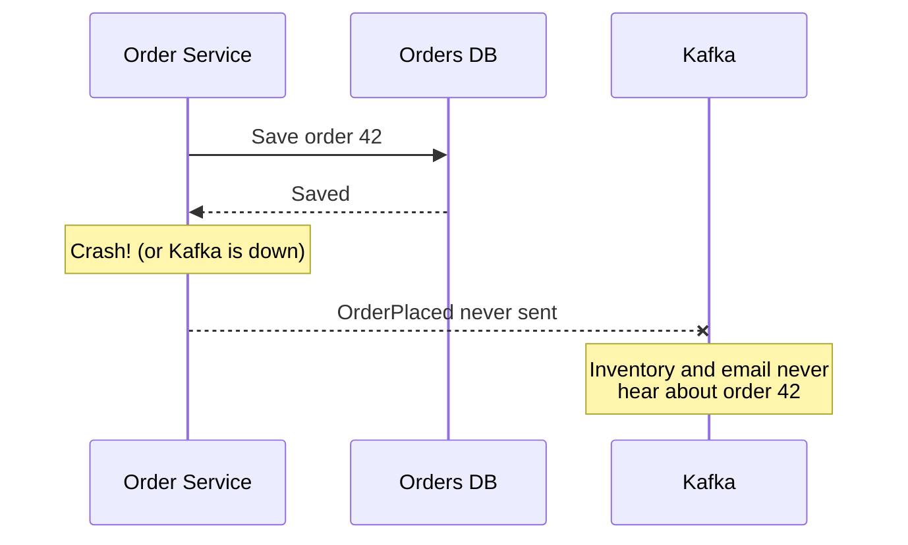
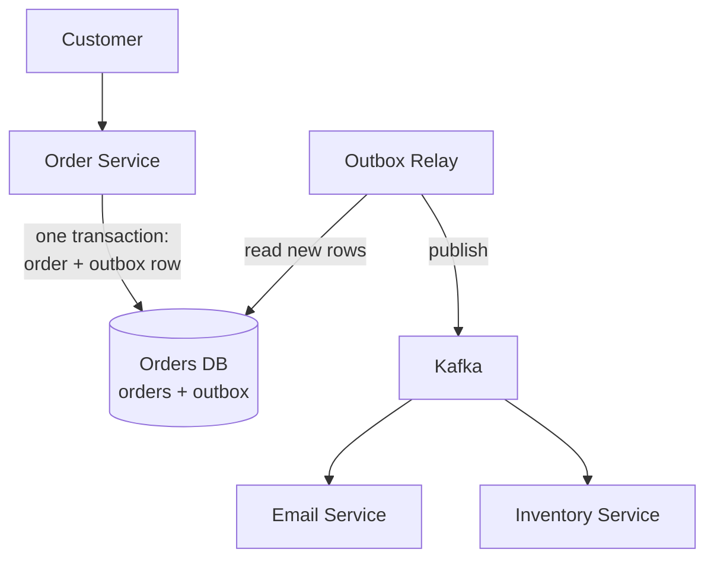
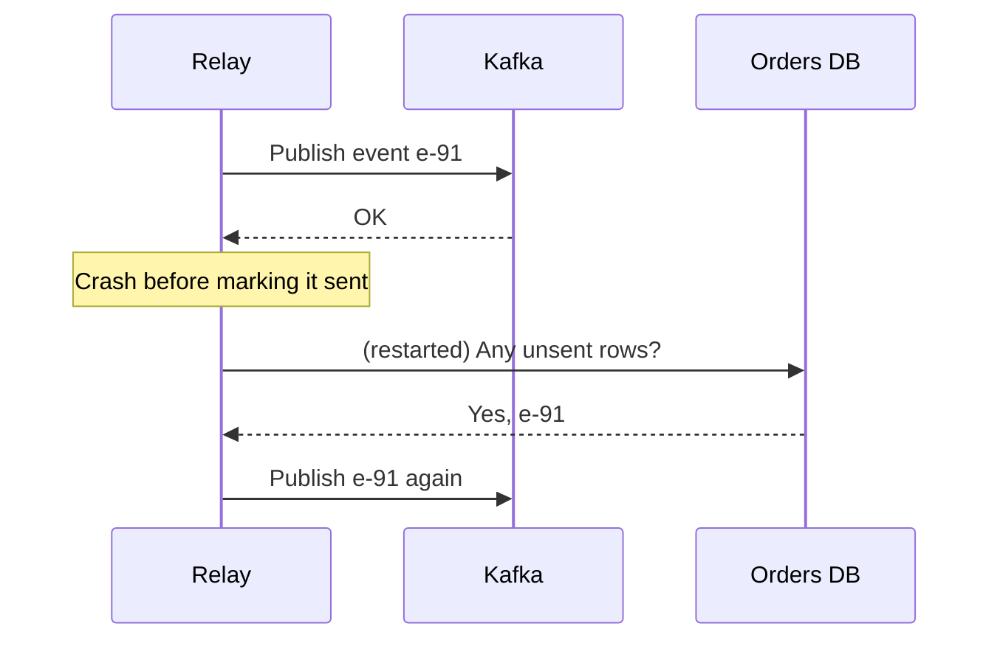

## What is it?

A shop owner makes a sale. She must do two things: write the sale in her **sales book**, and **text the warehouse** to pack the order.

If her phone dies right after she writes the sale, the warehouse never hears about it. The customer waits forever.

The fix: on the **same page** of the sales book, she also writes "To tell warehouse: order 42". An assistant checks the book every few minutes, texts any message not yet sent, and ticks it off. The sale and the note are written **together**, so you can never have one without the other.

That page note is the **outbox**.

## Why do we need it?

When an order is placed, the Order Service must:

1. **Save** the order in its database.
2. **Send** an `OrderPlaced` event to Kafka, so inventory, email and others can react.

These are two different systems. No single transaction covers both. This is called the **dual write problem**.

| Order of steps | What can go wrong |
| --- | --- |
| Save, then send | The order is saved, then the app crashes (or Kafka is down) before sending. **The event is lost.** |
| Send, then save | The event is sent, then the save fails. **Other services act on an order that doesn't exist.** |



## How it works inside

### The outbox table

Instead of sending the event directly, write it into a table called `outbox`, in the **same database** and the **same transaction** as the order. One transaction means both rows are saved, or neither is. (See [Transactions and ACID](../databases/transactions-acid.mdx).)

```sql
BEGIN;

INSERT INTO orders (id, user_id, total, status)
VALUES (42, 7, 500, 'PENDING');

-- seq is filled in by the database (a BIGSERIAL column)
INSERT INTO outbox (id, aggregate_id, topic, payload)
VALUES (gen_random_uuid(), '42', 'orders',
        '{"type": "OrderPlaced", "orderId": 42}');

COMMIT;
```

| Column | What it holds |
| --- | --- |
| `id` | A unique event ID. Consumers use it to spot duplicates |
| `seq` | A number that goes up with every new row (`BIGSERIAL`). Events go out in this order |
| `aggregate_id` | The thing the event is about, here order 42. Used as the Kafka key, so one order's events stay in order |
| `topic` | Where the event should go |
| `payload` | The event itself, as JSON |
| `sent_at` | Empty until the event is sent (used by the polling relay) |

**Why not sort by a `created_at` time?** In PostgreSQL, `now()` is the time the transaction **started**, not when it was saved. Say two transactions change order 42. A starts first, waits for B's lock on the order row, and saves after B. Sorting by time would send A's event before B's: the wrong order. Two events in one transaction would also get the same time. `seq` is handed out when the outbox row is inserted. So change the order row **first** (that takes its lock), then insert the outbox row: a second transaction on the same order then always gets a bigger `seq`.

### A relay that sends the events

A separate process, the **relay**, reads new rows from the outbox, publishes them to Kafka, and marks them as sent.



There are two ways to build the relay:

| Way | How it works | Good | Bad |
| --- | --- | --- | --- |
| **Polling** | Every second or so, read rows where `sent_at` is empty, publish them, then mark them sent | Simple. Works with any database | Extra queries on the database, and a small delay |
| **Log reading (CDC)** | Read the database's own change log and publish each new outbox row | Fast. No polling queries | Needs a tool like Debezium. See [Change Data Capture](./change-data-capture.mdx) |

A simple polling relay:

```js
// This code runs every second.

// 1. Read up to 100 rows that are not sent yet, oldest first
const rows = await db.query(
    "SELECT * FROM outbox WHERE sent_at IS NULL ORDER BY seq LIMIT 100"
);

// 2. Publish each row to Kafka, then mark it as sent
for (const row of rows) {
    await kafka.send({
        topic: row.topic,

        // The order ID: one order's events stay in one partition
        key: row.aggregate_id,

        // So consumers can spot duplicates
        headers: { eventId: row.id },

        value: row.payload,
    });

    await db.query("UPDATE outbox SET sent_at = now() WHERE id = $1", [row.id]);
}
```

Two practical notes:

- **Run one relay at a time**, picked with [leader election](./leader-election-consensus.mdx), and keep a spare ready to take over. If several relays share the table with `FOR UPDATE SKIP LOCKED`, they no longer pick the same rows, but two events for the same order can now be sent by two relays at the same moment and arrive **out of order**. (Those row locks also last only while each relay's transaction stays open.) If one relay is too slow, split the rows between relays by `aggregate_id`, so each order always goes through the same relay.
- **Delete old sent rows** regularly, so the table doesn't grow forever.

### At-least-once delivery

The relay can crash **after** publishing an event but **before** marking it sent. When it restarts, it sees the row as unsent and publishes it **again**.



So the outbox gives **at-least-once delivery**: every event is delivered, never zero times, but **sometimes twice**. (See [Delivery Guarantees](../messaging/delivery-guarantees.mdx).)

That's fine, as long as consumers are **idempotent**. A common way: each consumer keeps a `processed_events` table and saves the event ID **in the same transaction** as its own change. If the ID is already there, it skips the event. This table is sometimes called an **inbox**. See [Idempotency](../messaging/idempotency.mdx).

**Ordering:** the relay sends rows in `seq` order, and uses `aggregate_id` (the order ID) as the Kafka message key. So all events for one order go to the same partition and stay in order. See [Kafka](../messaging/kafka.mdx).

## When to use it

- **A service saves data and other services must hear about it:** `OrderPlaced`, `PaymentReceived`, `UserSignedUp`.
- **Each step of a saga** that publishes an event after its local change. See [Saga Pattern](./saga-pattern.mdx).
- **Sending emails or webhooks** after a database change, where a lost message means an angry customer.

**Don't use it when:**

- **Losing an event now and then is fine**, like a page-view count. Just publish it.
- **Other systems only need a copy of your rows.** Read the change log of the table itself with CDC, no outbox table needed.
- **The events already are your data** ([Event Sourcing](./event-sourcing.mdx)). Publish from the event store.

## Alternatives

| Option | What it is | Pick it when |
| --- | --- | --- |
| **Publish directly** | Save, then send, and accept that an event is lost now and then | A lost event is cheap |
| **CDC on the data tables** | Read the database's change log and publish each row change. No outbox table. See [Change Data Capture](./change-data-capture.mdx) | Consumers want row changes, not hand-made events |
| **Event sourcing** | Save only the events, and build the current state from them | You want the full history anyway |
| **Two-phase commit** | One transaction across the database and the broker | Both support it (XA). Rare today, and it can block. See [Distributed Transactions and 2PC](./distributed-transactions-2pc.mdx) |

## In the real world

**Debezium has a built-in outbox router.** Debezium, a popular open-source tool that reads database change logs, includes an "outbox event router" made for this pattern. It watches the outbox table and sends each new row to the right Kafka topic.

**Cloud providers recommend it.** Both AWS and Microsoft Azure describe the transactional outbox in their official architecture guides, as the way to update a database and publish an event reliably.

**Stripe's webhooks are at-least-once.** Stripe's docs warn that your server may receive the same webhook event more than once, and tell you to make your event handling idempotent. Any system that sends events reliably ends up with duplicates, so the receiver has to handle them.

## In the interview

Bring it up whenever a service saves data **and** publishes an event:

> "Saving the order and publishing OrderPlaced are two writes to two systems. To never lose the event, I'll write it to an outbox table in the same transaction as the order, and a relay will publish it to Kafka. That's at-least-once, so consumers ignore event IDs they've already processed."

<Callout title="Remember this" type="success">
  - **Dual write problem:** saving to the database and sending to a queue can't be one transaction.
  - **Why:** a crash between the two steps **loses the event**, or sends one for an order that doesn't exist.
  - **Outbox:** write the event into an `outbox` table in the **same transaction** as the data.
  - A **relay** reads the outbox and publishes to Kafka, by **polling** or by reading the log (**CDC**).
  - Result: **at-least-once delivery**. Events are never lost, but can arrive **twice**.
  - Consumers must be **idempotent**: skip event IDs they've already seen.
  - **Alternatives:** publish directly (accept loss), CDC on the tables, event sourcing, 2PC.
</Callout>
