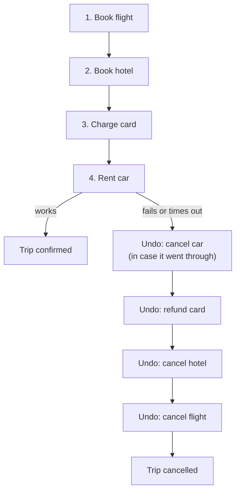
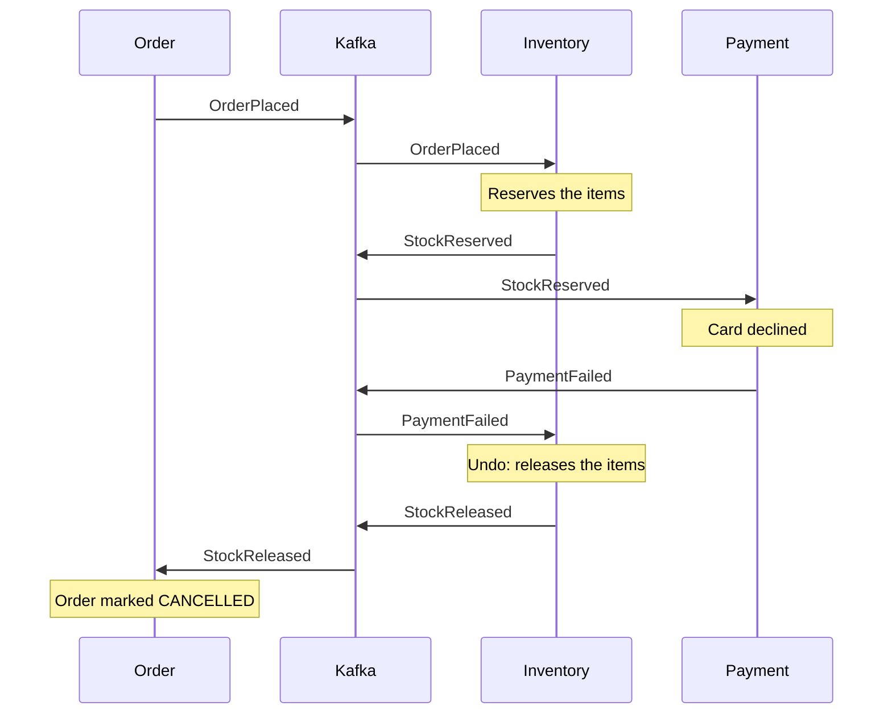
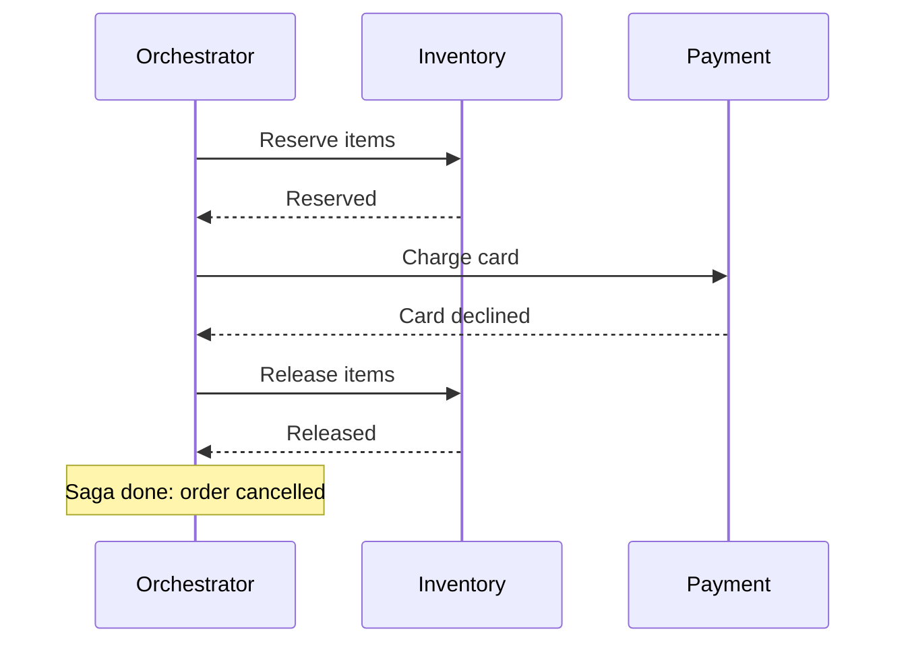

## What is it?

Think of a **travel agent** booking your trip: a flight, then a hotel, then a rental car.

She books them **one at a time**. Each booking is real and confirmed right away. If the car rental fails at the end, she doesn't pretend the flight never happened. She **cancels** the hotel and then **cancels** the flight. The airline still has a record of the booking and of the cancellation.

That is a **saga**: a long task split into steps. Each step is a normal, local transaction inside one service, and it **commits right away**. If a later step fails, the saga runs **undo steps** for the earlier ones, in reverse order.

Unlike [two-phase commit](./distributed-transactions-2pc.mdx), nobody waits and nothing stays locked across services. The price: for a short time, the system is **in between** (flight booked, hotel not yet).

## Why do we need it?

- **Each service has its own database.** One user action, like booking a trip, changes data in the flight, hotel, payment and car services. No single database transaction can cover all of them.
- **Two-phase commit doesn't fit.** It holds locks across services while it waits, gets stuck if the coordinator dies, and an outside API (a payment provider, an airline) can't "prepare". See [Distributed Transactions and 2PC](./distributed-transactions-2pc.mdx).
- **Doing nothing leaves a mess.** If the car step fails, the card is charged and the flight is booked for a trip that will never happen.

A saga accepts that each step commits on its own, and makes sure every failure has a planned way back.

## How it works inside

### A trip-booking saga



| Step | Service | Action | Undo step |
| --- | --- | --- | --- |
| 1 | Flight | Book a seat | Cancel the seat |
| 2 | Hotel | Reserve a room | Cancel the reservation |
| 3 | Payment | Charge the card | Refund the card |
| 4 | Car | Rent a car | Cancel the car. Even the last step needs one: its reply can be lost |

### Undo steps (compensating actions)

The official name for an undo step is a **compensating action**. A few rules make them work:

- **An undo is a new action, not an eraser.** You refund a payment, you don't delete it. Both records stay, which is good for audits.
- **Undo steps must succeed in the end.** If a refund fails, retry it until it works. So undo steps must be **idempotent** (safe to run twice). See [Idempotency](../messaging/idempotency.mdx).
- **Some things can't be undone.** You can't un-send an email or un-ship a parcel. Put those steps **last**, after everything that might fail. Since there is no undo, retry them with an [idempotency key](../messaging/idempotency.mdx) until they work.
- **Others can see the in-between state.** For a moment, a hotel room shows as taken, then becomes free again. Sagas don't give the "I" (isolation) of ACID. Use clear statuses like `PENDING`, `CONFIRMED` and `CANCELLED`, so screens can show "Booking in progress".

## Two ways to run a saga

### Choreography: everyone reacts to events

Like dancers who each know their moves by listening to the music. **Nobody is in charge.** Each service listens for events, does its step, and publishes a new event. (See [Event-Driven Architecture](../messaging/event-driven-architecture.mdx).)



- **Good:** simple for short flows. Services don't call each other directly.
- **Bad:** the flow is spread across many services. Answering "where is order 42 right now?" means reading the logs of every service.

### Orchestration: a conductor in charge

Like an orchestra with a conductor. One service, the **orchestrator**, tells each service what to do, step by step, and remembers where the saga is.



The orchestrator saves its progress in a database after every step. If it crashes, it starts again from the last saved step. Because steps can run twice after a crash, every step must be idempotent.

| | Choreography | Orchestration |
| --- | --- | --- |
| **Who is in charge** | Nobody. Services react to events | One orchestrator |
| **Seeing the whole flow** | Hard. It's spread over many services | Easy. It's in one place |
| **Coupling** | Loose | The orchestrator knows every step |
| **Best for** | Short flows, 2 to 4 steps | Longer flows with many rules |

In an interview, **orchestration is usually easier to explain**, and easier to debug in real life.

If services publish events after saving data, use the [Outbox Pattern](./outbox-pattern.mdx) so no event is lost.

## Tools like Temporal

You can build an orchestrator yourself, but tools do the hard parts (saving progress, retries, timers):

| Tool | What it is |
| --- | --- |
| **Temporal** | You write the saga as normal code. Temporal saves the result of every step, so after a crash the code continues from where it stopped |
| **AWS Step Functions** | You describe the steps as a diagram of states. AWS runs it and retries steps |
| **Conductor** | An open-source orchestration engine first built at Netflix. Netflix stopped maintaining it in December 2023. It lives on as **Conductor OSS**, maintained by Orkes and the community |

Here is the shape of a saga as code. With a tool like Temporal, each call is saved, so a crash halfway doesn't lose the progress:

```js
async function bookTrip(trip) {
    // A list of undo functions. "() => cancelFlight(trip)" is a small
    // function: we save it now, and call it later only if something fails.
    const undoSteps = [];

    try {
        // Add each undo BEFORE its step runs (see below why)
        undoSteps.push(() => cancelFlight(trip));
        await bookFlight(trip);

        undoSteps.push(() => cancelHotel(trip));
        await bookHotel(trip);

        undoSteps.push(() => refundCard(trip));
        await chargeCard(trip);

        // The last step too: its reply can be lost
        undoSteps.push(() => cancelCar(trip));
        await rentCar(trip);
    } catch (error) {
        // Undo in reverse order: the newest step first
        undoSteps.reverse();

        for (const undoStep of undoSteps) {
            // Retry with backoff until it works
            await retryUntilDone(undoStep);
        }

        throw error;
    }
}
```

Two details matter here:

- **The undo is added before its step.** Say `chargeCard` works, but its reply is lost and the call times out. If the refund were only added after a successful call, it would never run, and the customer would pay for a cancelled trip. So each undo is added first, and every undo must be **safe even if its step never happened**: "refund the payment for trip 42" does nothing if there is no payment. This holds for the **last** step too: if `rentCar` times out, the car may be rented, so `cancelCar` must be in the list.
- **Each undo is retried until it works.** A plain `await step()` would stop at the first failing undo and leave the rest undone. Undo steps must succeed in the end, so they are retried, and they are idempotent, so retries are safe.

## When to use it

- **One user action changes data in several services:** checkout, booking a trip, moving money between two services.
- **A step calls an outside API** that can't take part in a transaction, like a payment provider.
- **The flow is long:** seconds, hours or days, like an order that waits for the warehouse.

**Don't use it when:**

- **All the data is in one database.** Use a normal transaction. It is simpler and fully safe.
- **Users must never see the in-between state.** A saga has no isolation, so others can see "flight booked, hotel not yet".
- **A middle step can't be undone, and can't be moved to the end.**
- **You only need to save data and publish one event.** That is the [Outbox Pattern](./outbox-pattern.mdx), not a saga.

## Alternatives

| Option | What it is | Pick it when |
| --- | --- | --- |
| **One database transaction** | Keep the data in one database and use `BEGIN ... COMMIT` | The data can live in one service. Always the simplest |
| **Two-phase commit** | One all-or-nothing commit across databases, with locks held during the vote | A few databases inside one system, with short transactions |
| **Try-Confirm-Cancel (TCC)** | Each service first **holds** the resource (try), then confirms or releases it | You want "reserved, then confirmed" instead of "done, then undone", like holding a seat |
| **Fix it later (reconciliation)** | Let steps run. A nightly job or a person finds and fixes the rare mismatch | Failures are rare and cheap to fix by hand |

## In the real world

**The idea is from 1987.** The word "saga" comes from a 1987 paper by Hector Garcia-Molina and Kenneth Salem. It described long transactions split into steps, each with a compensating step. Microservices made the idea popular again.

**Uber built Cadence, which became Temporal.** Uber built Cadence to run long, reliable workflows. Its creators later started Temporal, which grew out of Cadence.

**AWS documents the saga pattern.** AWS publishes a guide for building a saga with Step Functions, using a travel booking as the example: each booking step has a matching cancel step that runs if a later step fails.

## In the interview

Use a saga whenever one user action changes data in several services, like checkout or booking:

> "Checkout is a saga run by an orchestrator: reserve stock, charge the card, create the shipment. If creating the shipment fails or times out, the orchestrator cancels the shipment in case it went through, refunds the card and releases the stock. Every step is idempotent, so retries after a crash are safe."

<Callout title="Remember this" type="success">
  - A **saga** = a long flow split into local steps that each **commit right away**.
  - **Why:** one action spans many services and databases. No single transaction covers them, and 2PC locks and blocks.
  - If a step fails, run **compensating actions** (undo steps) for earlier steps, in **reverse order**.
  - Undo is a **new action** (refund), not an eraser. It must be **idempotent** and retried until it works.
  - Add each undo **before** its step runs, even for the last step: a lost reply doesn't mean it failed.
  - Put steps that **can't be undone** (emails, shipping) **last**, and retry them until they work.
  - **Choreography** = services react to events. **Orchestration** = one conductor. Orchestration is easier to follow.
  - Tools: **Temporal**, AWS Step Functions, Conductor OSS (first built at Netflix).
  - **Alternatives:** one database transaction, 2PC, Try-Confirm-Cancel, nightly reconciliation.
</Callout>
