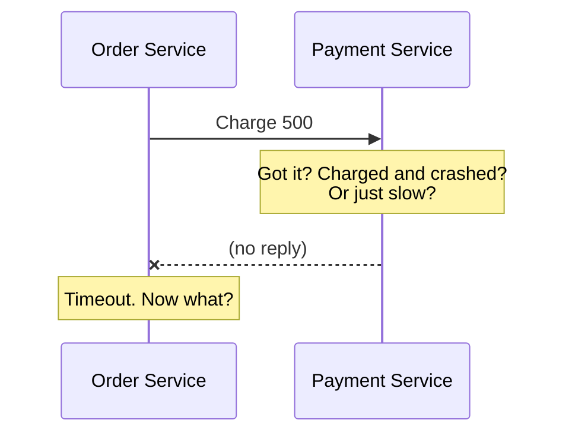
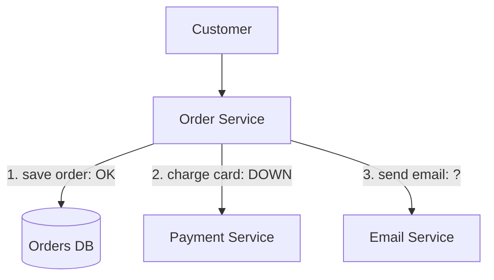

## The idea

A **distributed system** is a group of computers that work together over a network and look like **one system** to the user. When you open Instagram, your request may touch dozens of servers in different buildings. To you, it is just "Instagram".

Think of cooking dinner:

- **One cook in one kitchen** always knows what they did. If they drop a plate, they see it.
- **A team of cooks in different kitchens, who can only talk by text message**, has new problems. Messages arrive late or get lost. One cook faints, and nobody notices for a while. When a cook stops replying, you can't tell if they are busy or gone.

So why use many machines at all? Because one machine is not enough. It can't serve millions of users, it can't hold all the data, and when it dies, everything dies. Many machines fix that, but bring problems one machine never has.

## Why use many machines?

| Reason | Example |
| --- | --- |
| **More users** than one machine can serve | Millions of requests per second |
| **More data** than one machine can hold | Billions of photos and videos |
| **Survive failures** | One server dies, the others keep going |
| **Be close to users** | Servers in Europe for European users, in India for Indian users |

## Problem 1: the network is not reliable

Machines talk by sending messages over the network. A message can be:

- **lost** on the way
- **late**, by a few milliseconds or by many seconds
- **duplicated**, because someone retried
- **out of order**, so message 2 arrives before message 1

The worst part: **when you get no reply, you can't know what happened.**

| What really happened | Was the card charged? |
| --- | --- |
| The request was lost on the way | No |
| The server charged the card, then the reply was lost | Yes |
| The server is just slow, and the reply comes later | Yes, a bit later |

From the Order Service's side, all three look the same: silence. That is why distributed systems use **timeouts** (stop waiting after a set time), **retries** (try again), and make retries safe with [idempotency](../messaging/idempotency.mdx), so a retry never charges twice. See [Retries, Backoff and Timeouts](../messaging/retries-backoff-timeouts.mdx).

## Problem 2: slow looks the same as dead

You decide a server is dead when it doesn't answer within the timeout. But there is no perfect timeout:

- **Too short:** you give up on healthy servers that were only a little slow, and you retry work that was already done.
- **Too long:** users wait a long time before you notice a server really is dead.

A server can also **pause** without knowing it. A long garbage-collection pause (the program freezes while it cleans up memory) can stop a server for seconds. To everyone else, it looks dead. Then it wakes up and carries on as if nothing happened.

## Problem 3: partial failures

On one machine, failures are usually total: the program crashes, you restart it.

In a distributed system, **some parts fail while others keep working**. This is called a **partial failure**, and it is the hardest kind.

The order is saved, but the payment failed, and nobody knows if the email went out. The data is now **half done**. Some patterns exist to clean up exactly this mess: [Distributed Transactions and 2PC](./distributed-transactions-2pc.mdx), [Saga Pattern](./saga-pattern.mdx) and [Outbox Pattern](./outbox-pattern.mdx).

## Problem 4: no shared clock, no shared memory

- **No shared clock.** Every machine has its own clock, and the clocks drift apart. You can't trust timestamps to tell which event happened first. See [Clocks](./clocks.mdx).
- **No shared memory.** One machine can't simply look at another machine's data. To agree on anything (who is the leader, who holds a lock, which write wins), machines must send messages over the unreliable network. See [Leader Election and Consensus](./leader-election-consensus.mdx) and [Distributed Locking](./distributed-locking.mdx).

## The fallacies of distributed computing

In the 1990s, engineers at Sun Microsystems (L Peter Deutsch and others) wrote down eight **false beliefs** that programmers often have about networks. Each one leads to bugs.

| False belief | The truth |
| --- | --- |
| The network is reliable | Messages get lost |
| Latency is zero | Every network call takes time (**latency** = delay). Far more than a call inside one program |
| Bandwidth is infinite | There is a limit on how much data can move per second (**bandwidth**). Big messages are slow |
| The network is secure | Others may read or change data on the way. Use TLS |
| Topology doesn't change | The map of machines and links (**topology**) changes all the time. Servers come and go |
| There is one administrator | Many teams and companies control different parts |
| Transport cost is zero | Moving data costs time and money. Cloud providers charge for data transfer |
| The network is homogeneous | Machines use different hardware, systems and protocols |

## The toolbox

| Problem | Tools | Read more |
| --- | --- | --- |
| Lost, late or duplicate messages | Timeouts, retries, idempotency | [Idempotency](../messaging/idempotency.mdx) |
| Half-done work across services | Sagas, outbox | [Saga Pattern](./saga-pattern.mdx) |
| A server dies | Copies of data, failover | [Replication](../databases/replication.mdx) |
| Machines must agree | Consensus, leader election | [Leader Election](./leader-election-consensus.mdx) |
| No shared clock | Logical clocks, ID generators | [Clocks](./clocks.mdx) |
| The network splits | Choose consistency or availability | [CAP Theorem](./cap-theorem.mdx) |

## In the real world

**Facebook, October 2021.** During routine maintenance, a command meant to check the capacity of Facebook's backbone network (the private network that links its data centers) by mistake cut all of those links. Facebook, Instagram and WhatsApp were down for about six hours. Engineers had to go to the data centers in person, because their remote tools needed the same broken network.

**GitHub, October 2018.** Maintenance work cut the link between GitHub's main US East Coast data center and its network hub for **43 seconds**. In that short time, the automatic failover tool moved the main MySQL databases to the West Coast. Some writes had reached the East Coast but were not copied yet. GitHub ran in a degraded state for about **24 hours** while engineers put the data back together. A 43-second network blip became a one-day incident.

**"Everything fails, all the time."** This is a well-known saying of Werner Vogels, Amazon's CTO. Big systems are built on the idea that some part is always broken.

## In the interview

Don't give a lecture on theory. Instead, whenever you draw an arrow between two services, say what happens when that call fails or times out:

> "The call from the Order Service to the Payment Service can time out. A timeout doesn't tell us whether the charge happened, so we retry with an idempotency key, and the Payment Service ignores the duplicate."

<Callout title="Remember this" type="success">
  - A **distributed system** = many machines that talk over a network and act as one.
  - Messages can be **lost, late, duplicated or out of order**.
  - **No reply tells you nothing.** Slow looks the same as dead.
  - **Partial failures:** some parts work while others fail, leaving work half done.
  - **No shared clock.** Don't trust timestamps across machines.
  - Fix with **timeouts, retries + idempotency, copies of data**, and patterns like **sagas** and the **outbox**.
</Callout>
