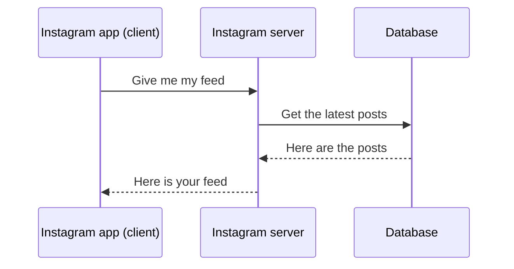
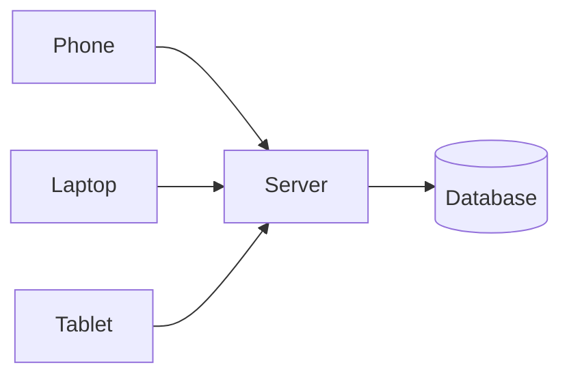
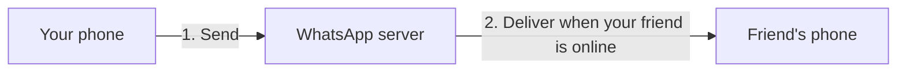

## What is it?

Almost every app works like this:

- A **client** asks for something.
- A **server** does the work and sends back an answer.

Think of a restaurant. You (the **client**) order a pizza. The kitchen (the **server**) makes it and sends it to your table. You never go into the kitchen. You just ask, and you get what you asked for.

### What is a client?

The client is the thing the user uses. For example:

- A web browser, like Chrome
- A mobile app, like Instagram
- **Another server.** When your server asks a payment company to charge a card, your server is the client.

### What is a server?

A server is a computer that runs all the time and waits for requests. It does the real work:

- Checks who you are (login)
- Reads and saves data
- Follows the business rules, like "a user can't buy a ticket that is sold out"

Servers usually live in a data center or in the cloud, like AWS or Google Cloud.

## Why do we need it?

Why not let the app on each phone do everything by itself? Three things break.

**1. Shared data.** Your friend's posts are not on your phone. They are on the server, in one place, so everyone sees the same posts.

**2. Safety.** You can't trust the client. Anyone can change the app on their own phone or browser.

> Example: a shop checks the price **on the client**. A user changes the price from 1,000 to 1 in their browser and buys the item for 1. If the price check happens **on the server**, this trick does not work.

So every important check must happen on the server.

**3. Power.** A server can be a big, fast machine. A phone has a small battery and little memory.

## How it works inside

### A real example

You open Instagram on your phone.

1. The Instagram app on your phone (the **client**) asks: "Give me my feed."
2. Instagram's **server** gets the latest posts from its **database**.
3. The server sends the posts back to your phone.
4. The app shows them on your screen.

### One request, step by step

Under the hood, every request takes the same steps:

1. **Find the server.** The client turns a name like `api.instagram.com` into an IP address, using [DNS](./dns.mdx).
2. **Open a connection.** It opens a **TCP** connection to that IP address and a **port**, usually `443` for HTTPS. See [IP Addresses and Ports](./ip-addresses-and-ports.mdx) and [TCP vs UDP](./tcp-vs-udp.mdx).
3. **Send a request.** It sends an **HTTP request**: a method, a path, headers, and sometimes a body. See [HTTP and HTTPS](./http-and-https.mdx).
4. **Do the work.** The server program is always **listening** on that port. It reads the request, checks who you are, runs the business rules, and reads or writes the database.
5. **Send a response.** The server sends back a **status code** and the data. The client shows it on the screen.

The **client always starts** the conversation. The server only answers. To let the server send data first, see [Polling, WebSockets and SSE](./polling-websockets-sse.mdx).

### One server, many clients

One server can answer many clients at the same time.

A server does this in one of two ways:

- **A thread per request:** each request gets its own worker thread from a pool. Classic Java servers work like this.
- **An event loop:** one thread juggles many open connections. While one request waits for the database, it works on another. Node.js and Nginx work like this.

But when millions of people use the app, one server is not enough. Then we use many servers working together. Making that work well is what system design is all about.

## When to use it

Almost always. It fits when:

- Many users must see the **same data**: posts, orders, a bank balance.
- You need **rules you can trust**: prices, payments, logins.
- The work is **too heavy for a phone**: search, video encoding, AI models.

**Don't use it when:**

- Many users share **big files** with each other. A central server would pay for all that traffic. Peer-to-peer fits better.
- **Delay must be as low as possible between two users**, like a video call. Calls often send the audio and video straight between the two devices, and use a server only to connect them.
- The app works **only on the device**, like a calculator. There is nothing to share, so no server is needed.

## Alternatives

| Option | What it is | Pick it when |
| --- | --- | --- |
| **Peer-to-peer (P2P)** | Devices talk to each other directly. There is no central server. BitTorrent shares files this way | Many users share big files, and no one wants to pay for one big server |
| **Hybrid** | A server helps two devices find each other, then they talk directly | Video calls (WebRTC): lower delay and less traffic through the server |
| **Local-first (offline-first)** | The app keeps its data on the device and syncs with a server later | Notes or to-do apps that must work without internet |

P2P is rare in interviews. Just know that it exists.

## In the real world

**WhatsApp's ticks.** When you send a message, your phone (the client) sends it to WhatsApp's servers first. The ticks tell you where the message is:

- **One grey tick:** it reached WhatsApp's server.
- **Two grey ticks:** the server delivered it to your friend's phone.
- **Two blue ticks:** your friend read it.

If your friend's phone is off, the message waits on the server. When the phone comes back online, the server delivers it and then deletes its copy.

## In the interview

Almost every design starts with **Client → Server → Database**. Draw this first, then improve it. And say out loud where the checks happen:

> "The client only shows data. All important checks happen on the server, because we can't trust the client."

<Callout title="Remember this" type="success">
  - The **client** asks. The **server** does the work and answers.
  - A client can be a browser, a mobile app, or even another server.
  - **Never trust the client.** Do important checks on the server.
  - One server can serve many clients. Big apps use many servers.
  - Every design starts with **Client → Server → Database**.
  - **Why:** one place for **shared data**, **checks you can trust**, and **more power** than a phone.
  - **Inside:** DNS finds the server, TCP connects to a port, HTTP request in, response out. The **client always starts**.
  - **Alternatives:** peer-to-peer (BitTorrent), hybrid (video calls), local-first apps.
</Callout>
