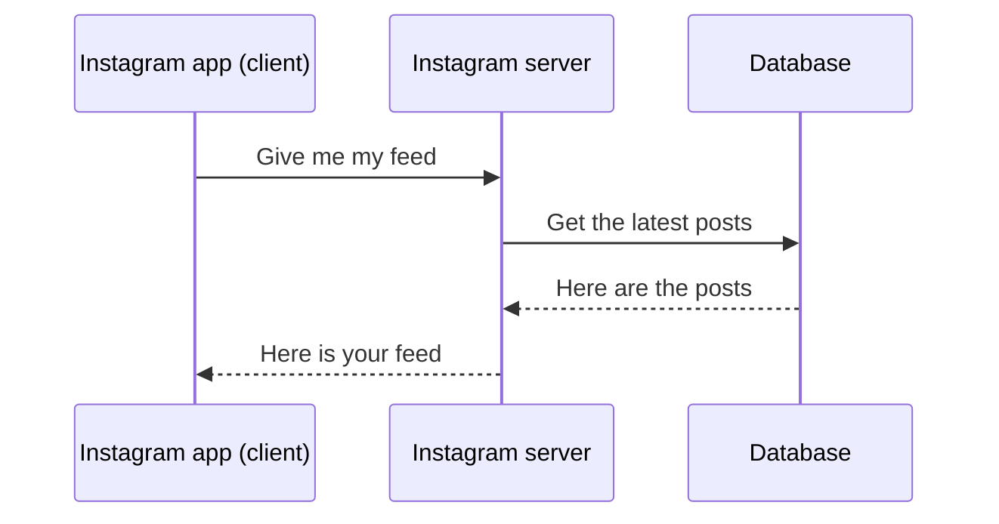
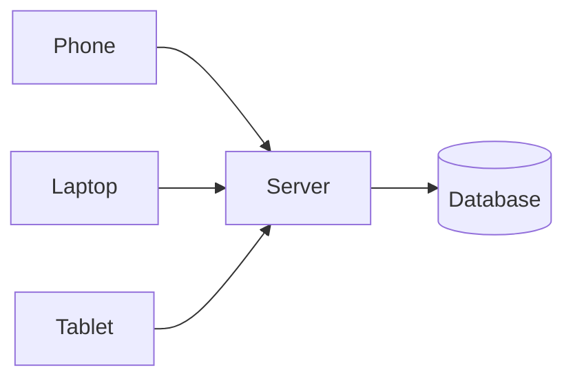
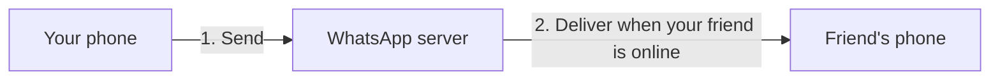

## The idea

Almost every app works like this:

- A **client** asks for something.
- A **server** does the work and sends back an answer.

Think of a restaurant. You (the **client**) order a pizza. The kitchen (the **server**) makes it and sends it to your table. You never go into the kitchen. You just ask, and you get what you asked for.

## A real example

You open Instagram on your phone.

1. The Instagram app on your phone (the **client**) asks: "Give me my feed."
2. Instagram's **server** gets the latest posts from its **database**.
3. The server sends the posts back to your phone.
4. The app shows them on your screen.

## What is a client?

The client is the thing the user uses. For example:

- A web browser, like Chrome
- A mobile app, like Instagram
- **Another server.** When your server asks a payment company to charge a card, your server is the client.

## What is a server?

A server is a computer that runs all the time and waits for requests. It does the real work:

- Checks who you are (login)
- Reads and saves data
- Follows the business rules, like "a user can't buy a ticket that is sold out"

Servers usually live in a data center or in the cloud, like AWS or Google Cloud.

## Why not do everything on the client?

**1. Shared data.** Your friend's posts are not on your phone. They are on the server, in one place, so everyone sees the same posts.

**2. Safety.** You can't trust the client. Anyone can change the app on their own phone or browser.

> Example: a shop checks the price **on the client**. A user changes the price from 1,000 to 1 in their browser and buys the item for 1. If the price check happens **on the server**, this trick does not work.

So every important check must happen on the server.

**3. Power.** A server can be a big, fast machine. A phone has a small battery and little memory.

## One server, many clients

One server can answer many clients at the same time.

But when millions of people use the app, one server is not enough. Then we use many servers working together. Making that work well is what system design is all about.

## The other way: peer-to-peer

In **peer-to-peer (P2P)**, devices talk to each other directly. There is no central server. For example, BitTorrent shares files this way.

It is rare in interviews. Just know that it exists.

## In the real world

**WhatsApp's ticks.** When you send a message, your phone (the client) sends it to WhatsApp's servers first. The ticks tell you where the message is:

- **One grey tick:** it reached WhatsApp's server.
- **Two grey ticks:** the server delivered it to your friend's phone.
- **Two blue ticks:** your friend read it.

If your friend's phone is off, the message waits on the server. When the phone comes back online, the server delivers it and then deletes its copy.

## In the interview

Almost every design starts with **Client → Server → Database**. Draw this first, then improve it. And say out loud where the checks happen:

> "The client only shows data. All important checks happen on the server, because we can't trust the client."

<Callout title="Remember this" type="success">
  - The **client** asks. The **server** does the work and answers.
  - A client can be a browser, a mobile app, or even another server.
  - **Never trust the client.** Do important checks on the server.
  - One server can serve many clients. Big apps use many servers.
  - Every design starts with **Client → Server → Database**.
</Callout>
