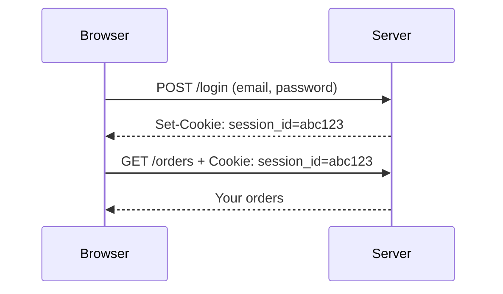
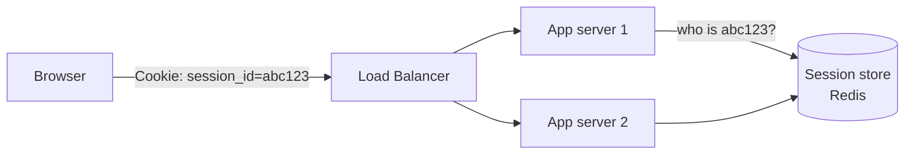
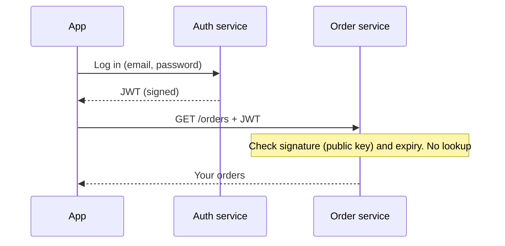

## The idea

HTTP forgets you after every request (see [HTTP and HTTPS](./http-and-https.mdx)). So how does a website keep you logged in? There are two common ways:

- **Session:** the server keeps your details and gives you a **ticket number**. Like a coat check: you hand over your coat and get token #27. Next time, you show #27, and they find your coat.
- **JWT:** the server gives you a **signed card** with your details written on it. Like a stamped event wristband: the staff only check that the stamp is real. They don't need to look you up in a list.

**Cookies** are the pocket where the browser keeps that ticket or card, and shows it automatically on every visit.

## Cookies

A **cookie** is a small piece of data (up to about 4 KB) that a server asks the browser to keep.

1. The server sends: `Set-Cookie: session_id=abc123`
2. From then on, the browser **automatically** adds `Cookie: session_id=abc123` to every request to that site.



Cookies have settings (flags) that keep them safe:

| Flag | What it does |
| --- | --- |
| `HttpOnly` | JavaScript on the page **can't read** the cookie, so a malicious script can't steal it |
| `Secure` | Only sent over **HTTPS** |
| `SameSite` | Not sent when **another site** triggers the request. Protects against fake requests from other sites (CSRF) |
| `Max-Age` / `Expires` | When the cookie runs out |

## Sessions

1. You log in.
2. The server creates a **session record**: "session `abc123` = user 7, logged in at 10:00".
3. It stores the record in a fast **session store**, usually Redis.
4. It sends you only the **session ID**, in a cookie.
5. On every request, the server looks up the session ID to find out who you are.



Because sessions live in Redis and not inside one app server, **any** server can handle **any** request. The app servers stay stateless (see [Stateless vs Stateful Servers](../hld-basics/stateless-vs-stateful.mdx)).

- **Good:** logging out is easy. Delete the session, and the user is logged out everywhere, instantly.
- **Bad:** every request needs a lookup in the session store.

## JWT (JSON Web Token)

A JWT is a token made of three parts, joined by dots: **header.payload.signature**.

```txt
eyJhbGciOiJSUzI1NiJ9.eyJ1c2VySWQiOjcsInJvbGUiOiJ1c2VyIiwiZXhwIjoxNzY0MDAwMDAwfQ.k3J9...
```

The middle part (the payload) is just JSON, encoded:

```json
{ "userId": 7, "role": "user", "exp": 1764000000 }
```

- The auth service **signs** the token with a **private key** that only it has. If anyone changes even one letter of the payload, the signature stops matching, and the token is rejected.
- The token is **signed, not encrypted**. Anyone can read the payload. **Never put secrets in it.**
- To check a JWT, a server checks the **signature** and the **expiry time** (`exp`). **No database lookup.**
- Other services check the signature with the matching **public key** (algorithms like `RS256` or `ES256`). A public key can check tokens but can't make them. With one shared secret (`HS256`), every service that can check tokens could also make fake ones.
- Mobile apps and other services send it in a header: `Authorization: Bearer <the token>`. In a browser, keep it in an `HttpOnly` cookie instead. A token that JavaScript can read can be stolen by a malicious script.



**The big problem:** you can't easily take a JWT back. It stays valid until it expires. The usual fix:

- A short-lived **access token** (like 15 minutes) that is sent with every request.
- A longer-lived **refresh token**, used only to get a new access token. It can be cancelled on the server.

## Sessions vs JWT

| | Sessions | JWT |
| --- | --- | --- |
| **Where your details live** | On the server (Redis or a database) | Inside the token |
| **Check on each request** | Look up the session | Check the signature |
| **Logging out** | Easy: delete the session | Hard: wait for it to expire, or keep a block list |
| **Size** | A small ID | Bigger (the whole payload) |
| **Best for** | Normal websites with one backend | Many services, mobile apps, "log in with" flows |

**Simple rule:** a normal website → **sessions in a cookie**. Many services or mobile apps → **short JWTs + refresh tokens**.

## Keeping them safe

- Always use **HTTPS**, and mark cookies `Secure`.
- Use `HttpOnly` cookies, so scripts can't steal them.
- Use `SameSite` cookies (or CSRF tokens) to block fake requests from other sites.
- Keep tokens **short-lived**, and replace refresh tokens each time they are used.
- **Never** put passwords or secrets inside a JWT.

## In the real world

**Facebook's "View As" bug (2018).** A bug let attackers steal **access tokens**. Facebook first said about 50 million accounts were hit, and later found that tokens for about 30 million were actually stolen. With a token, they could act as that user without a password. Facebook's fix was to **cancel the tokens** of about 90 million accounts, which logged all those people out. Tokens are keys: if they leak, you must be able to cancel them.

**The "alg: none" JWT bug (2015).** Some popular JWT libraries accepted tokens that said "no signature needed" in their header. Attackers could write any payload they liked. The lesson: always check the signature with the algorithm **you** expect, never the one the token asks for.

**"Log in with Google" gives you a JWT.** When an app uses Google sign-in, Google sends back an **ID token**, which is a JWT describing the user. See [OAuth 2.0 and OpenID Connect](../reliability-security/oauth-oidc.mdx).

## In the interview

Say how users stay logged in, and why:

> "Users log in through an auth service that returns a short-lived JWT and a refresh token. Every service checks the JWT signature itself with the auth service's public key, so there's no database lookup on each request."

<Callout title="Remember this" type="success">
  - **Cookies:** small data the browser keeps and sends back **automatically**.
  - **Session:** the server stores your details. The cookie holds only an **ID**. Easy to log out.
  - **JWT:** a **signed** token holding your details. No lookup, but **hard to cancel**.
  - JWTs are signed, **not encrypted**. Never put secrets inside.
  - Sign with a **private key** (`RS256`), check with the **public key**, and check `exp`. In browsers, keep tokens in `HttpOnly` cookies.
  - Use **short access tokens + refresh tokens**.
  - Cookie flags: `HttpOnly`, `Secure`, `SameSite`.
</Callout>
