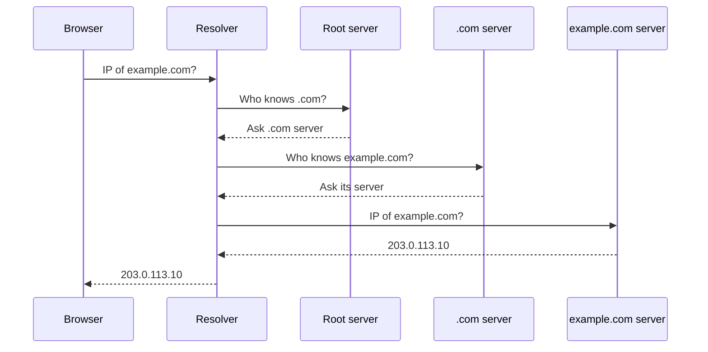
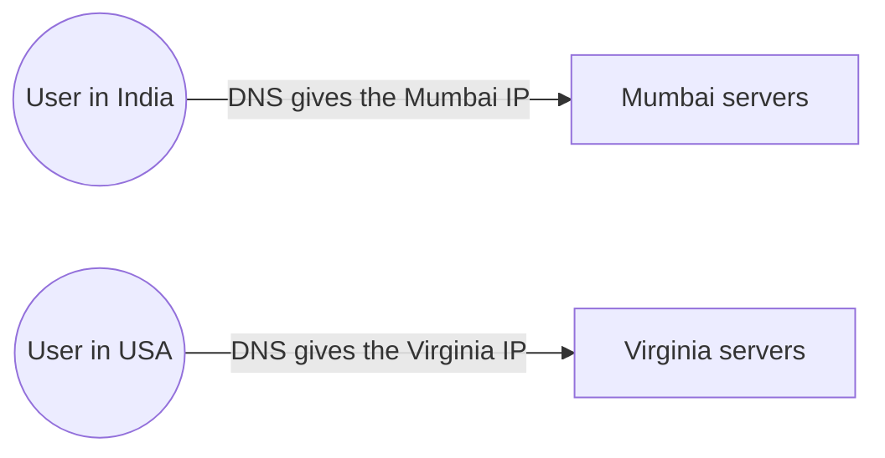

## What is it?

Computers find each other with IP addresses like `142.250.183.14`. People can't remember numbers like that, so we use names like `google.com`.

**DNS** (Domain Name System) turns a **name** into an **IP address**.

Think of the contacts on your phone. You tap "Mom", and the phone dials her number. You don't remember the number. Your contact list does. **DNS is the contact list of the internet.**

## Why do we need it?

Names are easier to remember, but that is not the only reason:

- **IP addresses change.** You move to a new server or a new cloud, and the IP changes. With DNS you change one record, and every user still types the same name.
- **One name can point to many servers**, in many places. DNS can give each user a different answer.
- **One big list doesn't scale.** Before DNS, every computer kept one file of all names and IPs (`HOSTS.TXT`), copied from one central place. As the network grew, the file changed every day and got too big. DNS replaced it in 1983. It splits the work: each domain owner runs (or rents) the servers for its own names. Your computer still has a small `hosts` file today.

## How it works inside

### What happens when you type a website name

Say you type `www.example.com`. The computer checks a few places, from fastest to slowest:

1. **Browser cache:** "Did I look this up a few minutes ago?" If yes, done.
2. **Computer (OS) cache:** "Does this computer remember it?" If yes, done.
3. **DNS resolver:** your computer asks a DNS resolver. This is usually run by your internet company, or a public one like Google (`8.8.8.8`) or Cloudflare (`1.1.1.1`). If the resolver has the answer saved, it replies right away.
4. **The full lookup:** if nobody has the answer saved, the resolver asks around, step by step:

- The **root server** knows where to find `.com`, `.org`, `.in` and so on.
- The **.com server** knows which name server is in charge of `example.com`.
- The **name server of example.com** knows the real answer.

The resolver then **saves (caches) the answer**, so the next person gets it right away. Because of caching, the full lookup is rare. Most lookups take just a few milliseconds.

### Caching and TTL

Every DNS answer comes with a **TTL** (time to live). It says how long others may keep the answer. For example, `TTL = 300` means "keep it for 5 minutes".

| TTL | Good | Bad |
| --- | --- | --- |
| **Long** (like 1 day) | Fewer lookups, so faster | If you change the IP, some users still go to the old one for up to a day |
| **Short** (like 1 minute) | Changes reach everyone quickly | More lookups |

**Tip:** before you move your site to a new server, lower the TTL a day early. Then the switch reaches everyone quickly.

### Record types to know

DNS stores different kinds of records:

| Type | What it does | Example |
| --- | --- | --- |
| **A** | Name → IPv4 address | `example.com` → `203.0.113.10` |
| **AAAA** | Name → IPv6 address | `example.com` → `2001:db8::10` |
| **CNAME** | Name → another name (an alias) | `www.example.com` → `example.com` |
| **MX** | Where to send email for this domain | `example.com` → `mail.example.com` |
| **NS** | Which name servers are in charge of this domain | `example.com` → `ns1.example.com` |

### Built to survive failures

- A lookup is usually **one small UDP packet** each way, on port **53**, so it is fast. If the answer is too big, DNS switches to TCP.
- Every domain has **at least two name servers**. If one does not answer, the resolver asks the other.
- There are only **13 root server names**, but each one runs on many machines around the world, all sharing the same IP (anycast, below). So the root of DNS never sits in one place.

## When to use it

**1. Send users to the nearest server.** DNS can give a different answer depending on where the user is. This is called **GeoDNS**.

A related trick is **anycast**: many servers around the world share the **same IP address**, and the internet's routers send each user to the nearest one. Cloudflare's `1.1.1.1` resolver and its CDN both work this way.

**2. Simple load balancing.** DNS can return several IP addresses for one name, and each client picks one. It is simple, but slow to react when a server dies, because the old answers stay cached. That is why we usually put a real **load balancer** behind DNS.

**3. Failover.** If a whole region goes down, you can point DNS to another region. But because of caching, the switch is **not instant**.

**Don't use it when:**

- You need to **remove a dead server in seconds**. Cached answers keep sending users to it until the TTL ends, and some clients keep them even longer. Use a load balancer with health checks.
- Servers **come and go every few seconds**, like inside a cluster. DNS answers go stale. A service registry keeps up better.

## Alternatives

| Option | What it is | Pick it when |
| --- | --- | --- |
| **hosts file** | A file on one computer that maps names to IPs (`/etc/hosts`) | Testing on your own machine |
| **Load balancer** | One fixed address that spreads traffic and drops dead servers in seconds | Fast failover inside a region. See [Load Balancing](../hld-basics/load-balancing.mdx) |
| **Anycast** | Many servers share one IP, and routers send each user to the nearest | Global routing that does not wait for DNS caches to expire |
| **Service registry** (like Consul) | A live list of healthy servers that services ask directly | Internal services that come and go often. See [Health Checks and Service Discovery](../hld-basics/health-checks-service-discovery.mdx) |

## In the real world

**Facebook's 6-hour outage (October 2021).** A mistake during maintenance cut Facebook's data centers off from the internet. Their DNS servers could not be reached either. Phones all over the world asked "What is the IP of facebook.com?" and got no answer. Facebook, Instagram and WhatsApp were down for about 6 hours.

**The attack on Dyn (October 2016).** Attackers flooded Dyn, a big DNS company, with fake traffic. Many people could not open Twitter, Netflix, Reddit or Spotify for hours, even though those companies' own servers were working fine. Since then, many big companies use **more than one DNS provider**.

**The lesson:** if DNS breaks, nobody can find your site, even when every server is healthy.

## In the interview

Draw DNS only when it matters, like when users are all over the world:

> "DNS sends each user to the nearest region. Inside each region, a load balancer spreads the traffic across servers."

<Callout title="Remember this" type="success">
  - DNS turns **names into IP addresses**. It is the internet's contact list.
  - Lookup order: **browser cache → computer cache → resolver → root → .com → the domain's name server**.
  - Answers are **cached for the TTL**, so DNS changes are not instant.
  - **A** = IPv4, **AAAA** = IPv6, **CNAME** = an alias to another name.
  - **GeoDNS** sends users to the nearest region. A **load balancer** does the rest.
  - **Why:** IPs change, one name can point to many servers, and one central list of all names doesn't scale.
  - **Inside:** small **UDP** packets on port **53**, at least **two name servers** per domain, root servers copied around the world.
  - **Alternatives:** a hosts file, a load balancer, anycast, a service registry.
</Callout>
