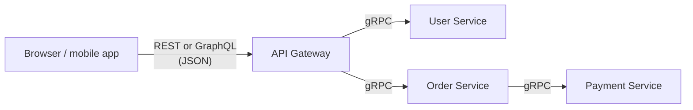
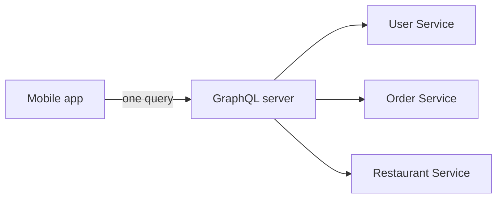

## What is it?

[REST](./rest-apis.mdx) is the most common API style, but not the only one. Two others come up a lot in interviews:

- **gRPC** lets one service **call a function on another service**, as if it were on the same computer. It is very fast. Think of calling a shop and asking one direct question: "Do you have size 9 in stock?"
- **GraphQL** lets the client **ask for exactly the data it needs**, in one request. Think of a buffet where you fill your plate with exactly what you want, instead of ordering fixed meals.

### RPC: calling a function far away

**RPC** means **Remote Procedure Call**: you call a function, but it runs on another server.

- REST style: `GET /users/7` ("give me the resource at this URL")
- RPC style: `getUser(7)` ("run this function for me")

## Why do we need it?

### Why gRPC

REST with JSON is fine for most apps. But **inside** a big system, one user request can turn into dozens of calls between services, and REST starts to hurt:

- **JSON is text.** It is bigger to send and slower to read than a binary format.
- **There is no contract.** If one team renames a field, the other team finds out when their code breaks in production.

### Why GraphQL: the problem it solves

Say your app's profile screen shows a user's name and their last 3 orders, with restaurant names. With REST:

1. `GET /users/7` returns **30 fields**, but you need only the name. This is **over-fetching**.
2. `GET /users/7/orders`, then `GET /restaurants/...` for each order. That is **many round trips**. This is **under-fetching**.

On a slow phone network, each extra round trip hurts.

## How it works inside

### gRPC

gRPC is an RPC system built by Google. Here is how it works:

1. You write a **contract** in a `.proto` file. It lists the functions and the shape of the data.
2. A tool **generates code** from it, for many languages (Java, Go, Node.js, Python...).
3. Data travels in **Protocol Buffers**: a compact **binary** format. It is smaller and faster to read than JSON.
4. It runs on **HTTP/2**, so many calls share one connection, and it supports **streaming**.

```proto
syntax = "proto3";

service UserService {
  rpc GetUser (GetUserRequest) returns (User);
}

message GetUserRequest {
  int64 id = 1;
}

message User {
  int64 id = 1;
  string name = 2;
  string email = 3;
}
```

The numbers (`= 1`, `= 2`) matter. On the wire, Protocol Buffers send the **field number**, not the field name. That is one reason messages are so small. It is also why you must **never reuse a number** for a different field: old code would read the new data wrongly.

Calling it from another service feels like a normal function call:

```js
// Looks like a normal function, but it runs on the user service
const user = await userService.getUser({ id: 7 });

console.log(user.name); // Asha
```

A call can be **one request and one response**, or a **stream** in either direction, or both at once (like a chat between two services). The caller can also set a **deadline**: if the answer doesn't come in time, the call fails with `DEADLINE_EXCEEDED` instead of waiting forever.

**Good:** very fast, and both sides must follow the same contract, so mistakes show up early.
**Bad:** browsers can't call gRPC directly (you need **gRPC-Web**, usually with a proxy like Envoy in between), and binary data is hard to read when you debug.

That is why gRPC is mostly used **between your own services**, while apps and browsers talk REST or GraphQL at the front door:



### GraphQL: how it fixes the problem

The app sends **one query** that describes exactly what it wants:

```graphql
query {
  user(id: 7) {
    name
    orders(last: 3) {
      total
      restaurant {
        name
      }
    }
  }
}
```

And it gets back data in **exactly that shape**:

```json
{
  "data": {
    "user": {
      "name": "Asha",
      "orders": [{ "total": 540, "restaurant": { "name": "Pizza Hub" } }]
    }
  }
}
```

How it works behind the scenes:

- There is usually **one endpoint**: `POST /graphql`.
- A **schema** describes every type and field the client may ask for.
- Small functions called **resolvers** fetch each field, often from different services.
- The server first **checks the query against the schema**, then runs the resolvers from the top down: `user` first, then `orders` for that user, then `restaurant` for each order.
- Queries **read**. **Mutations** change data. **Subscriptions** push live updates, usually over a WebSocket.



**Good:** no over-fetching, fewer round trips, and each screen can ask for different data without new endpoints.
**Bad:**

- **Caching is harder**, because every request is a `POST` to the same URL.
- A client can send a **very expensive query**, so you need limits on depth and cost.
- Resolvers can cause many small database calls (the **N+1 problem**): 1 call for the orders, then 1 more for each order's restaurant. The fix is to batch them, for example with a tool called **DataLoader**.

## REST vs gRPC vs GraphQL

| | REST | gRPC | GraphQL |
| --- | --- | --- | --- |
| **Style** | Resources and URLs | Call functions | Ask for exact fields |
| **Format** | JSON (text) | Protocol Buffers (binary) | JSON |
| **Speed** | Good | Fastest | Good |
| **Works in browsers** | Yes | Only with gRPC-Web | Yes |
| **Caching** | Easy (normal HTTP caching) | Hard | Hard |
| **Best for** | Public APIs, most apps | Calls between your own services | Apps with many screens that need different data |

## When to use which

**Simple rule:**

- Use **REST** by default.
- Use **gRPC** for busy service-to-service calls inside your system.
- Use **GraphQL** when many different clients and screens need different shapes of data.

**Don't use gRPC when** a browser calls it directly, or outside developers use your API. They expect plain HTTP and JSON.

**Don't use GraphQL when:**

- The API is **small and simple**, with one app calling it. REST is less work.
- You rely on **HTTP and CDN caching**. Every GraphQL request is a `POST` to one URL.

## Alternatives

| Option | What it is | Pick it when |
| --- | --- | --- |
| **tRPC** | Typed function calls between a TypeScript frontend and backend, with no schema file | One team writes both sides, all in TypeScript |
| **JSON-RPC** | RPC with plain JSON messages and no code generation | A simple RPC is enough. Ethereum nodes and code editors (the Language Server Protocol) use it |
| **Message queue** | Services send messages and don't wait for an answer | The caller doesn't need the result right now. See [Message Queues and Pub/Sub](../messaging/message-queues-pub-sub.mdx) |
| **WebSockets or SSE** | A connection that stays open, so the server can push | Live updates to apps. See [Polling, WebSockets and SSE](./polling-websockets-sse.mdx) |

## In the real world

**gRPC came from Google.** Google ran a fast internal RPC system for many years. In 2015 it released a public version called gRPC. Today it is common for service-to-service calls. For example, **etcd**, the database inside Kubernetes, uses gRPC for its API.

**GraphQL came from Facebook.** Facebook built it in 2012 for its mobile News Feed, because the app needed lots of nested data over slow phone networks. It became open source in 2015. **GitHub** offers a public GraphQL API next to its REST API, and **Shopify** uses GraphQL for its store APIs.

## In the interview

You rarely need to pick anything other than REST. Mention the others when they fit:

> "The mobile app talks to an API gateway over REST. Inside, services call each other with gRPC, because it's fast and the contracts are typed."

<Callout title="Remember this" type="success">
  - **RPC** = call a function that runs on another server.
  - **gRPC:** fast, binary (Protocol Buffers), typed contracts, HTTP/2. Best **between services**.
  - **GraphQL:** one query asks for **exactly the fields** you need. No over-fetching, fewer round trips.
  - GraphQL downsides: **harder caching**, expensive queries, the N+1 problem.
  - **REST by default**, gRPC inside, GraphQL for many different screens.
  - **Why:** inside a big system, JSON is slow and has **no contract** (gRPC). Apps suffer from **over-fetching and many round trips** (GraphQL).
  - **Inside:** gRPC sends **field numbers** in binary over HTTP/2, with streams and deadlines. GraphQL checks the query against a **schema** and runs **resolvers**.
  - **Alternatives:** tRPC, JSON-RPC, a message queue, WebSockets/SSE.
</Callout>
