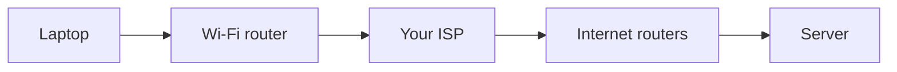
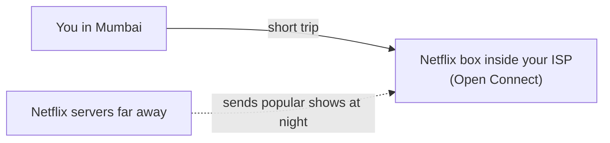

## What is it?

The internet is **many small networks joined together**. Your home Wi-Fi is a small network. Your internet company connects it to bigger networks, and those connect to the rest of the world.

When you send data, it does not travel as one big piece. It is cut into **small pieces called packets**. Each packet finds its own way to the other side, one step at a time.

### A simple example: sending postcards

Say you want to send a long letter, but the post office only accepts postcards.

1. You cut the letter into many **postcards** (packets).
2. On each postcard you write the **address** (where it goes) and a **number** (1, 2, 3...) so the receiver can put them back in order.
3. The postcards pass through **many post offices** (routers) on the way. Each post office only knows the next stop that brings the postcard closer.
4. The receiver collects all the postcards, puts them in order, and reads the full letter.

That is exactly how the internet sends data.

## Why do we need it?

Computers far apart need a way to send data to each other. Two simple ideas don't work:

- **A wire between every pair of computers.** Billions of devices would need an impossible number of wires.
- **One reserved line per conversation**, like old phone calls. The line sits idle when nobody talks, and nobody else can use it.

The internet fixes both. Networks connect to each other, so any device can reach any other through a **chain of hops**. Data goes in small **packets** that share the same cables with everyone else's packets. And there is **no single center**: if one link breaks, routers send packets another way.

## How it works inside

### The parts

| Part | What it does | In the postcard example |
| --- | --- | --- |
| **Your device** | Sends and receives data | You |
| **Home router** (Wi-Fi) | Connects your devices to the internet | The post box on your street |
| **ISP** (internet company, like Airtel or Comcast) | Connects your home to the internet | Your local post office |
| **Routers on the internet** | Pass packets closer to the target, one hop at a time | Post offices in between |
| **Undersea cables** | Carry data between countries | Planes and ships carrying the mail |
| **Server** | Receives the request and sends an answer | The person you wrote to |

### What happens when you open a website

1. You type `google.com`. **DNS** finds the server's address (see [DNS](./dns.mdx)).
2. Your laptop cuts the request into packets and sends them to your Wi-Fi router.
3. The router sends them to your ISP.
4. Routers pass the packets along, hop by hop, until they reach Google's server.
5. The server sends its answer back, also in packets. These packets may take different roads than the request did.

All of this usually takes **less than a second**.

To follow one request through every step, from DNS to the finished page, see [What Happens When You Type a URL](./what-happens-when-you-type-a-url.mdx).

### Packets

A 1 MB photo is cut into about **700 packets** of about 1,500 bytes each. Every packet carries:

- **From** address and **to** address
- A **number**, so the pieces can be put back in order
- A small **piece of the data**

Packets of the same photo can take **different roads** and arrive **out of order**. Some can even get **lost**. A protocol called **TCP** puts them back in order and asks again for the lost ones (see [TCP vs UDP](./tcp-vs-udp.mdx)).

### Layers: who does what

The work is split into **layers**. Each layer does one job and wraps the data of the layer above, like a letter inside an envelope inside a mail bag.

| Layer | Its job | Examples |
| --- | --- | --- |
| **Link** | Moves data over one hop: a cable or Wi-Fi | Ethernet, Wi-Fi |
| **IP** | Gives every device an address, and moves packets hop by hop | IPv4, IPv6 |
| **Transport** | Gets data to the right app (the **port**). TCP also keeps it complete and in order | TCP, UDP |
| **Application** | What the apps actually say to each other | HTTP, DNS |

### How a router picks the next hop

- Each router has a **routing table**: a list of address ranges, and the next hop for each. It reads the packet's **to** address, finds the best match, and sends the packet on. It never knows the whole path.
- Big networks (internet companies, Google, AWS) tell each other which addresses they can reach, using a protocol called **BGP**. When a link breaks, the routes change, and packets take another way.
- Every packet has a **TTL** (time to live) counter. Each router lowers it by 1 and drops the packet at 0. So a packet caught in a loop can't go around forever.

## Latency and bandwidth

You will use these two words a lot:

- **Latency** = how long **one trip** takes. Like the time a car needs to drive from one city to another.
- **Bandwidth** = how much data can travel **at the same time**. Like how many lanes the road has.

A road with more lanes doesn't make the trip shorter. In the same way, more bandwidth doesn't lower latency.

- For a web page with many small requests, **latency** matters most.
- For a big download, like a movie, **bandwidth** matters most.

## Distance matters

Data moves through cables very fast, but not instantly. The farther away the server is, the longer every request waits.

| From → to | Round trip (about) |
| --- | --- |
| Inside one data center | 0.5 ms |
| Same city | 5 ms |
| US East Coast ↔ Europe | 80 ms |
| India ↔ USA | 200 ms |

If your users are in India and your servers are in the USA, **every single request** waits about 200 ms just for travel. That is why big apps run servers in many countries, and use a **CDN** to keep files close to users.

## When to use it

You don't pick the internet like you pick a database. The real question is **which traffic goes over the public internet**. Use it for:

- **Users** reaching your app, from anywhere.
- Calling **outside services**, like a payment company's API.

**Don't use it when:**

- **Your own servers talk to each other.** Keep that on a private network, which is faster and safer.
- You move **a lot of data between your own sites** every day, and need steady speed. Public internet speed goes up and down.

## Alternatives

| Option | What it is | Pick it when |
| --- | --- | --- |
| **Private network** (like an AWS VPC) | Servers talk on private IPs inside one data center or cloud | Your own servers talk to each other. See [IP Addresses and Ports](./ip-addresses-and-ports.mdx) |
| **VPN** | An encrypted tunnel over the internet into a private network | Staff or an office must reach private servers |
| **Dedicated private link** (like AWS Direct Connect) | A private line from your data center to a cloud | Big, steady traffic that needs stable speed |
| **Cloud backbone** (like AWS Global Accelerator) | User traffic enters the cloud's own network close to the user | Users all over the world, and you want fewer public internet hops |
| **CDN** | Copies of files kept close to users | Images, videos, public pages. See [CDN](../caching/cdn.mdx) |

## In the real world

**Undersea cables.** Almost all data between countries travels through cables on the ocean floor, not through satellites. When a big cable breaks, the internet in a whole region gets slow. In 2024, the anchor of a sinking ship is believed to have cut three cables in the Red Sea, slowing traffic between Asia, Europe and Africa.

**Netflix keeps shows close to you.** Netflix puts its own servers, called **Open Connect**, inside internet companies' networks around the world. At night, when few people are watching, these servers copy the popular shows. So when you press play, the video comes from a box near your city, not from the USA. A short trip means a faster start and less buffering.

## In the interview

When users are all over the world, say:

> "I'll run servers in a few regions and put images and videos on a CDN, so data travels a short distance."

<Callout title="Remember this" type="success">
  - The internet is **many networks joined together**.
  - Data is cut into **packets**. **Routers** pass them along, hop by hop.
  - Packets can arrive **out of order** or get **lost**. TCP fixes this.
  - **Latency** = time for one trip. **Bandwidth** = how much data at once.
  - **Distance adds delay.** India ↔ USA is about 200 ms per round trip. Keep servers close to users.
  - **Why:** a wire between every pair of computers is impossible. Packets let everyone **share the same cables**, and there is **no single center** to break.
  - **Inside:** **layers** (link, IP, TCP/UDP, HTTP). Routers use a **routing table**, networks share routes with **BGP**, and **TTL** stops loops.
  - **Alternatives** for your own traffic: a private network, a VPN, a private link, a cloud backbone, a CDN.
</Callout>
