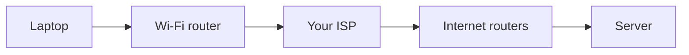

## The idea

The internet is **many small networks joined together**. Your home Wi-Fi is a small network. Your internet company connects it to bigger networks, and those connect to the rest of the world.

When you send data, it does not travel as one big piece. It is cut into **small pieces called packets**. Each packet finds its own way to the other side, one step at a time.

## A simple example: sending postcards

Say you want to send a long letter, but the post office only accepts postcards.

1. You cut the letter into many **postcards** (packets).
2. On each postcard you write the **address** (where it goes) and a **number** (1, 2, 3...) so the receiver can put them back in order.
3. The postcards pass through **many post offices** (routers) on the way. Each post office only knows the next stop that brings the postcard closer.
4. The receiver collects all the postcards, puts them in order, and reads the full letter.

That is exactly how the internet sends data.

## The parts

| Part | What it does | In the postcard example |
| --- | --- | --- |
| **Your device** | Sends and receives data | You |
| **Home router** (Wi-Fi) | Connects your devices to the internet | The post box on your street |
| **ISP** (internet company, like Airtel or Comcast) | Connects your home to the internet | Your local post office |
| **Routers on the internet** | Pass packets closer to the target, one hop at a time | Post offices in between |
| **Undersea cables** | Carry data between countries | Planes and ships carrying the mail |
| **Server** | Receives the request and sends an answer | The person you wrote to |

## What happens when you open a website

1. You type `google.com`. **DNS** finds the server's address (see [DNS](./dns.mdx)).
2. Your laptop cuts the request into packets and sends them to your Wi-Fi router.
3. The router sends them to your ISP.
4. Routers pass the packets along, hop by hop, until they reach Google's server.
5. The server sends its answer back, also in packets. These packets may take different roads than the request did.

All of this usually takes **less than a second**.

## Packets

A 1 MB photo is cut into about **700 packets** of about 1,500 bytes each. Every packet carries:

- **From** address and **to** address
- A **number**, so the pieces can be put back in order
- A small **piece of the data**

Packets of the same photo can take **different roads** and arrive **out of order**. Some can even get **lost**. A protocol called **TCP** puts them back in order and asks again for the lost ones (see [TCP vs UDP](./tcp-vs-udp.mdx)).

## Latency and bandwidth

You will use these two words a lot:

- **Latency** = how long **one trip** takes. Like the time a car needs to drive from one city to another.
- **Bandwidth** = how much data can travel **at the same time**. Like how many lanes the road has.

A road with more lanes doesn't make the trip shorter. In the same way, more bandwidth doesn't lower latency.

- For a web page with many small requests, **latency** matters most.
- For a big download, like a movie, **bandwidth** matters most.

## Distance matters

Data moves through cables very fast, but not instantly. The farther away the server is, the longer every request waits.

| From → to | Round trip (about) |
| --- | --- |
| Inside one data center | 0.5 ms |
| Same city | 5 ms |
| US East Coast ↔ Europe | 80 ms |
| India ↔ USA | 200 ms |

If your users are in India and your servers are in the USA, **every single request** waits about 200 ms just for travel. That is why big apps run servers in many countries, and use a **CDN** to keep files close to users.

## In the real world

**Undersea cables.** Almost all data between countries travels through cables on the ocean floor, not through satellites. When a big cable breaks, the internet in a whole region gets slow. In 2024, the anchor of a sinking ship is believed to have cut three cables in the Red Sea, slowing traffic between Asia, Europe and Africa.

**Netflix keeps shows close to you.** Netflix puts its own servers, called **Open Connect**, inside internet companies' networks around the world. At night, when few people are watching, these servers copy the popular shows. So when you press play, the video comes from a box near your city, not from the USA. A short trip means a faster start and less buffering.

## In the interview

When users are all over the world, say:

> "I'll run servers in a few regions and put images and videos on a CDN, so data travels a short distance."

<Callout title="Remember this" type="success">
  - The internet is **many networks joined together**.
  - Data is cut into **packets**. **Routers** pass them along, hop by hop.
  - Packets can arrive **out of order** or get **lost**. TCP fixes this.
  - **Latency** = time for one trip. **Bandwidth** = how much data at once.
  - **Distance adds delay.** India ↔ USA is about 200 ms per round trip. Keep servers close to users.
</Callout>
