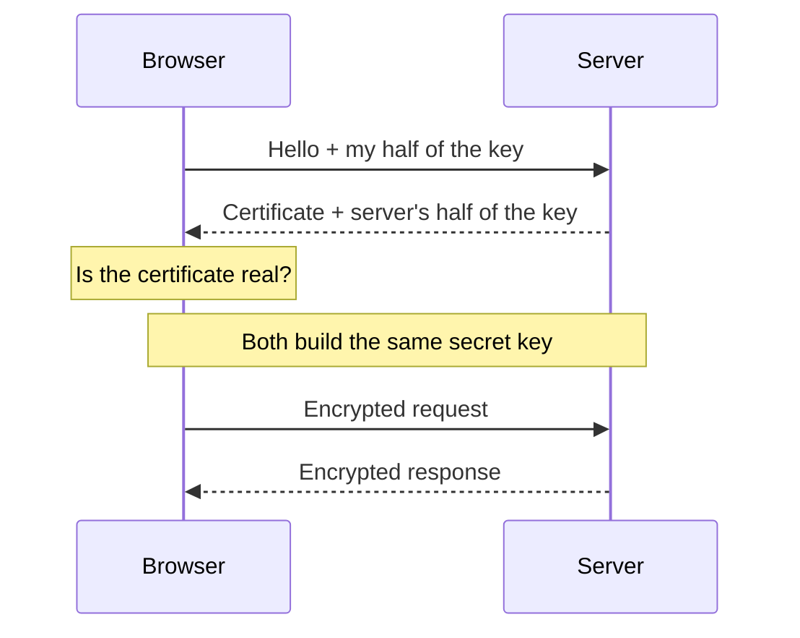
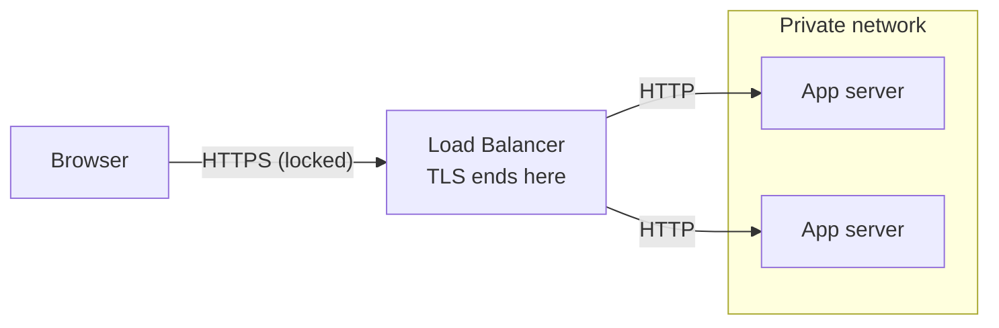

## The idea

**HTTP** is the language browsers and servers use to talk. The browser sends a **request**, and the server sends back a **response**. It is like ordering at a food counter: you say what you want, and you get your food with a receipt.

**HTTPS** is HTTP inside a **locked box**. Only your browser and the server can open it. Nobody in the middle, like the café Wi-Fi owner or your internet company, can read or change what is inside.

## A request and a response

Here is what a real request looks like:

```http
GET /products/42 HTTP/1.1
Host: shop.example.com
Accept: application/json
Cookie: session_id=abc123
```

And the server's response:

```http
HTTP/1.1 200 OK
Content-Type: application/json
Cache-Control: max-age=60

{ "id": 42, "name": "Running shoes", "price": 2999 }
```

| Part | In the request | In the response |
| --- | --- | --- |
| **First line** | Method + path: `GET /products/42` | Status code: `200 OK` |
| **Headers** | Extra notes: who you are, what format you want | Extra notes: format, how long to cache |
| **Body** | Data you send (for `POST`, `PUT`) | The data you asked for |

Methods, status codes and headers: see [HTTP Methods, Status Codes and Headers](./http-methods-status-codes-headers.mdx).

## HTTP is stateless

The server **forgets you after every request**. It is like a counter where a different person serves you each time. To be recognised, you must show your membership card every time.

That is why the browser sends a **cookie** or a **token** with every single request (see [Cookies, Sessions and JWT](./cookies-sessions-jwt.mdx)).

## HTTPS: HTTP + TLS

Without HTTPS, data travels as plain text. On café Wi-Fi, anyone on the same network could read your password as it goes by. With HTTPS, they only see scrambled data.

HTTPS adds a layer called **TLS** (Transport Layer Security) **under** HTTP. HTTP writes the message, TLS locks it, and TCP carries it. TLS gives you three things:

1. **Privacy:** nobody can read the data.
2. **No tampering:** nobody can change the data on the way.
3. **The right server:** you are really talking to `bank.com`, not a fake site. This is checked with a **certificate**.

## How TLS works, in simple words

Before any data is sent, the browser and server do a short **TLS handshake**:

1. The browser says hello, and sends **its half** of a key.
2. The server sends back its **certificate** (its ID card) and **its half** of the key.
3. The browser checks that the certificate is real and belongs to this website.
4. Both sides combine the two halves into the **same secret key**. The secret key itself is never sent over the network.
5. From now on, everything is locked with that secret key.



This handshake costs **one more round trip**, on top of the TCP handshake. So a brand-new HTTPS connection waits about **two round trips** before any data moves. Another reason to **reuse connections**.

### Certificates

- A **certificate** is the server's ID card. It says "this key belongs to `bank.com`".
- It is signed by a **Certificate Authority (CA)**, a company that browsers trust, like Let's Encrypt or DigiCert.
- If the certificate is fake, for the wrong site, or expired, the browser shows a big warning page.
- Certificates **expire** after a few months, so they must be renewed. Good teams renew them automatically.

## TLS at the load balancer

In system design, HTTPS usually **ends at the load balancer**. The load balancer unlocks (decrypts) the request, then passes it to the app servers over the private network.



This is called **TLS termination**. It helps because:

- Certificates live in **one place**, not on every server.
- App servers don't spend CPU on encryption.
- The load balancer can **read the request** and send `/api` and `/images` to different servers.

Many companies now encrypt the traffic **inside** the private network too, especially where data is sensitive, like payments. This idea is called **zero trust**: don't trust a request just because it comes from inside.

## HTTP/1.1 vs HTTP/2 vs HTTP/3

| Version | Year | What changed |
| --- | --- | --- |
| **HTTP/1.1** | 1997 | One request at a time on each connection. Browsers open about 6 connections per site to go faster. |
| **HTTP/2** | 2015 | **Many requests at the same time** on one connection. Smaller headers. |
| **HTTP/3** | 2022 | Runs on **QUIC (UDP)** instead of TCP. Faster setup, and one lost packet doesn't make everything else wait. Works better on phones moving between Wi-Fi and mobile data. |

## In the real world

**Firesheep (2010).** A free browser add-on called Firesheep let anyone on café Wi-Fi take over other people's Facebook and Twitter accounts with one click, because those sites didn't use HTTPS for everything. After the uproar, big sites moved to HTTPS for every page.

**Chrome marks HTTP as "Not secure".** Since 2018, Chrome shows "Not secure" next to any site without HTTPS. Today, well over 90% of pages loaded in Chrome use HTTPS.

**Let's Encrypt made certificates free.** Certificates used to cost money. Let's Encrypt started giving them away for free and renewing them automatically. It now protects hundreds of millions of websites.

## In the interview

Assume HTTPS everywhere, and say where TLS ends:

> "All traffic from users is HTTPS. TLS ends at the load balancer. Inside the private network, services use TLS too, because we don't trust traffic just because it is inside."

<Callout title="Remember this" type="success">
  - **HTTP** = request (method, path, headers, body) and response (status code, headers, body).
  - **HTTP is stateless.** Send a cookie or token with every request.
  - **HTTPS = HTTP + TLS:** private, can't be changed, and you know it's the right server.
  - A **certificate** is the server's ID card, signed by a trusted company.
  - A new HTTPS connection costs about **2 round trips**. Reuse connections.
  - **TLS usually ends at the load balancer.**
  - **HTTP/2:** many requests on one connection. **HTTP/3:** runs on QUIC (UDP).
</Callout>
