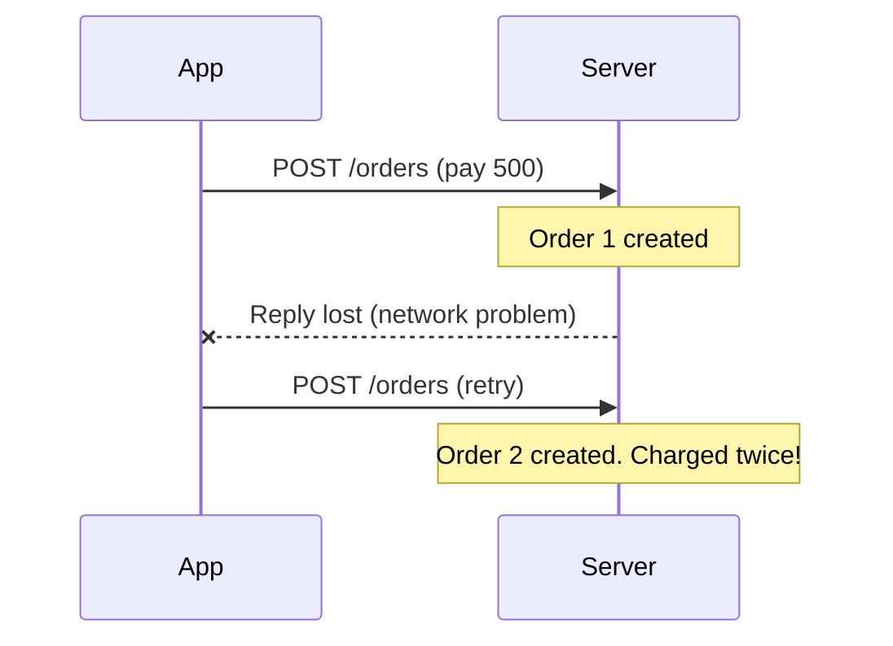
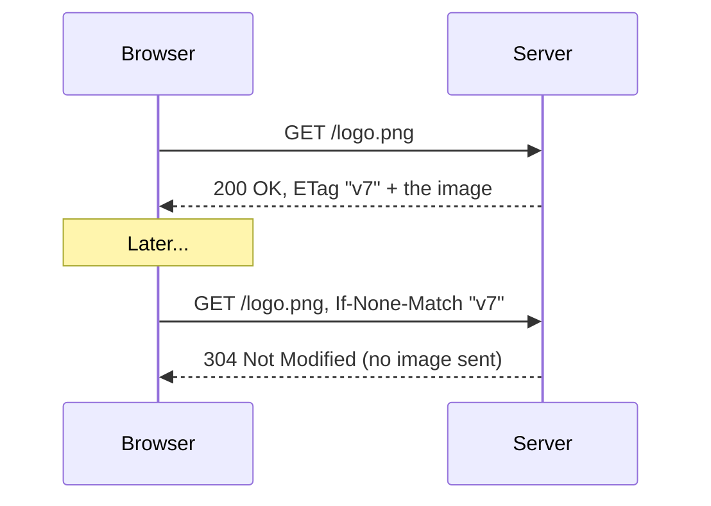

## The idea

Every HTTP request is like a short letter:

- The **method** is the verb: what you want to do. Read, create, change or delete.
- The **status code** is the short answer at the top of the reply: "done", "not found", "our mistake".
- The **headers** are the notes on the envelope: what format, who you are, how long to keep it.

All the examples below use a **food delivery app**.

## Methods

| Method | Meaning | Example |
| --- | --- | --- |
| `GET` | Read | `GET /orders/42`: see order 42 |
| `POST` | Create | `POST /orders`: place a new order |
| `PUT` | Replace the whole thing | `PUT /users/7`: replace user 7's full profile |
| `PATCH` | Change a part | `PATCH /orders/42`: change only the delivery address |
| `DELETE` | Remove | `DELETE /orders/42`: cancel order 42 |

### Safe and idempotent

Interviewers love these two words:

- **Safe** means it **changes nothing**. `GET` is safe. Call it 100 times and nothing changes.
- **Idempotent** means doing it **once or many times gives the same result**.
  - `PUT /users/7` with the name "Asha", sent twice: the name is still "Asha". **Idempotent.**
  - `DELETE /orders/42`, sent twice: the order is still cancelled. **Idempotent.**
  - `POST /orders`, sent twice: **two orders**, and maybe two payments! **Not idempotent.**

| Method | Safe? | Idempotent? |
| --- | --- | --- |
| `GET` | Yes | Yes |
| `PUT` | No | Yes |
| `DELETE` | No | Yes |
| `PATCH` | No | Not always |
| `POST` | No | No |

### Why this matters: retries

Networks fail. When an app gets no answer, it often **tries again**. That is fine for `GET`, `PUT` and `DELETE`. For `POST`, it can create a duplicate:

**The fix: an idempotency key.** The app sends a unique key with the request, like `Idempotency-Key: 7f3a9c`. The server remembers the key. If the same key comes again, it sends back the first result instead of creating a new order.

## Status codes

The first digit tells you the group:

| Group | Meaning |
| --- | --- |
| **2xx** | Success: "Done!" |
| **3xx** | Go somewhere else: "It's over there" |
| **4xx** | Client mistake: "You asked wrongly" |
| **5xx** | Server problem: "Our fault" |

The codes you should know:

| Code | Name | When it is used |
| --- | --- | --- |
| `200` | OK | It worked |
| `201` | Created | A new thing was created (after `POST`) |
| `204` | No Content | It worked, and there is nothing to send back (after `DELETE`) |
| `301` | Moved Permanently | The address changed forever |
| `302` | Found | Go to this other address for now |
| `304` | Not Modified | Your saved copy is still good. Use it |
| `400` | Bad Request | The request is wrong, like a missing field |
| `401` | Unauthorized | You are not logged in |
| `403` | Forbidden | You are logged in, but not allowed to do this |
| `404` | Not Found | It does not exist |
| `409` | Conflict | It clashes with something, like a username that is taken |
| `429` | Too Many Requests | Slow down. You hit a rate limit |
| `500` | Internal Server Error | A bug on the server |
| `502` | Bad Gateway | The load balancer got a broken answer from the server behind it |
| `503` | Service Unavailable | The server is overloaded or down for maintenance |
| `504` | Gateway Timeout | The server behind the load balancer took too long |

**Easy way to remember 401 vs 403:** `401` means "Who are you?" `403` means "I know who you are, but no."

**When should a client retry?**

- `5xx`, `429` or no answer: yes, **but only if the request is safe to repeat**. That means `GET`, `PUT`, `DELETE`, or a `POST` with an idempotency key. Otherwise a retry can charge twice, like in the example above.
- Wait before each retry, and wait longer each time (**backoff**). Add a little random extra time (**jitter**), so thousands of clients don't all retry at the same moment. If the server sends `Retry-After`, wait that long.
- Other `4xx`: no. Sending the same wrong request again gives the same error. Fix it first.

## Headers

Headers are extra information sent with requests and responses. These are the ones you will meet most:

| Header | Sent in | What it does | Example |
| --- | --- | --- | --- |
| `Content-Type` | Both | The format of the body | `application/json` |
| `Authorization` | Request | Who you are | `Bearer eyJhbGci...` |
| `Cookie` / `Set-Cookie` | Request / response | Small data the browser keeps and sends back | `session=abc123` |
| `Cache-Control` | Response | How long the response may be cached | `max-age=3600` |
| `ETag` / `If-None-Match` | Response / request | A version tag, to check if something changed | `"v7"` |
| `Location` | Response | Where to go, or where the new thing is | `/orders/43` |
| `Retry-After` | Response | How long to wait before trying again (with `429` or `503`) | `30` |
| `Idempotency-Key` | Request | Makes retries safe. Common, but not an official standard yet | `7f3a9c` |

### Example: saving data with ETag and 304

The browser can ask "has this changed since my last copy?" If not, the server answers `304` and sends **no body**. This saves time and data.

## In the real world

**Stripe never charges twice.** Stripe's payments API accepts an `Idempotency-Key` header. If your app's request times out and it retries a payment with the same key, Stripe sees the key and returns the first result. The customer is charged only once.

**GitHub tells you your limit.** GitHub's API sends headers like `x-ratelimit-remaining` with every response, so your app knows how many requests it has left. When you go over the limit, you get a `403` or `429` error.

## In the interview

When you write your API, pick the right method and status code, and say them out loud:

> "`POST /bookings` returns `201 Created`. If the seat is already taken, it returns `409 Conflict`. The client sends an idempotency key, so a retry never books or charges twice."

<Callout title="Remember this" type="success">
  - **Methods:** `GET` read, `POST` create, `PUT` replace, `PATCH` change a part, `DELETE` remove.
  - `GET` is **safe**. `GET`, `PUT` and `DELETE` are **idempotent**. `POST` is **not**, so use an **idempotency key**.
  - **2xx** success, **3xx** go elsewhere, **4xx** client mistake, **5xx** server problem.
  - **401** not logged in, **403** not allowed, **409** conflict, **429** slow down.
  - Retry **5xx** and **429** only if the request is safe to repeat (idempotent, or has an idempotency key), with **backoff and jitter**. Don't retry other **4xx**.
  - Headers to know: `Content-Type`, `Authorization`, `Cache-Control`, `ETag`, `Location`, `Retry-After`.
</Callout>
