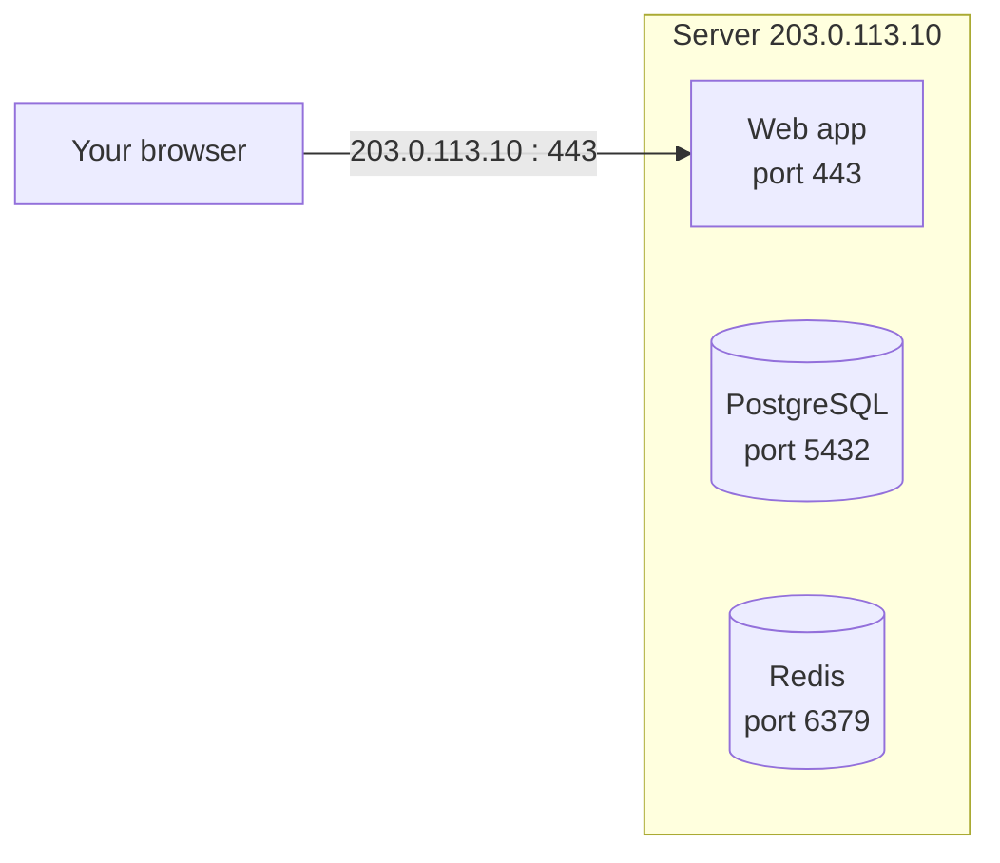
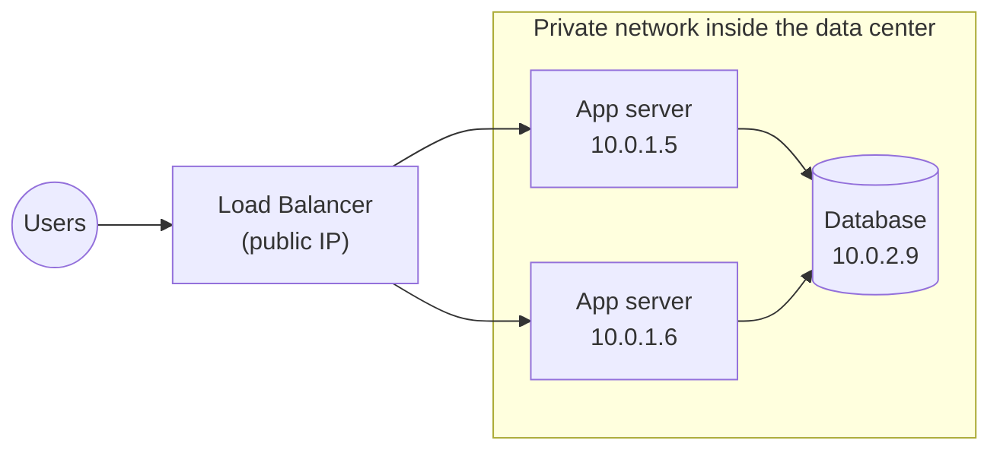

## What is it?

- An **IP address** tells you **which computer**. Like the address of a building.
- A **port** tells you **which app** on that computer. Like the flat number inside the building.

So `203.0.113.10:443` means "building `203.0.113.10`, flat `443`".

You already use this every day. When you run an app locally and open `http://localhost:3000`:

- `localhost` is a **name** that points to **your own computer**. Its IP address is `127.0.0.1`.
- `3000` is the **port** your app is listening on.

## Why do we need it?

The internet passes data from router to router (see [How the Internet Works](./how-the-internet-works.mdx)). That only works if every packet answers two questions:

- **Which computer?** Without an address, a router has no idea where to send the packet next.
- **Which program on it?** One server runs a web app, a database and a cache at the same time. Without a port, the data would arrive at the right machine but not the right program.

## How it works inside

### One server, many apps

One server can run many programs at once. The IP address gets the data to the right **server**. The port gets it to the right **program**.

### IP addresses

Every device on a network has an IP address.

- **IPv4** looks like `192.168.1.10`: four numbers from 0 to 255. There are only about **4.3 billion** of them. That is not enough for every phone, laptop and server in the world.
- **IPv6** looks like `2001:db8::1`. It is longer and has a **huge** number of addresses. It is slowly replacing IPv4.

A **range** of addresses is written like `10.0.0.0/16`. The `/16` means the first 16 bits are fixed, so this range holds 65,536 addresses. You see this when you set up a cloud network.

### Public vs private IP addresses

- A **public IP** can be reached from anywhere on the internet. Like a building's street address. Servers like `google.com` have public IPs.
- A **private IP** only works **inside one network**. Like room numbers inside an office. Your laptop at home probably has something like `192.168.1.10`.

Private addresses usually start with `10.`, `172.16.` to `172.31.`, or `192.168.`.

Your home router has **one public IP**, and gives a private IP to each of your devices. When your laptop talks to the internet, the router swaps your private address for its public one. This is called **NAT** (Network Address Translation). The router keeps a small table of which outgoing connection belongs to which device, so it knows where to send each answer.

### Ports

A port is a number from **0 to 65535**. Some numbers are standard, so everyone knows where to knock:

| Port | Used by |
| --- | --- |
| `80` | HTTP (websites, not secure) |
| `443` | HTTPS (secure websites) |
| `22` | SSH (logging in to a server) |
| `5432` | PostgreSQL |
| `3306` | MySQL |
| `6379` | Redis |
| `27017` | MongoDB |

When you open `https://google.com`, the browser uses port `443` by itself, so you never have to type it.

### How one port serves many users

The **client** has a port too. Your computer picks a random free one for each connection, like `52814`. So every connection is named by **four** values:

| Client IP | Client port | Server IP | Server port |
| --- | --- | --- | --- |
| `198.51.100.7` | `52814` | `203.0.113.10` | `443` |
| `198.51.100.7` | `52815` | `203.0.113.10` | `443` |

That is how one server on port `443` keeps thousands of connections apart, even two tabs from the same laptop.

## When to use it

Inside a data center, servers talk to each other using **private IPs**. Usually only the **load balancer** has a public IP. So nobody on the internet can reach your database directly. This is much safer.

**Don't:**

- Give a **database** or an app server a public IP.
- **Hard-code IP addresses** in your code. Servers get new IPs when they restart or move. Use a name, and let [DNS](./dns.mdx) find the IP.
- Leave ports **open to the whole internet** that only your team needs, like `22` (SSH) or `5432` (PostgreSQL).

## Alternatives

There is no real alternative: every device on a network needs an address. What you choose is **how clients find it** (a DNS name, not a raw IP), and how to live with too few IPv4 addresses: **NAT** (many devices share one public IP) or **IPv6**.

## In the real world

**Private networks on AWS.** On AWS, companies usually put only the load balancer in a **public subnet**, the part of the network the internet can reach. App servers and databases go in **private subnets**. It is the same picture as the diagram above.

**IPv4 addresses are running out.** Since February 2024, AWS charges about $3.65 a month for every public IPv4 address, because there are not enough of them. One more reason to give a public IP only to the load balancer.

## In the interview

You will rarely be asked about IPs and ports directly. But they help you explain safety:

> "Only the load balancer has a public IP. App servers and databases are on a private network, so nobody on the internet can reach the database. From outside, we only allow port 443."

<Callout title="Remember this" type="success">
  - **IP address = which computer.** **Port = which app** on that computer.
  - **IPv4** (`192.168.1.10`) is running out. **IPv6** (`2001:db8::1`) is the long new format.
  - **Public IP** = reachable from the internet. **Private IP** = only inside one network.
  - **NAT** lets many private devices share one public IP.
  - Keep app servers and databases on **private IPs**. Only the load balancer is public.
  - Ports to know: **80** HTTP, **443** HTTPS, **5432** PostgreSQL, **6379** Redis.
  - **Why:** a router needs to know **which computer**, and the computer needs to know **which program**.
  - **Inside:** every connection is named by **4 values**: client IP and port, server IP and port.
  - **Alternatives:** none really. Use **DNS names**, not raw IPs, and NAT or IPv6 when IPv4 runs short.
</Callout>
