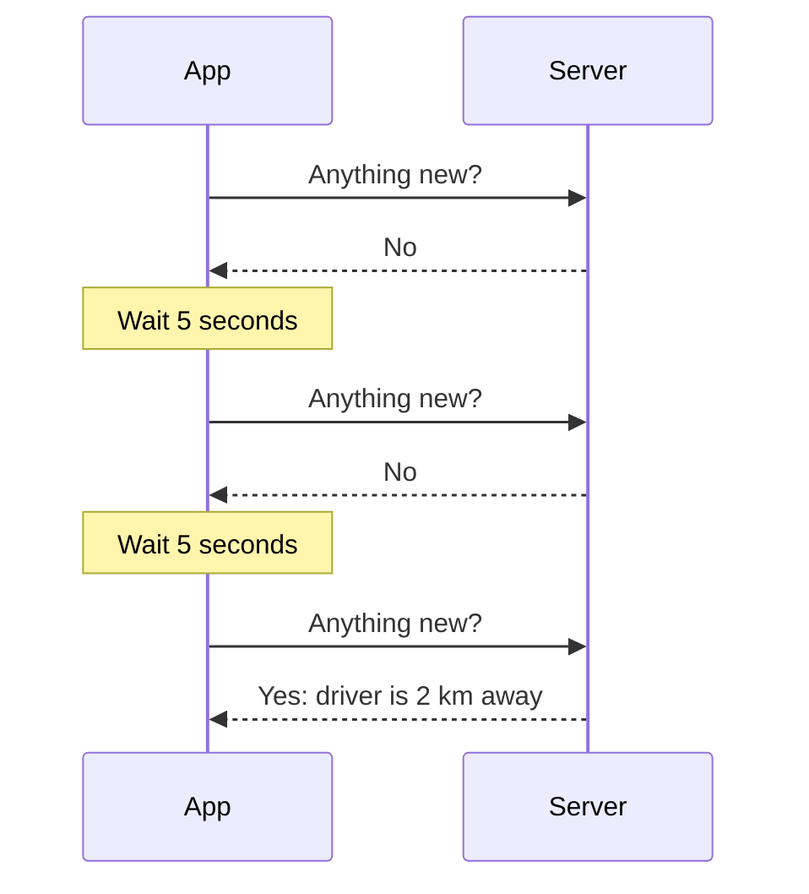
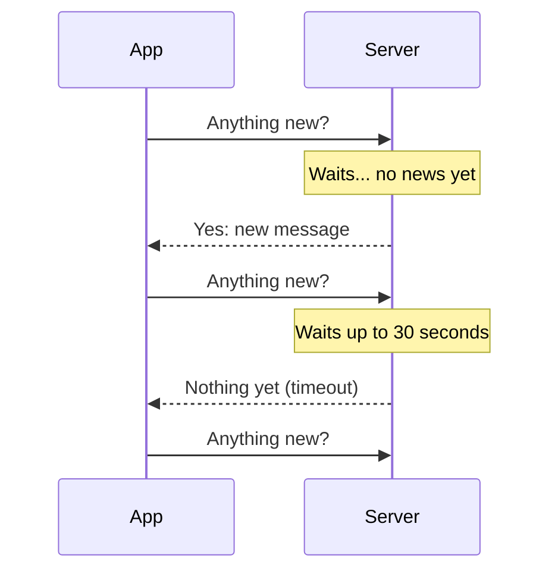
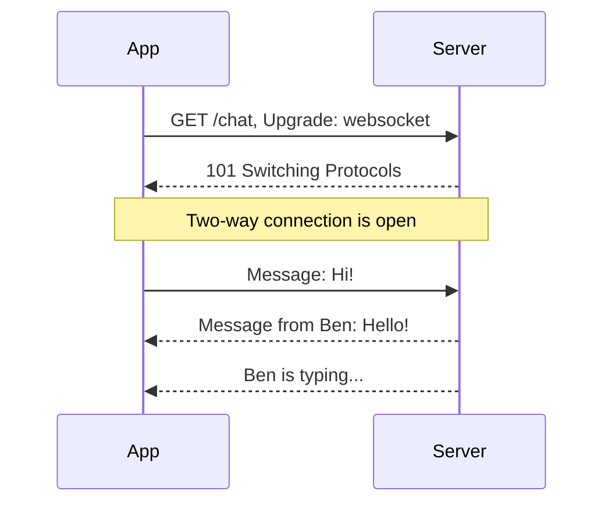
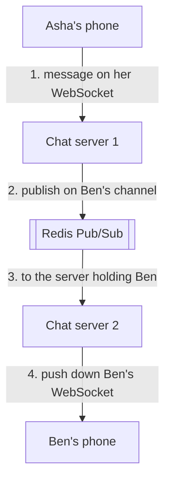
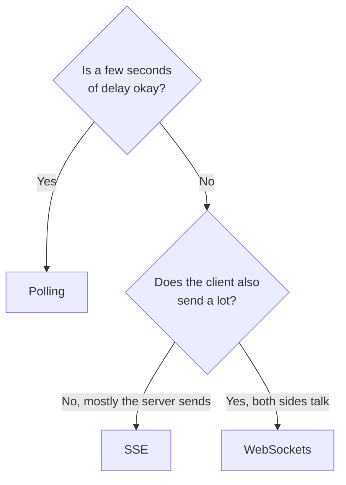

## What is it?

**Polling, long polling, SSE and WebSockets** are four ways to get new data from the server to the client as soon as it happens.

Think of waiting for a parcel:

- **Polling:** you open the door every 5 minutes to check.
- **Long polling:** you open the door and wait there until the courier comes. Then you open it again and wait.
- **SSE:** you give the courier your phone number, and they text you every time there is news. One direction only.
- **WebSockets:** a phone call that stays open. Both of you can talk at any time.

## Why do we need it?

With normal HTTP, the **client asks** and the **server answers**. The server can never start the conversation (see [HTTP and HTTPS](./http-and-https.mdx)).

But many apps need the server to send updates **as soon as they happen**: a new chat message, a live cricket score, your food delivery moving on the map. Asking the user to refresh the page doesn't work. So we need a way for news to reach the client without the user doing anything.

## How it works inside

### Polling

The client asks every few seconds: "Anything new?"



- **Good:** the simplest option. Works everywhere.
- **Bad:** most answers are "no", so most requests are wasted. And news can be up to 5 seconds late.

1 million users polling every 5 seconds is **200,000 requests per second**, mostly asking for nothing.

### Long polling

The client asks, and the server **holds the request open** until there is news, or until a timeout (like 30 seconds). Then the client asks again right away.



- **Good:** almost instant, and it is still plain HTTP.
- **Bad:** the server holds many open requests, and every update needs a brand-new request.

### SSE (Server-Sent Events)

The client opens **one HTTP connection that stays open**. The server sends events down it whenever it wants. Data flows **one way only**: server to client.

Browsers have this built in, and they **reconnect by themselves** if the connection drops:

```js
// In the browser
const updates = new EventSource("/orders/42/updates");

// Runs every time the server sends an event
updates.onmessage = (event) => {
    console.log("Update:", event.data); // Update: Out for delivery
};
```

What the server sends is simple text:

```http
HTTP/1.1 200 OK
Content-Type: text/event-stream

data: Order accepted

data: Out for delivery
```

Each event can also carry an `id`. If the connection drops, the browser reconnects and sends the last id it saw in a `Last-Event-ID` header, so the server can send the events that were missed.

**Good for:** notifications, live scores, stock prices, and AI answers that appear word by word.

**Watch out:** over HTTP/1.1, a browser opens only about 6 connections per site, and each SSE stream keeps one busy. With many tabs open, the site can run out. Over HTTP/2, many streams share one connection, so this limit goes away.

### WebSockets

A WebSocket starts as a normal HTTP request with the header `Upgrade: websocket`. Then the connection turns into a **two-way channel that stays open**. Both sides can send messages at any time, with very little extra data per message.



After the `101`, HTTP is gone. The same TCP connection now carries small **frames**, each with a header of only 2 to 14 bytes. Special frames check that the other side is still there (**ping** and **pong**) and **close** the connection.

```js
const socket = new WebSocket("wss://chat.example.com");

// Runs every time a message arrives
socket.onmessage = (event) => {
    showMessage(event.data);
};

// Send only after the connection is open. Sending earlier throws an error.
socket.onopen = () => {
    const message = { to: "ben", text: "Hi!" };
    socket.send(JSON.stringify(message));
};
```

- **Good:** truly real-time, in both directions.
- **Bad:** harder to scale. Each server holds many open connections, and you must know **which server holds which user**.

#### HTTP vs WebSocket

| | HTTP | WebSocket |
| --- | --- | --- |
| How it talks | Request → response | Two-way: messages flow in both directions |
| Connection | Each request gets one response, and that exchange is over | Stays open until one side closes it |
| Who can send first | Only the client | The client or the server, at any time |
| Good for | APIs: load a page, save a form | Real-time updates: chat, games, live tracking |

## Scaling open connections

Say Asha is connected to **chat server 1**, and Ben is connected to **chat server 2**. Asha sends Ben a message. Server 1 doesn't hold Ben's connection, so how does the message reach him?

The usual answer is **pub/sub** (publish-subscribe). Every chat server listens for messages meant for its own users:



1. Asha's message arrives at chat server 1.
2. Server 1 **publishes** it on Ben's channel.
3. Chat server 2, which holds Ben's connection, is **subscribed** to that channel. It gets the message.
4. Server 2 pushes it down Ben's WebSocket.

Two more things to plan for:

- The **load balancer** must support long-lived connections. Load balancers and proxies also close a connection that stays quiet too long (often after about 60 seconds). So send a tiny **heartbeat** message (a ping) every 30 seconds or so. It keeps the connection open and shows quickly when the other side is gone.
- When a server restarts, its users get disconnected. Clients must **reconnect automatically**.

See [Message Queues and Pub/Sub](../messaging/message-queues-pub-sub.mdx) and [Design WhatsApp](../questions/whatsapp.mdx) for more.

## Side by side

| | Polling | Long polling | SSE | WebSockets |
| --- | --- | --- | --- | --- |
| **Direction** | Client asks | Client asks | Server → client | Both ways |
| **Delay** | Up to the polling gap | Almost none | None | None |
| **Server cost** | Many wasted requests | Many waiting requests | One open connection per user | One open connection per user |
| **How hard** | Easiest | Easy | Easy | Harder |
| **Good for** | Updates that can wait | A simple fallback | Notifications, live scores, AI streaming | Chat, games, editing together |

## When to use which



**Don't use:**

- **Polling** when updates must be instant, or for millions of users. Most requests are wasted.
- **WebSockets** when only the server sends. SSE is simpler and works with normal HTTP tools.
- **Any of these** when the app is closed. An open connection only exists while the app runs. Use mobile push notifications.

## Alternatives

| Option | What it is | Pick it when |
| --- | --- | --- |
| **Mobile push notifications** (APNs for iPhone, FCM for Android) | Apple or Google deliver a message to the phone, even when the app is closed | The user must hear about it while the app isn't open |
| **Webhooks** | Your server calls another server's URL when something happens | Updates from server to server, not to browsers |
| **WebRTC** | A direct connection between two browsers | Voice and video calls, data between users |
| **WebTransport** | A newer browser API on HTTP/3 (QUIC), with many streams | Fast, low-delay data like browser games. Support is still growing |
| **Hosted service** (like Pusher, Ably, Firebase) | A company holds the open connections for you | You don't want to run connection servers yourself |

## In the real world

**Slack uses WebSockets.** When you open Slack, the app keeps a WebSocket open to Slack's servers, and new messages arrive through it instantly.

**AI answers stream over SSE.** When you ask OpenAI's API to stream an answer, it sends it over SSE: each new piece of text arrives as an event on the open connection, so the answer appears word by word. Many AI chat apps show their answers this way.

**Polling is still everywhere.** Many apps simply ask every few seconds for things that can wait a little, like the status of a payment or a report.

## In the interview

Pick the simplest option that meets the need, and say why:

> "Chat needs instant messages in both directions, so I'll use WebSockets. Each chat server holds open connections, and Redis Pub/Sub moves messages between servers. For order tracking, SSE is enough."

<Callout title="Remember this" type="success">
  - **Polling:** ask every few seconds. Simple, but wasteful and delayed.
  - **Long polling:** the server holds the request until there is news.
  - **SSE:** one open connection, **server → client** only. Great for notifications and live updates.
  - **WebSockets:** one open connection, **both ways**. Great for chat and games.
  - Open connections are hard to scale: use **pub/sub** to reach users on other servers.
  - Pick the **simplest** option that is fast enough.
  - **Why:** in HTTP the **server can never speak first**, but chat, scores and tracking need news the moment it happens.
  - **Inside:** SSE resumes with `Last-Event-ID`. A WebSocket upgrades with `101`, then sends small **frames** with **ping/pong**.
  - **Alternatives:** mobile push notifications (app closed), webhooks (server to server), WebRTC, WebTransport.
</Callout>
