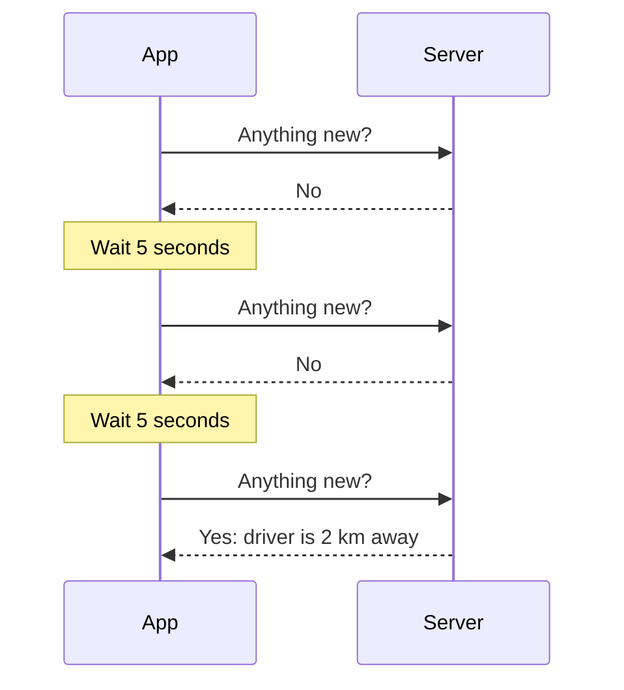
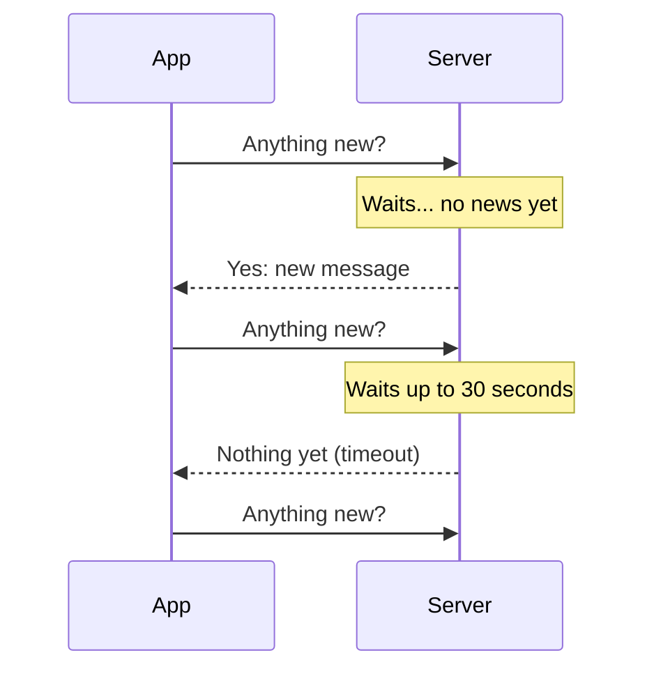
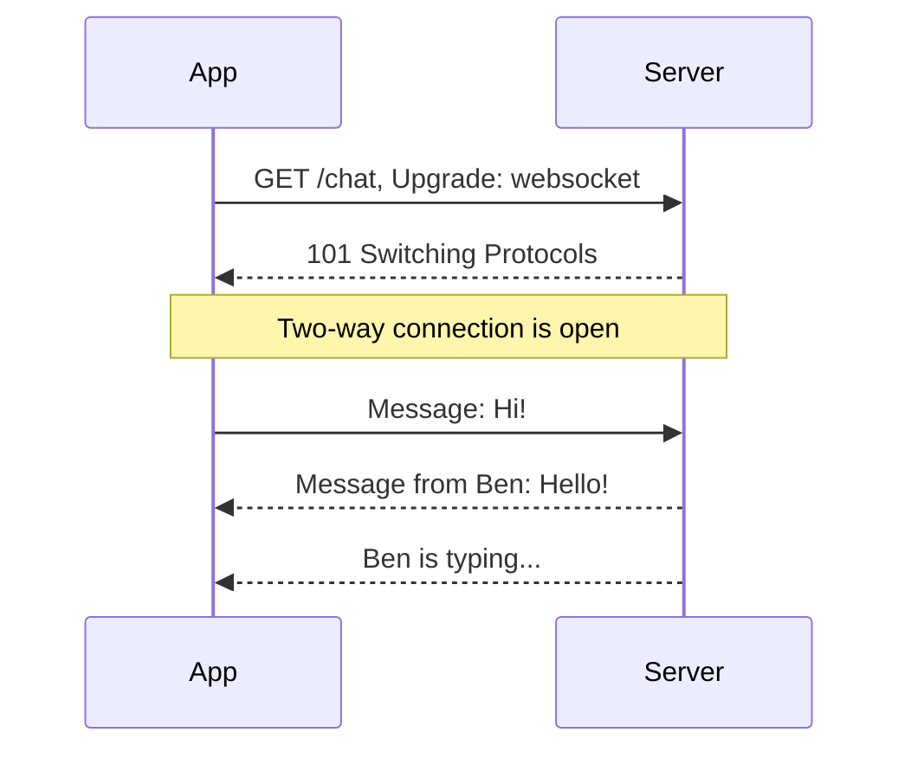
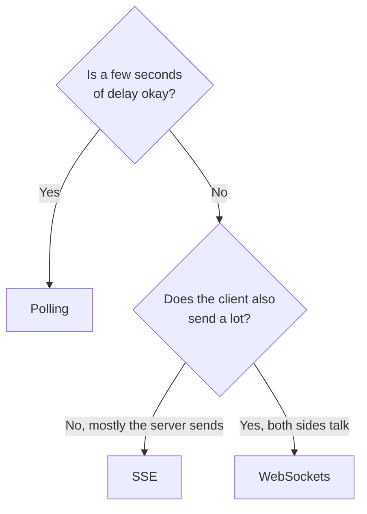
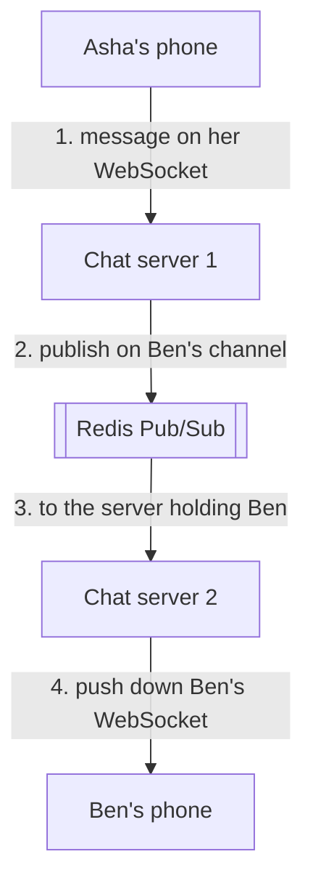

## The idea

With normal HTTP, the **client asks** and the **server answers**. The server can never start the conversation.

But many apps need the server to send updates **as soon as they happen**: a new chat message, a live cricket score, your food delivery moving on the map.

Think of waiting for a parcel:

- **Polling:** you open the door every 5 minutes to check.
- **Long polling:** you open the door and wait there until the courier comes. Then you open it again and wait.
- **SSE:** you give the courier your phone number, and they text you every time there is news. One direction only.
- **WebSockets:** a phone call that stays open. Both of you can talk at any time.

## Polling

The client asks every few seconds: "Anything new?"



- **Good:** the simplest option. Works everywhere.
- **Bad:** most answers are "no", so most requests are wasted. And news can be up to 5 seconds late.

1 million users polling every 5 seconds is **200,000 requests per second**, mostly asking for nothing.

## Long polling

The client asks, and the server **holds the request open** until there is news, or until a timeout (like 30 seconds). Then the client asks again right away.



- **Good:** almost instant, and it is still plain HTTP.
- **Bad:** the server holds many open requests, and every update needs a brand-new request.

## SSE (Server-Sent Events)

The client opens **one HTTP connection that stays open**. The server sends events down it whenever it wants. Data flows **one way only**: server to client.

Browsers have this built in, and they **reconnect by themselves** if the connection drops:

```js
// In the browser
const updates = new EventSource('/orders/42/updates');

updates.onmessage = (event) => {
  console.log('Update:', event.data); // "Out for delivery"
};
```

What the server sends is simple text:

```http
HTTP/1.1 200 OK
Content-Type: text/event-stream

data: Order accepted

data: Out for delivery
```

**Good for:** notifications, live scores, stock prices, and AI answers that appear word by word.

## WebSockets

A WebSocket starts as a normal HTTP request with the header `Upgrade: websocket`. Then the connection turns into a **two-way channel that stays open**. Both sides can send messages at any time, with very little extra data per message.



```js
const socket = new WebSocket('wss://chat.example.com');

socket.onmessage = (event) => showMessage(event.data);

// Send only after the connection is open. Sending earlier throws an error.
socket.onopen = () => {
  socket.send(JSON.stringify({ to: 'ben', text: 'Hi!' }));
};
```

- **Good:** truly real-time, in both directions.
- **Bad:** harder to scale. Each server holds many open connections, and you must know **which server holds which user**.

## Side by side

| | Polling | Long polling | SSE | WebSockets |
| --- | --- | --- | --- | --- |
| **Direction** | Client asks | Client asks | Server → client | Both ways |
| **Delay** | Up to the polling gap | Almost none | None | None |
| **Server cost** | Many wasted requests | Many waiting requests | One open connection per user | One open connection per user |
| **How hard** | Easiest | Easy | Easy | Harder |
| **Good for** | Updates that can wait | A simple fallback | Notifications, live scores, AI streaming | Chat, games, editing together |

## How to choose



## Scaling open connections

Say Asha is connected to **chat server 1**, and Ben is connected to **chat server 2**. Asha sends Ben a message. Server 1 doesn't hold Ben's connection, so how does the message reach him?

The usual answer is **pub/sub** (publish-subscribe). Every chat server listens for messages meant for its own users:



1. Asha's message arrives at chat server 1.
2. Server 1 **publishes** it on Ben's channel.
3. Chat server 2, which holds Ben's connection, is **subscribed** to that channel. It gets the message.
4. Server 2 pushes it down Ben's WebSocket.

Two more things to plan for:

- The **load balancer** must support long-lived connections.
- When a server restarts, its users get disconnected. Clients must **reconnect automatically**.

See [Message Queues and Pub/Sub](../messaging/message-queues-pub-sub.mdx) and [Design WhatsApp](../questions/whatsapp.mdx) for more.

## In the real world

**Slack uses WebSockets.** When you open Slack, the app keeps a WebSocket open to Slack's servers, and new messages arrive through it instantly.

**ChatGPT's answers stream over SSE.** The text appears word by word because the server sends each new piece as an event on an open SSE connection. OpenAI's API streams answers the same way.

**Polling is still everywhere.** Many apps simply ask every few seconds for things that can wait a little, like the status of a payment or a report.

## In the interview

Pick the simplest option that meets the need, and say why:

> "Chat needs instant messages in both directions, so I'll use WebSockets. Each chat server holds open connections, and Redis Pub/Sub moves messages between servers. For order tracking, SSE is enough."

<Callout title="Remember this" type="success">
  - **Polling:** ask every few seconds. Simple, but wasteful and delayed.
  - **Long polling:** the server holds the request until there is news.
  - **SSE:** one open connection, **server → client** only. Great for notifications and live updates.
  - **WebSockets:** one open connection, **both ways**. Great for chat and games.
  - Open connections are hard to scale: use **pub/sub** to reach users on other servers.
  - Pick the **simplest** option that is fast enough.
</Callout>
