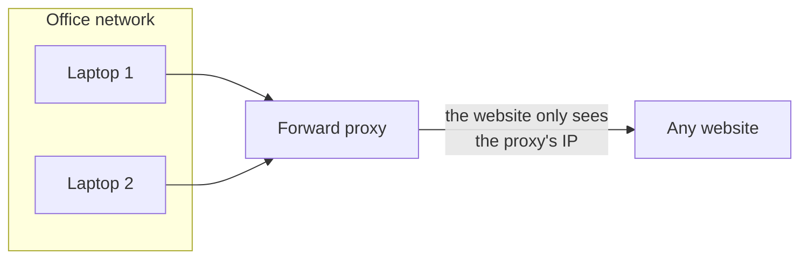
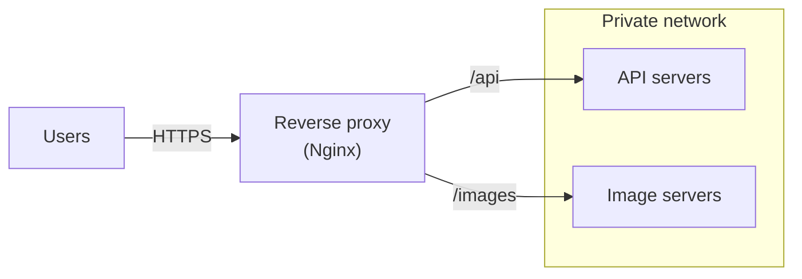

## What is it?

A **proxy** is a server that sits **in the middle** and passes messages on someone else's behalf.

- A **forward proxy** works for the **clients**. Think of an office receptionist who makes outside calls for the staff. The people being called only see the office number, never your own.
- A **reverse proxy** works for the **servers**. Think of a hotel front desk. Guests only talk to the desk, and never walk into the back offices. The desk passes each request to the right person.

## Why do we need it?

Without a middleman, every server talks to the internet on its own:

- Each server needs a **public IP**, its own **certificate**, and its own protection against attacks.
- Clients must know **which server** to call. Add or remove a server, and every client has to change.
- On the client side, every laptop in an office talks to the internet directly. There is **no single place** to set rules, keep logs, or cache files.

A proxy gives you **one place** to do these jobs, without changing the clients or the servers.

## How it works inside

### Forward proxy

A forward proxy sits **in front of the clients**. All their traffic goes through it before reaching the internet.



What it is used for:

- **Company rules:** block some websites, and log what is visited.
- **Privacy:** websites see the proxy's IP address, not yours.
- **Shared caching:** if 100 people in an office download the same file, the proxy can fetch it once.
- **Getting around blocks:** reach content that is blocked in your region.

### Reverse proxy

A reverse proxy sits **in front of the servers**. Users think they are talking to the website directly, but they only ever reach the proxy.



What a reverse proxy does:

1. **Load balancing:** spreads requests across many servers (see [Load Balancing](../hld-basics/load-balancing.mdx)).
2. **HTTPS:** it holds the certificate and unlocks the traffic, so the servers don't have to (see [HTTP and HTTPS](./http-and-https.mdx)).
3. **Caching:** keeps copies of popular responses.
4. **Compression:** makes responses smaller before sending them.
5. **Security:** hides the real servers, and blocks bad traffic.
6. **Routing:** sends `/api` to the API servers and `/images` to the image servers.

Here is what that routing looks like in **Nginx**, a popular reverse proxy:

```nginx
upstream api_servers {
  server 10.0.1.5:3000;
  server 10.0.1.6:3000;
}

upstream image_servers {
  server 10.0.2.5:8080;
  server 10.0.2.6:8080;
}

server {
  listen 443 ssl;
  server_name shop.example.com;
  # certificate settings left out

  location /api/ {
    proxy_pass http://api_servers;
  }

  location /images/ {
    proxy_pass http://image_servers;
  }
}
```

### What happens to one request

1. The reverse proxy accepts the user's connection, and unlocks HTTPS if it holds the certificate.
2. It reads the request: the `Host` header, the path, other headers.
3. It picks a server, and sends the request over its **own connection**. Proxies keep a pool of open connections to the servers and reuse them.
4. The server now sees the **proxy's IP**, not the user's. So the proxy adds a header like `X-Forwarded-For` with the user's real IP.
5. It passes the answer back. If the server gives a broken answer, the user gets `502 Bad Gateway`. If it takes too long, `504 Gateway Timeout`.

A **forward proxy** handles HTTPS differently. The browser sends `CONNECT shop.example.com:443`, and the proxy just passes the locked bytes along. It sees **which site** you visit, but not what is inside. Some companies install their own certificate on work laptops, so their proxy can unlock and inspect the traffic too.

## Forward vs reverse

| | Forward proxy | Reverse proxy |
| --- | --- | --- |
| **Works for** | The clients | The servers |
| **Hides** | Who the client is | Which servers are behind it |
| **Set up by** | The client side: a company, a school, a user | The website owner |
| **Examples** | Office web filters, Squid | Nginx, HAProxy, Envoy, Cloudflare |

## Reverse proxy, load balancer, API gateway?

All three sit in front of your servers, so they overlap:

- A **reverse proxy** is the general idea: a middleman for servers.
- A **load balancer** is a reverse proxy whose main job is spreading traffic.
- An **API gateway** is a reverse proxy with extra API features: login checks, rate limits, API keys (see [API Gateway](../hld-basics/api-gateway.mdx)).

In real systems, one tool like Nginx or Envoy often does all three jobs.

## When to use it

- **Reverse proxy:** in front of almost every website in production. One public entry point that ends HTTPS, routes, caches and blocks bad traffic.
- **Forward proxy:** a company or school that must filter, log or cache its users' web traffic. Also for servers on a private network that may only reach a few approved outside APIs.

**Don't use it when** the traffic isn't HTTP, like a UDP game server. An HTTP proxy can't read it. Use an L4 load balancer, or connect directly.

And never run **only one**. All traffic goes through it, so a single proxy is a single point of failure. Run at least two.

## Alternatives

| Option | What it is | Pick it when |
| --- | --- | --- |
| **Direct connection** | Clients reach the server's own public IP | One small server, with nothing to hide or spread |
| **DNS load balancing** | DNS returns several server IPs, and each client picks one | Simple spreading with no box in the middle. See [DNS](./dns.mdx) |
| **L4 load balancer** | Passes TCP or UDP connections on, without reading HTTP | Non-HTTP traffic, or the lowest delay. See [Load Balancing](../hld-basics/load-balancing.mdx) |
| **Sidecar proxy** (service mesh) | A small proxy, often Envoy, next to every service | Many services calling each other, with encryption, retries and metrics on every call |
| **VPN** (instead of a forward proxy) | Sends **all** of a device's traffic through an encrypted tunnel | Reach a private network, or hide your IP for every app, not only the browser |
| **NAT gateway** (instead of a forward proxy) | Lets private servers reach the internet, without reading the traffic | Servers need to go out to the internet, and no filtering is needed |

## In the real world

**Cloudflare is a giant reverse proxy.** When you visit a site that uses Cloudflare, your browser actually connects to Cloudflare's servers. Cloudflare blocks attacks, serves cached files, and passes the rest to the site's real servers, which stay hidden.

**Nginx** is one of the most used web servers and reverse proxies on the internet. **Envoy** was built at Lyft to sit next to every service and handle the traffic between them.

**Companies use forward proxies** to filter employee web traffic and block harmful websites.

## In the interview

You usually draw the reverse proxy as your load balancer or API gateway. Say what it does:

> "Users reach us through a reverse proxy. It ends HTTPS, caches static files, and routes `/api` to the API servers. The servers themselves stay on a private network."

<Callout title="Remember this" type="success">
  - A **proxy** sits in the middle and passes messages on.
  - **Forward proxy** = works for **clients**. Hides who they are, filters and caches their traffic.
  - **Reverse proxy** = works for **servers**. Load balancing, HTTPS, caching, routing, security.
  - Load balancers and API gateways are **special kinds of reverse proxy**.
  - Examples: **Nginx, HAProxy, Envoy, Cloudflare**.
  - **Why:** **one place** for HTTPS, routing, caching and protection, so clients and servers don't have to change.
  - **Inside:** a new connection to the server, reused from a pool. The user's IP goes in `X-Forwarded-For`. Broken answer = `502`, too slow = `504`.
  - **Alternatives:** a direct connection, DNS load balancing, an L4 load balancer, a sidecar proxy, a VPN, a NAT gateway.
</Callout>
