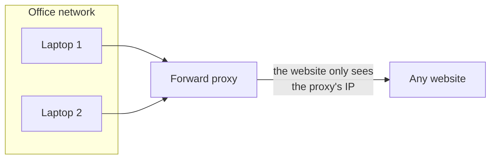
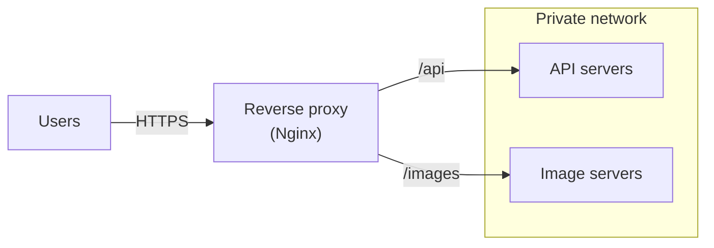

## The idea

A **proxy** is a server that sits **in the middle** and passes messages on someone else's behalf.

- A **forward proxy** works for the **clients**. Think of an office receptionist who makes outside calls for the staff. The people being called only see the office number, never your own.
- A **reverse proxy** works for the **servers**. Think of a hotel front desk. Guests only talk to the desk, and never walk into the back offices. The desk passes each request to the right person.

## Forward proxy

A forward proxy sits **in front of the clients**. All their traffic goes through it before reaching the internet.



What it is used for:

- **Company rules:** block some websites, and log what is visited.
- **Privacy:** websites see the proxy's IP address, not yours.
- **Shared caching:** if 100 people in an office download the same file, the proxy can fetch it once.
- **Getting around blocks:** reach content that is blocked in your region.

## Reverse proxy

A reverse proxy sits **in front of the servers**. Users think they are talking to the website directly, but they only ever reach the proxy.



What a reverse proxy does:

1. **Load balancing:** spreads requests across many servers (see [Load Balancing](../hld-basics/load-balancing.mdx)).
2. **HTTPS:** it holds the certificate and unlocks the traffic, so the servers don't have to (see [HTTP and HTTPS](./http-and-https.mdx)).
3. **Caching:** keeps copies of popular responses.
4. **Compression:** makes responses smaller before sending them.
5. **Security:** hides the real servers, and blocks bad traffic.
6. **Routing:** sends `/api` to the API servers and `/images` to the image servers.

Here is what that routing looks like in **Nginx**, a popular reverse proxy:

```nginx
upstream api_servers {
  server 10.0.1.5:3000;
  server 10.0.1.6:3000;
}

upstream image_servers {
  server 10.0.2.5:8080;
  server 10.0.2.6:8080;
}

server {
  listen 443 ssl;
  server_name shop.example.com;
  # certificate settings left out

  location /api/ {
    proxy_pass http://api_servers;
  }

  location /images/ {
    proxy_pass http://image_servers;
  }
}
```

## Forward vs reverse

| | Forward proxy | Reverse proxy |
| --- | --- | --- |
| **Works for** | The clients | The servers |
| **Hides** | Who the client is | Which servers are behind it |
| **Set up by** | The client side: a company, a school, a user | The website owner |
| **Examples** | Office web filters, Squid | Nginx, HAProxy, Envoy, Cloudflare |

## Reverse proxy, load balancer, API gateway?

All three sit in front of your servers, so they overlap:

- A **reverse proxy** is the general idea: a middleman for servers.
- A **load balancer** is a reverse proxy whose main job is spreading traffic.
- An **API gateway** is a reverse proxy with extra API features: login checks, rate limits, API keys (see [API Gateway](../hld-basics/api-gateway.mdx)).

In real systems, one tool like Nginx or Envoy often does all three jobs.

## In the real world

**Cloudflare is a giant reverse proxy.** When you visit a site that uses Cloudflare, your browser actually connects to Cloudflare's servers. Cloudflare blocks attacks, serves cached files, and passes the rest to the site's real servers, which stay hidden.

**Nginx** is one of the most used web servers and reverse proxies on the internet. **Envoy** was built at Lyft to sit next to every service and handle the traffic between them.

**Companies use forward proxies** to filter employee web traffic and block harmful websites.

## In the interview

You usually draw the reverse proxy as your load balancer or API gateway. Say what it does:

> "Users reach us through a reverse proxy. It ends HTTPS, caches static files, and routes `/api` to the API servers. The servers themselves stay on a private network."

<Callout title="Remember this" type="success">
  - A **proxy** sits in the middle and passes messages on.
  - **Forward proxy** = works for **clients**. Hides who they are, filters and caches their traffic.
  - **Reverse proxy** = works for **servers**. Load balancing, HTTPS, caching, routing, security.
  - Load balancers and API gateways are **special kinds of reverse proxy**.
  - Examples: **Nginx, HAProxy, Envoy, Cloudflare**.
</Callout>
