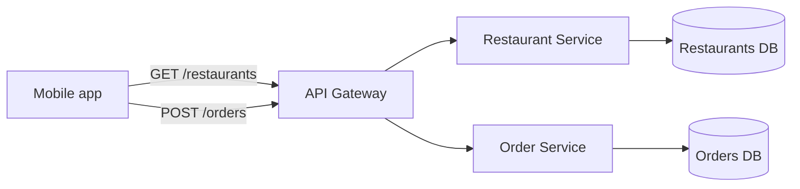

## What is it?

An **API** is the menu of your system. It lists what other programs can ask for, and how to ask.

**REST** is the most common style of web API. It follows three simple rules:

1. Everything is a **resource**: a thing, like a user, an order or a restaurant.
2. Each resource has its own **URL**, like `/orders/42`.
3. You use **HTTP methods** (`GET`, `POST`, `PATCH`, `DELETE`) to say what you want to do with it.

Think of a library. Every book has its own shelf number (the URL). You don't walk in and shout "do the borrowing thing". You take book number 42 to the desk and say "borrow" (the method).

## Why do we need it?

Before REST, every API made up its own style. One had `/createOrder` and `/getOrderById`. Another (old **SOAP** services) sent every call as a `POST` to one URL, wrapped in XML. This caused two problems:

- **Every API had to be learned from zero.** Nothing was the same from one company to the next.
- **HTTP's help was lost.** When every call is a `POST`, caches can't store reads, and clients can't tell which calls are safe to retry.

REST reuses what HTTP already has: **URLs** to name things, **methods** for the actions, **status codes** for the result (see [HTTP Methods, Status Codes and Headers](./http-methods-status-codes-headers.mdx)). So caches, proxies, browsers and tools just work, and any language can call the API with plain HTTP. The idea comes from Roy Fielding's PhD thesis in 2000.

## How it works inside

### One request, step by step

When `GET /orders/42` reaches the server:

1. The **router** matches the method and the path against a pattern, like `GET /orders/:id`, and picks the code that handles it.
2. It reads the **path param** (`id` is `42`) and the **login token** from the headers.
3. The handler reads the order from the **database**.
4. It turns the result into a **status code** and a **JSON** body.

Here is that handler in Express (Node.js):

```js
app.get("/orders/:id", async (request, response) => {
    // Path param: which order
    const orderId = request.params.id;

    // The user comes from the login token (a login middleware set it)
    const userId = request.user.id;

    const order = await db.findOrder(orderId, userId);

    if (order === null) {
        response.status(404).json({ error: "ORDER_NOT_FOUND" });
        return;
    }

    response.status(200).json(order);
});
```

### What "REST" means

REST stands for **REpresentational State Transfer**. The server never hands out the resource itself (a row in its database). It sends a **representation** of it, usually JSON. The client changes the resource by sending a representation back, like a `PATCH` body. And because each request is **stateless**, any server behind the load balancer can answer it.

## Resources and URLs

All examples here use a **food delivery app**. Its resources are restaurants, menu items, orders and users.

| What you want | Request |
| --- | --- |
| List restaurants | `GET /restaurants` |
| See one restaurant | `GET /restaurants/17` |
| See its menu | `GET /restaurants/17/menu-items` |
| Place an order | `POST /orders` |
| See an order | `GET /orders/42` |
| Change the delivery address | `PATCH /orders/42` |
| Remove an item from your cart | `DELETE /cart/items/5` |

### Rules for good URLs

1. **Nouns, not verbs.** The method is already the verb. Use `/orders`, not `/createOrder`.
2. **Plural names.** `/orders` for the list, `/orders/42` for one order. A thing each user has only one of, like their cart, stays singular: `/cart`.
3. **Nest only for "belongs to".** `/restaurants/17/menu-items` means "menu items of restaurant 17". Don't go deeper than one or two levels.
4. **Filters go in the query string.** `GET /restaurants?city=pune&sort=rating&limit=20`
5. **Lowercase, with hyphens.** `/menu-items`, not `/Menu_Items`.

| Bad | Good |
| --- | --- |
| `GET /getOrder?id=42` | `GET /orders/42` |
| `POST /createOrder` | `POST /orders` |
| `POST /orders/42/delete` | `DELETE /orders/42` |
| `GET /Restaurants_List` | `GET /restaurants` |

### Path params vs query params

A URL can carry values in two places.

**Path params** are part of the **path**. They say **which resource** you mean: one specific record.

```text
GET /restaurants/17                 → restaurant 17
GET /orders/42                      → order 42
GET /restaurants/17/menu-items      → the menu items of restaurant 17
```

In code and docs, a path param is written with a colon: the route `/restaurants/:id` matches `/restaurants/17`, and `id` is `17`.

**Query params** come after the `?`, as `key=value` pairs joined with `&`. They don't point to a resource. They **change what you get back**: filter, sort, search or page through a list. You can use them in any combination, and all of them are optional.

```text
GET /restaurants?city=pune                       → filter
GET /restaurants?cuisine=thai&sort=rating        → filter and sort
GET /restaurants?search=pizza                    → search
GET /orders?page=2&limit=20                      → page 2, 20 orders per page
```

| | Path param | Query param |
| --- | --- | --- |
| Where | In the path: `/orders/42` | After the `?`: `/orders?status=delivered` |
| Use it to | Identify one specific resource | Filter, sort, search, paginate |
| Required? | Yes. Without it, it's a different URL | No. Leave it out and you get the full list |

A simple test: if the value answers **"which one?"**, it's a path param. If it answers **"which ones, and in what order?"**, it's a query param.

When the search is too big or complex for query params, send it in a body instead. See [the QUERY method](#the-query-method-a-search-with-a-body) below.

## The right method and status code

Here is a full example of placing an order:

```http
POST /orders
Authorization: Bearer eyJhbGci...
Content-Type: application/json
Idempotency-Key: 7f3a9c

{ "restaurantId": 17, "items": [{ "menuItemId": 3, "quantity": 2 }] }
```

The server creates the order and answers:

```http
201 Created
Location: /orders/42

{ "id": 42, "status": "PLACED", "total": 540 }
```

If something is wrong, use a real error code **and** a clear error body:

```http
409 Conflict

{ "error": "RESTAURANT_CLOSED", "message": "This restaurant is closed right now." }
```

The `error` code is for programs. The `message` is for people. See [HTTP Methods, Status Codes and Headers](./http-methods-status-codes-headers.mdx) for all the codes.

## Designing a small API, step by step

<Steps>
<Step>

**List the features.** Browse restaurants nearby, see a menu, place an order, track an order.

</Step>
<Step>

**Find the nouns.** They become your resources: restaurant, menu item, order.

</Step>
<Step>

**Write one endpoint per feature.** This way you can check that every feature is covered.

</Step>
<Step>

**Pick the method and the success code** for each one.

</Step>
<Step>

**Take the user from the login token**, never from the request body. Otherwise anyone could place orders as someone else.

</Step>
</Steps>

The result:

| Feature | Endpoint | Success |
| --- | --- | --- |
| Browse restaurants nearby | `GET /restaurants?lat=18.52&lng=73.85` | `200` |
| See a menu | `GET /restaurants/17/menu-items` | `200` |
| Place an order | `POST /orders` | `201` |
| Track an order | `GET /orders/42` | `200` |

And how these requests flow through the system:



## A few more REST rules

- **Stateless.** Every request carries everything the server needs, including the login token (see [HTTP and HTTPS](./http-and-https.mdx)).
- **JSON** is the normal format for bodies.
- **`GET` responses can be cached** with the `Cache-Control` header.
- **Big lists come in pages**, and **APIs need versions** when they change. See [API Pagination and Versioning](../advanced-components/api-pagination-versioning.mdx).

## The QUERY method: a search with a body

`QUERY` is a **new HTTP method**. It works like `GET`: it only **reads** data and never changes anything. The difference is that the search goes in the **request body**, not in the URL.

### Why a new method was needed

Say the food app gets an advanced search: 3 cuisines, a minimum rating, open now, vegan only, sorted by rating. With `GET`, every filter goes into the URL:

```http
GET /restaurants?city=pune&cuisines=thai,italian,south-indian&minRating=4&openNow=true&dietary=vegan&sort=rating
```

That works for a few filters. But as searches grow, putting everything in the URL causes problems:

1. **URLs have a length limit.** Browsers, servers and proxies cut off or reject very long URLs, often at around 8 KB. A search with a list of 500 product IDs won't fit.
2. **Complex filters are hard to write in a URL.** Nested conditions like "(thai AND rating ≥ 4) OR (italian AND open now)" don't fit nicely in `key=value` pairs.
3. **URLs get saved everywhere**: server logs, proxy logs, browser history. Anything private in the query string, like an email or a phone number, ends up in all of them.

So why not put the search in a body? Neither old method does that well:

- **`GET` with a body:** HTTP never said what a body on `GET` means. Many servers, proxies and libraries ignore it or reject it. A browser's `fetch` throws an error if you try.
- **`POST` with a body:** this works, and it's what most teams do today (`POST /restaurants/search`). But `POST` tells everyone "this request may **change** something". So a client can't safely **retry** it when the network fails, a cache won't **store** the answer, and someone reading the API can't tell it's only a read.

`QUERY` fixes this. It has **the safety of `GET` and the body of `POST`**.

### How it looks

```http
QUERY /restaurants
Content-Type: application/json

{
  "city": "pune",
  "cuisines": ["thai", "italian", "south-indian"],
  "minRating": 4,
  "openNow": true,
  "dietary": ["vegan"],
  "sort": "rating"
}
```

The server answers `200 OK` with the matching restaurants, just like a `GET`.

| | `GET` | `POST` | `QUERY` |
| --- | --- | --- | --- |
| Has a body | No | Yes | Yes |
| Safe (only reads, changes nothing) | Yes | No | Yes |
| Idempotent (safe to retry) | Yes | No | Yes |
| Response can be cached | Yes | Not normally | Yes. The body is part of the cache key |

The last row matters. A cache can't tell two `QUERY` requests apart by URL alone, because they all go to `/restaurants`. So it uses the URL **and the body** to decide whether it has seen this exact search before.

### Can you use it today?

It's new, so support is still growing. The IETF, the group that writes the HTTP rules, has been finishing the standard, and many servers, frameworks, API gateways and tools don't handle `QUERY` yet. Until yours does, use `POST /restaurants/search`, and write in the docs that it doesn't change anything.

In an interview, if a search has many or complex filters, you can say: "For simple filters I'd use `GET` with a query string. For a big, complex search I'd use the new `QUERY` method, or `POST /search` if our stack doesn't support it yet."

## Common mistakes

- Verbs in URLs: `/getOrders`, `/deleteUser`.
- Taking the user ID from the request body instead of the token.
- Returning `200 OK` with an error message inside. Use a real error code.
- Returning a list of 100,000 items with no paging.
- Changing the API in a way that breaks old apps, without a new version.

## When to use it

- **Public APIs** that other developers will use. Everyone knows REST, and every language can call it.
- **Web and mobile apps** talking to their own backend: create, read, change and delete resources.
- **Reads you want to cache**, with `Cache-Control` and CDNs.

**Don't use it when:**

- **Your own services call each other** a huge number of times, and speed matters most. Use gRPC.
- **Each screen needs data from many resources**, and different apps need different fields. REST means many round trips, or too much data. Use GraphQL.
- **The server must push updates**, like chat or live scores. Use [WebSockets or SSE](./polling-websockets-sse.mdx).

## Alternatives

| Option | What it is | Pick it when |
| --- | --- | --- |
| **gRPC** | Call a function on another service. Small binary messages on HTTP/2 | Fast calls between your own services. See [gRPC and GraphQL](./grpc-and-graphql.mdx) |
| **GraphQL** | One endpoint. The client asks for exactly the fields it needs | Many different screens and apps need different data. See [gRPC and GraphQL](./grpc-and-graphql.mdx) |
| **WebSockets or SSE** | A connection that stays open, so the server can push | Live updates. See [Polling, WebSockets and SSE](./polling-websockets-sse.mdx) |
| **Webhooks** | The other system calls **your** URL when something happens | You want to hear about events, like Stripe telling you a payment succeeded |
| **SOAP** | An older style: XML messages and a strict contract | Old enterprise systems that already use it |

## In the real world

**Stripe** is famous for its clean REST API. Its resources look like `/v1/customers` and `/v1/refunds`, and errors come back with a clear type and message. The `/v1` in the URL has stayed the same for years. Real changes get **date-named versions** (like `2024-06-20`): each account stays on its version until it chooses to upgrade, and an app can ask for a version with the `Stripe-Version` header. So old apps keep working. Teams often copy Stripe's style.

**GitHub** shows nesting done well: `GET /repos/OWNER/REPO/issues` lists the issues of one repository.

## In the interview

In the API step, write one endpoint for each feature, and say where the user comes from:

> "To place an order: `POST /orders` with the restaurant and the items. The user ID comes from the login token. It returns `201 Created` with the new order ID."

<Callout title="Remember this" type="success">
  - REST: **resources** (nouns) with **URLs**, and **HTTP methods** as the actions.
  - Plural nouns, nest only for "belongs to", filters in the **query string**.
  - **Path param** = which one (`/orders/42`). **Query param** = filter, sort, search, page (`/orders?page=2&limit=20`).
  - **`QUERY`** = the safety of `GET` + the body of `POST`. Use it for searches too big or complex for a URL (or `POST /search` until it's supported).
  - Use the **right status code**, plus a clear error body.
  - **One endpoint per feature.**
  - Take the **user from the token**, never from the body.
  - **Page** big lists. **Version** the API when it changes.
  - **Why:** one shared style that **reuses HTTP** (URLs, methods, status codes), so caches, retries and tools just work.
  - **Inside:** the router matches **method + path pattern**, the handler reads the token and the database, and returns a **status code + JSON**.
  - **Alternatives:** gRPC (service to service), GraphQL (flexible fields), WebSockets/SSE (push), webhooks.
</Callout>
