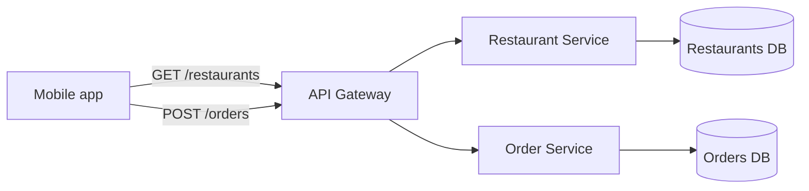

## The idea

An **API** is the menu of your system. It lists what other programs can ask for, and how to ask.

**REST** is the most common style of web API. It follows three simple rules:

1. Everything is a **resource**: a thing, like a user, an order or a restaurant.
2. Each resource has its own **URL**, like `/orders/42`.
3. You use **HTTP methods** (`GET`, `POST`, `PATCH`, `DELETE`) to say what you want to do with it.

Think of a library. Every book has its own shelf number (the URL). You don't walk in and shout "do the borrowing thing". You take book number 42 to the desk and say "borrow" (the method).

## Resources and URLs

All examples here use a **food delivery app**. Its resources are restaurants, menu items, orders and users.

| What you want | Request |
| --- | --- |
| List restaurants | `GET /restaurants` |
| See one restaurant | `GET /restaurants/17` |
| See its menu | `GET /restaurants/17/menu-items` |
| Place an order | `POST /orders` |
| See an order | `GET /orders/42` |
| Change the delivery address | `PATCH /orders/42` |
| Remove an item from your cart | `DELETE /cart/items/5` |

### Rules for good URLs

1. **Nouns, not verbs.** The method is already the verb. Use `/orders`, not `/createOrder`.
2. **Plural names.** `/orders` for the list, `/orders/42` for one order. A thing each user has only one of, like their cart, stays singular: `/cart`.
3. **Nest only for "belongs to".** `/restaurants/17/menu-items` means "menu items of restaurant 17". Don't go deeper than one or two levels.
4. **Filters go in the query string.** `GET /restaurants?city=pune&sort=rating&limit=20`
5. **Lowercase, with hyphens.** `/menu-items`, not `/Menu_Items`.

| Bad | Good |
| --- | --- |
| `GET /getOrder?id=42` | `GET /orders/42` |
| `POST /createOrder` | `POST /orders` |
| `POST /orders/42/delete` | `DELETE /orders/42` |
| `GET /Restaurants_List` | `GET /restaurants` |

## The right method and status code

Here is a full example of placing an order:

```http
POST /orders
Authorization: Bearer eyJhbGci...
Content-Type: application/json
Idempotency-Key: 7f3a9c

{ "restaurantId": 17, "items": [{ "menuItemId": 3, "quantity": 2 }] }
```

The server creates the order and answers:

```http
201 Created
Location: /orders/42

{ "id": 42, "status": "PLACED", "total": 540 }
```

If something is wrong, use a real error code **and** a clear error body:

```http
409 Conflict

{ "error": "RESTAURANT_CLOSED", "message": "This restaurant is closed right now." }
```

The `error` code is for programs. The `message` is for people. See [HTTP Methods, Status Codes and Headers](./http-methods-status-codes-headers.mdx) for all the codes.

## Designing a small API, step by step

<Steps>
<Step>

**List the features.** Browse restaurants nearby, see a menu, place an order, track an order.

</Step>
<Step>

**Find the nouns.** They become your resources: restaurant, menu item, order.

</Step>
<Step>

**Write one endpoint per feature.** This way you can check that every feature is covered.

</Step>
<Step>

**Pick the method and the success code** for each one.

</Step>
<Step>

**Take the user from the login token**, never from the request body. Otherwise anyone could place orders as someone else.

</Step>
</Steps>

The result:

| Feature | Endpoint | Success |
| --- | --- | --- |
| Browse restaurants nearby | `GET /restaurants?lat=18.52&lng=73.85` | `200` |
| See a menu | `GET /restaurants/17/menu-items` | `200` |
| Place an order | `POST /orders` | `201` |
| Track an order | `GET /orders/42` | `200` |

And how these requests flow through the system:



## A few more REST rules

- **Stateless.** Every request carries everything the server needs, including the login token (see [HTTP and HTTPS](./http-and-https.mdx)).
- **JSON** is the normal format for bodies.
- **`GET` responses can be cached** with the `Cache-Control` header.
- **Big lists come in pages**, and **APIs need versions** when they change. See [API Pagination and Versioning](../advanced-components/api-pagination-versioning.mdx).

## Common mistakes

- Verbs in URLs: `/getOrders`, `/deleteUser`.
- Taking the user ID from the request body instead of the token.
- Returning `200 OK` with an error message inside. Use a real error code.
- Returning a list of 100,000 items with no paging.
- Changing the API in a way that breaks old apps, without a new version.

## In the real world

**Stripe** is famous for its clean REST API. Its resources look like `/v1/customers` and `/v1/refunds`, and errors come back with a clear type and message. The `/v1` in the URL has stayed the same for years. Real changes get **date-named versions** (like `2024-06-20`): each account stays on its version until it chooses to upgrade, and an app can ask for a version with the `Stripe-Version` header. So old apps keep working. Teams often copy Stripe's style.

**GitHub** shows nesting done well: `GET /repos/OWNER/REPO/issues` lists the issues of one repository.

## In the interview

In the API step, write one endpoint for each feature, and say where the user comes from:

> "To place an order: `POST /orders` with the restaurant and the items. The user ID comes from the login token. It returns `201 Created` with the new order ID."

<Callout title="Remember this" type="success">
  - REST: **resources** (nouns) with **URLs**, and **HTTP methods** as the actions.
  - Plural nouns, nest only for "belongs to", filters in the **query string**.
  - Use the **right status code**, plus a clear error body.
  - **One endpoint per feature.**
  - Take the **user from the token**, never from the body.
  - **Page** big lists. **Version** the API when it changes.
</Callout>
