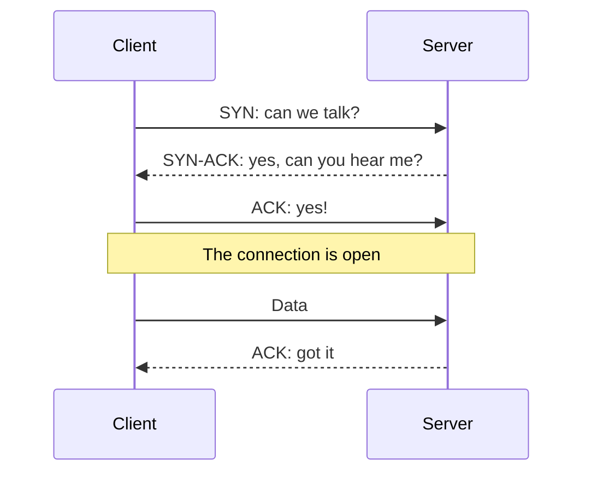
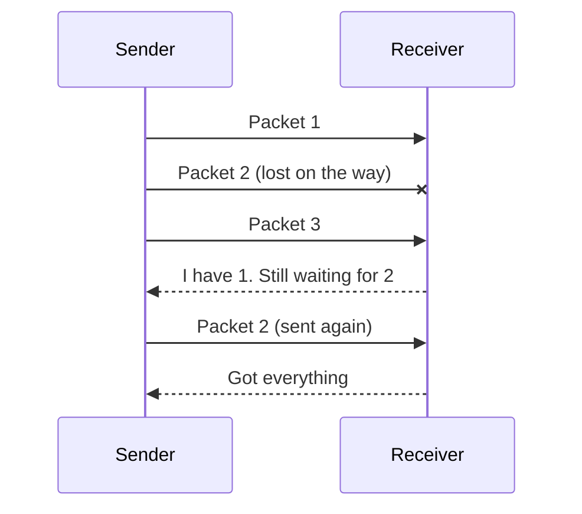
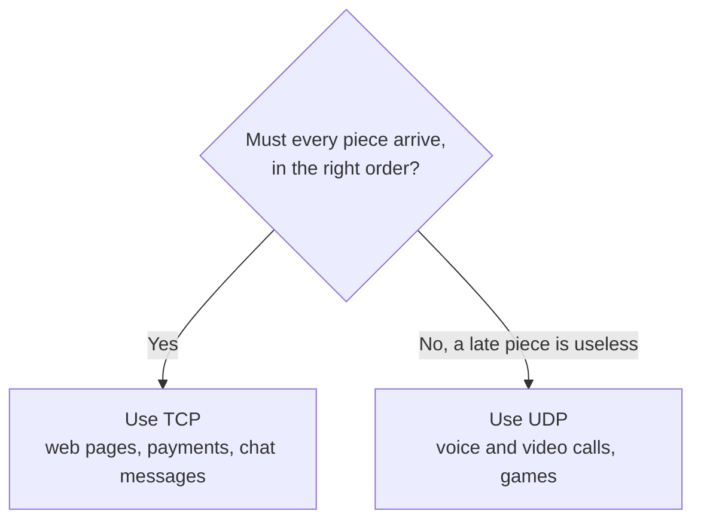

## The idea

Data travels across the internet in small pieces called **packets** (see [How the Internet Works](./how-the-internet-works.mdx)). TCP and UDP are two different sets of rules for sending those packets.

- **TCP** is like a **tracked courier**. Every package is tracked and signed for. If one gets lost, it is sent again. Safe, but a little slower.
- **UDP** is like **throwing flyers from a moving car**. Very fast, but nobody checks whether each flyer reached someone.

## TCP: safe and in order

TCP makes four promises:

1. **Every packet arrives.** Lost packets are sent again.
2. **Packets arrive in order.** If packet 3 comes before packet 2, TCP holds it until 2 comes. The app always gets them in order.
3. **No duplicates.** Each piece is delivered once.
4. **It slows down when the network is busy**, so it doesn't make traffic worse.

### Step 1: the handshake

Before any data moves, TCP opens a connection with three short messages. It is like starting a phone call: "Hello, can you hear me?" "Yes, can you hear me?" "Yes!" Then you start talking.

This handshake costs **one full round trip** before any data is sent. If the server is in the USA and you are in India, that is about 200 ms of waiting. That is why apps **reuse open connections** instead of opening a new one for every request.

### Step 2: fixing lost packets

The receiver sends back an **ACK** (acknowledgment) for what it got. If a packet goes missing, the sender notices and sends it again.

## UDP: fast, no promises

UDP skips all of that:

- **No handshake.** It just sends.
- **No resending.** A lost packet is simply gone.
- **No ordering.** Packets can arrive in any order.

Less work means **less delay**. The app itself decides what to do about lost packets, and often the answer is "nothing".

## Side by side

| | TCP | UDP |
| --- | --- | --- |
| **Setup** | Handshake first | None, just send |
| **Lost packets** | Sent again | Gone |
| **Order** | Always in order | Any order |
| **Speed** | A little slower | Faster |
| **Used for** | Web pages, APIs, chat messages, payments, database connections | Voice and video calls (WebRTC, the system built into browsers for live calls), online games, DNS lookups |

## How to choose

**Use TCP by default.** Pick UDP only when **old data is useless**:

- **Video call:** a video frame from one second ago doesn't matter anymore. Skip it and show the next one. A tiny glitch is better than a frozen screen.
- **Online game:** the game sends player positions many times a second. An old position is useless, because a newer one is already on its way.
- **Payment:** every byte must arrive correctly. This is TCP.
- **Streaming video** (YouTube, Netflix, even live streams on Twitch): not a UDP case. The video is sent as small chunks over normal HTTP, through a CDN. The player keeps a few seconds of video ready, so a resent packet is never noticed.

## In the real world

**Video calls use UDP.** Zoom and WhatsApp calls send audio and video over UDP when they can. On a bad network you hear a short "robot voice" or see a small glitch, but the call keeps going instead of freezing.

**Online games use UDP.** Fast multiplayer games like Fortnite send player movements over UDP, because a late update is worse than a missing one.

**HTTP/3 is built on UDP.** Google created a new protocol called **QUIC**. It runs on UDP and adds TCP's safety on top, but sets up connections faster and works better on phones. The newest version of HTTP, **HTTP/3**, uses QUIC. YouTube and Google Search use it today.

## In the interview

Most of the time you won't mention TCP at all. Everything that uses HTTP already runs on TCP (or QUIC). Bring up UDP only for voice or video calls, or games:

> "For the video call itself, I'll use UDP through WebRTC, because a late frame is useless. For chat messages, I'll use TCP, because every message must arrive."

<Callout title="Remember this" type="success">
  - **TCP = safe:** handshake first, every packet arrives, in order. A little slower.
  - **UDP = fast:** no handshake, no resending, no order.
  - The TCP handshake costs **one round trip**, so reuse open connections.
  - **TCP by default.** UDP for **voice and video calls and games**, where late data is useless.
  - **Streaming video** (even live) is not UDP: it is HTTP chunks through a CDN.
  - **HTTP/3** runs on **QUIC**, which is built on UDP.
</Callout>
