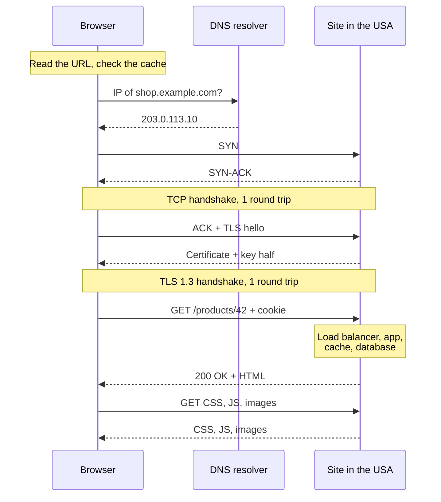
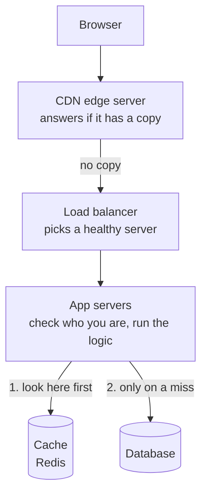
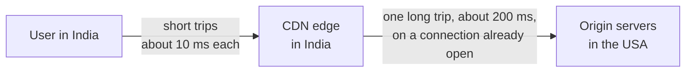

## The idea

You type `https://shop.example.com/products/42` and press Enter. About a second later, a page appears. In that second, many small steps happen, one after another.

Think of visiting a company's office in another city:

1. You look up the **address** in your contacts. (DNS)
2. You **drive there**, and the guard at the gate lets you in. (TCP connection)
3. The company shows you its **official ID**, so you know it is the real office, and you agree on a private way to talk. (TLS)
4. At the front desk, you say **what you want** and show your visitor pass. (HTTP request with a cookie)
5. The front desk sends you to a **free person** who can help. (load balancer and app server)
6. That person looks in their **files** and gives you an answer. (cache, database and the response)

## The whole journey

Here is the network part for a user in India and a website in the USA, on a first visit:



## 1. The browser reads the URL

A URL has three main parts:

| Part | Here | What it tells the browser |
| --- | --- | --- |
| **Scheme** | `https` | How to talk: HTTP inside TLS, on port 443 unless the URL names another port |
| **Host** | `shop.example.com` | Which server. DNS turns this name into an IP address |
| **Path** | `/products/42` | Which page or thing you want on that server |

If what you typed is not a URL at all, like `running shoes`, the browser sends it to a search engine instead.

Then the browser checks its own **cache**: "Do I already have a fresh copy of this?" The `Cache-Control` header from the last visit says how long a copy stays fresh. If it is still fresh, the browser uses it with **no network at all**. HTML pages are usually kept only briefly, or must be checked with the server first, so the page itself normally needs the network. Images, CSS and JavaScript often come straight from the cache.

## 2. DNS finds the IP address

The browser knows the name, but it needs the **IP address**. It asks DNS (see [DNS](./dns.mdx)): first the browser cache, then the computer's cache, then the DNS resolver. Usually one of them has the answer saved, so this takes a few milliseconds. Only when nobody has it does the resolver do the full lookup.

If the site sits behind a CDN, DNS gives back the address of a **nearby CDN edge server**, not the site's own servers (more in step 6).

## 3. TCP opens a connection

The browser opens a **TCP connection** to that IP address, on port 443 (see [TCP vs UDP](./tcp-vs-udp.mdx)). Three short messages, SYN, SYN-ACK and ACK, cost **one round trip** (there and back) before any data moves.

## 4. TLS locks the connection

Next comes the **TLS handshake** (see [HTTP and HTTPS](./http-and-https.mdx)). The server sends its **certificate**, the browser checks that it is real and belongs to `shop.example.com`, and both sides build the same secret key. With **TLS 1.3**, this costs **one more round trip**. The older TLS 1.2 needs two.

During this handshake, the two sides also agree which HTTP version to speak, usually **HTTP/2**.

## 5. The browser sends the HTTP request

Now the browser sends the request, locked inside TLS (see [HTTP Methods, Status Codes and Headers](./http-methods-status-codes-headers.mdx)). In the simple HTTP/1.1 text form, it looks like this:

```http
GET /products/42 HTTP/1.1
Host: shop.example.com
Accept: text/html
Cookie: session_id=abc123
```

HTTP/2 sends the same information in a compact binary form, but the meaning is the same.

- `GET`, because you are reading a page.
- `Host` says which website you want, because one server can host many.
- `Cookie` is added **automatically** by the browser. HTTP forgets you after every request, so this is how the server knows you are logged in (see [Cookies, Sessions and JWT](./cookies-sessions-jwt.mdx)). A mobile app sends a token in the `Authorization` header instead.

## 6. The request reaches the servers

The request now passes through a few machines. Each one either answers, or passes it on:



1. **CDN edge server** (see [CDN and Edge Caching](../caching/cdn.mdx)). If it has a fresh copy (images, CSS, JS, or a public page), it answers right away, from close by. If not, it passes the request on to the site's own servers, called the **origin**.
2. **Load balancer** (see [Load Balancing](../hld-basics/load-balancing.mdx)). It sends the request to a healthy app server. The CDN edge and the load balancer are both **reverse proxies**: middlemen that stand in front of the servers (see [Reverse and Forward Proxies](./proxies.mdx)). HTTPS usually ends at one of them.
3. **App server.** It reads the cookie to find out who you are, then runs the business logic: "get product 42, with this user's price".
4. **Cache, then database.** The app asks the cache (like Redis) first, which answers in about a millisecond. Only on a miss does it go to the database, and then it saves the answer in the cache for next time (see [What is Caching](../caching/what-is-caching.mdx)).

The load balancer, app servers, cache and database sit in one data center, where a round trip takes under a millisecond. So the trips between them are tiny compared with the trip from India.

## 7. The response comes back

```http
HTTP/1.1 200 OK
Content-Type: text/html
Cache-Control: private, no-cache
ETag: "v7"

<!doctype html> ...the page...
```

- **Status code:** `200 OK` means "here is your page". A `301` or `302` sends the browser to the address in the `Location` header, which costs at least one more round trip. A `404` or `500` shows an error page.
- **Headers:** `Content-Type: text/html` says it is a web page. `Cache-Control` says who may keep a copy, and for how long. This page is personal, so `private` means only the browser may keep it, never the CDN. `no-cache` means "you may keep it, but ask me first if it changed". The `ETag` is a version tag: next time, the browser sends it back, and if nothing changed, the server answers `304 Not Modified` with no body.
- **Body:** the HTML itself.

## 8. The browser builds the page

The HTML is only the start. As the browser reads it, it finds links to other files, and asks for them too:

1. **CSS, JavaScript and images.** Files from the same site go over the **connection that is already open**, so there is no new handshake. With **HTTP/2**, the browser asks for many files **at the same time** on that one connection. Files on another domain, like `cdn.example.com`, usually need their own DNS lookup and connection. Files that are fresh in the browser cache (step 1) need no request at all.
2. **Drawing the page.** HTML gives the structure, CSS gives the look, and the browser paints it on the screen. It usually waits for the CSS first, so the page doesn't flash without styles.
3. **Running the JavaScript.** Scripts make the page interactive. They often call APIs, like `GET /api/cart`, to fetch personal data as JSON and fill it into the page. Each API call is one more HTTP request, usually on the same open connection.

## The latency budget

How long does all this take? Take a user in **India** and a server in the **USA**. One round trip is about **200 ms** (see [How the Internet Works](./how-the-internet-works.mdx)). Count the round trips for a first visit, with a brand-new connection:

| Step | Round trips | Time (about) |
| --- | --- | --- |
| DNS lookup (already cached) | 0 | 0 ms |
| TCP handshake | 1 | 200 ms |
| TLS 1.3 handshake | 1 | 200 ms |
| Request + response | 1 | 200 ms |
| Server work (app, cache, database) | 0 | say 50 ms |
| **First byte of the page arrives** | **3** | **about 650 ms** |

So the browser waits **about 600 ms plus the server's time** before the first byte of HTML arrives. This wait is often called **time to first byte** (TTFB). If DNS was not cached, and the resolver must ask name servers far away, add another 200 ms or so. And that is only the HTML. The CSS, JavaScript and images need at least one more round trip, so the page takes close to a second to show.

Notice where the time goes: **mostly travel, not the server**. Making the server twice as fast saves 25 ms. Removing one round trip saves 200 ms.

### Making it faster

**1. A CDN edge server nearby.** DNS sends the user to an edge server in India, about 10 ms away. Now the TCP and TLS handshakes are short trips.



- **The edge has a copy** (images, CSS, JS, a public page): 3 short round trips, about **30 ms** in total.
- **The edge has no copy** (a personal page): the 3 short round trips (about 30 ms), plus **one** long trip to the origin and the server work (about 250 ms). The edge usually keeps its own connection to the origin open and reuses it, so it doesn't pay for TCP and TLS again. Total: about **280 ms**.

**2. Reuse the connection.** A second request on the same connection skips TCP and TLS. It costs one round trip plus server time: about **250 ms**. Browsers keep connections open for a while for exactly this reason, and HTTP/2 sends many requests on one connection at once.

**3. HTTP/3.** HTTP/3 runs on **QUIC**, a newer protocol built on UDP. QUIC does the connection setup and the TLS handshake **together, in one round trip**. So a new connection needs 2 round trips before the first byte instead of 3: about **450 ms**. Browsers often learn that a server supports HTTP/3 from an earlier response, so a very first visit may still use HTTP/2.

| Setup (user in India, origin in the USA) | Before the first byte (about) |
| --- | --- |
| New connection, straight to the USA | 650 ms |
| New connection, with HTTP/3 | 450 ms |
| CDN edge, page fetched from the origin | 280 ms |
| Reused connection, straight to the USA | 250 ms |
| CDN edge, copy at the edge | 30 ms |

## In the real world

**A classic interview question.** "What happens when you type a URL into the browser and press Enter?" is one of the best-known questions in software interviews. There is no single right depth. You can answer in two minutes, or talk for an hour.

**The "what-happens-when" write-up.** A famous open-source project on GitHub, called **what-happens-when**, answers "What happens when you type google.com into your browser's address box and press enter?" in great detail. Many people added to it. It starts with the key press on your keyboard and goes all the way to the pixels on the screen. It shows how deep this one question can go.

**See it in your own browser.** In Chrome, open the developer tools (F12), go to the **Network** tab, and click a request. Its **Timing** view splits the request into steps like DNS lookup, initial connection, SSL (the TLS handshake), waiting for the server, and content download. These are the same steps as above.

**TLS 1.3 removed a round trip.** TLS 1.3, finished in 2018, cut the TLS handshake from two round trips to one. QUIC (a standard since 2021), the protocol under HTTP/3 (a standard since 2022), went further and merged the connection setup and the TLS handshake into a single round trip.

## In the interview

Go through **every step briefly, in order**, then let the interviewer pick where to go deeper. Give the round-trip numbers: they show you know where the time goes.

> "The browser checks its cache, then DNS turns the name into an IP. It opens a TCP connection and does a TLS handshake, about two round trips. Then it sends a GET with my cookie. A CDN or load balancer passes it to an app server, which reads from the cache or the database. The response comes back with a status code and headers like Cache-Control, and the browser builds the page, fetching CSS, JS and images on the same connection. Which part should I go deeper on?"

The same story explains many design choices: a **CDN** and servers in several regions make the trips short, and **reused connections** skip the handshakes.

<Callout title="Remember this" type="success">
  - The journey: **URL and cache → DNS → TCP → TLS → HTTP request → CDN / load balancer → app server → cache / database → response → page**.
  - A new HTTPS connection costs **2 round trips** (TCP + TLS 1.3). The request itself is **1 more**.
  - India ↔ USA: about **600 ms plus server time** before the first byte, on a new connection.
  - **Travel is most of the wait.** Cut round trips: a **CDN edge** nearby, **reused connections**, **HTTP/3**.
  - The HTML is only the start: **CSS, JS, images and API calls** follow, many at once on one HTTP/2 connection.
  - In the interview: **every step briefly, in order**, then go deep where asked.
</Callout>
