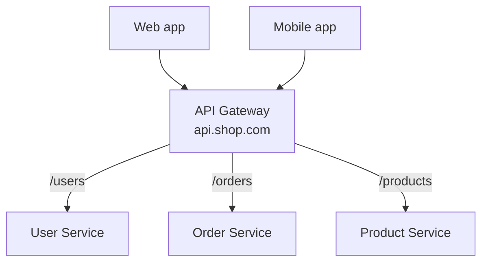
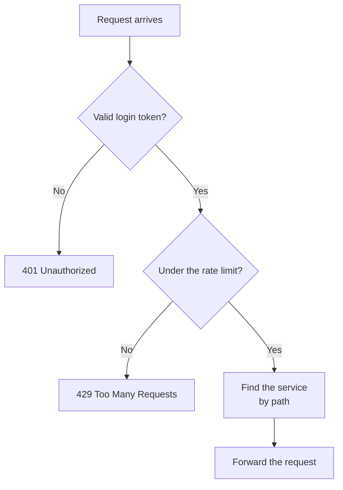
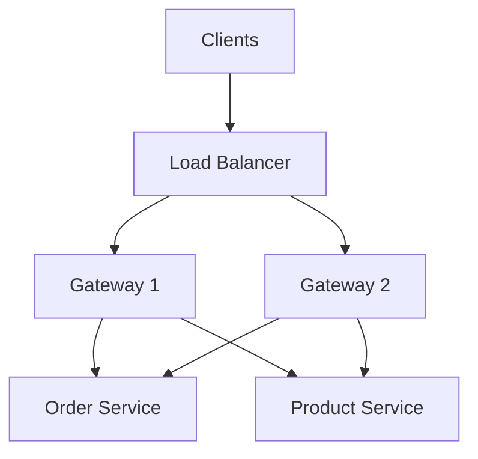

## The idea

An **API gateway** is one front door for all your backend services. Every request from outside comes to the gateway first. The gateway checks it, then sends it to the right service.

Think of the reception desk in a big office building. Visitors don't wander the floors looking for the right office. They go to reception. Reception checks their ID, signs them in, turns away people who keep coming back too often, and tells them which floor to go to. The offices inside don't each need their own security guard.

In tech: a shopping app has a user service, an order service and a product service. The mobile app talks to just one address, `api.shop.com`. The gateway sends `/orders` requests to the order service, `/products` requests to the product service, and so on.

## What an API gateway does



| Job | What it means |
| --- | --- |
| **Routing** | Send each request to the right service, based on the path, host or method |
| **Authentication** | Check the login token once, before any service sees the request |
| **Rate limiting** | Limit how many requests each user or API key can send |
| **TLS termination** | Handle HTTPS, so the services behind it don't have to |
| **Changing requests** | Add headers (like the user's ID), rename fields, convert formats |
| **Combining answers** | Call several services and merge the results into one response |
| **Caching** | Keep common answers for a short time |
| **Logging and metrics** | One place to record every request that comes in |
| **Versioning** | Send `/v1` to the old service and `/v2` to the new one |

Every request goes through the same checks, in order:



## Routing requests to the right service

The gateway keeps a list of rules: "this path goes to that service". Most gateways let you write them as config:

```yaml
routes:
  - path: /users/**
    service: user-service
  - path: /orders/**
    service: order-service
  - path: /products/**
    service: product-service
```

Each service usually runs on many servers. The gateway finds their current addresses through [service discovery](./health-checks-service-discovery.mdx), and spreads requests across them like a [load balancer](./load-balancing.mdx).

The client only needs to know **one address**. You can split, merge or move services behind the gateway, and the mobile app never has to change.

## Login checks and rate limiting in one place

**Without a gateway,** every service must check login tokens and count requests on its own. That is the same code written many times, maybe in different languages, and it is easy to get one of them wrong.

**With a gateway,** the check happens once, at the door:

1. The gateway checks the login token, for example a JWT (see [Cookies, Sessions and JWT](../foundations/cookies-sessions-jwt.mdx)).
2. If the token is good, it passes the user's ID to the service in a header, like `X-User-Id: 42`. First, it **removes** any `X-User-Id` header the client sent. Otherwise anyone could send `X-User-Id: 1` and act as another user.
3. The service trusts that header, because only the gateway can reach the services. They sit in a private network.

One thing stays in the service. The gateway checks **who you are** (authentication). But "may user 42 cancel order 7?" is still checked by the order service, because only it knows who owns order 7. That is **authorization**. See [Authentication vs Authorization](../reliability-security/authn-vs-authz.mdx).

**Rate limiting** works the same way. The gateway counts requests per user or per API key, for example 100 per minute. Above the limit, it answers `429 Too Many Requests` without bothering the services. How the counting works is in [Rate Limiting](../reliability-security/rate-limiting.mdx).

## API gateway vs load balancer

Both sit in front of servers and forward requests. The difference is their main job:

| | Load balancer | API gateway |
| --- | --- | --- |
| **Main job** | Spread traffic across copies of the **same** service | Send requests to **different** services, and apply API rules |
| **Knows about** | Servers and their health | APIs, users, API keys, plans |
| **Typical features** | Algorithms, health checks, TLS | Login checks, rate limits, routing by path, changing requests |
| **Examples** | AWS Application Load Balancer, HAProxy | Amazon API Gateway, Kong, Apigee |

The line is blurry, because an L7 load balancer can also route by path. A simple way to think about it: a **load balancer manages traffic**, and a **gateway manages APIs**.

You often use both together. The gateway itself runs as several copies behind a load balancer, so it is not a single point of failure:



## The downsides

- **One more hop.** Every request passes through one more server, which adds a few milliseconds.
- **It can be a single point of failure** if you run only one copy.
- **It can be a bottleneck.** All traffic goes through it, so it must scale.
- **Too much logic.** If business rules creep into the gateway, it becomes a small monolith that every team must change. Keep it to routing and shared checks.

A common variation is the **backend for frontend** (BFF): a separate gateway for each kind of client, such as one for the mobile app and one for the website. Each one shapes the answers for its own client.

## In the real world

**Netflix Zuul.** Netflix built **Zuul** as the front door for all requests from devices and websites to its backend. It handles routing, monitoring and security, and Netflix released it as open source. Later, Netflix rebuilt it as Zuul 2, which handles requests asynchronously, so one server can hold many more open connections.

**Ready-made gateways.** Most companies don't build their own. Common choices are **Amazon API Gateway** (run for you by AWS), **Kong** (open source, built on top of Nginx) and **Apigee** (from Google).

## In the interview

Add a gateway when there are several services, or a public API with keys and limits:

> "All client traffic goes through an API gateway. It checks the JWT, applies per-user rate limits, and routes by path to the user, order and product services. The gateway runs as several copies behind a load balancer."

With a single service, a load balancer is enough. Don't add a gateway just because big companies have one.

<Callout title="Remember this" type="success">
  - An **API gateway** is one front door for many services.
  - Its jobs: **routing, login checks, rate limits, TLS**, logging, and sometimes combining answers.
  - Check **who you are** once at the gateway. Services still check **what you may do** with their data.
  - **Load balancer** = spread traffic over copies of one service. **Gateway** = route to different services and apply API rules.
  - Run several gateway copies, and keep business logic out of it.
</Callout>
