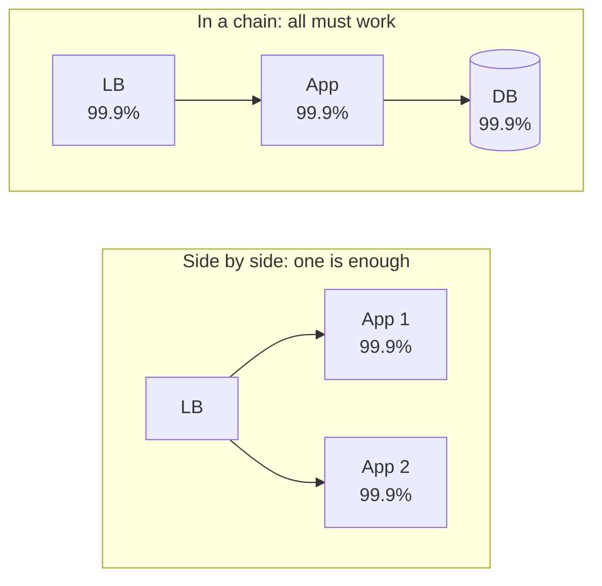
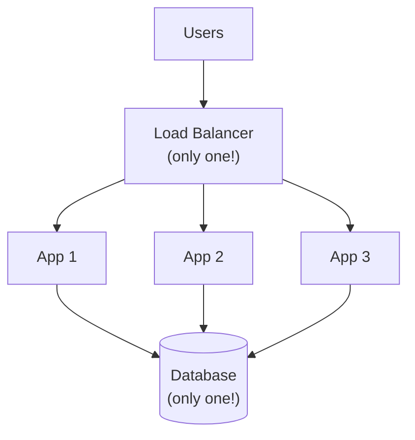

## The idea

Two words that sound alike, but mean different things:

- **Availability:** is the system **up** when I need it? Does it answer?
- **Reliability:** does it **work correctly**, every time, over a long period?

Think of an ATM. If it is switched on and accepts your card, it is **available**. If it also gives you the right amount of cash and takes the right amount from your account, it is **reliable**. An ATM that is always on but sometimes gives the wrong cash is available, but not reliable.

Both start from the same fact: **parts will fail.** Disks die, servers crash, networks break, and people make mistakes. A good design expects failure and keeps working anyway.

## Availability vs reliability

| | Availability | Reliability |
| --- | --- | --- |
| **The question** | Is it up right now? | Does it keep working correctly over time? |
| **Measured as** | % of time it answers (uptime) | How rarely it fails or gives wrong results |
| **A bad day** | The site returns `503` errors for an hour | The site is up, but some orders are lost or charged twice |

A reliable system is almost always available. But an available system is not always reliable.

In interviews, people mostly talk about **availability**, and they measure it in "nines".

## Uptime and the "nines"

**Uptime** is the share of time the system works. People write it as a percentage, like **99.9%** ("three nines") or **99.99%** ("four nines").

Each extra nine looks tiny. It is not. **Each extra nine means 10 times less downtime.**

| Availability | Name | Down per year | Down per month | Down per day |
| --- | --- | --- | --- | --- |
| 99% | two nines | 3.65 days | 7.3 hours | 14.4 minutes |
| 99.9% | three nines | 8.76 hours | 43.8 minutes | 1.4 minutes |
| 99.99% | four nines | 52.6 minutes | 4.4 minutes | 8.6 seconds |
| 99.999% | five nines | 5.3 minutes | 26 seconds | 0.9 seconds |

The easy way to remember it: **99.9% allows about 9 hours down per year. 99.99% allows under 1 hour. 99.999% allows about 5 minutes.**

At five nines, a person doesn't even have time to notice the problem and log in. Only **automatic** recovery can reach it.

Teams set an availability goal for themselves (an **SLO**), and sometimes promise it to customers in a contract (an **SLA**). See [SLI, SLO and SLA](../production/sli-slo-sla.mdx).

## Parts in a chain vs parts side by side

Availability changes when you connect parts together. There are two simple rules.

**In a chain, availability goes down.** A request goes through the load balancer, then the app server, then the database. All three must work. So you multiply:

**99.9% × 99.9% × 99.9% ≈ 99.7%**

Every part you add to the chain makes the whole system a little less available.

**Side by side, availability goes up.** You have two app servers, and each is up 99.9% of the time. The system is down only if **both** are down at the same moment:

- Chance that one is down: 0.1% = 0.001
- Chance that both are down: 0.001 × 0.001 = 0.000001
- So the pair is up **99.9999%** of the time.

This only works if the two fail **independently**. Two servers on the same power supply can die together.

## Single points of failure

A **single point of failure** (SPOF) is any one part that takes the whole system down when it breaks.

Here, losing one app server is fine. Losing the load balancer or the database is not:

**How to find them:** point at each box in your design and ask, **"What happens if this one dies?"** If the answer is "everything stops", it is a SPOF.

Common SPOFs:

- One database with no copy
- One load balancer
- One data center, or one cloud region
- One DNS provider (see [DNS](../foundations/dns.mdx))
- Hidden ones: one config server, one shared cache, or one person who knows how to deploy

## How to make a system more available

| Technique | What it means | Example |
| --- | --- | --- |
| **Redundancy** | Keep spare copies of every important part | 3 app servers instead of 1 |
| **Failover** | Switch to the spare automatically when the main one dies | A database replica becomes the new primary |
| **Health checks** | Keep checking which parts are alive, and stop sending traffic to dead ones | See [Health Checks](./health-checks-service-discovery.mdx) |
| **Replication** | Keep copies of the data on several machines | See [Replication](../databases/replication.mdx) |
| **Many zones** | Spread machines across separate data centers | Survive a power cut in one building |
| **Graceful degradation** | When one feature breaks, turn it off and keep the rest working | Show the feed without recommendations. See [Graceful Degradation](../reliability-security/graceful-degradation.mdx) |
| **Careful deploys** | Roll out changes to a few servers first | Many outages come from bad changes, not broken hardware. See [Deployment Strategies](../production/deployment-strategies.mdx) |

Two cloud words you will hear a lot:

- An **availability zone** is one or more data centers with their own power and network, separate from the others.
- A **region** is an area, like Mumbai or Virginia, with several zones close to each other.

Running in two or more zones is the normal setup. Running in several regions protects you from a whole region going down, but costs much more. Spare copies and failover are covered in depth in [Redundancy and Failover](../reliability-security/redundancy-failover.mdx).

**More nines cost more.** Each extra nine costs a lot more money and work. Pick the target the product really needs. A payment system needs more nines than a company's internal lunch menu.

## In the real world

**One typo took down part of the internet (AWS S3, February 2017).** An Amazon engineer was looking into a slow billing system and ran a command to remove a few servers. One input was typed wrong, and far more servers were removed than intended. S3 in the US East region was down for about four hours, and many websites and apps that kept their files there broke. AWS's own status page could not show the problem at first, because it also depended on S3. Afterwards, AWS changed the tool so it removes servers more slowly and never goes below a safe minimum.

**Netflix breaks its own servers on purpose.** Netflix built a tool called **Chaos Monkey** that randomly shuts down servers in production during working hours. Every team must build services that survive a lost server, because it happens all the time. Netflix later released it as open source.

## In the interview

Availability is a **non-functional requirement**. Give a target and say why. Then, in your design, point out each SPOF and how you remove it:

> "Browsing events should be highly available, around 99.99%. I'll run app servers in at least two zones, and the database has a replica in another zone with automatic failover, so no single machine can take us down."

<Callout title="Remember this" type="success">
  - **Availability** = is it up? **Reliability** = does it work correctly over time?
  - Each extra **nine** = 10× less downtime. **99.9% ≈ 9 hours a year. 99.99% ≈ 53 minutes a year.**
  - Parts **in a chain** multiply availability down. Parts **side by side** multiply it up.
  - A **single point of failure** takes everything down. Ask "what if this one dies?"
  - Fix with **redundancy, failover, health checks, many zones** and careful deploys.
</Callout>
