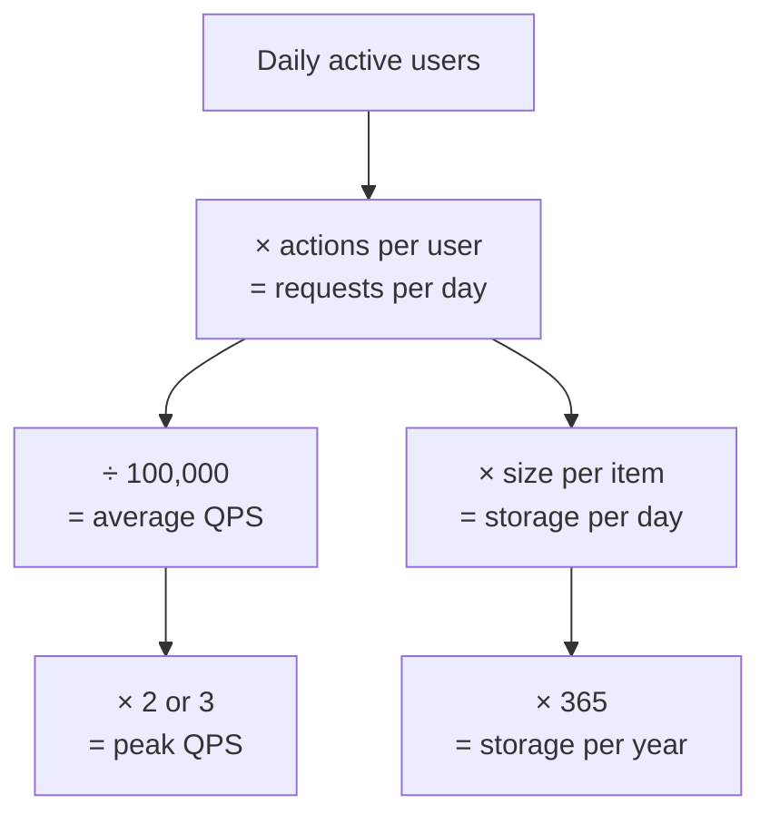

## The idea

**Capacity estimation** (also called **back-of-the-envelope math**) is quick, rough math that tells you how big a system must be: how many requests per second, how much storage, how much network traffic.

Think of planning a wedding dinner. You don't need the exact guest count. "About 300 guests, about 2 plates each" tells you how much food to order and how many cooks to hire. Being off by 10% doesn't matter. Being off by 10 times does.

So the goal is the **order of magnitude**: is it 100, 10,000 or 1 million requests per second? That is what changes the design.

## Numbers to know

### Sizes and powers of ten

| Number | In words | As bytes |
| --- | --- | --- |
| 1,000 (10³) | a thousand | 1 KB (kilobyte) |
| 1,000,000 (10⁶) | a million | 1 MB (megabyte) |
| 1,000,000,000 (10⁹) | a billion | 1 GB (gigabyte) |
| 10¹² | a trillion | 1 TB (terabyte) |
| 10¹⁵ | a thousand trillion | 1 PB (petabyte) |

Handy shortcuts: **a million × 1 KB = 1 GB.** **A billion × 1 KB = 1 TB.** **A million × 1 MB = 1 TB.**

| Thing | Rough size |
| --- | --- |
| One English character | 1 byte |
| A number (int / long) | 4 / 8 bytes |
| A timestamp | 8 bytes |
| A UUID (a random unique ID) | 16 bytes (36 as text) |
| A chat message or short post, with IDs and time | a few hundred bytes |
| A user profile row | about 1 KB |
| A compressed photo | about 200 KB to 2 MB |
| 1 minute of HD video | about 50 to 100 MB |

### Time

| | Exact | Round it to |
| --- | --- | --- |
| One day | 86,400 seconds | **100,000** (10⁵) |
| One month | about 2.6 million seconds | 2.5 million |
| One year | about 31.5 million seconds | 30 million |

So, dividing by 100,000:

- **1 million** requests a day ≈ **10** per second
- **100 million** a day ≈ **1,000** per second
- **1 billion** a day ≈ **10,000** per second

Rounding the day up makes these a little low. The exact answer for 1 million a day is about 12 per second. For the order of magnitude, that doesn't matter.

### Latency numbers

These are rounded from a famous list called "Latency numbers every programmer should know", made popular by Jeff Dean at Google. Units: 1 ms = 1,000 µs (microseconds) = 1,000,000 ns (nanoseconds).

| Action | Rough time |
| --- | --- |
| Read from memory (RAM) | 100 ns |
| Random read from an SSD | 100 µs (0.1 ms) |
| Round trip inside one data center | 0.5 ms |
| Read from Redis over the network | under 1 ms |
| Read 1 MB in a row from an SSD | 1 ms |
| Simple database query using an index | 1 to 10 ms |
| Hard disk (HDD) seek | 10 ms |
| Round trip USA (East Coast) ↔ Europe | about 80 ms |
| Round trip India ↔ USA | about 200 ms |

What to take away:

- **Memory is about 1,000 times faster than an SSD.** That is why caches live in memory.
- **Inside one data center, the network is cheap** (0.5 ms).
- **Across an ocean, it is expensive** (80 to 200 ms). Put data near users, and avoid many round trips.

### What one machine can handle

These are **very rough** numbers for normal modern servers. The real number depends a lot on the hardware and on how much work each request does. Use them as a starting guess, and say that out loud.

| Component | Rough limit for one machine |
| --- | --- |
| App server, simple API calls | 1,000 to 10,000 requests per second |
| SQL database (PostgreSQL, MySQL) | a few thousand to about 10,000 simple queries per second. Fewer for writes and heavy queries |
| Redis | about 100,000 operations per second |
| Kafka broker | hundreds of thousands of messages per second |
| Open connections (WebSockets) | hundreds of thousands, on a well-tuned server |
| Memory (RAM) | 64 to 512 GB is common. The biggest cloud machines have several TB |
| SSD storage | a few TB to tens of TB |
| Network | about 10 Gbps, which is about 1 GB per second |

## Requests per second from daily users

Start from **DAU** (daily active users): the number of different people who use the app on a normal day.

- **Requests per day** = DAU × actions per user per day
- **Average QPS** = requests per day ÷ 100,000
- **Peak QPS** ≈ average × 2 or 3 (more for very spiky apps, like ticket sales)

Do **reads and writes separately**. They scale in different ways (see [Scaling Reads](./scaling-reads.mdx) and [Scaling Writes](./scaling-writes.mdx)).

## Storage per day and per year

- **Storage per day** = new items per day × size of one item
- **Storage per year** = storage per day × 365 (round to 400 if you like easy math)
- Databases usually keep **3 copies**, so the real disk needed is about 3 times more.

Keep **big files** (photos, videos) apart from **small data** (rows in a database). Big files go to object storage like Amazon S3. Only their links go in the database.

**Bandwidth** is the data sent per second: QPS × the size of each response.

## Worked example 1: a photo-sharing app

**Assumptions** (say them out loud):

- 10 million daily users
- Each user views 50 photos a day
- 1 in 10 users posts one photo a day, so 1 million new photos a day
- A photo is about 500 KB. Its database row (owner, caption, time) is about 1 KB.

**The math:**

- **Reads:** 10 million × 50 = 500 million views a day. ÷ 100,000 = **5,000 per second**. Peak: about **15,000 per second**.
- **Writes:** 1 million a day ÷ 100,000 = **10 per second**. Peak: about **30 per second**.
- **Read-to-write ratio:** 5,000 ÷ 10 = **500 to 1**. Very read-heavy.
- **Photo storage:** 1 million × 500 KB = 500 GB a day. × 365 ≈ **180 TB a year**.
- **Row storage:** 1 million × 1 KB = 1 GB a day ≈ **365 GB a year**.
- **Bandwidth:** 5,000 views a second × 500 KB = **2.5 GB per second**, more at peak.

**What the numbers tell us:**

| Number | Decision |
| --- | --- |
| 15,000 reads per second at peak | Too many for one database. Add a cache and read replicas |
| 30 writes per second | One primary database handles this easily. No sharding needed |
| 180 TB of photos a year | Photos go to object storage (S3), not the database |
| 365 GB of rows a year | Fits on one database machine for years |
| 2.5 GB per second of images | Serve photos from a [CDN](../caching/cdn.mdx), not from app servers |

## Worked example 2: a chat app

**Assumptions:**

- 50 million daily users
- Each user sends 40 messages a day
- One message with its IDs and time is about 200 bytes

**The math:**

- **Writes:** 50 million × 40 = 2 billion messages a day. ÷ 100,000 ≈ **20,000 per second**. (The exact answer with 86,400 is about 23,000. Close enough.) Peak: about **60,000 per second**.
- **Storage:** 2 billion × 200 bytes = 400 GB a day. × 365 ≈ **150 TB a year**.

**What the numbers tell us:**

- 60,000 writes per second is far too many for one SQL primary. We need to split the data across machines by chat ID, or use a write-friendly database like Cassandra. See [Scaling Writes](./scaling-writes.mdx).
- 150 TB a year can't fit on one machine anyway.

Same kind of math, different answer. The photo app needed **read** scaling. The chat app needs **write** scaling. That is why you do the math.

## When math matters, and when to skip it

Do the math when the answer **changes the design**:

- Does the data fit on one machine? (Shard or not?)
- Can one database take the writes?
- Is it read-heavy? (Cache and replicas?)
- Is the bandwidth huge? (CDN?)

Keep it short, or skip it, when:

- The numbers clearly fit on one machine.
- The interviewer says they don't need it.
- Time is short. Say "I'll assume it's big enough to need X" and move on.

Tips:

- **Round hard.** 86,400 becomes 100,000. Nobody wants to see long division.
- **Write your assumptions down,** so the interviewer can correct them.
- **Keep the units** next to every number: per day or per second, GB or TB.
- Spend **2 to 3 minutes** on it, not 10. See [The Interview Framework](../interview-framework.mdx).

## In the real world

**Jeff Dean's numbers.** The latency list above comes from talks by Jeff Dean, one of Google's most senior engineers. Engineers still use it to judge quickly whether a design can be fast enough, for example whether reading from disk on every request is acceptable.

**Gangnam Style nearly broke YouTube's counter.** YouTube stored view counts as a 32-bit number, which can only go up to about 2.1 billion (2,147,483,647). In December 2014, PSY's "Gangnam Style" video got close to that limit, and YouTube announced it had moved to a 64-bit number. Picking sizes is part of capacity planning too.

**WhatsApp's 2 million connections.** In 2012, WhatsApp wrote that it had held more than 2 million open connections on a single server, using Erlang on FreeBSD. One well-tuned machine can do far more than people expect.

## In the interview

Do the math right after the requirements, and turn every number into a decision:

> "10 million daily users viewing 50 photos is 500 million views a day, about 5,000 per second, maybe 15,000 at peak. That's too many for one database, so I'll add a cache. Writes are only about 10 per second, so one primary database is fine."

<Callout title="Remember this" type="success">
  - The goal is the **order of magnitude**, not the exact number.
  - **1 day ≈ 100,000 seconds.** 1 million a day ≈ 10 per second (about 12 exactly).
  - **Peak ≈ 2 to 3 × average.**
  - **A million × 1 KB = 1 GB. A billion × 1 KB = 1 TB.**
  - Memory **100 ns**, SSD **0.1 ms**, same data center **0.5 ms**, across an ocean **80 to 200 ms**.
  - Every number should lead to a **decision**: cache, shard, S3, CDN.
</Callout>
