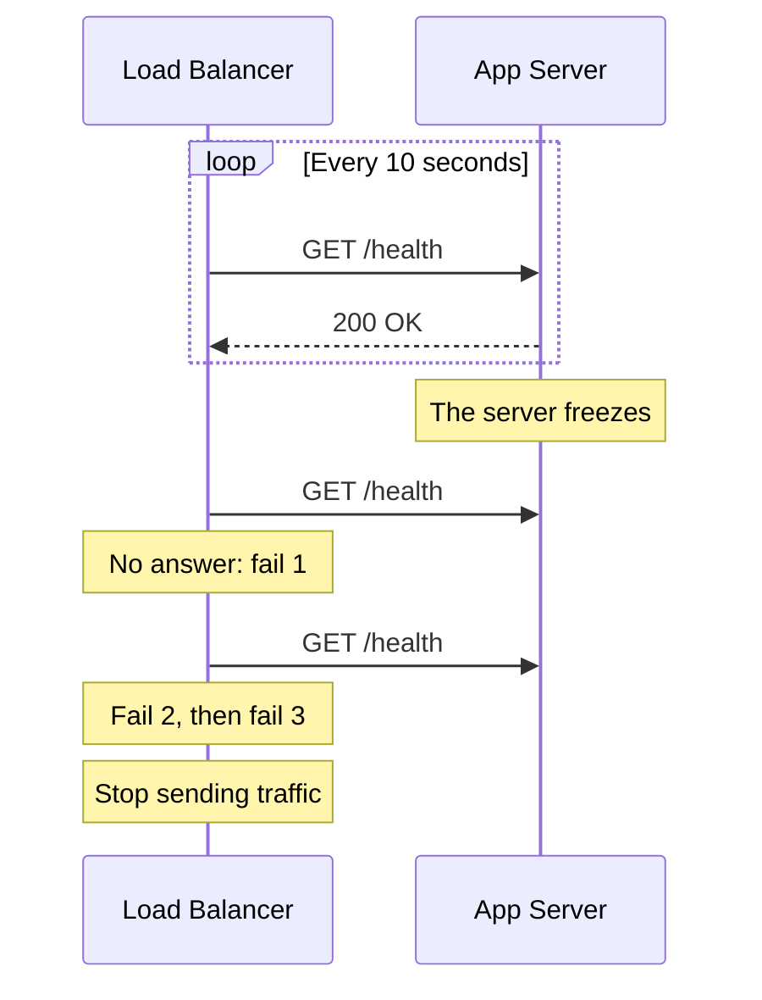
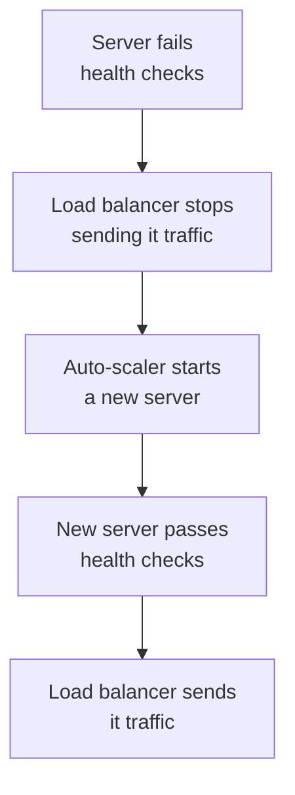
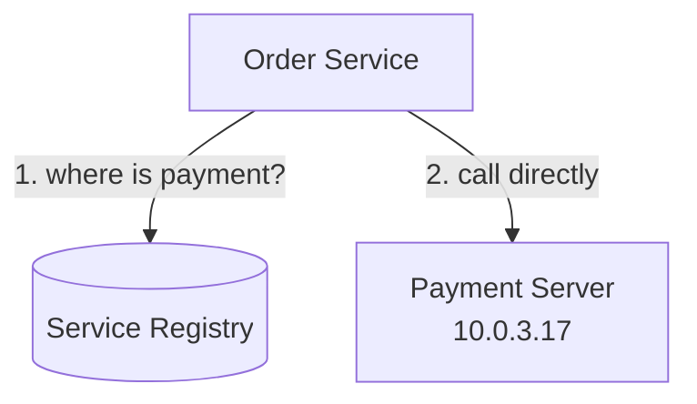
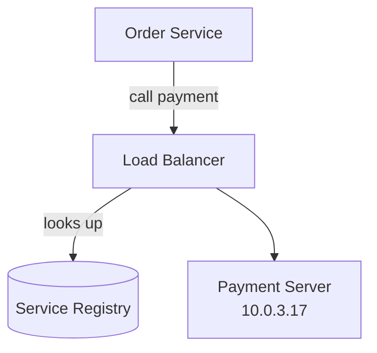

## The idea

In a big system, servers come and go all the time. Some crash. Some are added when traffic is high. Some are replaced during a deploy. Two questions keep coming up:

1. **Is this server okay?** This is a **health check**.
2. **Where is the service I need, right now?** This is **service discovery**.

Think of a taxi company. Every few minutes, the dispatcher radios each driver: "Are you okay? Are you working?" That is a health check. The dispatcher also keeps a board of which drivers are working right now and where they are. When a customer calls, the dispatcher looks at the board and picks a free driver. That is service discovery. If a driver stops answering the radio, their name comes off the board.

## Health checks: is this server okay?

A **health check** is a small test that runs again and again. Usually the load balancer calls an address like `GET /health` every few seconds. A `200 OK` answer means healthy. An error, or no answer in time, means not.



Every health check has a few settings:

| Setting | Meaning | Example |
| --- | --- | --- |
| **Interval** | How often to check | Every 10 seconds |
| **Timeout** | How long to wait for an answer | 5 seconds |
| **Unhealthy threshold** | Failures in a row before the server is removed | 3 |
| **Healthy threshold** | Passes in a row before it is added back | 2 |

Why not remove a server after **one** failure? Networks have small hiccups. If one slow answer removed a server, servers would keep dropping out and coming back. This is called **flapping**.

### Shallow and deep checks

- A **shallow** check asks: "Is the program running, and can it answer?" The `/health` page just returns `200` right away.
- A **deep** check asks: "Can it really do its job?" It also tests the database connection, the cache, and free disk space.

Deep checks find more problems, but they have a trap. Say the shared database gets slow. Now **every** server fails its deep check at the same moment, the load balancer removes all of them, and the whole site goes down, even though the servers could still have served cached pages.

**Rule of thumb:** the check that decides traffic should test only what the server itself owns. Don't fail it because a shared dependency, like the database, is slow. Watch shared parts with monitoring and alerts instead.

Here are two health pages in Express (Node.js):

```js
// Set to true when startup work is done
let started = false;

// Set to true when a deploy stops this server
let shuttingDown = false;

// Live: the program is running
app.get("/health/live", (req, res) => {
    res.status(200).send("ok");
});

// Ready: the server can take traffic.
// It checks only things this server owns. Not the shared database.
app.get("/health/ready", (req, res) => {
    if (started && !shuttingDown) {
        res.status(200).send("ready");
        return;
    }

    res.status(503).send("not ready");
});
```

### Active and passive checks

- **Active:** the load balancer sends test requests, like the ones above.
- **Passive:** the load balancer watches **real** traffic. If a server returns many `5xx` errors or times out, it is taken out for a while. Envoy calls this **outlier detection**.

Many systems use both.

## Removing dead servers automatically

Health checks are what let a system heal itself, with no human awake at 3 a.m.:



An **auto-scaler** is the part that adds and removes servers, like an AWS Auto Scaling group or Kubernetes. It can use the same health checks to decide when to replace a server.

During a deploy, it works the other way around. The old server is first marked "not ready", so it gets no new requests. It finishes the requests it already has (**draining**), and only then shuts down. Users see no errors.

## Service discovery: finding other services

With many services, the Order service needs to call the Payment service. But payment servers come and go, and their IP addresses change. If you write `10.0.3.17` in a config file, it breaks the moment that server is replaced.

**Service discovery** means finding the **current** addresses of a service by its **name**.

The main piece is a **service registry**: a live list of services and the addresses of their healthy servers. It is like the contacts on your phone, but it updates itself.

1. **Register.** When a server starts, it is added to the registry: "payment-service is at 10.0.3.17, port 8080."
2. **Stay healthy.** The registry health-checks it, or the server sends a small "I'm alive" message (a **heartbeat**) every few seconds. If the checks fail or the heartbeats stop, the entry is removed.
3. **Look up.** A caller asks, "Where is payment-service?", and gets back the healthy addresses.

There are two ways to use the registry.

**Client-side discovery:** the caller asks the registry, gets the list, and picks a server itself.



**Server-side discovery:** the caller sends the request to one fixed address, like a load balancer. The load balancer looks up the registry and forwards the request. The caller knows nothing about the registry.



| | Client-side | Server-side |
| --- | --- | --- |
| **Who picks the server** | The caller | A load balancer or router |
| **Caller code** | Needs a discovery library | Nothing special. Just one address |
| **Extra network hop** | No | Yes, through the load balancer |
| **Example** | Netflix Eureka | Kubernetes Services, AWS load balancers |

## Tools: DNS, Consul, Kubernetes

| Tool | How it works |
| --- | --- |
| **DNS** | The simplest registry: a name gives back IP addresses, and every language can use it. But answers are cached for their TTL, so a dead server's address can be returned for a while. See [DNS](../foundations/dns.mdx) |
| **Consul** | A service registry by HashiCorp, with health checks built in. A service can be found through a DNS name like `payment.service.consul`, or through an HTTP API |
| **etcd, ZooKeeper** | Very reliable key-value stores, often used as the base for registries. Kubernetes keeps its own data in etcd |
| **Netflix Eureka** | A registry for client-side discovery. Servers send heartbeats to stay on the list |
| **Kubernetes** | Built in. See below |

**In Kubernetes**, a running copy of your app is called a **pod**. You create a **Service** named `payment`, and Kubernetes gives it a stable name and address. Other pods just call `payment` (the full DNS name is `payment.default.svc.cluster.local`), and Kubernetes forwards each call to a healthy pod.

Kubernetes has three kinds of health checks, called **probes**:

- **Liveness probe:** "Is the app stuck?" If it fails, Kubernetes **restarts** the container.
- **Readiness probe:** "Can it take traffic?" If it fails, the pod is **taken out of the Service**, but not restarted.
- **Startup probe:** for apps that start slowly. The other probes wait until this one passes.

```yaml
livenessProbe:
  httpGet:
    path: /health/live
    port: 8080
  periodSeconds: 10
  failureThreshold: 3
readinessProbe:
  httpGet:
    path: /health/ready
    port: 8080
  periodSeconds: 5
```

Keep the readiness probe about **this pod only**, like the `/health/ready` code above. If every pod's readiness checked the shared database, one database problem would take **every** pod out of the Service at once, and the whole site would go down.

More on Kubernetes in [CI/CD, Docker and Kubernetes](../production/cicd-docker-kubernetes.mdx).

## In the real world

**Netflix Eureka.** Netflix runs its services on AWS, where servers are started and stopped all the time. It built **Eureka** to keep track of them, and released it as open source. Each server registers with Eureka and sends heartbeats. Callers ask Eureka for the list and pick a server themselves, which is client-side discovery.

**Kubernetes made it part of the platform.** In Kubernetes, discovery and health checks come built in: every Service gets a DNS name, and only pods that pass their readiness probe get traffic. Teams that run on Kubernetes often don't need a separate registry at all.

## In the interview

You usually need only a sentence or two. Bring it up when you have many services or auto-scaling:

> "The load balancer health-checks each server every few seconds and stops sending traffic after three failures. Services find each other by name through Kubernetes Services, so nobody hard-codes IP addresses."

<Callout title="Remember this" type="success">
  - A **health check** is a regular "are you okay?" test, usually `GET /health`.
  - Fail a few times **in a row** → removed. Pass a few times → added back.
  - **Liveness** = is it running? (restart if not). **Readiness** = can it take traffic? (remove if not).
  - Readiness checks only what the server **owns**. If it checks a shared database, one slow database can fail every server at once.
  - **Service discovery** = find a service's current addresses by name, using a **registry**.
  - **Client-side** (Eureka) vs **server-side** (load balancer, Kubernetes Service).
</Callout>
