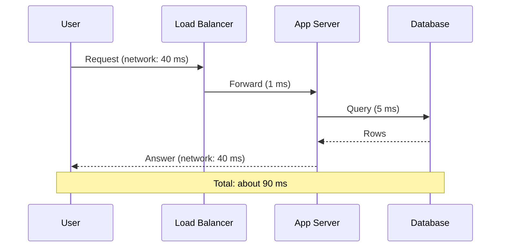
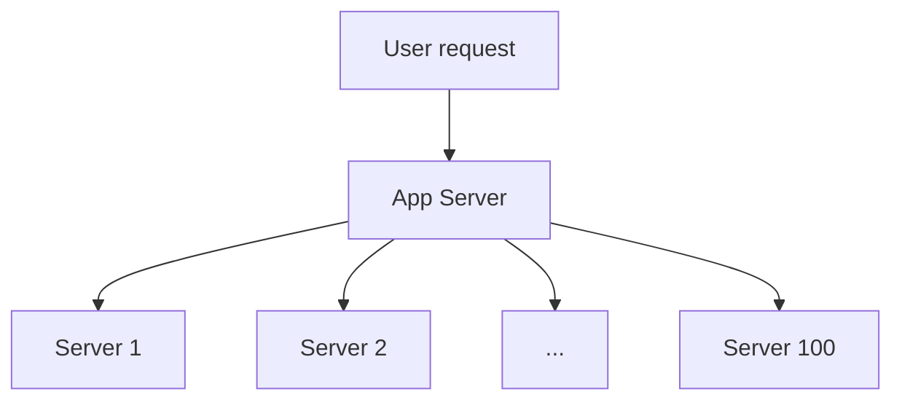

## What is it?

There are two different questions about "speed":

- **Latency:** how long does **one** request take?
- **Throughput:** how **many** requests can the system finish every second?

Think of a highway. **Latency** is how long one car takes to drive from city A to city B. **Throughput** is how many cars reach city B every hour. Adding lanes lets more cars through (more throughput), but each car still takes about the same time (same latency).

## Why do we need it?

"The app is fast" means nothing until you put a number on it. Without these two numbers:

- **You can't set a goal.** Is 500 ms OK for opening a short link? You need a target to design for and to test against.
- **You can't size the system.** How many servers you need depends on how many requests per second arrive, and how long each one takes.
- **You can't see trouble coming.** Latency climbing week by week tells you to add capacity **before** users feel it.

Users feel latency directly. A slow page feels broken, and people leave. Throughput is what decides whether the system survives the busiest hour.

## How it works inside

### Latency: the time for one request

**Latency** is the time from sending a request to getting the answer back. It is measured in **milliseconds** (ms). 1 second = 1,000 ms.

The latency of one request is the sum of many small waits:

Where the time goes:

- **Network:** the distance to the server. Data in cables is fast, but a round trip from India to the USA still takes about 200 ms.
- **Waiting in line (queueing):** if the server is busy, the request waits its turn.
- **Doing the work:** running code, and reading from the database or the disk.

How to lower latency:

- Put data **closer to users**: a [CDN](../caching/cdn.mdx), or servers in more regions.
- **Cache** popular data in memory (see [What is Caching](../caching/what-is-caching.mdx)).
- Make **fewer round trips**: one call that gets everything instead of ten small calls.
- Make queries faster with **indexes** (see [Indexes](../databases/indexes.mdx)).
- Do slow work **later**, in the background, with a queue (see [Sync vs Async](../messaging/sync-vs-async.mdx)).

For a feel of how long common actions take (memory, disk, network), see the numbers table in [Capacity Estimation](./capacity-estimation.mdx).

### Throughput and QPS: requests per second

**Throughput** is how much work the system finishes per second. For web systems, we usually count requests:

| Short name | Means | Often used for |
| --- | --- | --- |
| **QPS** | Queries per second | Search, databases, APIs |
| **RPS** | Requests per second | Web servers, APIs |
| **TPS** | Transactions per second | Databases, payments |

They all mean roughly the same thing: **how many requests per second.**

For video or file downloads, throughput is measured in **data per second** instead, like MB per second. This is often called **bandwidth**.

**Average vs peak.** Traffic is not flat. People use apps more in the evening, during a sale, or during a big cricket match. The **peak** is often 2 to 3 times the average, and much more during special events. **Design for the peak, not the average.** To turn "users per day" into QPS, see [Capacity Estimation](./capacity-estimation.mdx).

### Why the average can hide slow requests

Say a server handles 1,000 requests:

- 980 requests take 50 ms.
- 20 requests take 3 seconds (3,000 ms).

The **average** is (980 × 50 + 20 × 3,000) ÷ 1,000 = **109 ms**. That looks fine. But 2 users out of every 100 wait 3 seconds, which is not fine at all.

So we use **percentiles** instead:

- **p50** (the median): half of all requests are faster than this.
- **p99:** 99% of requests are faster than this. Only the slowest 1% are slower.

| Measure | Value | What it tells you |
| --- | --- | --- |
| Average | 109 ms | "Looks fine." It hides the problem |
| p50 | 50 ms | A normal request is fast |
| p99 | 3,000 ms | The slowest 1 in 100 users waits 3 seconds |

**How a percentile is found:** sort all the request times, then take the one 99% of the way down the list. Real systems don't keep every single time. They keep a **histogram**: a count of requests in time buckets (0–10 ms, 10–50 ms, and so on), and estimate the percentile from the buckets.

The slow requests are called the **tail**, and their latency is **tail latency**. They matter for two reasons:

1. The slow users are often your **best** users: the ones with the biggest carts, the most friends, the most data.
2. **One page often needs many calls.** If any one of them is slow, the whole page is slow.

The second point gets worse with **fan-out**: one request that calls many servers and waits for all of them.

Each server is slow only 1 time in 100. But the app waits for **all 100**. The chance that all 100 are fast is 0.99 multiplied by itself 100 times, which is about 37%. So about **63% of user requests are slow**. Rare slowness on each server becomes common slowness for users.

More on percentiles: [Latency Percentiles](../production/latency-percentiles.mdx).

### How latency and throughput affect each other

A simple rule, called **Little's Law**, links them:

**requests in progress = throughput × latency**

**If a server can only work on a fixed number of requests at once, slower requests mean fewer requests per second.** Example: a server can work on 100 requests at the same time. Each one takes 0.1 seconds. So it can finish 100 ÷ 0.1 = **1,000 requests per second**. If the database gets slow and each request now takes 0.2 seconds, the same server can only finish **500 per second**. Latency doubled, throughput halved.

If instead the traffic stays the same, slower requests mean **more requests in progress** at once, so threads and connections can run out (see [Queueing Basics](./queueing-basics.mdx)).

**Busy servers get slow.** It also works the other way. Think of a supermarket. With a few shoppers, you walk straight to a free checkout. When every checkout is busy, a line forms, and each new shopper waits longer and longer.

| How busy the server is | What happens to latency |
| --- | --- |
| Under about 50% | Little waiting. Latency stays low |
| About 70 to 80% | Some waiting. Latency starts to rise |
| Over 90% | Long lines. Latency shoots up, and timeouts start |

These numbers are rough. A server with many workers (threads or cores) sharing one line waits less than a single worker at the same busyness, but the shape is the same.

That is why teams add servers **before** they reach 100%, not after. [Queueing Basics](./queueing-basics.mdx) shows the math behind this curve.

Some choices trade one for the other:

- **Batching** (doing many items at once) raises throughput, but adds latency. It is like a bus that waits until it is full: it moves more people per trip, but the first passenger waits.
- **Caching** improves both.
- **Queues** give the user a fast answer ("got it"), and do the slow work later.

## When to use which

| Situation | Watch this | Why |
| --- | --- | --- |
| A user waits for the answer (page load, API call) | **Latency at p99** | Users feel the slow ones, not the average |
| Background work (a pipeline, a batch job, a queue consumer) | **Throughput** | Nobody waits on one item. What matters is keeping up |
| Sizing servers and databases | **Peak QPS** | You must survive the busiest hour |
| Video, downloads, uploads | **Bandwidth** (MB per second) | The size of the data matters more than the number of requests |

**Don't:**

- **Use the average for latency.** It hides the slow tail. Use p50 and p99.
- **Look at throughput alone.** A system can serve many requests per second while each one takes 5 seconds. Always check both.
- **Average percentiles** across servers. Add the histograms, then compute the percentile.

## Alternatives

These are measures, not tools, so nothing replaces them. But they are not the whole picture. Google's SRE book adds **errors** and **saturation** (how full the system is) to make the **four golden signals**. See [Observability](../production/observability.mdx).

## In the real world

**Google's "The Tail at Scale".** In a 2013 paper, Google engineers Jeff Dean and Luiz André Barroso showed the fan-out math above: if each server is slow for 1 in 100 requests, a user request that waits for 100 servers is slow 63% of the time. One of their fixes is the **hedged request**: if the first server is slow to answer, send the same request to a second server and use whichever answers first.

**Amazon measures the 99.9th percentile.** Amazon's 2007 Dynamo paper explains that Amazon sets its internal speed targets at the **99.9th percentile**, not the average or the median. The goal is a good experience for almost every customer, not only the typical one.

## In the interview

Put latency and throughput in your **non-functional requirements**, with numbers and percentiles:

> "Opening a short link should take under 100 ms at p99. We expect about 12,000 reads per second on average, so I'll design for peaks of around 30,000."

<Callout title="Remember this" type="success">
  - **Latency** = the time for one request. **Throughput** = how many requests finish per second.
  - **Why:** without numbers you can't set goals, size servers, or see trouble coming.
  - **QPS / RPS** = requests per second. Design for the **peak**, not the average.
  - The average hides slow requests. Use **p50 and p99**, computed from **histograms**.
  - With **fan-out**, rare slowness on each server becomes common slowness for users.
  - **Inside:** Little's Law: in progress = throughput × latency. **Busy servers get slow.** Add capacity before you hit 100%.
  - **Batching**: more throughput, more latency. **Caching**: better at both.
  - **Alternatives:** none, but add **errors** and **saturation** to get the four golden signals.
</Callout>
