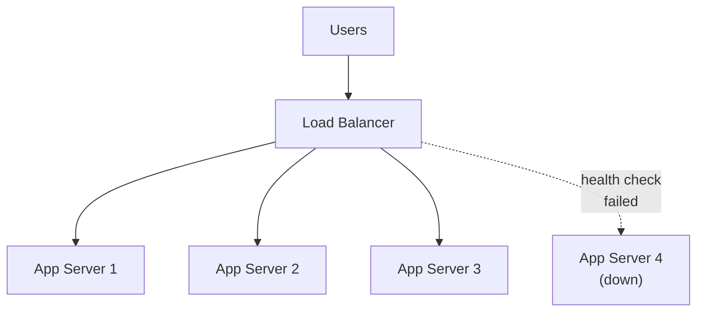
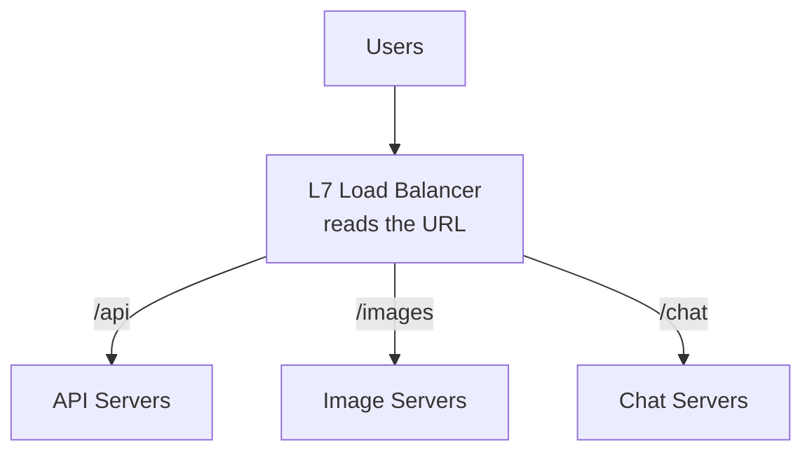
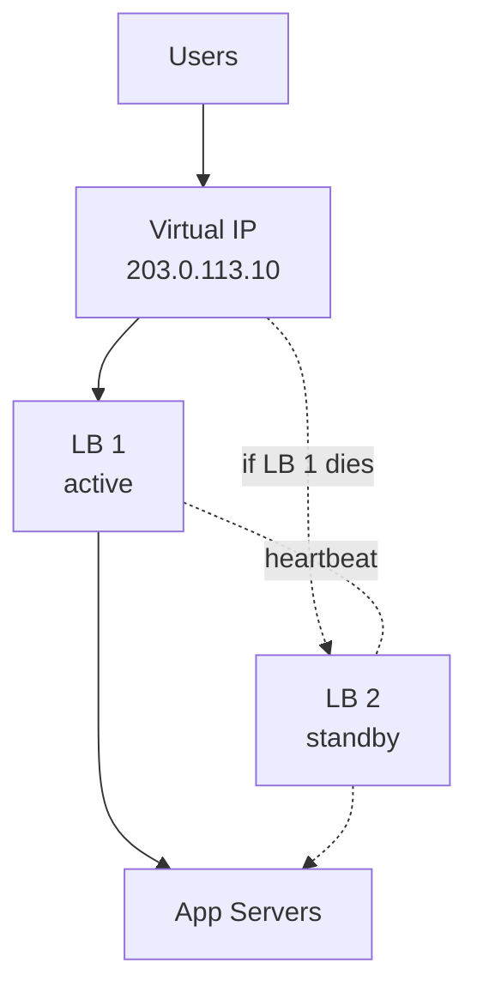

## The idea

A **load balancer** sits in front of a group of servers and decides which server gets each request.

Think of a big bank with many counters. A staff member stands at the door and says "Counter 3, please", "Counter 5, please". Customers don't need to know which counters are open. The person at the door does. If counter 2 closes for lunch, they simply stop sending people there.

Users see **one address**. Behind it, there can be 2 servers or 2,000.

## What a load balancer does



It has four main jobs:

1. **Spread the load,** so no server gets too much.
2. **Skip dead servers.** It checks the servers all the time and stops sending traffic to broken ones.
3. **Give one address for many servers.** You can add or remove servers behind it, and users never notice.
4. **Extras.** Many load balancers also handle HTTPS for the servers (**TLS termination**: they decrypt traffic once, so the servers don't have to), keep connections to the servers open and reuse them, and route by URL.

A load balancer is a kind of **reverse proxy**: a server that stands in front of your servers and passes requests to them (see [Reverse and Forward Proxies](../foundations/proxies.mdx)).

Load balancers come in three forms:

| Form | Examples |
| --- | --- |
| **Software** you run yourself | Nginx, HAProxy, Envoy |
| **Managed by a cloud provider** | AWS Elastic Load Balancing, Google Cloud Load Balancing |
| **Hardware** boxes in your own data center | F5 |

They don't only sit between users and web servers. They also sit between your own services, and in front of groups of database replicas or cache servers.

## Algorithms: who gets the next request?

| Algorithm | How it picks | Good for |
| --- | --- | --- |
| **Round robin** | In turn: 1, 2, 3, 1, 2, 3... | Same-size servers, similar requests |
| **Weighted round robin** | In turn, but bigger servers get more turns | Servers of different sizes |
| **Least connections** | The server with the fewest open requests right now | Requests that take very different times |
| **Hashing** | A hash of a key (user ID, IP, URL) picks the server | The same user or key must reach the same server |
| **Power of two choices** | Pick two servers at random, use the less busy one | Very big systems with many load balancers |

### Round robin

Like dealing cards: one to each player, in turn. Request 1 goes to server A, request 2 to B, request 3 to C, request 4 to A again. It is simple, and it is the default in Nginx.

**The weak spot:** it ignores how busy each server is. If some requests are 10-second reports and others are 10 ms lookups, one server can get stuck with several slow ones while another sits idle.

**Weighted round robin** fixes uneven servers. Server A has 16 CPUs, server B has 8. Give A a weight of 2 and B a weight of 1, and A gets 2 of every 3 requests.

### Least connections

Like picking the supermarket checkout with the **shortest line**. The load balancer counts the open requests on each server and sends the new one to the least busy.

It is better than round robin when requests take very different times, and for long-lived connections like WebSockets, where one server could slowly fill up.

### Hashing

A **hash** is a function that turns any input, like a user ID, into a number. The same input always gives the same number. So the same user always lands on the same server:

```js
const servers = ['A', 'B', 'C'];

function pickServer(userId) {
  return servers[hash(userId) % servers.length];
}
// pickServer(42) gives the same server every time
```

This is useful when a server keeps something for that key: a cache, a chat room, a game match.

**The weak spot:** with `hash % N`, adding a fourth server changes `% 3` into `% 4`, and **most** users move to a different server. Their cached data is suddenly in the wrong place. **Consistent hashing** fixes this: when a server is added or removed, only a small share of keys move. See [Consistent Hashing](../databases/consistent-hashing.mdx).

Hashing by the user's **IP address** (IP hash) is a simple version. But many users can share one IP, like a whole office behind one router, so the load can be uneven.

### Which one to choose

- **Stateless app servers:** round robin or least connections. This is the usual answer.
- **Requests with very different lengths, or WebSockets:** least connections.
- **The same key must reach the same server** (caches, chat rooms, game matches): consistent hashing.

## L4 vs L7 load balancers

Network messages are described in **layers**. Two of them matter here:

- **Layer 4** is the **transport** layer: TCP and UDP (see [TCP vs UDP](../foundations/tcp-vs-udp.mdx)). An L4 load balancer sees only **IP addresses and ports** (see [IP Addresses and Ports](../foundations/ip-addresses-and-ports.mdx)).
- **Layer 7** is the **application** layer: HTTP. An L7 load balancer can read the **whole request**: the URL, the headers, the cookies.

Think of a post office. An L4 sorter only reads the address on the envelope. An L7 sorter opens the letter, reads it, and decides based on what it says.

Because it can read the URL, an L7 load balancer can send different paths to different groups of servers:



| | L4 | L7 |
| --- | --- | --- |
| **Sees** | IP addresses and ports | The full HTTP request: URL, headers, cookies |
| **Can route by** | Address and port only | Path, host name, header, cookie |
| **Speed** | Very fast. Little work per packet | A bit slower. It must read every request |
| **HTTPS** | Usually passes encrypted traffic straight through | Usually decrypts it, to read the request |
| **Extras** | Few | Sticky cookies, retries, compression, rate limits |
| **Examples** | AWS Network Load Balancer, Google Maglev | AWS Application Load Balancer, Nginx, HAProxy, Envoy |
| **Use for** | Huge traffic, non-HTTP traffic (games, databases) | Most web apps and APIs |

Nginx, HAProxy and Envoy can work in either mode. Big systems often use **both**: a fast L4 layer at the edge that takes the raw traffic, and an L7 layer behind it for the smart routing.

## Health checks, briefly

The load balancer checks every server regularly, for example `GET /health` every 10 seconds. After a few failures in a row (say 3), the server is marked **unhealthy** and gets no more traffic. When it passes again a few times, it is added back.

When you remove a server on purpose, for example during a deploy, the load balancer first **drains** it: it stops sending new requests, but lets the requests already in progress finish. AWS calls this the **deregistration delay**.

The full story is in [Health Checks and Service Discovery](./health-checks-service-discovery.mdx).

## Running more than one load balancer

If all traffic goes through one load balancer, that load balancer is a **single point of failure** (see [Availability and Reliability](./availability-reliability.mdx)). So you run at least two.

**Active-passive with a floating IP.** Two load balancers share one **virtual IP address** (an address that can move between machines). The **active** one holds the address and takes all the traffic. The **passive** one watches it with a **heartbeat**: a small "I'm alive" message sent every second or so. If the heartbeats stop, the passive one takes over the address within seconds. A common tool for this is **keepalived**.



**Active-active.** Both load balancers take traffic at the same time. DNS returns both addresses, or the network spreads users across them. If one dies, the other takes everything, so each one must be able to carry the full load alone.

**Cloud load balancers.** A managed load balancer, like the ones on AWS or Google Cloud, already runs on many machines across several zones. You don't build the pair yourself.

**Across regions.** For users all over the world, DNS first picks the nearest region, and a load balancer inside that region picks the server. See [DNS](../foundations/dns.mdx).

## In the real world

**Google Maglev.** Google built its own L4 load balancer called **Maglev**. It runs as software on ordinary Linux servers instead of special hardware, and has handled Google's traffic since 2008. Google described it in a 2016 paper. It uses its own form of consistent hashing, so packets from one connection keep reaching the same server.

**Facebook Katran.** Facebook built an L4 load balancer called **Katran** and released it as open source in 2018. It runs on normal servers and uses a Linux feature (XDP and eBPF) to handle packets very early, before the normal network code even sees them, which makes it very fast.

**AWS offers both kinds.** The AWS **Application Load Balancer** works at L7 and can route by path or host name. The AWS **Network Load Balancer** works at L4, and is built for very high traffic and for protocols other than HTTP.

## In the interview

Draw a load balancer in front of every group of stateless servers. Then say which algorithm you use and why, and that the load balancer itself is not a single point of failure:

> "Users hit an L7 load balancer that sends `/api` requests to the API servers using least connections. It health-checks the servers and skips dead ones. The load balancer runs as a redundant pair, so it isn't a single point of failure."

<Callout title="Remember this" type="success">
  - A **load balancer** spreads requests across servers and skips dead ones. Users see one address.
  - **Round robin** = in turn. **Least connections** = least busy. **Hashing** = same key, same server.
  - `hash % N` moves most keys when servers change. **Consistent hashing** moves only a few.
  - **L4** = fast, sees only IP and port. **L7** = reads HTTP, routes by URL, header or cookie.
  - **Drain** a server before removing it, so requests in progress can finish.
  - Never just one load balancer: use **active-passive** with a floating IP, **active-active**, or a managed cloud LB.
</Callout>
