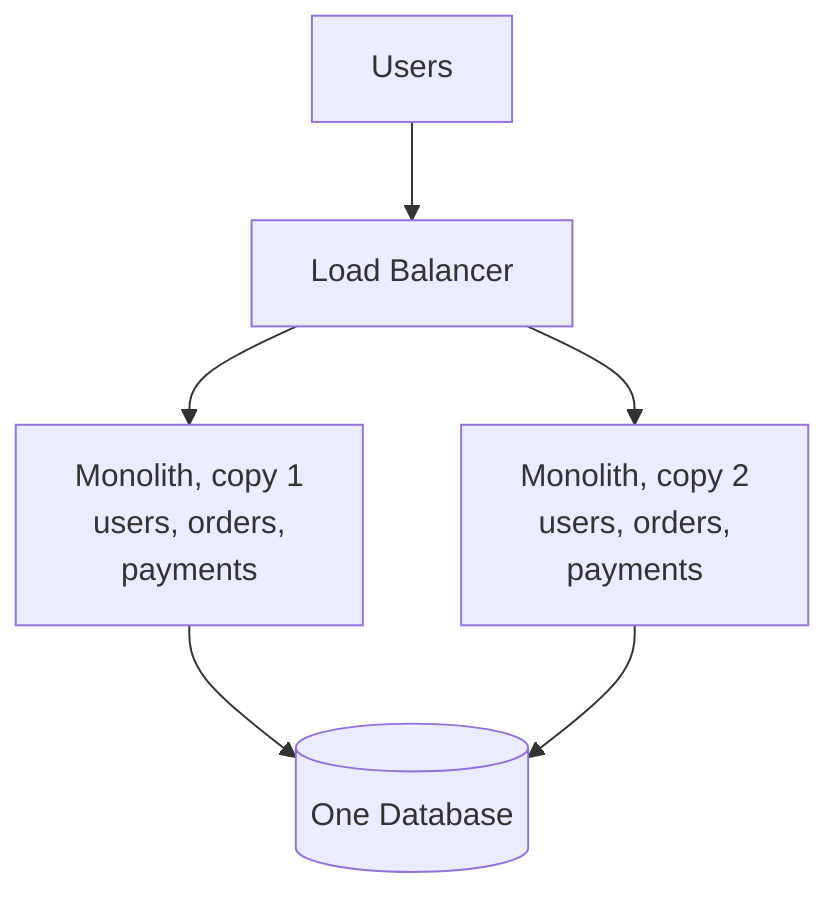
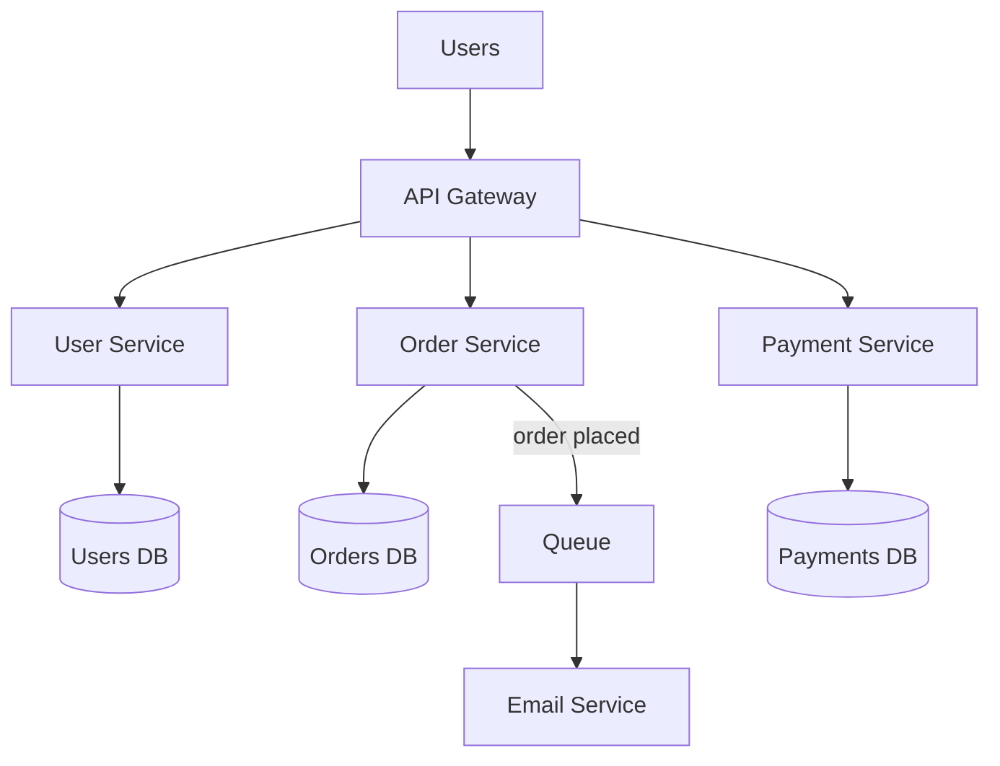
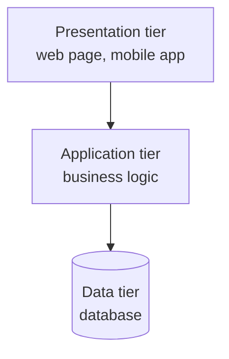
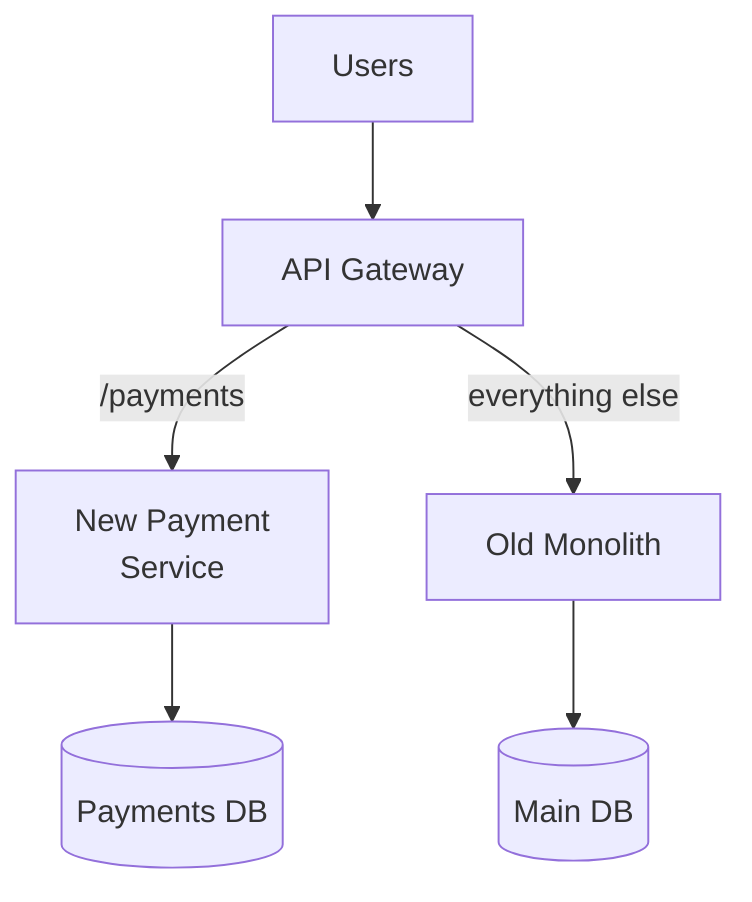

## The idea

A **monolith** is one app that does everything. All the code for users, orders, payments and emails lives in one codebase. It is built together and deployed together, as one unit.

**Microservices** split the app into many small services. Each one does one job, runs on its own, and is deployed on its own. They talk to each other over the network.

Think of a single restaurant kitchen versus a food court. A restaurant has one kitchen, one team and one menu. It is easy to run while it is small, because everything is in one room. A food court has many small stalls, each with its own cook, menu and opening hours. The pizza stall can change its menu without asking the noodle stall. But now someone has to run the shared seating and cleaning, and sort out who is in charge of what.

## Monolith: one app, one deploy

A monolith can still scale horizontally: you run many copies of the **whole app** behind a [load balancer](./load-balancing.mdx).

**Good:**

- **Simple** to build, test and deploy. One codebase, one deploy.
- **Fast calls.** Parts of the app call each other as normal function calls, with no network in between.
- **Easy transactions.** There is one database, so "create the order and take the payment" can be one database transaction: both happen, or neither does (see [Transactions and ACID](../databases/transactions-acid.mdx)).
- **Easy to debug.** One log, one place to look.

**Bad, as it grows:**

- **Slow to change.** Even a tiny change means building, testing and deploying the whole app.
- **Teams get in each other's way.** A hundred engineers in one codebase, all waiting for the same release.
- **One bug can take everything down.** A memory leak in the email code crashes the whole app, including checkout.
- **You scale everything together.** If only search is busy, you still have to copy the whole app.
- **One tech stack.** It is hard to use a different language or database for one part.

## Microservices: many small services

Each service **owns its own data**. No other service reads its database directly. They talk through APIs or messages (see [API Gateway](./api-gateway.mdx) and [Message Queues and Pub/Sub](../messaging/message-queues-pub-sub.mdx)).

**Good:**

- **Teams move on their own.** Each team deploys its service whenever it wants.
- **Scale only what is busy.** Run 20 copies of search and 2 copies of settings.
- **Failures stay small,** if designed well. If the email service is down, people can still place orders.
- **The right tool for each job.** A different language or database per service.

**Bad:**

- **Network calls.** They are slower than function calls, and they can fail (see [Why Distributed Systems Are Hard](../distributed-systems/why-distributed-is-hard.mdx)).
- **No simple transactions across services.** Placing an order and taking the payment now touch two databases. You need patterns like the [Saga Pattern](../distributed-systems/saga-pattern.mdx).
- **Hard to debug.** One request can pass through ten services. You need tracing (see [Observability](../production/observability.mdx)).
- **Much more to run.** Many deploys, [service discovery](./health-checks-service-discovery.mdx), monitoring for every service.

How to split services and how they should talk is covered in [Microservices in Practice](../advanced-components/microservices-patterns.mdx).

## Three-tier and SOA, in short

**Three-tier architecture** is the classic way to split an app into **layers**:

Most monoliths look like this inside. It splits the app by **technical layer**, not by business area. Microservices split by business area instead: users, orders, payments.

**SOA** (service-oriented architecture) was popular in big companies in the 2000s. The system is split into a few **large** services, often shared across the whole company. They usually talk through an **enterprise service bus** (ESB): a smart middleman that routes and converts messages between services.

Microservices are like a lighter version of SOA: smaller services, each owned by one team, each with its own data, talking through simple pipes (plain HTTP or a simple queue) instead of a smart central bus.

| | Monolith | SOA | Microservices |
| --- | --- | --- | --- |
| **Parts** | One big app | A few large services | Many small services |
| **They talk through** | Function calls | A central bus (ESB) | HTTP, gRPC or simple queues |
| **Data** | One database | Often shared | Each service has its own |
| **Deploy** | Everything together | Per service, often planned together | Each service on its own |

## When to pick each

| Pick a monolith when... | Pick microservices when... |
| --- | --- |
| The product is new and still changing | Many teams need to ship on their own |
| The team is small | Parts have very different load, like search vs settings |
| You don't yet know where the clean lines between parts are | Parts need different tech, or different reliability |
| Building fast matters most | You already have good automation: deploys, monitoring, tracing |

There is a middle way: the **modular monolith**. It is one app with one deploy, but the code inside is split into clear modules with strict rules about who may call whom. You get the simple life of a monolith, and you can still pull a module out into its own service later.

Microservices mostly solve a **people problem**: many teams working without blocking each other. There is an old rule called **Conway's Law**: a system's design ends up looking like the way the company's teams talk to each other. Split services along team lines.

## Moving from one to the other

Don't rewrite everything at once. Big rewrites take years and often fail. Move **one piece at a time**. This is the [Strangler Pattern](../advanced-components/strangler-pattern.mdx):

<Steps>
<Step>

**Put a gateway in front of the monolith.** Users now talk to the gateway, not straight to the monolith.

</Step>
<Step>

**Pick one part with clear edges and a real reason to move,** like payments or notifications.

</Step>
<Step>

**Build it as a new service with its own data,** and move its data out of the main database.

</Step>
<Step>

**Send its traffic to the new service.** Keep the old code for a while, in case you need to switch back.

</Step>
<Step>

**Repeat** for the next part. Many companies never finish, and that is fine.

</Step>
</Steps>

You can also go the other way, and merge services back together when they were split too small.

## In the real world

**Netflix: from one app to microservices.** In August 2008, a major database corruption stopped Netflix from shipping DVDs for three days. After that, Netflix moved from its own data centers to AWS, and from one big app to hundreds of microservices. The move took about seven years and finished in early 2016.

**Shopify: a modular monolith.** Shopify runs one of the largest Ruby on Rails apps in the world. Instead of breaking it into microservices, they split the code **inside** the monolith into clear modules with strict boundaries.

**Amazon Prime Video went back to a monolith, for one tool.** In 2023, the Prime Video team wrote that their tool for checking video and audio quality was built from many small serverless pieces. Passing data between the pieces was expensive and hit scaling limits. They merged it into one app and cut the tool's infrastructure cost by over 90%. The lesson is not "microservices are bad". It is: pick the shape that fits the job.

## In the interview

Most interview designs show a few services, because that makes each part easy to talk about. Split by business area, and say why:

> "I'll draw separate services for users, orders and payments, because they scale differently and payments needs extra care. With a small team, I'd start as a modular monolith and split these out as the team grows."

<Callout title="Remember this" type="success">
  - **Monolith** = one app, one deploy. Simple and fast to build, but hard to change as it grows.
  - **Microservices** = many small services, each with its own data and deploy. Teams move freely, but the network makes everything harder.
  - **Three-tier** = split by layer. **SOA** = a few large shared services and a central bus.
  - Start with a **modular monolith**. Split when **teams or load** really need it.
  - Move piece by piece with the **strangler pattern**, never with a big rewrite.
</Callout>
