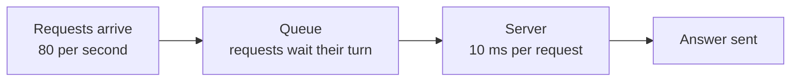
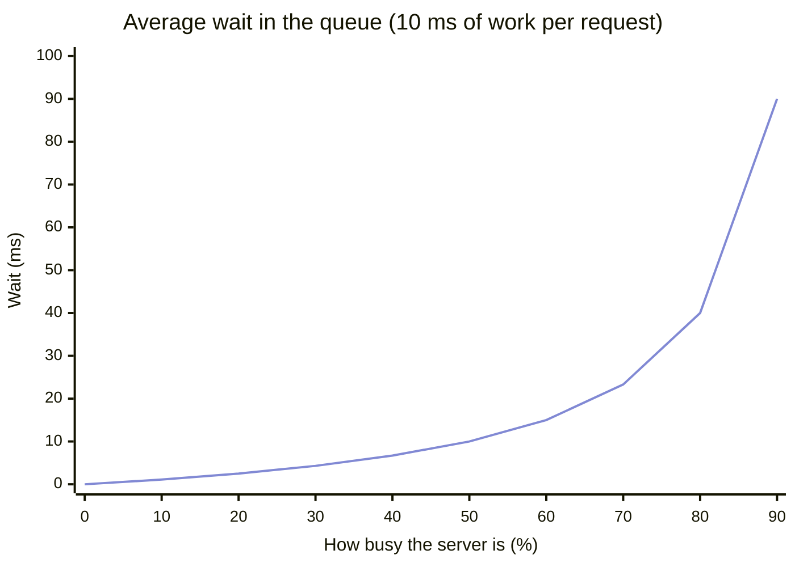
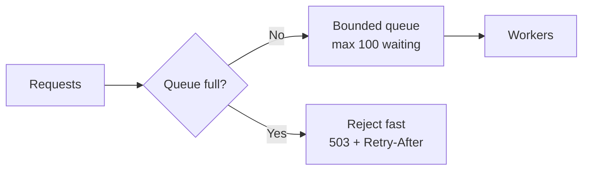

## What is it?

Think of a coffee shop with **one cashier**. Each order takes about 1 minute.

- If a customer walks in **every 2 minutes**, the cashier is free half the time. You almost never wait.
- If a customer walks in **almost every minute**, the cashier is busy nearly all the time. Now and then, three people walk in together. A line forms, and there is almost no free time to clear it. You can easily wait 10 minutes for a 1-minute order.

The cashier didn't get slower. The line got longer, because **customers don't arrive evenly**. They come in random bunches.

A server works the same way. Requests are the customers, the server is the cashier, and the line where requests wait their turn is the **queue**. Waiting grows slowly at first and then **explodes** as a server gets close to 100% busy. Below: why that happens, and how to count how many requests are inside your system at once.

## Why do we need it?

Most people think a server at 80% busy still has 20% to spare. It doesn't work that way. Long before a server is "full", requests already spend most of their time **waiting in line**, not being worked on.

Without a little queueing math, you can't answer simple design questions:

- **Why did latency jump** when traffic only grew by 10%?
- **How many threads or database connections** do I need?
- **Why did one slow database freeze every app server**, even ones with free CPU?

Queueing explains all three, with two small formulas. It is the math behind the "busy servers get slow" rule in [Latency, Throughput and QPS](./latency-throughput-qps.mdx).

## How it works inside

### The numbers that matter

| Number | What it means | Coffee shop | Server |
| --- | --- | --- | --- |
| **Arrival rate** | How many come in per second (or per hour) | 48 customers per hour | 80 requests per second |
| **Service time** | Time to handle one, **not** counting the wait | 1 minute per order | 10 ms per request |
| **Service rate** | The most it can finish if it is never idle: 1 ÷ service time | 60 orders per hour | 100 requests per second |
| **Utilization** | How busy it is: arrival rate ÷ service rate | 48 ÷ 60 = 80% | 80 ÷ 100 = 80% |

**Utilization** is the share of time the server is working. At 80%, it is busy 80% of the time and idle 20% of the time.

The time a request spends inside the system is **time waiting in the queue + service time**. The service time stays the same. The waiting is what changes.

If the arrival rate is **higher** than the service rate (over 100% busy), the queue grows forever. No amount of waiting fixes that: you must add servers or turn work away (see [Backpressure](../reliability-security/backpressure.mdx)).

### Why waiting explodes near 100%

The simplest textbook model is called **M/M/1**: requests arrive at random moments, service times vary at random, and there is **one server** that handles one request at a time. For this model, there is a short formula:

**average wait in the queue = utilization ÷ (1 − utilization) × service time**

With a service time of 10 ms:

| How busy | utilization ÷ (1 − utilization) | Average wait in the queue | Total time (wait + work) |
| --- | --- | --- | --- |
| 50% | 0.5 ÷ 0.5 = **1×** | 10 ms | 20 ms |
| 80% | 0.8 ÷ 0.2 = **4×** | 40 ms | 50 ms |
| 90% | 0.9 ÷ 0.1 = **9×** | 90 ms | 100 ms |
| 95% | 0.95 ÷ 0.05 = **19×** | 190 ms | 200 ms |
| 99% | 0.99 ÷ 0.01 = **99×** | 990 ms | 1,000 ms |

In plain words:

- At **50%** busy, a request waits about as long as the work itself.
- Going from 50% to **80%** busy makes the wait **4 times** longer.
- Going from 90% to **99%** busy, the server does only 10% more work, but the wait grows **11 times**: from 90 ms to 990 ms.

**Why it happens.** Requests come in random bunches. To clear a line, the server needs **free time**. At 50% busy it has plenty, so lines disappear fast. At 99% busy it has almost none, so every small bunch leaves a line that takes a very long time to clear, and the next bunch arrives before it is gone.

**It is a simplified model, but the shape is real.** Real traffic is not exactly like M/M/1, so the exact numbers will differ. Some things make it worse: the more the service times vary (most requests take 5 ms, a few take 500 ms), the longer the lines. Some things make it better: at the same busyness, one shared line in front of many workers means shorter waits than a single worker. But real systems show the same shape: **flat at first, then a steep wall near 100%.**

### Little's Law: how many are inside

**Little's Law** is a simple rule that works for almost any system that is stable (the line is not growing forever):

**items in the system = arrival rate × time in the system**

Coffee shop: 1 customer arrives every 2 minutes (0.5 per minute), and each one spends 10 minutes inside (ordering, then drinking the coffee at a table). So on average there are 0.5 × 10 = **5 customers** in the shop.

It doesn't matter how the customers arrive, or how long each single order takes. Only the averages matter. You may know it from [Latency, Throughput and QPS](./latency-throughput-qps.mdx) as "requests in progress = throughput × latency". In a stable system, what goes in equals what comes out, so it is the same rule.

#### Example 1: requests in flight

An API gets **1,000 requests per second**, and each request takes **0.2 seconds** (200 ms) from start to finish.

1,000 × 0.2 = **200 requests in flight** at any moment.

"In flight" means started but not finished yet. If your servers use one thread per request, you need at least **200 threads** across all servers, just for the average. If the peak is 2 times the average, plan for about 400.

Now the dangerous direction. If a slow dependency makes each request take **1 second** instead of 0.2, the same traffic means 1,000 × 1 = **1,000 requests in flight**. Nothing changed on your side, but you suddenly need 5 times as many threads. This is how one slow database can freeze a whole fleet of app servers.

#### Example 2: sizing a connection pool

Five app servers handle **2,000 requests per second** in total. Each request holds a database connection for about **10 ms** (0.01 seconds) while its queries run.

Connections in use = 2,000 × 0.01 = **20** on average, about 4 per app server.

A pool of 10 connections per server (50 in total) leaves good headroom: each pool is only about 40% busy. Now the database gets slow, and each request holds its connection for **50 ms**. Connections needed = 2,000 × 0.05 = **100**, but only 50 exist. Requests start **waiting in line for a connection**, and latency climbs. See [Connection Pooling](../databases/connection-pooling.mdx).

### How queues make the tail slow

The average hides the worst waits. Even when a server is 80% busy on average, some requests arrive just after a bunch and wait behind all of it. Those unlucky requests become your **tail latency**: the slowest requests, like the p99 (see [Latency Percentiles](../production/latency-percentiles.mdx)).

In the same M/M/1 model, the slowest 1 in 100 requests take about **4.6 times the average** time. At 80% busy with 10 ms of work, the average is 50 ms, but the **p99 is about 230 ms**. The work itself averages only 10 ms. Almost all the rest is waiting in line.

And waits add up. A request that passes through five busy services waits in five lines.

## Practical rules

1. **Leave headroom.** Don't run latency-sensitive servers near 100% busy. A common rule of thumb is to stay well below it even at peak, often somewhere around 50 to 70%. Background jobs (resizing images, sending reports) are different: nobody waits for each one, so running near 100% is fine. There, throughput matters, not latency.
2. **Bound every queue.** Give each queue a size limit. A request waiting behind 10,000 others is already too late, so it is better to say "no" right away.
3. **Use timeouts.** The caller should stop waiting after a set time (see [Retries, Backoff and Timeouts](../messaging/retries-backoff-timeouts.mdx)). The server should also check: if a request has already waited longer than the caller will wait, drop it instead of doing work nobody will see.
4. **Shed load and push back.** When the queue is full, reject extra work quickly (`503 Service Unavailable`), so the work you accept still finishes on time. Rejecting work on purpose is called **load shedding**. Telling the sender to slow down is **backpressure** (see [Backpressure](../reliability-security/backpressure.mdx)).
5. **Watch the queue, not only the CPU.** Alert on how long the queue is, and on how long items have been waiting.

## When to use it

Use queueing math whenever you **size** something that requests wait for:

- **Servers:** how many, so they stay at a safe busyness at peak.
- **Thread pools and connection pools:** Little's Law gives the number in use.
- **Auto-scaling targets:** why the target is 60%, not 95%.
- **Queue limits and timeouts:** how long a line is worth keeping.

**Don't use it when:**

- **You need exact numbers.** The models are simple. Real traffic and real service times differ, so treat the results as rough guides, and measure.
- **The work itself is slow, not the wait.** If requests are slow at 20% busy, the line is not the problem. Find the slow query or call first. See [Finding Bottlenecks](../production/finding-bottlenecks.mdx).

## Alternatives

| Option | What it is | Pick it when |
| --- | --- | --- |
| **Load testing** | Send fake traffic and measure the real latency curve | You need real numbers before a launch. See [Load Testing](../production/load-testing.mdx) |
| **Watch production** | Graph latency and queue length against how busy the servers are | The system is already live and has real traffic |
| **Rule of thumb** | Keep latency-sensitive servers around 50 to 70% busy at peak | You need a quick answer, like in an interview |

## In the real world

**Little's Law has a proof.** The rule is named after John Little, who published a proof of it in 1961. In textbooks it is written L = λW: items = arrival rate × time.

**Amazon: "Avoiding insurmountable queue backlogs".** In this Amazon Builders' Library article, AWS engineer David Yanacek explains the hidden risk of queues. During an outage, messages keep arriving but nothing is processed, so a large **backlog** builds up. After the fix, the service must work through all of it, so it can stay slow for a long time after the cause is fixed. The article suggests measuring the **age** of the messages in the queue, not only how many there are, and moving extra traffic into a separate "spillover" queue so it doesn't block normal work.

**Google's SRE book.** The chapter "Addressing Cascading Failures" advises keeping queues short: for steady traffic, a queue of about 50% or less of the thread pool size. It also notes that Gmail often uses servers with **no queue at all**: when all threads are busy, the request goes to another server instead. The chapter "Handling Overload" covers how servers turn away extra work and how clients slow themselves down.

## In the interview

When you size servers or pools, use Little's Law out loud, and say how busy you will let servers get:

> "At peak we expect 3,000 requests per second, and each takes about 50 ms, so about 150 are in flight at once. I'll size servers to stay around 60% busy at peak, because waiting grows fast near 100%. Queues are bounded, and beyond that we shed load with 503s."

<Callout title="Remember this" type="success">
  - **Utilization** = arrival rate ÷ service rate = how busy the server is.
  - **Why:** requests wait in line long before a server is "full". The math tells you how many servers, threads and connections you need.
  - Waiting **explodes** near 100%. In the simple M/M/1 model, wait = utilization ÷ (1 − utilization) × service time: 50% → 1×, 90% → 9×, 99% → 99×.
  - **Little's Law:** items in the system = arrival rate × time in the system. 1,000 per second × 0.2 s = 200 in flight.
  - A **slow dependency** means more requests in flight, so threads and connection pools run out.
  - Leave **headroom** on latency-sensitive servers. Batch jobs can run near 100%.
  - **Bound every queue**, use timeouts, and shed load or push back when full.
  - Queues create **tail latency**: unlucky requests wait behind a burst.
  - **Alternatives:** load testing, watching production, or the 50 to 70% rule of thumb.
</Callout>
