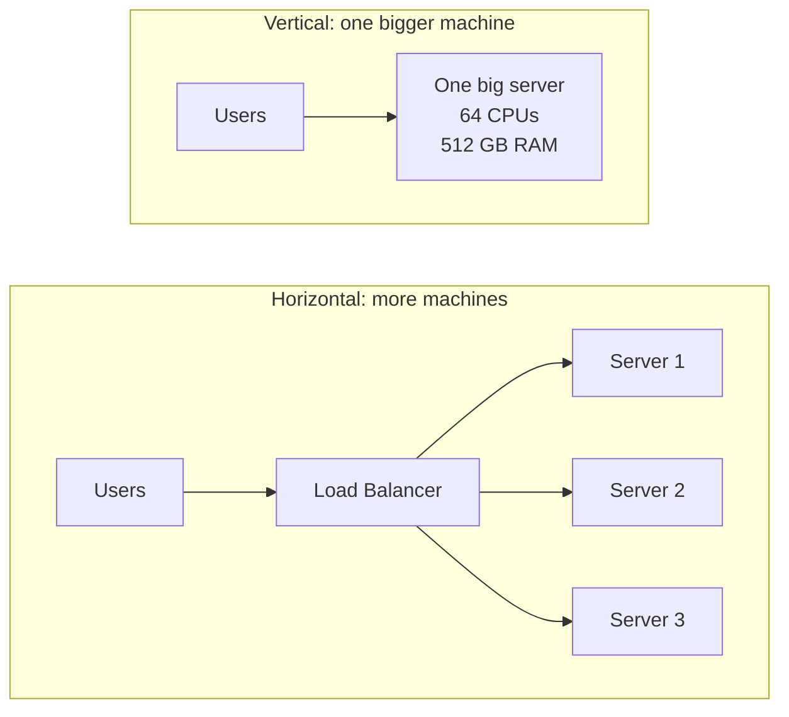
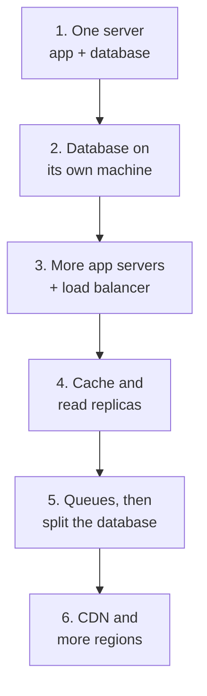

## The idea

A system is **scalable** if it can handle more users, more data and more requests just by adding more resources, without being rebuilt.

Think of a small restaurant. On a quiet day, one cook is enough. Then the restaurant gets famous, and the line goes out the door. The owner has two choices:

- **Buy a bigger stove and hire a faster cook.** This is **vertical scaling**.
- **Add more cooks and more stoves.** This is **horizontal scaling**.

Both work for a while. But one cook, however fast, can only cook so much. A kitchen with many cooks can keep growing.

## What scalability means

Scalability is not the same as speed. A system can be fast for 100 users and fall over at 10,000. That system is fast, but not scalable.

A simple test: **if traffic doubles, can I handle it by adding machines, or must I change the design?** If adding machines is enough, the system scales.

Growth comes in three shapes, and each one hurts a different part:

| More of... | Example | What feels it first |
| --- | --- | --- |
| **Requests** | A video goes viral | App servers and the database |
| **Data** | Years of photos and messages | Database disk and slow queries |
| **Users far away** | The app launches in new countries | Latency, because users are far from the servers |

## Vertical scaling: a bigger machine

**Vertical scaling** (also called **scaling up**) means making one machine stronger: more CPU, more memory (RAM), a faster disk.

**Good:**

- Very simple. No code changes.
- No new problems. It is still one machine, so all data is in one place.

**Bad:**

- **There is a ceiling.** Even the biggest machine you can buy has a limit.
- **You pay for the peak all day.** In the cloud, a machine twice as big costs about twice as much. But one big machine must be sized for your busiest hour, and you pay for that size even when traffic is low.
- **It is still one machine.** If it dies, everything is down. This is a **single point of failure** (see [Availability and Reliability](./availability-reliability.mdx)).
- An upgrade often needs a restart, so there is some downtime.

## Horizontal scaling: more machines

**Horizontal scaling** (also called **scaling out**) means adding more machines and spreading the work across them. A [load balancer](./load-balancing.mdx) sits in front and sends each request to one of them.

**Good:**

- **Almost no ceiling.** Need more? Add another machine.
- **It survives failures.** If one machine dies, the others keep working.
- Many cheap, normal machines instead of one huge, expensive one.
- **Auto-scaling:** cloud providers can add machines when traffic goes up and remove them when it goes down.

**Bad:**

- **More moving parts:** a load balancer, many machines, more things to watch.
- **Servers must not keep user data in their own memory.** Otherwise a user's next request may land on a machine that doesn't know them. See [Stateless vs Stateful Servers](./stateless-vs-stateful.mdx).
- **Data is harder.** Adding app servers is easy. Spreading one database across many machines is hard (see [Scaling Writes](./scaling-writes.mdx)).

## Side by side

| | Vertical (scale up) | Horizontal (scale out) |
| --- | --- | --- |
| **How** | A bigger machine | More machines |
| **Limit** | The biggest machine you can buy | Very high |
| **If a machine dies** | Everything is down | The others keep working |
| **Complexity** | Low | Higher |
| **Best for** | Databases, young apps | Stateless app servers, big systems |

In practice, you do both. You scale app servers **out**, and you scale the database **up** as far as it sensibly goes before you split it.

## What usually breaks first as you grow

The order is surprisingly similar for most apps:

1. **One server does everything.** Fine for the first thousands of users.
2. **The app and the database fight for CPU and memory.** Move the database to its own machine.
3. **One app server is too busy.** Add more app servers behind a load balancer. This is easy if the servers are stateless.
4. **The database becomes the bottleneck.** A **bottleneck** is the slowest part, the one that limits everything else, like the narrow neck of a bottle. Usually reads hurt first. See [Scaling Reads](./scaling-reads.mdx).
5. **Writes or data outgrow one database.** Use queues and batching, and finally split the data across machines (**sharding**). See [Scaling Writes](./scaling-writes.mdx).
6. **Users all over the world feel slow.** Add a [CDN](../caching/cdn.mdx) and servers in more regions.

The lesson: **the database is almost always the hard part.** App servers are easy to copy. Data is not.

## In the real world

**Stack Overflow scaled up.** For many years, Stack Overflow, one of the busiest websites on the internet, ran on a small number of its own servers, with a few very powerful SQL Server database machines. Its engineers wrote about this setup openly. Big machines plus good caching went a very long way.

**Instagram started small.** When Facebook bought Instagram in 2012, it had about 30 million users and only 13 employees. The team used simple, well-known tools (Django, PostgreSQL, Redis) on AWS, added machines as they grew, and later split their PostgreSQL data across many machines.

**Twitter's "fail whale".** In its early years, Twitter often went down when traffic spiked, and users saw a cartoon whale on the error page. Twitter later moved its busiest parts out of one big Ruby on Rails app into separate services that could scale on their own.

## In the interview

Every design should scale horizontally at the app layer. Say it early, then spend your time on the data, where the real problems are:

> "The app servers are stateless, so I can add more behind the load balancer as traffic grows. The harder part is the database, so let's look at reads and writes there."

<Callout title="Remember this" type="success">
  - **Scalable** = handle more load by adding resources, without a redesign.
  - **Vertical** = a bigger machine. Simple, but it has a ceiling and is a single point of failure.
  - **Horizontal** = more machines. Almost no ceiling and survives failures, but more complex.
  - Horizontal scaling needs **stateless** servers.
  - Usual order: **separate DB → more app servers → cache and replicas → shard → CDN and regions**.
  - The **database** is almost always the hard part.
</Callout>
