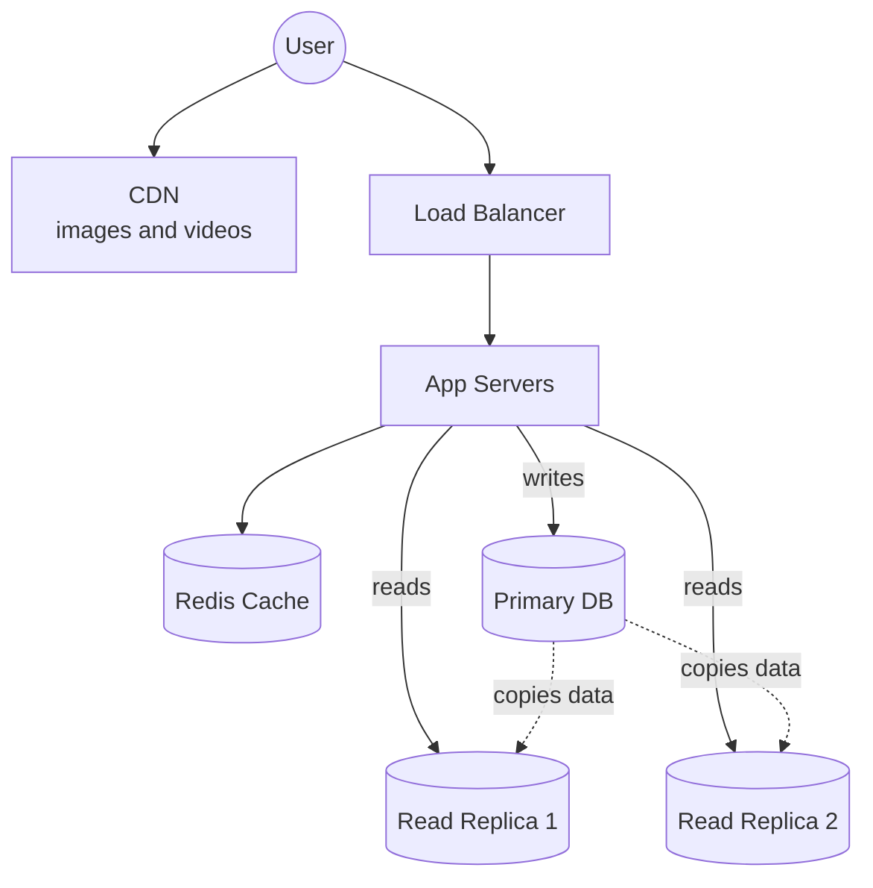

## The problem

Most apps are **read-heavy**. On Instagram, one person posts a photo, and thousands of people view it. Reads can be 100 times more than writes, or even more.

One database machine can only answer so many reads per second. When traffic grows, reads become the first problem.

## The fixes, from simple to advanced

Try these in order. Don't jump to the hard ones first.

<Steps>
<Step>

**Make the database faster.** Add an **index** to the columns you search by. An index is like the index at the back of a book: it lets you find a row without reading every row.

</Step>
<Step>

**Add a cache.** Keep popular data in Redis. Most reads never reach the database. See [Caching](../caching/what-is-caching.mdx).

</Step>
<Step>

**Add read replicas.** A replica is a copy of the database that only answers reads. The main database (the **primary**) takes all writes, and copies them to the replicas.

</Step>
<Step>

**Use a CDN.** A CDN keeps copies of images, videos and files on servers close to your users, all over the world.

</Step>
<Step>

**Prepare answers early.** Instead of counting likes every time someone views a post, store the like count and update it when a like happens. This is called **precomputing**.

</Step>
</Steps>

## What it looks like

## Watch out

- **Replica lag:** a replica can be a little behind the primary. A user may save something and then not see it right away. **Fix:** read the user's own new data from the primary for a few seconds after they write.
- **Stale cache:** cached data can be old. Use a TTL and delete keys when data changes.
- **Hot keys:** one very popular item can overload one cache server. **Fix:** keep a copy of it in each app server's memory for a few seconds, or store several copies of the key. See [Cache Problems](../caching/cache-problems.mdx).

## In the real world

**Facebook's giant cache.** In a 2013 paper, "Scaling Memcache at Facebook", Facebook described how it puts a huge layer of Memcached cache servers in front of its MySQL databases. People read far more content on Facebook than they create, so the cache answers most reads and the databases see only a small share.

**Netflix built its own CDN.** Netflix runs its own CDN, called **Open Connect**. It places Netflix servers full of videos inside internet providers' networks, close to viewers. When you press play, the video usually comes from a server near you, not from a faraway data center.

## In the interview

Almost every question has a read-heavy part: a URL shortener, a news feed, the YouTube video page, the Ticketmaster event page. Say the read-to-write ratio early, then walk through the fixes in order:

> "This is read-heavy, about 100 reads for every write. I'll put Redis in front of the database, add read replicas for cache misses, and serve images from a CDN. For a user's own recent changes, I'll read from the primary so they always see what they just saved."

<Callout title="Remember this" type="success">
  - Most systems are **read-heavy**.
  - Fix in order: **index → cache → read replicas → CDN → precompute**.
  - Replicas can be a little **behind**. Read your own new writes from the primary.
  - Say the read-to-write ratio early. It tells you this pattern is needed.
</Callout>
