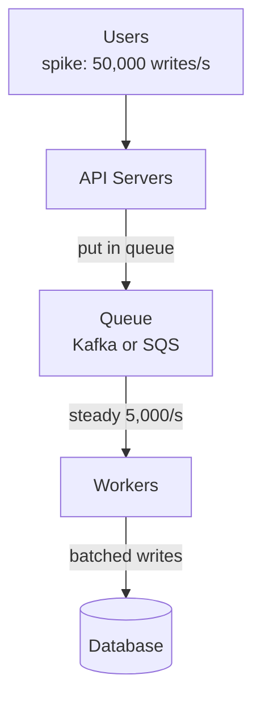
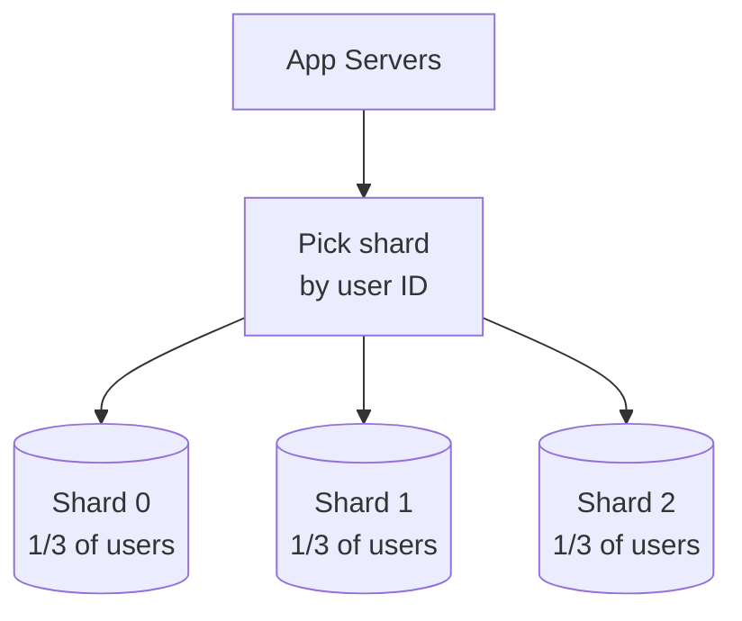
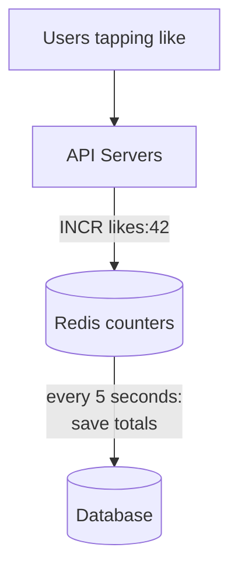

## The idea

Most apps read far more than they write (see [Scaling Reads](./scaling-reads.mdx)). But some are **write-heavy**: chat messages, likes, clicks, GPS updates from drivers, logs, sensor data.

Reads are easier to scale: make copies of the data and read from any copy. Writes can't do that. In a database with one **primary** (the usual setup for PostgreSQL and MySQL), every write must go to the primary, the one copy that accepts changes, and then be copied to all the others. Adding read replicas doesn't help writes at all. It actually adds work, because each replica must copy every write.

Some databases, like Cassandra, have no single primary: any node can take a write and pass it to the copies. Even there, **every copy still has to store every write**. What adds write capacity is splitting the data across more machines, as shown below.

Think of a bank where one cashier writes every deposit into one big ledger book. Reading balances is easy: make photocopies of the book. But every deposit must go into the one real book. When the line gets too long, the bank has choices:

- Collect deposit slips in a tray and write them in bunches. (**Batching**)
- Give people a numbered ticket, and handle them in order at a steady pace. (**A queue**)
- Split into two books, A to M and N to Z, each with its own cashier. (**Sharding**)
- Use a kind of book that is faster to write in. (**A write-friendly database**)

**But first, make each write cheaper.** Every index on a table must be updated on every write, so remove indexes you don't use (see [Indexes](../databases/indexes.mdx)). Don't write data that hasn't changed.

## Batching and buffering writes

Every write has a fixed cost: a network round trip, starting a transaction, and saving to disk. Writing 1,000 rows in one go is much cheaper than 1,000 separate writes.

```sql
-- Slow: one statement per row, 1,000 round trips
INSERT INTO views (video_id, viewed_at) VALUES (7, now());
-- ...999 more like this

-- Fast: one statement, many rows
INSERT INTO views (video_id, viewed_at) VALUES
  (7, now()),
  (7, now()),
  (9, now());
```

**Buffering** goes one step further. Keep writes in memory for a short time, then save them together. For example, collect view events for 5 seconds, then write **one** update per video: "video 7: plus 1,250 views".

**The cost:** if the server crashes before saving, the buffered writes are lost, and the data is always a few seconds behind. That is fine for view counts and analytics. It is **not** fine for payments.

## Queues to absorb sudden spikes

Traffic comes in waves: a flash sale, a goal in a big match. A **queue** sits between the app and the database. The app puts each write in the queue and answers the user right away ("got it"). **Workers** take writes from the queue at a steady speed the database can handle.



Think of the order rail in a restaurant kitchen. Waiters clip orders onto the rail as fast as customers order. The cooks take them one by one, at their own pace. The rail fills up during the dinner rush and empties later.

**Good:**

- The database never gets more than it can handle.
- If the database is down for a minute, nothing is lost. The writes wait in the queue.
- Workers can retry failed writes.

**Bad:**

- The write is not done right away. The user may not see their change for a moment (see [Eventual Consistency](../messaging/eventual-consistency-async.mdx)).
- A queue only smooths out **spikes**. If writes come in faster than the workers can handle **all day long**, the queue just keeps growing. Then you still need a bigger write path.

More in [Message Queues and Pub/Sub](../messaging/message-queues-pub-sub.mdx) and [Kafka](../messaging/kafka.mdx).

## Sharding the write load

Batching and queues help, but in the end one primary machine has a limit. **Sharding** splits the data across several databases, and each one has its own primary. Each shard takes only its share of the writes.



With 3 shards, each primary takes about a third of the writes. With 10 shards, you can take about 10 times the writes.

The big decision is the **shard key**: the field that decides which shard a row goes to.

- **Good key:** spreads writes evenly, and keeps data that is read together in one place. For chat messages, the **chat ID** works well: all messages of one chat sit on one shard.
- **Bad key:** the date. All of today's writes would land on the same shard, while the others sit idle. This is a **hot shard**.

Sharding has real costs: queries across shards are hard, and adding shards means moving data. Full details: [Partitioning and Sharding](../databases/partitioning-sharding.mdx) and [Consistent Hashing](../databases/consistent-hashing.mdx).

## Picking a write-friendly database

Databases store data in different ways. Most SQL databases use a **B-tree**, which updates data in place on disk. That means jumping around the disk to find the right spot for every write.

Write-friendly databases often use an **LSM tree** (log-structured merge tree). Each new write is added to a list in memory and to the **end** of a log file on disk. Later, in the background, the data is sorted and merged. Adding to the end is very fast. It is like writing new notes at the bottom of a notebook, instead of finding and erasing the right line every time.

| Kind | Examples | Good for |
| --- | --- | --- |
| Wide-column, LSM-based | Cassandra, ScyllaDB | Huge write volumes: messages, events, sensor data |
| Key-value | DynamoDB | Simple writes by key, scales out on its own |
| Time-series | InfluxDB, TimescaleDB | Metrics, where every row has a time |
| Log | Kafka | Storing events in order, only ever adding to the end |
| In-memory | Redis | Very fast counters and short-lived data |

Databases like Cassandra also **shard for you**: add a machine, and the data spreads out on its own. The price is fewer features: limited joins and transactions, and you must design your tables around your queries up front. See [Indexes: B-Trees and LSM Trees](../databases/indexes.mdx) and [SQL vs NoSQL](../databases/sql-vs-nosql.mdx).

## Counting things at scale (likes, views)

Counting looks simple:

```sql
UPDATE posts SET likes = likes + 1 WHERE id = 42;
```

But a viral post can get thousands of likes per second, and every one updates **the same row**. The database locks the row for each update, so they all wait in one line. This is a **hot row** (see [Locks and Deadlocks](../databases/locking.mdx) and [Hot Keys](../advanced-components/hot-keys-fan-out.mdx)).

The fixes, from simple to advanced:

1. **Count in Redis.** `INCR likes:42` happens in memory and is very fast. Copy the totals to the database every few seconds.
2. **Batch the increments.** Each app server counts in its own memory for a few seconds, then writes `likes = likes + 312` once.
3. **Sharded counters.** Split one counter into, say, 10 smaller counters. Each like adds 1 to a random one. To read the total, add them up. Now 10 writes can happen at the same time.
4. **Approximate counts.** For "how many **different** people viewed this?", use a **HyperLogLog**, which estimates the answer using very little memory (see [Bloom Filter, HyperLogLog, Count-Min Sketch](../advanced-components/probabilistic-data-structures.mdx)).
5. **Events and a counting job.** Write each like as an event to Kafka. A job reads the events and updates the totals every few seconds. You also keep a record of who liked what.



A sharded counter in SQL looks like this:

```sql
-- One row per small counter: (post_id, slot, count)
-- Write: add 1 to a random slot, from 0 to 9
UPDATE like_counts SET count = count + 1
WHERE post_id = 42 AND slot = 7;

-- Read: add all the slots together
SELECT SUM(count) FROM like_counts WHERE post_id = 42;
```

Most apps show "1.2M likes" anyway. An exact, up-to-the-second count is rarely needed. A few seconds late is fine.

## In the real world

**Discord stores messages in a write-friendly database.** In 2017, Discord wrote that it had moved its messages from MongoDB to Cassandra, because it needed to store billions of messages with a heavy, steady stream of writes. In 2023, it wrote about moving again, to ScyllaDB (a database compatible with Cassandra), as it grew to trillions of messages.

**Google Firestore tells you to shard counters.** Google's Firestore documentation says a single document can only be updated about once per second. For counters that change faster, it tells developers to use **distributed counters**: split the count across several documents and add them up when reading.

**Instagram sharded PostgreSQL.** In 2012, Instagram's engineering blog described splitting its data into thousands of small **logical shards**, spread across a much smaller number of PostgreSQL servers. Each new ID even includes the number of the shard it lives on, so the app always knows where to find it.

## In the interview

Bring this up when your math shows thousands of writes per second, or when the design has counters:

> "We get about 20,000 messages per second, with peaks near 60,000. That's too many for one SQL primary, so I'll store messages in Cassandra, partitioned by chat ID. Like counts go to Redis first and are saved to the database every few seconds."

<Callout title="Remember this" type="success">
  - Replicas and caches don't help writes: **every copy must store every write**. With one primary, all writes go through it.
  - First make writes cheaper: fewer indexes, and **batch** many rows into one write.
  - A **queue** absorbs spikes. Workers write at a steady pace.
  - **Sharding** splits writes across many primaries. Pick a key that spreads writes evenly.
  - **Write-friendly databases** (Cassandra, LSM trees) handle huge write volumes.
  - **Counters:** Redis plus a regular save, batching, or sharded counters. Never one hot row.
</Callout>
