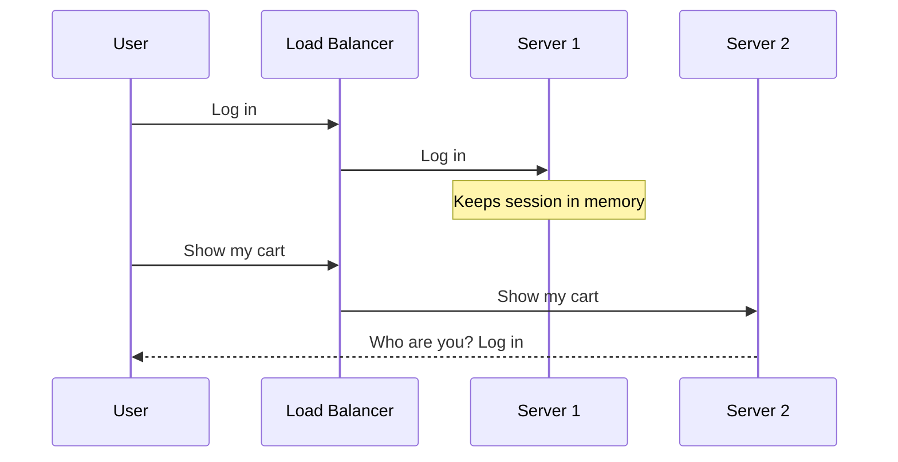
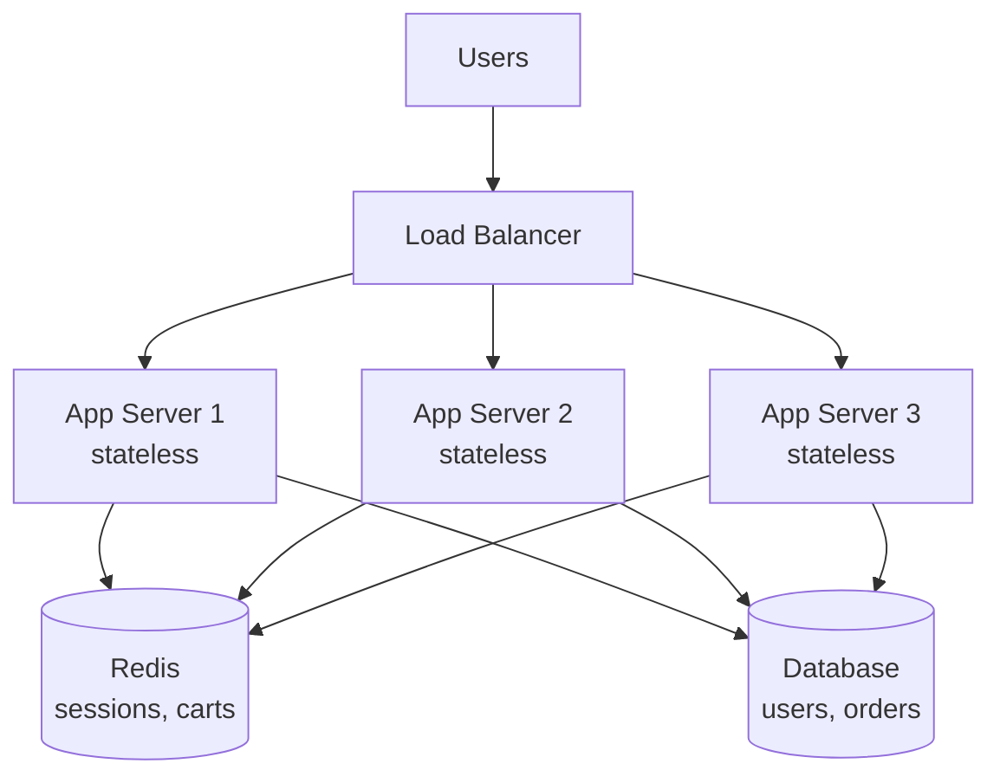
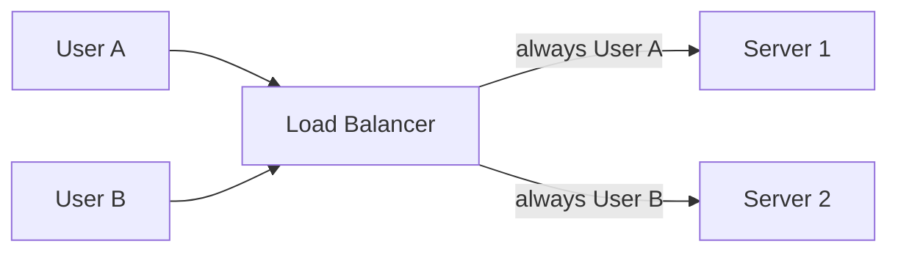

## The idea

**State** is anything a server remembers between two requests: who is logged in, what is in the shopping cart, how much of a file has been uploaded.

Think of two coffee shops:

- In the first shop, one barista remembers your usual order in their head. That is nice, but only that barista can serve you. If they are sick or busy, you are stuck.
- In the second shop, your order is written in a shared notebook at the counter. Any barista can read it and serve you.

The first barista is a **stateful** server: the knowledge lives inside it. The second is **stateless**: the barista remembers nothing, and the knowledge lives in a shared place.

## What "state" is

| State | Example |
| --- | --- |
| Login session | "User 42 is logged in" |
| Shopping cart | 3 items, not bought yet |
| Live connections | An open chat connection (a WebSocket) |
| Work in progress | Half of an uploaded video |
| Data kept in memory | The top 100 products, loaded once |

HTTP itself forgets everything after each request (see [HTTP and HTTPS](../foundations/http-and-https.mdx)). Apps add memory on top, usually with cookies and sessions (see [Cookies, Sessions and JWT](../foundations/cookies-sessions-jwt.mdx)). The question is **where** that memory lives.

## Stateful servers: the problem

Say each server keeps login sessions in its own memory. A [load balancer](./load-balancing.mdx) spreads requests across two servers:

The user just logged in, and the next request says "please log in". Problems:

- **The load balancer can't pick freely.** Only one server knows this user.
- **A crash loses data.** If server 1 dies, all its users are logged out and their carts are gone.
- **Scaling down and deploying are hard.** You can't simply remove a server, because its users would lose their state.
- **Uneven load.** One server can end up with many heavy users.

## Stateless servers: why they scale easily

A **stateless** server keeps nothing in its own memory between requests. Each request either carries what is needed (like a login token), or the server reads it from a shared store.

- **Any server can handle any request.** The load balancer picks freely.
- **Adding a server is easy.** Start it, add it to the load balancer, done.
- **A crash loses nothing.** Requests simply go to the other servers.
- **Deploys are easy.** Replace servers one at a time.

This is what makes [horizontal scaling](./scalability.mdx) work.

## Where to keep state instead

Move the state **out** of the app servers, into places built to keep it:

| Kind of state | Where to keep it | Why |
| --- | --- | --- |
| Login sessions | Redis, or a signed token (JWT) that the client carries | Fast. Redis can delete old sessions on its own |
| Shopping cart | Redis, or the database if it must last for weeks | Every server can see it |
| Users, orders, payments | The database | Must never be lost |
| Uploaded files | Object storage, like Amazon S3 | Too big for memory or the database |
| Work waiting to be done | A queue | Any worker can pick it up |

With a **JWT** (JSON Web Token), the client carries a signed note that says "I am user 42". The server checks the signature and needs no lookup at all.

The state did not disappear. It moved to places built to hold it. Data that must never be lost goes in the **database**, which keeps copies and backups. **Redis** holds state you can afford to lose now and then: if Redis loses the sessions, users just log in again. See [Redis](../caching/redis.mdx).

## Stateful servers: where they are needed

Some parts **must** remember things:

- **Databases and caches.** Keeping state is their whole job.
- **Live connections.** In a chat app, each user's open WebSocket lives on one server. To send them a message, you must reach **that** server (see [Polling, WebSockets and SSE](../foundations/polling-websockets-sse.mdx)).
- **Multiplayer game servers.** One match usually runs on one server that keeps the game in memory, because it changes many times a second.
- **Live document editing.** All edits to one document often go through one server, so it can merge them in order.

How to handle them:

- Keep them **few**, and separate them from the stateless parts.
- Keep a **map of who is where**, for example in Redis: "user 42 → chat server 7".
- **Route by key**, so the same user, room or document always reaches the same server (see [Consistent Hashing](../databases/consistent-hashing.mdx)).
- **Plan for crashes.** Save state often, so a new server can take over.

## Sticky sessions

**Sticky sessions** (also called **session affinity**) is a load balancer setting. It sends all of one user's requests to the **same** server, usually by setting a cookie.

| Good | Bad |
| --- | --- |
| A quick fix for an old app that keeps sessions in memory | Uneven load: one server can get many busy users |
| Useful for live connections, where the server really must stay the same | If the server dies, its users still lose their sessions |
| | Harder to remove servers and deploy |

Use sticky sessions as a **temporary fix**, or for live connections. For normal web apps, move the state out instead.

## In the real world

**The Twelve-Factor App.** Heroku published "The Twelve-Factor App", a well-known set of rules for building apps that run in the cloud. One rule says app processes should be **stateless and share nothing**. Anything that must be kept goes into a backing service, like a database. It also says sticky sessions should never be used or relied on, and suggests keeping session data in a store like Redis or Memcached, which can expire old entries.

**AWS load balancers use a cookie for stickiness.** On an AWS Application Load Balancer, you can turn on sticky sessions. The load balancer then sets a cookie (named `AWSALB`) in the user's browser, and uses it to send that user back to the same server.

**Kubernetes treats the two kinds differently.** Normal app servers run as a **Deployment**: every copy is the same and can be replaced at any time. Databases and other stateful apps run as a **StatefulSet**: each copy gets a fixed name and its own disk, which stays with it even after a restart.

## In the interview

Always make your app servers stateless, and say so out loud:

> "The app servers are stateless. Sessions live in Redis, and permanent data lives in the database. So any server can handle any request, and I can add or remove servers freely."

For chat or other live features, add: "The WebSocket servers are stateful, so I keep a map in Redis of which server each user is connected to."

<Callout title="Remember this" type="success">
  - **State** = what a server remembers between requests.
  - **Stateless** servers: any server can answer any request. Easy to add, remove and replace.
  - Move state to **Redis** (sessions), the **database** (permanent data), **S3** (files), or a **token** the client carries.
  - Some parts must be stateful: **databases, caches, live connections, game servers**.
  - **Sticky sessions** keep a user on one server. A quick fix, but uneven load and lost sessions on a crash.
</Callout>
