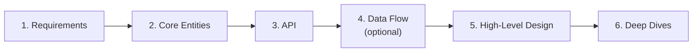
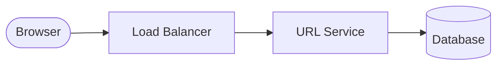

In an interview it is easy to get lost. You may start drawing too early, forget an important feature, or run out of time.

A **framework** is a fixed plan you follow every time. It helps you in three ways:

- You stay calm, because you always know what comes next.
- You don't forget important parts.
- The interviewer sees that you work in an organized way.

On this page we use one example the whole way: **"Design a URL shortener like bit.ly."** A URL shortener takes a long link and gives you a short one. When someone opens the short link, they are sent to the long link.

## The 6 steps at a glance



| Step | What you do | Time (45 min interview) |
| --- | --- | --- |
| 1. Requirements | Agree on **what** to build | about 5 min |
| 2. Core Entities | List the main "things" the system stores | about 2 min |
| 3. API | Decide how users talk to the system | about 5 min |
| 4. Data Flow | Explain how data moves step by step (only for some systems) | about 5 min |
| 5. High-Level Design | Draw the boxes and arrows | 10 to 15 min |
| 6. Deep Dives | Make the design strong: fast, big and safe | about 10 min |

If you skip step 4, give that time to the deep dives.

The question pages number only the steps they use. So when a question skips Data Flow, High-Level Design is **step 4** there, and Deep Dives is **step 5**.

## Step 1: Requirements (about 5 minutes)

Don't start drawing yet. First, ask questions and agree on what you will build. There are two kinds of requirements.

### Functional requirements: what the system does

These are the **features**. Write them as "Users should be able to...".

For the URL shortener:

1. Users should be able to create a short link from a long link.
2. Users should be able to open a short link and be sent to the long link.
3. (Optional) Users should be able to choose their own short link, like `short.ly/my-blog`.

Keep it to the **top 3 features**. Also say clearly what you will **not** build:

> "I will not cover user accounts or click analytics. Is that okay?"

This is called putting things **out of scope**. It shows the interviewer that you can focus.

### Non-functional requirements: how well the system works

These are the **qualities** of the system: speed, size, uptime and correctness. Write them as "The system should be...". Use numbers when you can.

For the URL shortener:

1. **Unique:** two long links must never get the same short code.
2. **Fast:** opening a short link should take less than 100 ms.
3. **Always up:** if the system is down, every short link on the internet breaks. Aim for 99.99% uptime.
4. **Big:** support about 1 billion links and 100 million users per day.

Not sure what to ask? Go through this list:

| Think about | Ask yourself |
| --- | --- |
| **Scale** | How many users? How much data? |
| **Latency** (speed) | How fast must one request be? |
| **Availability** (uptime) | Is it okay if the system is down for a few minutes? |
| **Consistency** | Must every user see the newest data right away? |
| **Read vs write** | Do people read more, or write more? |
| **Security** | Is there private data, money, or a risk of abuse? |

<Callout title="Read-heavy" type="idea">
  People open short links much more often than they create them, maybe 100 opens for every 1 create. We call
  this **read-heavy**. It tells us early that a cache will help a lot.
</Callout>

### Quick math (only if it helps)

Some people spend 10 minutes on math here. You usually don't need that. Do math only when the answer **changes your design**.

Good example:

> "1 billion links × about 500 bytes each = about 500 GB. That fits on one database machine, so I don't need to split the data just because of size."

The math led to a decision. That is the kind of math interviewers like.

## Step 2: Core Entities (about 2 minutes)

**Entities** are the main "things" your system stores and works with. Think of the nouns in your requirements. Just list them for now; you will add details later.

For the URL shortener:

- **Link**: a short code and the long URL it points to.

That is all. User accounts are out of scope, so there is no User entity.

Another example, for a ticket booking site like Ticketmaster: **Event**, **Venue**, **Ticket**, **Booking**.

This step gives you and the interviewer the same words to use in the next steps.

## Step 3: API (about 5 minutes)

The **API** is how the outside world talks to your system. Write **one endpoint for each functional requirement**. This way you can easily check that you covered every feature.

Use **REST** by default. REST means you use normal web URLs and HTTP methods: `GET` to read, `POST` to create, `PUT` or `PATCH` to update, `DELETE` to delete.

```http
POST /urls
{ "longUrl": "https://www.example.com/a/very/long/link", "customAlias": "my-blog" }
→ 201 Created
{ "shortUrl": "https://short.ly/my-blog" }

GET /{shortCode}
→ 302 Found
Location: https://www.example.com/a/very/long/link
```

Tips:

- Use plural nouns in paths: `/urls`, `/events`, `/bookings`.
- Never put the user's ID in the request body. Get it from the login token in the request header. Otherwise anyone could pretend to be another user.
- REST is not the only choice. For live updates (chat, live scores) you may use **WebSockets**. Mention it only when it is needed.

## Step 4: Data Flow (optional, about 5 minutes)

Some systems are mainly about **processing data in many steps**, like a web crawler or a system that counts ad clicks. For these, write a short numbered list of how the data moves.

Example for a web crawler:

1. Take a URL from the queue.
2. Download the web page.
3. Save the page.
4. Find new links in the page.
5. Add the new links to the queue.

For the URL shortener we **skip** this step. It is a simple "request in, answer out" system.

## Step 5: High-Level Design (10 to 15 minutes)

Now draw boxes and arrows: users, servers, databases, caches.

Go through your API **one endpoint at a time**, and build the **simplest design that works**. Don't add caches, queues or extra databases yet. Say:

> "I will keep it simple first, and make it stronger in the deep dives."

For the URL shortener:



**Create a short link** (`POST /urls`):

1. The browser sends the long URL.
2. The URL Service makes a new unique short code.
3. It saves `short code → long URL` in the database.
4. It returns the short link.

**Open a short link** (`GET /{shortCode}`):

1. The browser asks for `/abc123`.
2. The URL Service looks up `abc123` in the database.
3. It sends back a redirect to the long URL.

Add database fields next to the database box only when you need them. For example: `shortCode`, `longUrl`, `createdAt`.

<Callout title="Talk while you draw" type="idea">
  For every box, say **what it does** and **why you need it**. Keep a small list on the side: "Things to
  improve later". You will use this list in the deep dives.
</Callout>

## Step 6: Deep Dives (about 10 minutes)

Now make the design strong. Go back to your **non-functional requirements** and check each one. Does the design meet it? If not, fix it.

| Requirement | Problem in the simple design | Fix |
| --- | --- | --- |
| Fast (under 100 ms) | Every open reads from the database. 100 million users × about 10 opens a day is about 12,000 opens per second, more at busy times. One database gets overloaded and slow | Put a cache (Redis) in front of the database, so most opens never reach it |
| Unique codes | Two servers might make the same code | Use one shared counter, and turn the number into a short code |
| 100 million users per day | One server cannot handle all the traffic | Run many copies of the service behind the load balancer |

For each fix, explain the **tradeoff**. For example:

> "The cache takes most reads off the database, so it stays fast. The downside is that a deleted link could still work for a few minutes, until the cache entry expires."

How much you lead here depends on your level:

- **Mid-level:** the interviewer often picks the topics. Answer them well.
- **Senior:** find the weak spots yourself and lead the discussion.
- **Staff:** go deeper. Talk about failures, cost and real-world experience.

## Common mistakes

- Drawing before agreeing on the requirements.
- Adding complex tools (Kafka, sharding, microservices) "just because". Every box needs a reason.
- Staying silent while thinking. Think out loud.
- Spending 20 minutes on requirements and math, and running out of time for the design.
- Making choices without saying the tradeoff.

<Callout title="Remember this" type="success">
  - **6 steps:** Requirements → Core Entities → API → (Data Flow) → High-Level Design → Deep Dives.
  - **Requirements first:** top 3 features, plus clear qualities with numbers.
  - **Do math only if it changes a decision.**
  - **One API endpoint per feature.**
  - **Simple design first**, then make it strong in the deep dives.
  - **Always say the tradeoff:** "I chose X because..., the downside is...".
</Callout>

See the full answer in [Design a URL Shortener](./questions/url-shortener.mdx).
