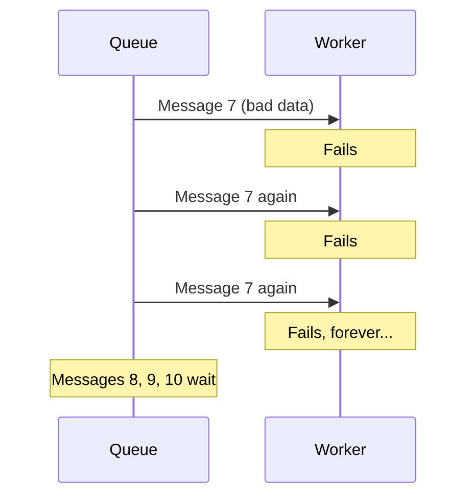
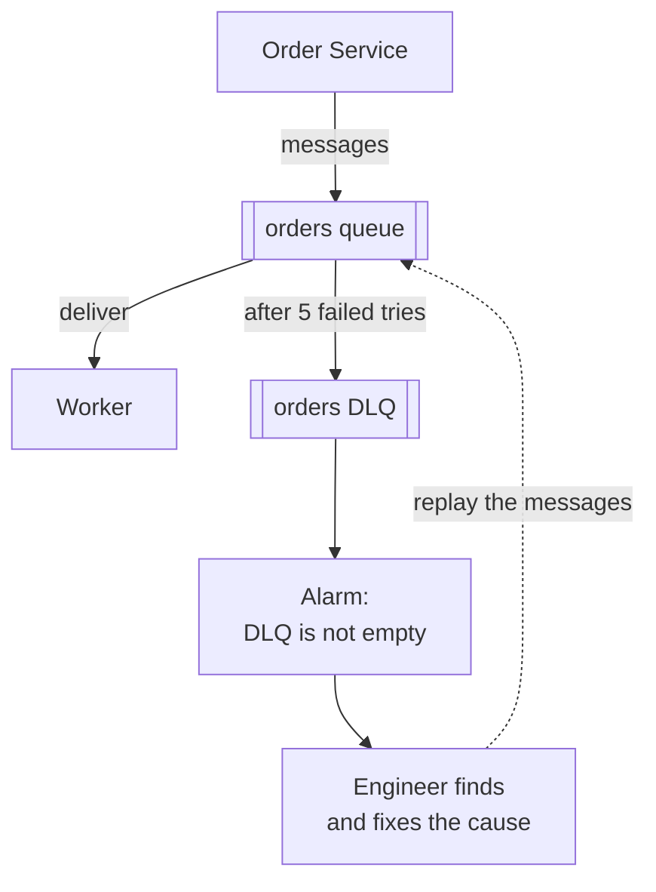
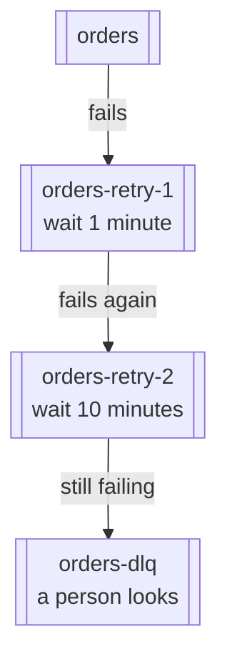

## The idea

Post offices have long had a **dead letter office**. A letter that can't be delivered, like one with an unreadable address and no return address, goes there. It doesn't travel back and forth forever. Staff open it later and try to work out what to do with it by hand.

A **dead-letter queue (DLQ)** does the same for messages. If a message fails again and again, it is **moved aside** into a separate queue. The main queue keeps flowing, and an engineer looks at the failed message later.

## What a "poison" message is

A **poison message** is a message that fails **every time**, no matter how often you retry it. Common causes:

- **Bad data:** a missing field, broken JSON, text where a number should be.
- **A bug** in the consumer for one rare case.
- **Something it points to is gone**, like an order that was deleted.
- **It is too big** or in an old format the consumer no longer understands.

Without a DLQ, the consumer takes the message, fails, the broker hands it out again, it fails again... **forever**.



It wastes workers and fills the logs with errors. In a queue that keeps **strict order**, like a Kafka partition, it is worse: every message behind it **waits**. This is called **head-of-line blocking**.

It helps to sort failures into two kinds:

| Kind | Example | What to do |
| --- | --- | --- |
| **Short-lived** | A timeout, a database restarting, a `503` | Retry with backoff (see [Retries](./retries-backoff-timeouts.mdx)) |
| **Permanent** | Broken JSON, a missing field, a bug | Retrying won't help. Move it to the DLQ |

## How a dead-letter queue works



<Steps>
<Step>

A worker takes a message, tries to handle it, and fails. It doesn't ack it, so the message goes back to the queue.

</Step>
<Step>

The broker counts how many times the message was handed out. After a limit, like **5 tries**, it moves the message to the DLQ.

</Step>
<Step>

The main queue keeps flowing. The other messages are not stuck behind the bad one.

</Step>
<Step>

An alarm fires. An engineer looks at the message, fixes the cause, and **replays** it.

</Step>
</Steps>

### How each tool does it

| Tool | How |
| --- | --- |
| **Amazon SQS** | Give the main queue a **redrive policy**: which queue is the DLQ, and `maxReceiveCount`, how many tries before a message moves there |
| **RabbitMQ** | A **dead-letter exchange**. A message goes there when a consumer rejects it without putting it back, when its time limit runs out, or when the queue is over its size limit |
| **Kafka** | No built-in DLQ for consumers. Your consumer code writes the failed message to a separate topic, like `orders.dlq`, then moves on. Kafka Connect has a DLQ setting built in |

The SQS redrive policy:

```json
{
  "deadLetterTargetArn": "arn:aws:sqs:us-east-1:123456789012:orders-dlq",
  "maxReceiveCount": 5
}
```

**Save the reason with the message.** When your own code moves a message to a DLQ (as with Kafka), add the error message, the number of tries and the time, for example as message headers. SQS moves messages for you but doesn't record **why**, so log each error together with the message ID.

### Retry first, then dead-letter

For short-lived errors, don't go straight to the DLQ. A common setup with Kafka uses **retry topics** with growing delays, and the DLQ only at the end:



The main topic never waits on a failing message, and short problems fix themselves in a retry topic.

## Checking and replaying failed messages

1. **Alert** as soon as the DLQ has any messages. Also watch how fast it grows.
2. **Look** at the messages and the error logs. Find the cause.
3. **Fix** it: deploy a code fix, or correct the bad data.
4. **Replay** (also called **redrive**): move the messages back into the main queue. SQS has a built-in "DLQ redrive" for this, in the console and the API. For Kafka, a small tool reads the DLQ topic and writes the messages back to the main topic.
5. **Or delete** messages that are truly junk, like test data, and write down why.

Watch out:

- **A DLQ nobody watches is a black hole.** It is data loss, just slower.
- **DLQ messages expire too.** Keep them longer than in the main queue. AWS recommends exactly this for SQS.
- **Replayed messages arrive late and out of order.** The consumer must be [idempotent](./idempotency.mdx), and must not let an old message overwrite newer data.
- **A sudden flood into the DLQ** usually means a bug or a broken dependency, not bad messages. Don't set the limit too low (like 1 try), or every short blip fills the DLQ.

## In the real world

**Uber's retry and DLQ topics.** Uber's engineering blog post "Building Reliable Reprocessing and Dead Letter Queues with Apache Kafka" (2018) describes the setup above: failed messages go through a series of retry topics with growing delays, and messages that still fail land in a DLQ topic, where they can be fixed and replayed.

**AWS Lambda.** For functions that run from events, AWS Lambda can send events that still fail after its retries to a dead-letter queue (an SQS queue or SNS topic), or to an "on-failure" destination.

## In the interview

Mention a DLQ every time you add a queue. It shows you thought about failure:

> "Each queue has a dead-letter queue. After five failed tries, a message is moved aside so it can't block the others, and an alarm fires. After we fix the cause, we replay the messages. Consumers are idempotent, so replaying is safe."

<Callout title="Remember this" type="success">
  - A **poison message** fails every time. Without a DLQ, it is retried **forever** and can block others.
  - A **DLQ** takes a message after **N failed tries**, so the main queue keeps flowing.
  - Retry **short-lived** errors with backoff. Send **permanent** errors to the DLQ.
  - **Alert** when the DLQ is not empty. Fix the cause, then **replay** (redrive).
  - Replay is only safe if consumers are **idempotent**.
</Callout>
