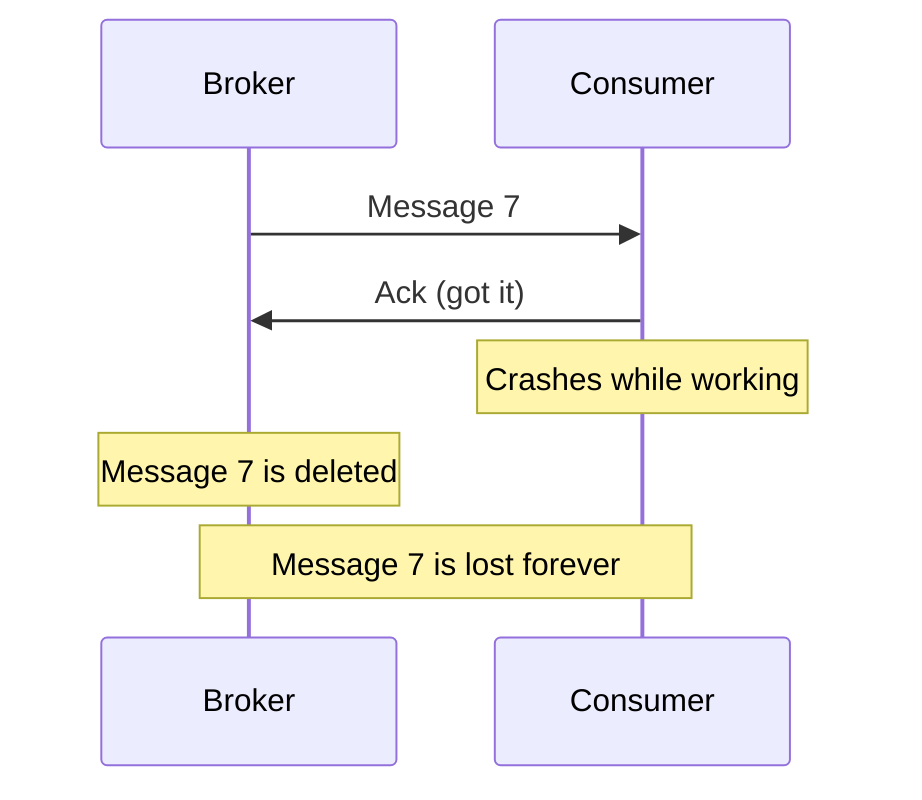
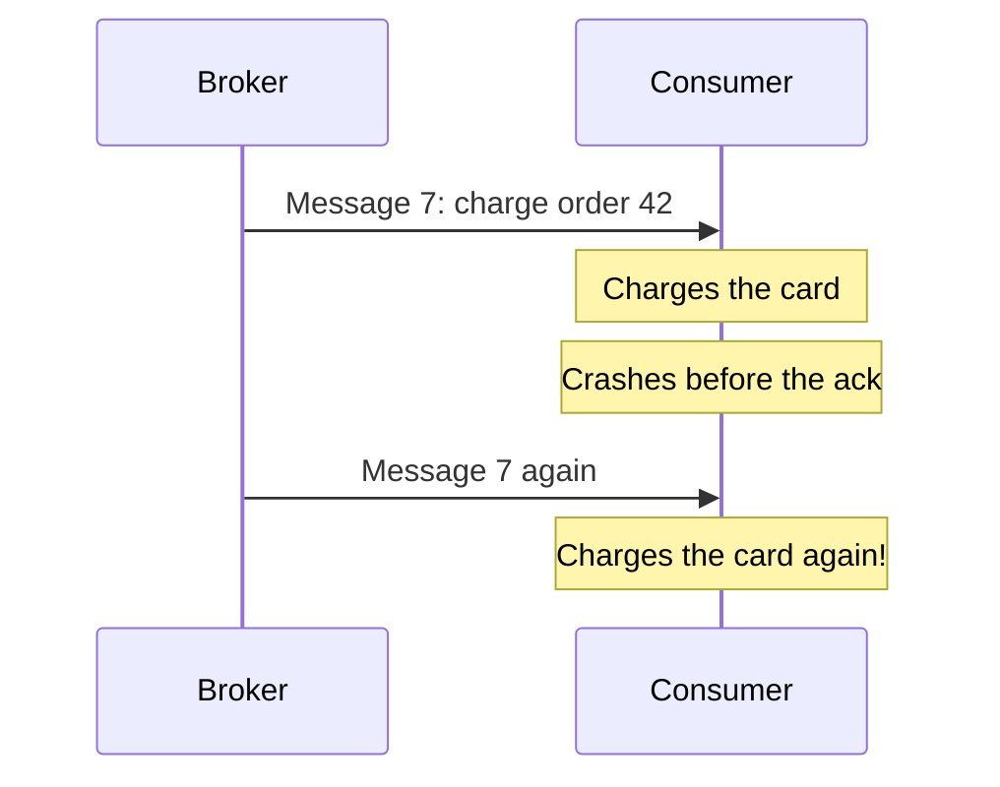

## What is it?

You send an important parcel. The delivery company can make one of three promises:

- **At most once:** "We'll try once. If it gets lost, it's lost." The parcel arrives once or **never**. Never twice.
- **At least once:** "We'll keep trying until someone signs for it." The parcel **always** arrives. But if the signed slip gets lost on its way back, the courier comes again, and you get the parcel **twice**.
- **Exactly once:** "It arrives once. Never lost, never twice." Everybody wants this. Over a real network, it is only possible with help from the receiver.

## Why do we need it?

Messages travel over networks that drop packets, to machines that crash and restart (see [Why Distributed Systems Are Hard](../distributed-systems/why-distributed-is-hard.mdx)). So every system that passes messages must decide what happens **when something goes wrong in the middle**. If you don't know which promise your system makes, you either **lose orders** without noticing, or **charge a card twice**.

A message makes two trips: **producer → broker**, then **broker → consumer**. On each trip, the receiver sends back an **ack** (acknowledgment): "got it".

The problem: if the sender gets no ack, it **can't tell** what went wrong. Maybe the message was lost. Maybe the message arrived, and only the ack was lost. So it must choose:

- **Don't send again**, and risk **losing** the message.
- **Send again**, and risk a **duplicate**.

That choice is the delivery guarantee.

## How it works inside

### Both trips need a choice

The guarantee comes from two small decisions, one on each trip:

| Trip | At-most-once | At-least-once |
| --- | --- | --- |
| **Producer → broker** | Send once. Don't retry if no ack comes | Retry until the broker acks |
| **Broker → consumer** | Ack **before** doing the work | Ack **after** the work is done |

A system is only as strong as its **weaker** trip. A producer that never retries makes the whole path at-most-once, however careful the consumer is.

### At-most-once

The consumer **acks first, then does the work**. If it crashes during the work, the message is gone.

- Fast and simple. **Never a duplicate.**
- Messages **can be lost**.
- Fine for: metrics, logs, live map positions, "user is typing..." signals. A newer message is coming soon anyway.

### At-least-once

The consumer **does the work first, then acks**. If it crashes before the ack, the broker sends the message again.

- Messages are **never lost**.
- **Duplicates can happen**, so the consumer must handle them.
- This is the **normal choice** for most systems: SQS standard queues, RabbitMQ with manual acks, and Kafka when you commit the offset after the work (see [Kafka](./kafka.mdx)).

### Exactly-once, and its limits

True exactly-once **delivery** over a network is not possible, for the reason above: the sender can never be sure whether the message or the ack got lost.

What you **can** get is **exactly-once processing**, also called **effectively once**. The message may arrive twice, but its **effect** happens only once:

**exactly-once processing = at-least-once delivery + a consumer that ignores duplicates**

Some tools help with part of this:

- **Kafka exactly-once.** Added in Kafka 0.11 (2017). It has two parts. The **idempotent producer**: the broker spots and drops a message the producer sent twice (on by default since Kafka 3.0). And **transactions**: a consumer can read from one topic, write its results to another topic and save its offset, all in one step that fully happens or doesn't happen at all.
  - **How the broker spots a repeat:** each producer gets an ID, and each batch it sends to a partition carries a **sequence number**. If a batch arrives with a number the broker has already written, it is dropped.
  - **The limit:** this only works while the data stays **inside Kafka**. If your consumer sends an email or charges a card, Kafka can't take that back.
- **SQS FIFO queues.** SQS drops a message if another one with the same **deduplication ID** was sent in the last **5 minutes**.
  - **The limit:** only a 5-minute window. And if a consumer crashes before it deletes a message, the message still comes back and is handled again.

**So the real rule is:** assume **at-least-once**, and make every consumer **idempotent** (safe to run twice).

### Handling duplicate messages

Three ways, often used together. [Idempotency](./idempotency.mdx) shows each one in detail, with code.

1. **Give every message a unique ID.** The producer sets it, like `eventId: "e-7f3a9c"`. Retries reuse the same ID.
2. **Remember what you've done.** The consumer saves each handled message ID in a table, **in the same database transaction** as its work. If the ID is already there, it skips the message and just acks it.
3. **Make the work safe to repeat.** Write the work so that doing it twice changes nothing:

| Not safe to repeat | Safe to repeat |
| --- | --- |
| Add 10 points: `points = points + 10` | Set the total: `points = 110` |
| Insert a new payment row every time | Insert with a unique `order_id`, so a second insert fails |
| Mark the order paid, whatever its state | `UPDATE ... WHERE id = 42 AND status = 'PENDING'` |

The same problem exists on the **producer** side. A service must save its data **and** publish an event. The [Outbox Pattern](../distributed-systems/outbox-pattern.mdx) makes sure the event is always published, at least once.

## When to use which

| Guarantee | Can messages be lost? | Can they be doubled? | Use for |
| --- | --- | --- | --- |
| **At-most-once** | Yes | No | Metrics, logs, live positions |
| **At-least-once** | No | Yes | Almost everything: orders, emails, jobs |
| **Exactly-once processing** | No | The **effect** happens once | Money, counters, Kafka-to-Kafka pipelines |

**Don't pick:**

- **At-most-once** when a lost message costs money or a user would notice: orders, payments, emails.
- **At-least-once** with a consumer that is **not** idempotent, when a repeat does harm (a second charge, a second email).
- A tool's **"exactly-once"** setting as your only protection when the work leaves the tool, like a card charge or an email.

## Alternatives

Other ways to get a message's effect to happen once:

| Option | What it is | Pick it when |
| --- | --- | --- |
| **Sync call + retries with an idempotency key** | The caller waits for an answer, and retries with the same key until it gets one | The caller must know the result now. See [Idempotency](./idempotency.mdx) |
| **Two-phase commit** (XA) | The broker and the database commit together, or neither does | Older enterprise systems (like Java's JMS) that support it. Slow, and rare in new designs. See [Distributed Transactions](../distributed-systems/distributed-transactions-2pc.mdx) |
| **Outbox pattern** | The event is saved in the same database transaction as the data, then sent by a relay | The producer must never lose an event. See [Outbox Pattern](../distributed-systems/outbox-pattern.mdx) |
| **Reconciliation job** | A job compares both sides on a schedule and fixes any differences | Money. A safety net on top of everything else |

## In the real world

**SQS says it plainly.** AWS's documentation says standard SQS queues give at-least-once delivery, and that occasionally more than one copy of a message is delivered. FIFO queues add exactly-once processing with a 5-minute deduplication window.

**Redis Pub/Sub is at-most-once.** Redis's documentation says its Pub/Sub feature has at-most-once delivery. If a subscriber is offline or disconnects, it misses the messages sent in that time. That is fine for live updates, but not for work that must happen.

## In the interview

Never claim "exactly-once" without saying how. Say this instead:

> "The queue gives at-least-once delivery, so a message can arrive twice. Every event has a unique ID, and the consumer saves that ID in the same transaction as its update. A duplicate finds the ID already there and does nothing."

<Callout title="Remember this" type="success">
  - **Why:** networks drop messages and machines crash. Without a clear promise, you **lose** messages or **double** them.
  - **Inside:** the guarantee comes from two choices: does the producer **retry**, and does the consumer ack **before or after** the work?
  - **At-most-once:** ack first. May **lose** messages, never doubles. OK for metrics.
  - **At-least-once:** work first, then ack. Never loses, may **double**. The normal choice.
  - Exactly-once **delivery** is impossible over a network. Exactly-once **processing** is possible.
  - **Exactly-once processing = at-least-once + idempotent consumer.**
  - Kafka exactly-once works only **inside Kafka**. Emails and card charges still need idempotency.
  - **Alternatives:** sync call + idempotency key, two-phase commit, outbox, reconciliation jobs.
</Callout>
