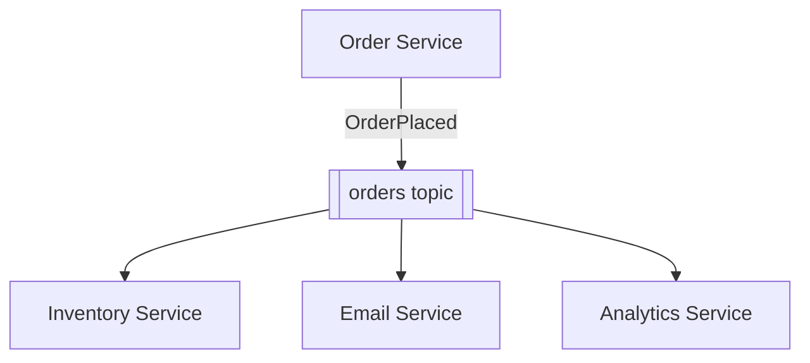
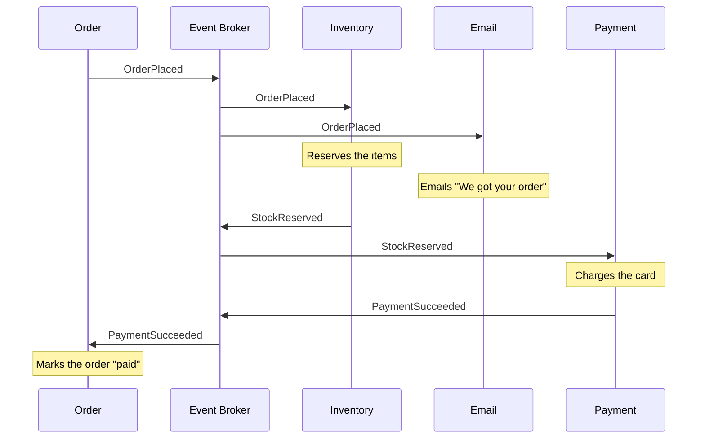

## The idea

Think of the **school bell**. When it rings at lunchtime, the bell doesn't tell each person what to do. Teachers stop their lessons, students go to eat, and the canteen opens its doors. Each one **knows what to do** when they hear it. The bell doesn't even know who is listening.

**Event-driven architecture** works the same way. A service announces **what happened**. This announcement is called an **event**. Other services listen, and each one reacts in its own way. The service that sent the event doesn't call them, and doesn't know who they are.

The opposite is the usual style, where one service **calls** each of the others and tells them what to do (see [Sync vs Async](./sync-vs-async.mdx)).

## What an event is

An event is a **fact about something that already happened**.

- It is named in the **past tense**: `OrderPlaced`, `PaymentFailed`, `UserSignedUp`.
- It **can't be changed**. What happened, happened. If something changes later, that is a **new** event, like `OrderCancelled`.
- It has a **unique ID**, so a consumer can spot a copy it has already handled (see [Idempotency](./idempotency.mdx)).

```json
{
  "eventId": "e-7f3a9c",
  "type": "OrderPlaced",
  "occurredAt": "2026-03-14T10:15:00Z",
  "data": { "orderId": 42, "userId": 7, "total": 500 }
}
```

### Events vs commands

| | Command | Event |
| --- | --- | --- |
| **Means** | "Please do this" | "This happened" |
| **Name** | `ChargeCard`, `SendEmail` | `OrderPlaced`, `CardCharged` |
| **Sent to** | One known receiver | Anyone who wants to listen |
| **Can the receiver say no?** | Yes | No, it is already true |

### How much data goes in an event?

- **Thin event:** only the ID, like `{"orderId": 42}`. Consumers call the Order Service for the details. Small, but every consumer makes an extra call.
- **Fat event:** all the data the consumers need. No extra calls, but events are bigger, and every consumer keeps its own copy of the data.

Most teams send enough data that consumers **don't need to call back**.

## Services that react to events

Events usually travel through a broker like [Kafka](./kafka.mdx), using [pub/sub](./message-queues-pub-sub.mdx): every interested service gets its own copy.



- The Order Service doesn't call anyone. It publishes one event and is done.
- Want to add loyalty points? Build a Loyalty Service that **subscribes** to `OrderPlaced`. Nothing else changes.
- If the Email Service is down for an hour, orders still work. It catches up from the topic when it is back.

## A simple example: an online order

Here is one order, step by step. Each service listens for the events it cares about and publishes its own result.



<Steps>
<Step>

The **Order Service** saves the order as "pending", publishes `OrderPlaced`, and tells the user "Order received".

</Step>
<Step>

The **Inventory Service** hears `OrderPlaced`, reserves the items, and publishes `StockReserved` (or `OutOfStock`). The **Email Service** hears `OrderPlaced` too and emails "We got your order".

</Step>
<Step>

The **Payment Service** hears `StockReserved`, charges the card, and publishes `PaymentSucceeded` (or `PaymentFailed`). The Order Service hears `PaymentSucceeded` and marks the order "paid".

</Step>
</Steps>

**What if the payment fails?** The Payment Service publishes `PaymentFailed`. The Inventory Service hears it and releases the items, and the Order Service marks the order as failed. When several steps have already happened, each one must be **undone** like this. That is the [Saga Pattern](../distributed-systems/saga-pattern.mdx). Here, each service reacts on its own with no boss. This is called **choreography**. Using one central service that tells each step what to do is called **orchestration**. The saga page compares the two.

**One trap:** the Order Service must both **save the order** and **publish the event**. If it crashes between the two, the event is lost. The [Outbox Pattern](../distributed-systems/outbox-pattern.mdx) fixes this.

## Good and bad sides

**Good:**

- **Loose coupling.** Services don't call each other, so one service being down doesn't stop the others.
- **Easy to add features.** A new service just subscribes.
- **Spikes are absorbed.** The broker holds events until consumers are ready.
- **History.** With Kafka, events are kept for days or longer, so a new service can read old events to fill its own database.

**Bad:**

- **Hard to see the whole flow.** No single place in the code says "this is what happens after an order". Fix: give every event of one order the same **correlation ID** (an ID that travels with every event and log line of one request), and use tracing (see [Observability](../production/observability.mdx)).
- **Data is out of date for a moment.** The order is "paid" in one service but not yet in another. See [Eventual Consistency](./eventual-consistency-async.mdx).
- **Duplicates and order.** Events can arrive twice or out of order. See [Delivery Guarantees](./delivery-guarantees.mdx).
- **Changing an event can break consumers you forgot about.** Treat events like a public API: add new fields, but don't rename or remove old ones. A **schema registry** (a shared store of event formats) can check this for you.

**Not the same as event sourcing.** Event-driven architecture is about how services **talk to each other**. [Event Sourcing](../distributed-systems/event-sourcing.mdx) is about how one service **stores its own data**: as a list of events instead of only the latest state. You can use one without the other.

## In the real world

**Webhooks are events between companies.** When a payment succeeds, Stripe sends a `payment_intent.succeeded` event to your server. When someone pushes code, GitHub sends a `push` event to the services you connected, which is how outside CI tools know to start a build.

**LinkedIn built Kafka for events.** LinkedIn needed to move events like page views and searches to many different systems. It built Kafka for this, and made it open source in 2011. Kafka is now one of the most common tools for event-driven systems.

## In the interview

Use events when one action causes several **independent** follow-ups:

> "The Order Service publishes an `OrderPlaced` event. Inventory, email and analytics each subscribe on their own. If we add a loyalty-points service later, it just subscribes, and the Order Service doesn't change."

<Callout title="Remember this" type="success">
  - An **event** is a **fact** in the past tense: `OrderPlaced`. It can't be changed.
  - A **command** says "do this" to one receiver. An **event** says "this happened" to anyone listening.
  - The publisher doesn't know its consumers, so adding a feature = **adding a subscriber**.
  - Good: loose coupling, easy to extend. Bad: hard to trace, data **catches up later**, duplicates.
  - Use a **correlation ID** to follow one order across services.
  - Failures across steps → [Saga](../distributed-systems/saga-pattern.mdx). Safe publishing → [Outbox](../distributed-systems/outbox-pattern.mdx).
</Callout>
