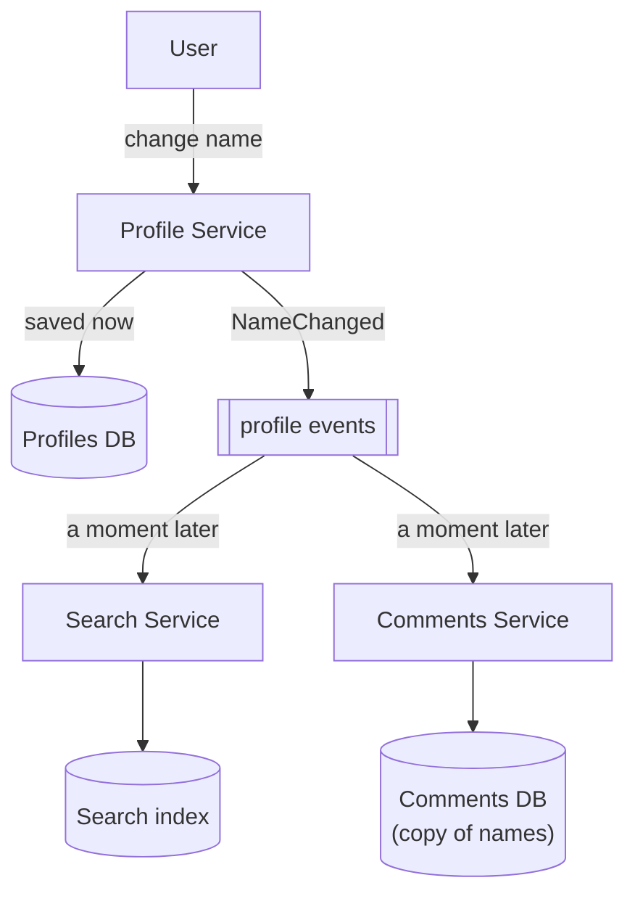
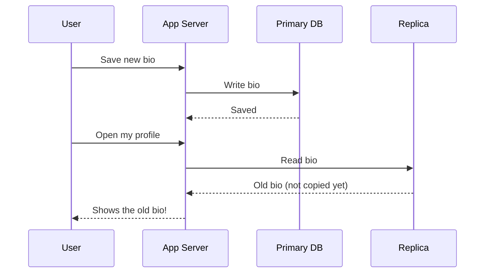

## The idea

You move house and tell the post office your new address. For a few days, some letters still go to the old address, and some friends still have the old one. But **eventually**, everyone has the new address and every letter goes to the right place.

Async systems behave the same way. A change is saved in **one place first**, and the other places hear about it **a little later**. For a short time, different parts of the system give different answers. If no new changes come in, they **eventually** all agree. This is called **eventual consistency**.

[Consistency Models](../distributed-systems/consistency-models.mdx) covers the theory. This page is about what it means in practice when services talk through queues and events.

## Why async systems are eventually consistent

When a user changes their name, the Profile Service saves it **right away**. Other services keep their **own copy** of the name, and they update it only when the event reaches them.

The gap comes from: publishing the event, waiting in the queue, and the consumer doing its work. Usually this takes **milliseconds to seconds**. But if a consumer is slow, down, or behind a big pile of messages, it can take **minutes or hours**.

This gap is called **lag**. In Kafka, **consumer lag** is how many messages a consumer group is behind the newest one. It is one of the most important numbers to watch.

The same thing happens inside a database, when [read replicas](../databases/replication.mdx) copy the primary a little late.

## What users notice

| What the user sees | Why it happens |
| --- | --- |
| They place an order, but "My orders" doesn't show it yet | The order list is built from events and hasn't caught up |
| They change their name, but old comments still show the old one | The Comments Service keeps its own copy of the name |
| A new product doesn't show up in search | The search index is updated a few seconds later |
| 100 likes on their phone, 99 on their laptop | The two devices read from different copies |
| They save a post, refresh, and it's gone. Refresh again, it's back | Each read goes to a different replica, and one of them is behind |

The last one is the worst: users think their data was **lost**.

## Ways to hide the delay

1. **Send the result back in the response.** After a write, the API returns the new data. The app shows it straight away, without reading it again from a copy that may be behind.
2. **Optimistic UI.** The app shows the change **before** the server confirms it. The heart turns red the moment you tap "like". If the server later fails, the app undoes it and shows an error.
3. **Show a "pending" state honestly.** "Order received, confirming..." Then update the screen when the work is done. This is honest, and users are used to it.
4. **Push the update when it is ready**, with WebSockets, SSE or polling (see [Polling, WebSockets and SSE](../foundations/polling-websockets-sse.mdx)).
5. **Read your own writes** (next section).

## Read-your-own-writes

**Read-your-own-writes** means: after **you** change something, **you** always see your change. Other people may see it a little later, and that is usually fine. People mostly notice delays in their **own** changes.

Here is the problem it solves:

Ways to get read-your-own-writes:

- **Read from the source for a short while.** For a few seconds after a user writes, read **that user's** data from the primary database, or from the service that owns it, instead of from a copy.
- **Check the version.** The write returns a version number. The client sends it with its next read. The server only uses a copy that has caught up to that version, and otherwise reads from the source.
- **Keep the change in the app.** The app remembers what the user just saved and shows that, until the server's copy catches up.

## When "eventually" is not good enough

Some things must be correct **right now**:

- A **money balance** before a withdrawal.
- The **last seat** or the last item in stock.
- A **unique username**.

For these, check the **source of truth** synchronously, with a transaction or a lock. Let everything else be eventual: emails, search, analytics, recommendations, counters. Most systems are a **mix**: a small strongly consistent core, with eventually consistent copies around it. See [CAP Theorem](../distributed-systems/cap-theorem.mdx) and [CQRS](../distributed-systems/cqrs.mdx), where the read side is often an eventually consistent copy.

## In the real world

**Amazon S3 became strongly consistent in 2020.** Before December 2020, S3 was only eventually consistent for overwrites and deletes: right after you replaced or deleted a file, a read could still return the old version. Since December 2020, S3 gives strong read-after-write consistency for all requests, at no extra cost.

**DynamoDB lets you choose.** DynamoDB reads are eventually consistent by default. You can ask for a strongly consistent read, but it uses twice as much read capacity. Its global secondary indexes (extra lookup tables that DynamoDB updates in the background) support only eventually consistent reads.

## In the interview

Say which parts can be eventual, which can't, and how you hide the delay:

> "Search and order history are updated from events, so they can lag by a second or two. That's fine for them. So the user isn't confused, the app shows the new order straight from the API response. Stock and payment are checked synchronously, because they must be correct right now."

<Callout title="Remember this" type="success">
  - Async = the change is saved in **one place first**, and copies **catch up later**.
  - The delay is **lag**: usually seconds, but minutes if a consumer is slow or down. Watch **consumer lag**.
  - Hide it: **return the result**, **optimistic UI**, **"pending" state**, **push** the update.
  - **Read-your-own-writes:** the writer always sees their own change. Read from the source for a short while.
  - Money, the last seat and unique names must be **strongly consistent**. The rest can be eventual.
</Callout>
