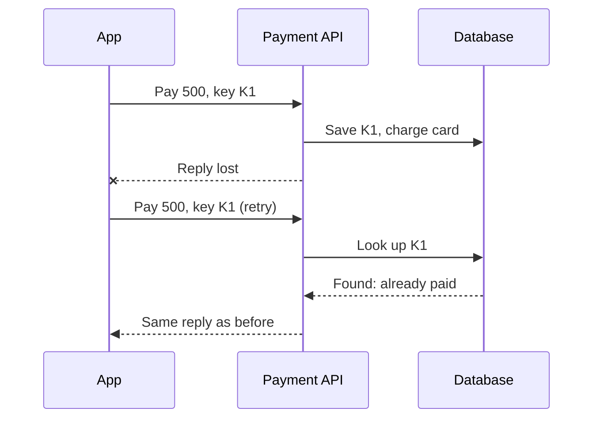
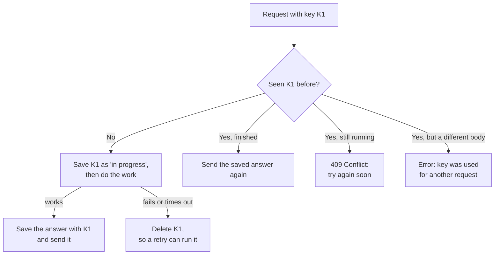

## The idea

Think of the **button at a pedestrian crossing**. Press it once and the light will change. Press it ten more times out of impatience: the light still changes **once**. Pressing again does no extra harm.

That is **idempotency**: doing the same thing **once or many times has the same effect**.

Now think of paying in a shopping app. You tap "Pay". The app spins, the network drops, and you don't know if it worked. You tap again. If the payment system is **not** idempotent, you **pay twice**. If it is, the second tap is seen as the **same payment**, and you pay once.

Networks fail all the time. Every retry, whether by the user, the app, a proxy or a message queue, is a chance to do something twice. Idempotency is what makes retries safe.

## Where duplicates come from

- A user **double-clicks** a button.
- The app **times out and retries**, but the first request actually worked. Only the reply was lost. (See [HTTP Methods, Status Codes and Headers](../foundations/http-methods-status-codes-headers.mdx).)
- A **load balancer or proxy** retries a request on its own.
- A **message queue** delivers a message again (see [Delivery Guarantees](./delivery-guarantees.mdx)).

You can't stop all of these. So the **server** must make repeats harmless.

## Idempotency keys

An **idempotency key** is a unique ID that the **client** creates for one **action**, like "pay for basket 42". The client sends it with the request, and sends the **same key** with every retry of that action.

```http
POST /payments HTTP/1.1
Idempotency-Key: 5f1c2e8a-3b7d-4c11-9a2e-8d4f6b0c7e13
Content-Type: application/json

{"orderId": 42, "amount": 500}
```

The server remembers each key and the answer it gave. If the same key comes again, it sends back the **saved answer** and does **not** do the work again.



### What the server does with a key



### The rules

- **One key per action, not per attempt.** A retry reuses the key. A new purchase gets a new key.
- **Use a random UUID** (a long random ID like the one above), so two clients never make the same key by chance.
- **Tie keys to the user.** Store the key with the user or account ID, so one user's key can never return another user's answer.
- **Check the body.** If the same key comes with a **different** amount, the client has a bug. Return an error instead of the old answer.
- **Only one copy may win a race.** Two copies of a request can arrive at the same moment, and both see "key not found". So "save the key" must be **atomic**: one step that only one request can win. A **unique constraint** in the database does this. The second insert fails, so that request knows another one is already running.
- **Pass the key down.** If your service calls a card provider, send your own idempotency key to the provider too, so a retry can't charge twice there either.

### The code

A table to hold the keys:

```sql
CREATE TABLE idempotency_keys (
  user_id         BIGINT      NOT NULL,
  idempotency_key TEXT        NOT NULL,
  request_hash    TEXT        NOT NULL, -- to spot the same key with a different body
  status          TEXT        NOT NULL, -- 'in_progress' or 'done'
  response_code   INT,                  -- the status code we sent the first time
  response        JSONB,                -- the body we sent the first time
  locked_at       TIMESTAMPTZ NOT NULL DEFAULT now(), -- when a request claimed it, to spot crashed ones
  created_at      TIMESTAMPTZ NOT NULL DEFAULT now(),
  PRIMARY KEY (user_id, idempotency_key)
);
```

And the request handler:

```js
async function createPayment(req, res) {
  const userId = req.user.id;
  const key = req.headers['idempotency-key'];
  if (!key) return res.status(400).json({ error: 'Idempotency-Key header is required' });

  // 1. Try to claim the key. The primary key makes sure only one request wins.
  const claimed = await db.query(
    `INSERT INTO idempotency_keys (user_id, idempotency_key, request_hash, status)
     VALUES ($1, $2, $3, 'in_progress')
     ON CONFLICT DO NOTHING`,
    [userId, key, hash(req.body)]
  );

  // 2. Seen before: never do the work again.
  if (claimed.rowCount === 0) {
    const row = await findKey(userId, key);
    if (!row) return res.status(409).json({ error: 'Try again' }); // freed a moment ago
    if (row.request_hash !== hash(req.body)) return res.status(422).json({ error: 'Key reused' });
    if (row.status === 'done') return res.status(row.response_code).json(row.response); // the first answer, sent again
    // Still 'in_progress'. Take it over only if its request crashed (the UPDATE below).
    const tookOver = await takeOverStaleKey(userId, key);
    if (!tookOver) return res.status(409).json({ error: 'Still running' });
  }

  // 3. We own the key: do the work once, then save the answer.
  try {
    const result = await chargeCard(req.body, key);  // pass the key down
    const code = result.declined ? 402 : 201;        // a declined card is an answer too
    await saveResponse(userId, key, code, result);   // saves code + body, sets status = 'done'
    return res.status(code).json(result);
  } catch (err) {
    // An error, or no answer (a timeout). Free the key, so the client's retry can run the work.
    // Safe even if the charge went through: the card provider got the same key and won't charge twice.
    await deleteKey(userId, key);
    return res.status(503).json({ error: 'Please try again' });
  }
}
```

The failure paths:

- **The work fails or times out.** The `catch` deletes the key, so the client's next retry runs the work again. That is only safe because the key was **passed down** to the card provider.
- **A final answer, like a declined card, is not an error here.** `chargeCard` returns it, and it is saved like any other answer, so a retry gets the same "declined".
- **The server crashes in the middle.** The `catch` never runs, and the key stays `in_progress`. Without a fix, every retry gets `409` forever. So treat a key that has been `in_progress` for more than a few minutes as abandoned. A retry takes it over with one conditional update, and then runs the work again. This is what `takeOverStaleKey` runs:

```sql
-- Take over a key whose request crashed. Only one retry can win this.
UPDATE idempotency_keys SET locked_at = now()
WHERE user_id = $1 AND idempotency_key = $2
  AND status = 'in_progress' AND locked_at < now() - interval '5 minutes';
-- 1 row updated: we own it now, so run the work. 0 rows: it is still running, so answer 409.
```

## Idempotent HTTP methods

Some HTTP methods are idempotent by design: `GET`, `PUT` and `DELETE`. `POST` and `PATCH` are not. [HTTP Methods, Status Codes and Headers](../foundations/http-methods-status-codes-headers.mdx) explains why. Idempotency keys are for the methods that are **not** idempotent, mostly `POST`.

One more trick: let the **client** choose the ID. `PUT /orders/5f1c2e8a` with a client-made ID creates the order the first time, and simply replaces it with the same data on a retry. No key table needed.

## Idempotent message consumers

Messages work the same way. The message's own **event ID** is the key. Say the Order Service gets a `PaymentSucceeded` event for order 42. It saves the event ID **in the same transaction** as its work:

```sql
BEGIN;
-- event_id is the primary key, so this fails if we handled the event before
INSERT INTO processed_events (event_id) VALUES ('e-4d81b7');
UPDATE orders SET status = 'PAID' WHERE id = 42;
COMMIT;
```

If the insert fails with a duplicate key error, the transaction stops, nothing changes, and the consumer just acks the message.

## Making the work safe by design

Sometimes you don't need a key table at all, because the work itself is safe to repeat:

- **Set, don't add.** `SET status = 'PAID'` is safe twice. `balance = balance + 10` is not.
- **Only change from the expected state.** `UPDATE orders SET status = 'PAID' WHERE id = 42 AND status = 'PENDING'`. The second time, it changes 0 rows.
- **Unique constraints.** A unique `order_id` on the payments table means the database refuses a second payment for the same order.
- **Upsert.** "Insert, or update if it already exists" gives the same row however many times it runs.

## Where to store the keys

| Where | Good | Watch out |
| --- | --- | --- |
| **Same database as the data** | The key and your own database changes are saved in **one transaction**: both or neither | More rows in the main database. Delete old keys. An outside call, like a card charge, can never be in that transaction, so pass the key down |
| **Redis** (`SET key value NX EX 86400`) | Very fast. Old keys expire by themselves | Not in the same transaction as your database. Redis can lose recent writes in a crash |
| **Memory of one server** | Nothing | Lost on restart, and other servers can't see it. Don't do this |

**How long to keep them?** Long enough to cover every retry. **24 hours** is common. Remove old keys with a TTL (an expiry time) or a nightly clean-up job.

## In the real world

**Stripe.** Stripe's API accepts an `Idempotency-Key` header on `POST` requests and suggests random V4 UUIDs as keys. It saves the status code and body of the first request for each key, and returns the same result for repeats, **even if the first result was an error**. It compares the parameters of a repeat with the first request and returns an error if they differ. Keys can be removed once they are at least 24 hours old.

**PayPal** uses a header called `PayPal-Request-Id` for the same job.

**AWS EC2.** The API call that starts new servers (`RunInstances`) accepts a `ClientToken`. If a retry sends the same token, AWS doesn't start extra servers.

## In the interview

Bring it up whenever money moves, or whenever you add retries or a queue:

> "The client makes one idempotency key per checkout and sends it with every retry. The payment service claims the key with a unique constraint before it charges, and passes the same key to the card provider. A repeat gets the saved result. If the charge fails or times out, it frees the key for the retry, and the provider's own key check stops a double charge. So a retry can never charge twice."

<Callout title="Remember this" type="success">
  - **Idempotent** = once or many times, **same effect**. It makes retries safe.
  - The **client** makes one **idempotency key** per action. Every retry sends the same key.
  - The server saves key + answer. A repeat gets the **saved answer**, and the work is not done again.
  - Claim the key **atomically** (unique constraint), so two copies can't both win.
  - For messages, the **event ID** is the key. Save it in the **same transaction** as the work.
  - Store keys in the **same database** as the data. Keep them about **24 hours**.
</Callout>
