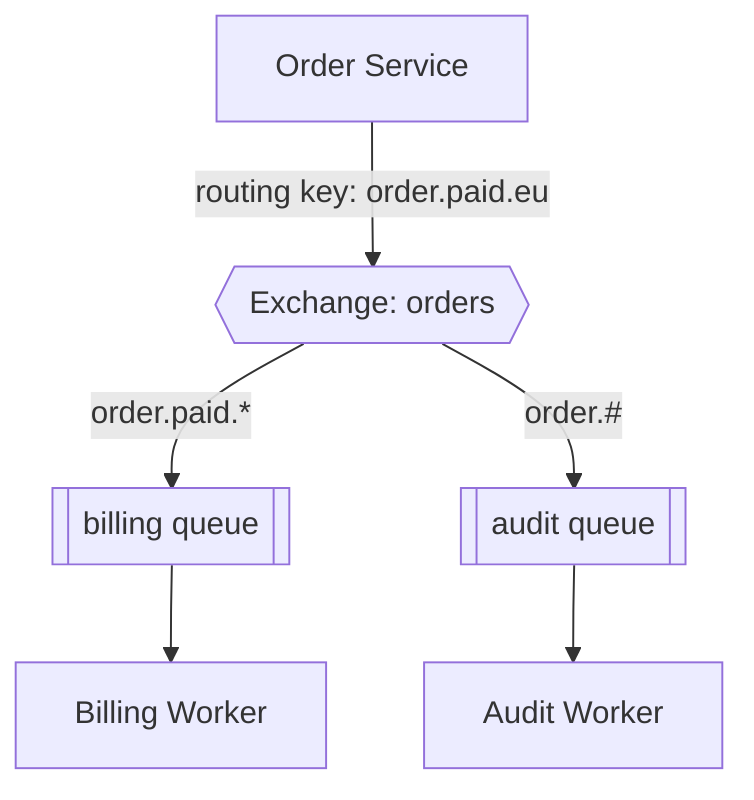
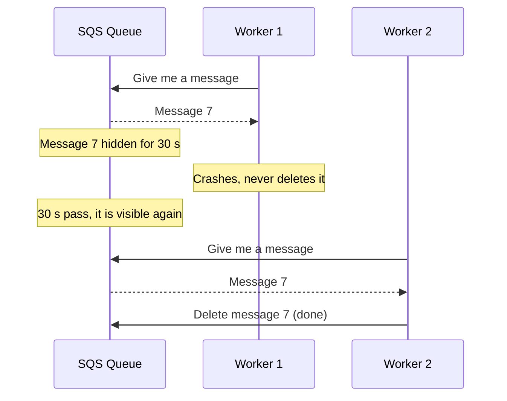
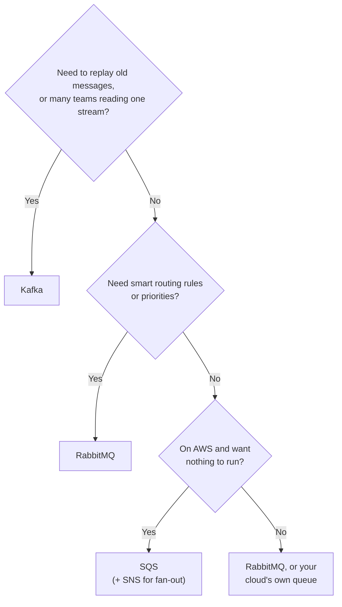

## The idea

Three ways to handle mail:

- **Kafka** is a **newspaper archive**. Every edition is kept on the shelf. Anyone can read from any date, and reading doesn't take anything away.
- **RabbitMQ** is a **post office sorting room**. Letters come in, staff read the labels, and sort each letter into the right mailboxes by rules. Once you collect your letter, it is gone from the box.
- **Amazon SQS** is a **rented mailbox**. You don't run anything. You drop letters in, take letters out, and pay per letter. Simple, with few extras.

## Kafka: a log you can replay

[Kafka](./kafka.mdx) keeps messages in a **log**. Consumers keep a bookmark (an **offset**) and read at their own pace.

- **Messages stay** after they are read, for days or forever. You can **replay** old messages.
- **Many readers** can read the same stream, each at its own position.
- **Order** is kept inside a partition.
- **Very high throughput**: built for millions of messages per second across a cluster.
- **Harder to run.** You must plan partitions, brokers and disks. Managed versions like **Amazon MSK** and **Confluent Cloud** run it for you.
- **Weak at:** per-message tricks like delays, priorities, or retrying one message while the next ones move on. (As of 2026, Kafka 4.2's **share groups** add per-message acks and retries, but give up order.)

## RabbitMQ: a smart message broker

**RabbitMQ** is a classic **message broker** (the system that stores and passes messages between services). Producers don't send straight to a queue. They send to an **exchange**: a router that decides which queues get the message, using rules called **bindings** and a label on each message called the **routing key**.

| Exchange type | Rule | Example |
| --- | --- | --- |
| **Direct** | The routing key must match exactly | `payment.failed` goes to the payments queue |
| **Topic** | Pattern match. `*` = exactly one word, `#` = any number of words | `order.*.eu` matches `order.paid.eu` |
| **Fanout** | Copy to every queue bound to it | Broadcast to everyone |

- The broker **pushes** messages to consumers and tracks every ack. A message is **deleted after its ack**.
- Rich features: **priorities**, **time limits** on messages, and **dead-letter exchanges** for failed messages (see [Dead-Letter Queues](./dead-letter-queues.mdx)).
- Uses an open standard protocol called **AMQP**.
- **Order:** a queue hands messages out in order, but with **several consumers** they finish out of order, and a message that fails and is put back can come round again later. Strict order needs **one consumer** per queue.
- **Weak at:** replay (messages are gone after the ack) and very long queues. It works best when queues stay short. Newer versions add **streams**, a Kafka-like log, for replay.
- You run it yourself, or use a managed service like **Amazon MQ**.

## SQS: a simple managed queue

**Amazon SQS** (Simple Queue Service) is a queue that AWS runs for you. There are no servers to manage, it grows on its own, and you pay per request.

Consumers **pull** messages (they ask for them). The key idea is the **visibility timeout**:

- When a worker takes a message, SQS **hides** it from others for a while (30 seconds by default).
- If the worker **deletes** it in time, it is done. If not (the worker crashed), it comes back and another worker gets it.

| | Standard queue | FIFO queue |
| --- | --- | --- |
| **Delivery** | At least once: a message can come twice | Exactly-once processing, with a 5-minute window to drop duplicates |
| **Order** | Best effort, can be mixed up | Strict order inside each **message group** (for example, per order ID) |
| **Speed** | Almost no limit | Lower limit on messages per second |

- Messages are kept for **4 days** by default, up to **14 days**.
- SQS has **no pub/sub** by itself. Put an **SNS** topic in front to send one message to many queues (see [Message Queues and Pub/Sub](./message-queues-pub-sub.mdx)).
- **Weak at:** replay (deleted means gone), and it only exists on AWS. Other clouds have their own versions, like Google Cloud Pub/Sub and Azure Service Bus.

## Side by side

| | Kafka | RabbitMQ | SQS |
| --- | --- | --- | --- |
| **Model** | Log | Smart broker with queues | Simple queue |
| **After reading** | Message stays | Deleted after ack | Deleted when the worker deletes it |
| **Replay old messages** | Yes | No (yes with streams) | No |
| **Order** | Per partition | Per queue, only with a single consumer | FIFO: per message group. Standard: best effort |
| **Routing** | By topic and key | Rich: exchanges and patterns | None (add SNS for fan-out) |
| **Many readers of one stream** | Consumer groups | Fanout exchange | Add SNS |
| **Speed** | Very high | High | Standard: very high. FIFO: lower |
| **Who runs it** | You, or MSK / Confluent Cloud | You, or Amazon MQ | AWS |
| **Best for** | Event streams, replay, analytics | Task queues with routing and priorities | Simple background jobs on AWS |

## How to choose

Many companies use **more than one**: Kafka for the main event stream, and SQS or RabbitMQ for simple job queues like sending emails.

## In the real world

**Kafka came from LinkedIn.** It was built there and made open source in 2011. Some of its creators later started **Confluent**, the company behind Confluent Cloud.

**SQS is one of the oldest AWS services.** AWS announced SQS in 2004, before S3 and EC2.

**RabbitMQ is written in Erlang**, a programming language first built at Ericsson for telephone systems that must keep running all the time.

## In the interview

Pick one, and give the reason in one sentence:

> "For order events I'll use Kafka, because billing, search and analytics all read the same stream and we may need to replay it. For sending emails, a plain SQS queue is enough: each email is one job, done once."

<Callout title="Remember this" type="success">
  - **Kafka** = a log. Messages **stay**, many groups read, you can **replay**. Huge throughput, harder to run.
  - **RabbitMQ** = a smart broker. **Exchanges** route by rules. Deleted after **ack**. Priorities and routing.
  - **SQS** = a simple **managed** queue. **Visibility timeout**, Standard vs **FIFO**, add **SNS** for fan-out.
  - Replay or many readers → **Kafka**. Smart routing → **RabbitMQ**. Simple jobs on AWS → **SQS**.
  - Using two of them together is normal.
</Callout>
