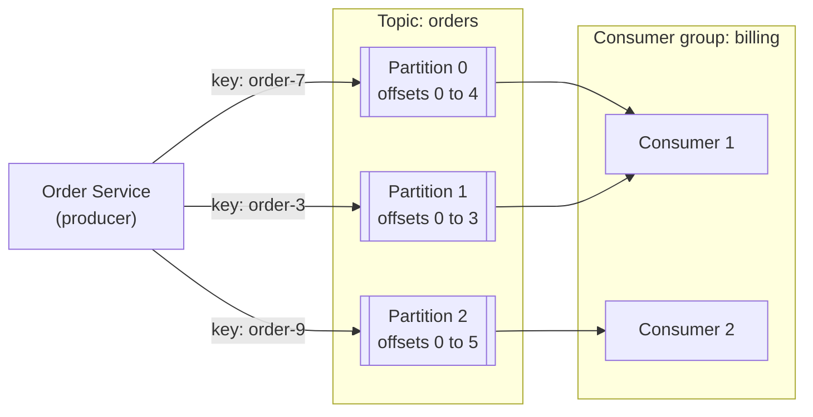
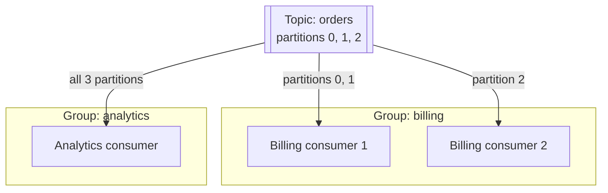

## What is it?

Think of a **ship's logbook**. The crew only ever **adds new lines at the bottom**. Nobody erases or changes old lines. Every line has a line number.

Many people can read the same logbook. Each reader keeps their **own bookmark**: the captain may be on line 120, the engineer on line 95. Reading doesn't remove anything, so a new reader can start from line 1 and catch up.

**Apache Kafka** works the same way. It is a **log**: a list of messages where new ones are only added at the end. Producers add messages. Consumers read them and remember how far they got. Messages **stay** after they are read, for as long as you choose to keep them. This is the big difference from a normal queue, where a message is deleted once it is handled.

## Why do we need it?

A normal queue (see [Message Queues and Pub/Sub](./message-queues-pub-sub.mdx)) **deletes** a message once it is handled. That is fine for jobs, but it hurts when:

- **Many teams want the same stream.** Billing, search, analytics and fraud all want every order event. A queue needs one copy per reader, and every new reader means new setup.
- **You need to go back.** A bug wrote wrong data for 2 days, or a new service needs all past events to fill its database. Once a queue deletes a message, it is gone.
- **The volume is huge.** Clicks, page views and logs from millions of users can mean millions of messages per second. A broker that tracks every message for every reader struggles at that size.

Without a shared log, companies often ended up wiring **each data source to each system that needs it**, with many separate pipelines. Kafka gives them **one place** where every event is written once and read by everyone, at their own pace, as often as they like.

## How it works inside

### The parts

| Word | Meaning | Logbook picture |
| --- | --- | --- |
| **Broker** | One Kafka server. A Kafka **cluster** is a group of brokers. | The library that keeps the books |
| **Topic** | A named stream of messages, like `orders` | One logbook |
| **Partition** | A topic is split into several partitions. Each one is its own log. | The logbook split into volumes |
| **Offset** | The position number of a message inside one partition | The line number |
| **Producer** | A service that writes messages | A crew member writing lines |
| **Consumer** | A service that reads messages | A reader |
| **Consumer group** | A team of consumers that share the reading of a topic | A team that splits the volumes between them |

Each message has an optional **key** (like an order ID), a **value** (the data, often JSON) and a time.

### A topic with partitions and a consumer group

- The producer picks a partition **from the key**. All messages with the same key go to the **same partition**.
- Inside a group, each partition is read by **only one** consumer. Here Consumer 1 reads partitions 0 and 1, and Consumer 2 reads partition 2.
- Partitions of one topic live on **different brokers**, so the work is spread over many machines.

### How a partition is stored on disk

- Each partition is a folder of **segment files**. New messages are added to the end of the newest segment. When it gets big (1 GB by default), Kafka starts a new one.
- Each segment has a small **index** from offset to position in the file, so Kafka can jump straight to "offset 3,000,000" without reading from the start.
- When **retention** runs out, Kafka deletes **whole old segments**. It never edits a file in the middle.
- **Compacted topics** work differently: Kafka keeps at least the **latest message for each key** and removes older ones. This is handy for "the current state of each user" (setting `cleanup.policy=compact`).

### Offsets: how a consumer remembers where it is

Here is partition 0 of the `orders` topic:

| Offset | Message |
| --- | --- |
| 0 | Order 101 placed |
| 1 | Order 102 placed |
| 2 | Order 101 paid |
| 3 | Order 103 placed |
| 4 | Order 102 cancelled |

1. The billing consumer reads offsets 0, 1 and 2, and handles them.
2. It then **commits offset 3**. This tells Kafka: "billing is done up to here. Next time, start at 3." Kafka saves this number for each group and each partition, in an internal topic called `__consumer_offsets`.
3. The consumer crashes. Another consumer in the group takes over partition 0. It asks Kafka where billing was, gets **3**, and carries on from "Order 103 placed". Nothing is skipped.

Some things to notice:

- **Each group has its own offsets.** An analytics group can be at offset 1 on the same partition while billing is at 3. They never get in each other's way.
- **You can go back.** Move a group's offset back to 0 and it reads everything again. This is called **replay**. It is useful after fixing a bug, or to fill a brand new database from old events.
- **Crash at the wrong moment = duplicate.** If the consumer handles offset 3 but crashes **before** committing, the next consumer reads offset 3 again. So consumers must cope with duplicates. See [Delivery Guarantees](./delivery-guarantees.mdx) and [Idempotency](./idempotency.mdx).
- **Reading doesn't delete.** Kafka removes old messages only after a set time or size (the default is 7 days). This is called **retention**. You can also keep messages forever.

### Consumer groups

Consumer groups give you **both** queue and pub/sub behavior (see [Message Queues and Pub/Sub](./message-queues-pub-sub.mdx)):

- **Between groups, it is pub/sub.** Every group gets **every** message.
- **Inside a group, it is a queue.** The partitions are **split** between the group's consumers.

- **Partitions limit how many consumers can work.** With 3 partitions, a 4th consumer in the same group sits idle. So pick enough partitions up front for the speed you need.
- **Share groups change this.** Since Kafka 4.2 (2026), a **share group** lets more consumers than partitions read together, like a classic queue. Each message is acked on its own, redelivered if it fails, and its tries are counted. The price: **no order**, even inside a partition.
- When a consumer joins, leaves or crashes, Kafka **rebalances**: it hands that consumer's partitions to the others. Reading can pause for a moment while this happens.

### Message ordering

- Kafka keeps order **only inside one partition**. Across partitions there is no order.
- So give related messages the **same key**. By default Kafka picks the partition with `hash(key) % numberOfPartitions`, so the same key always lands in the same partition.
- Example: use the **order ID** as the key. "Order 42 placed", "Order 42 paid" and "Order 42 shipped" all go to one partition and are read in that order.

Watch out:

- **No key** means messages are spread over all partitions, with no order between them.
- **Adding partitions later** changes where keys land, so order can break around that moment.
- **A hot key** (one very busy key, like a celebrity's user ID) overloads one partition. See [Hot Keys and Fan-out](../advanced-components/hot-keys-fan-out.mdx).

### Copies and failover

**Not losing data:** each partition is copied to several brokers (often 3). One copy is the **leader** and takes the reads and writes. The others are **followers** that copy it. If the leader's broker dies, a follower takes over. With the producer setting `acks=all`, a write counts as saved only when all the up-to-date copies have it. Pair it with the topic setting `min.insync.replicas=2` (with 3 copies). Without it, if both followers fall behind, "all up-to-date copies" can mean just the leader, and losing the leader then loses the write. With it, Kafka refuses an `acks=all` write when fewer than 2 up-to-date copies are there to save it.

Older Kafka versions needed a separate system called ZooKeeper to manage the cluster. Kafka's built-in replacement, **KRaft**, has been ready for production since Kafka 3.3 (2022), and Kafka 4.0 (2025) removed ZooKeeper completely.

## Why Kafka is so fast

1. **It only appends to the end of files.** Writing to the end of a file, one after another, is much faster than jumping around the disk.
2. **It uses the page cache.** The operating system keeps recently used file data in memory. Consumers that are up to date read new messages straight from memory.
3. **Zero-copy.** Kafka hands data from the page cache straight to the network, without copying it through the Kafka program first.
4. **Batching and compression.** Producers send many messages in one request, squeezed together.
5. **Partitions spread the work** across many brokers, so many machines read and write at the same time.
6. **The broker stays simple.** It doesn't track each message for each consumer. Consumers just remember one offset per partition.

## When to use it

| Use | Example |
| --- | --- |
| **Event bus between services** | `OrderPlaced` goes to inventory, email and analytics ([Event-Driven Architecture](./event-driven-architecture.mdx)) |
| **Activity tracking** | Clicks, page views and searches from millions of users |
| **Collecting logs and metrics** | Thousands of servers send logs to one place |
| **Stream processing** | Count ad clicks per minute as they happen ([Batch vs Stream](../advanced-components/batch-vs-stream.mdx)) |
| **Change data capture** | Every database change becomes an event ([CDC](../distributed-systems/change-data-capture.mdx)) |

**Don't use it when** (Kafka is too much):

- It is a **simple job queue** with a few messages per second.
- Jobs need **per-message delays or priorities**. A plain queue is simpler: SQS can delay messages, and RabbitMQ also supports priorities. See [Kafka vs RabbitMQ vs SQS](./kafka-vs-rabbitmq-vs-sqs.mdx).
- The sender **needs an answer back**. Kafka passes messages one way.
- Nobody on the team can run a cluster, and a managed version is not an option.

## Alternatives

| Option | What it is | Pick it when |
| --- | --- | --- |
| **RabbitMQ** | A broker with smart routing. Messages are deleted after the ack | Task queues with routing rules and priorities |
| **Amazon SQS** (+ SNS) | A simple queue that AWS runs for you | Simple background jobs on AWS |
| **Amazon Kinesis Data Streams** | AWS's own log, split into **shards** (like partitions). Keeps data 24 hours by default, up to 365 days | You are on AWS and want a Kafka-like stream with no brokers to run |
| **Apache Pulsar** | A log and a queue in one. Storage is kept apart from the brokers | You want both queue and stream styles in one system |
| **Redpanda** | Speaks Kafka's protocol, written in C++, no ZooKeeper or JVM | You want Kafka's API with fewer parts to run |
| **Managed Kafka** (Amazon MSK, Confluent Cloud) | Real Kafka, run by someone else | You want Kafka but not the work of running it |

## In the real world

**LinkedIn built it.** Kafka was created at LinkedIn to move activity events between systems, and made open source in 2011. In 2019, LinkedIn's engineering blog said its Kafka setup handled more than 7 trillion messages a day.

**Netflix's data pipeline.** Netflix's Keystone pipeline, which carries event data across the company, is built on Kafka.

**The New York Times keeps everything.** The New York Times stores every article it has published since 1851 in Kafka, with no time limit, and new systems fill themselves by reading the log from the start.

## In the interview

Say the topic, the key and the consumer groups:

> "Order events go to a Kafka topic keyed by order ID, so all events for one order stay in order in one partition. Billing and analytics are separate consumer groups, so each gets every event and keeps its own offset. If we find a bug, we can reset the offset and replay."

<Callout title="Remember this" type="success">
  - Kafka is a **log**: messages are added at the end and **stay** after being read.
  - **Why:** a queue deletes messages, so many readers, **replay** and huge volume are hard. Kafka writes once, and everyone reads at their own pace.
  - A **topic** is split into **partitions**. The **offset** is a message's position in a partition.
  - **Inside:** each partition is **segment files** on disk, copied to several brokers (**leader** and **followers**). Old segments are deleted whole.
  - Consumers **commit** their offset. A crash before the commit means the message is read **again**.
  - Every **consumer group** gets every message. Inside a group, partitions are **split** between consumers.
  - Order is kept **only inside a partition**, so use a **key** (like the order ID).
  - Fast because of **append-only writes, page cache, zero-copy, batching** and **partitions**.
  - **Alternatives:** RabbitMQ, SQS, Kinesis, Pulsar, Redpanda, managed Kafka.
</Callout>
